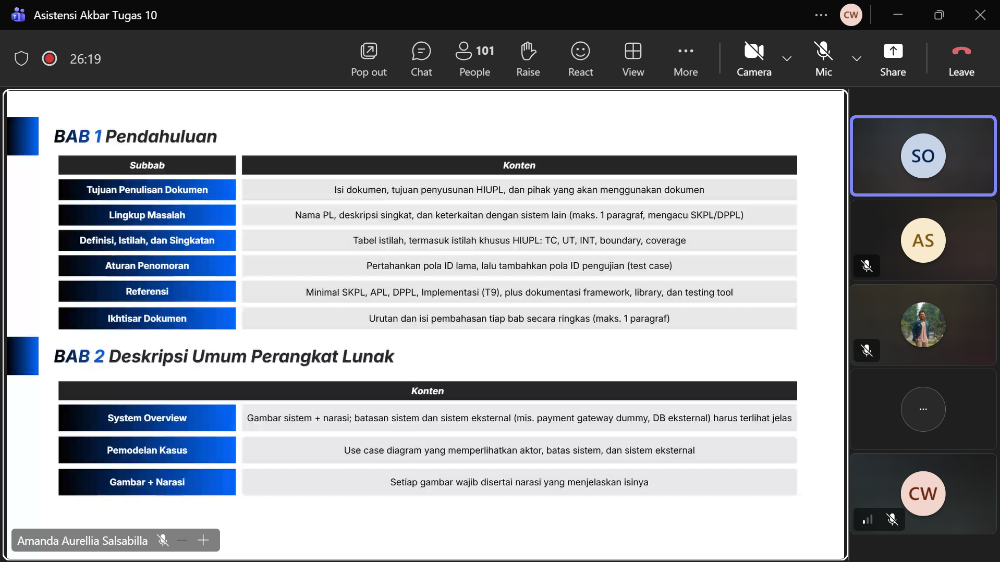

# Form Asistensi

## Tugas Besar IF2150 - Rekayasa Perangkat Lunak

| Informasi | Keterangan |
| --- | --- |
| **Hari** | *Senin* |
| **Tanggal** | *16/11/2026* |
| **Kelas** | *03* |
| **Nomor Kelompok** | *04*  |
| **Nama Kelompok** | *pakespinwheel*  |
| **Nama Perangkat Lunak** | *Mahasehat*  |
| **Dokumen** | *K03_G04_HIUPL.md*  |

### Anggota Kelompok

| NIM | Nama |
| --- | --- |
| *13525021* | *Haikal Muhammad Royyan* |
| *13525066* | *Cynthia Winda Wijaya* |
| *13525081* | *Rendy Salastra Putra* |
| *13525090* | *Sophia Imelda Rogate Marpaung* |
| *13525141* | *Christabelcyne Costan* |

### Catatan

| Catatan |
| --- |
| 1. *Software testing diperlukan untuk menemukan bug lebih awal, menjamin kebutuhan terpenuhi, dan meningkatkan kualitas dan kinerja.*  |
| 2. *Ada dua cara testing, yaitu manual dan automatic testing* |
| 3. *DI HIUPL, pengujian manual dilakukan pada pengujian use case dan sebagian KNF. Pengujian otomatis untuk pengujian unit dan integrasi.* |
| 4. *Pengetahuan mengenai tools yang dapat digunakan untuk unit testing, test coverage, integration testing, nonfuctional testing.* |
| 5. *Setiap kelas diklasifikasikan menjadi Mendalam, Sedang, dan Tidak Perlu.* |

## Dokumentasi

<!--  -->

  

  <i>Gambar 1. Dokumentasi kegiatan asistensi.</i>

