<h1>
IF2150 REKAYASA PERANGKAT LUNAK
<br>
TUGAS 10
<br>
HASIL IMPLEMENTASI DAN UJI PERANGKAT LUNAK (HIUPL)
</h1>
<br>

## *Mahasehat: Mental Health Monitoring App for Students*


### Untuk: *Stefani Angeline Oroh*

Dipersiapkan oleh:
| Informasi | Keterangan |
| --- | --- |
| Kelas | *03* |
| Kelompok | *04* |

| NIM | Nama |
|---|---|
| *13525021* | *Haikal Muhammad Royyan* |
| *13525066* | *Cynthia Winda Wijaya* |
| *13525081* | *Rendy Salastra Putra* |
| *13525090* | *Sophia Imelda Rogate Marpaung* |
| *13525141* | *Christabelcyne Costan* |
---

## Daftar Isi

- [BAB 1: Pendahuluan](#bab-1-pendahuluan)
  - [1.1 Tujuan Penulisan Dokumen](#11-tujuan-penulisan-dokumen)
  - [1.2 Lingkup Masalah](#12-lingkup-masalah)
  - [1.3 Definisi, Istilah, dan Singkatan](#13-definisi-istilah-dan-singkatan)
  - [1.4 Aturan Penomoran](#14-aturan-penomoran)
  - [1.5 Referensi](#15-referensi)
  - [1.6 Deskripsi Umum Dokumen (Ikhtisar)](#16-deskripsi-umum-dokumen-ikhtisar)
- [BAB 2: Deskripsi Umum Perangkat Lunak](#bab-2-deskripsi-umum-perangkat-lunak)
- [BAB 3: Implementasi](#bab-3-implementasi)
  - [3.1 Lingkungan Implementasi](#31-lingkungan-implementasi)
  - [3.2 Implementasi Modul](#32-implementasi-modul)
  - [3.3 Implementasi Antarmuka](#33-implementasi-antarmuka)
  - [3.4 File Lain](#34-file-lain)
- [BAB 4: Hasil Pengujian](#bab-4-hasil-pengujian)
  - [4.1 Strategi dan Kedalaman Pengujian Kelas](#41-strategi-dan-kedalaman-pengujian-kelas)
  - [4.2 Pengujian Unit Kelas](#42-pengujian-unit-kelas)
  - [4.3 Pengujian Integrasi](#43-pengujian-integrasi)
  - [4.4 Pengujian Use Case](#44-pengujian-use-case)
  - [4.5 Pengujian Kebutuhan Non-Fungsional (KNF)](#45-pengujian-kebutuhan-non-fungsional-knf)
  - [4.6 Tangkapan Layar dan Bukti Hasil Pengujian](#46-tangkapan-layar-dan-bukti-hasil-pengujian)
- [BAB 5: Traceability](#bab-5-traceability)

---

## Daftar Perubahan

| Revisi | Deskripsi |
| :--- | :--- |
| ... | ... |

---

# BAB 1: Pendahuluan

## 1.1 Tujuan Penulisan Dokumen
Dokumen ini menjelaskan deskripsi umum perangkat lunak, implementasi, hasil pengujian perangkat lunak, dan traceability. HIUPL digunakan sebagai acuan teknis bagi pengembang perangkat lunak untuk melakukan pengujian perangkat lunak.
Tuliskan uraian ringkas mengenai isi dokumen, tujuan pembuatan dokumen HIUPL ini, dan siapa saja target pembacanya.

## 1.2 Lingkup Masalah
Mahasehat merupakan aplikasi berbasis web yang membantu pelajar dalam memantau dan memahami kondisi kesehatan mental sehari-hari serta memperoleh akses terhadap layanan kesehatan mental. Aplikasi ini menyediakan fitur pencatatan suasana hati, pola tidur, aktivitas fisik, pola makan, tingkat stres, dan refleksi harian. Data tersebut digunakan dan disajikan dalam bentuk statistik dan laporan untuk melihat perkembangan kondisi pelajar sehingga pelajar dapat mengenali pola atau perubahan pada kondisi kesehatan mentalnya. Selain pemantauan mandiri, Mahasehat menyediakan akses terhadap layanan kesehatan mental melalui tenaga kesehatan. Pelajar dapat mencari tenaga kesehatan sesuai kebutuhan, melihat jadwal yang tersedia, serta mengajukan konsultasi. Selain itu, orang tua/wali dilibatkan dalam pemantauan kondisi pelajar melalui informasi dan notifikasi tertentu, sementara tenaga kesehatan dapat mengakses informasi kesehatan yang relevan untuk mendukung proses konsultasi.

## 1.3 Definisi, Istilah, dan Singkatan
Semua definisi dan singkatan yang digunakan dalam dokumen ini beserta penjelasannya.

Tabel 1.3. Definisi Istilah dan Singkatan

| Singkatan, Akronim, atau Istilah | Penjelasan |
| :--- | :--- |
| *P/L* | *Singkatan dari Perangkat Lunak, yaitu aplikasi yang memberikan perintah kepada komputer untuk menjalankan tugas tertentu.* |
| *SKPL* | *Singkatan dari Spesifikasi Kebutuhan Perangkat Lunak, yaitu dokumen yang merangkum kriteria-kriteria yang diperlukan untuk membangun aplikasi menjalankan tugasnya.* |
| *DPPL* | *Singkatan dari Deskripsi Perancangan Perangkat Lunak, yaitu dokumen yang menjelaskan rancangan arsitektur, kelas, dan antarmuka P/L.* |
| *HIUPL* | *Singkatan dari Hasil Implementasi dan Uji Perangkat Lunak, yaitu dokumen yang melaporkan hasil implementasi dan pengujian P/L.* |
| *KF* | *Singkatan dari Kebutuhan Fungsional.* |
| *KNF* | *Singkatan dari Kebutuhan Non-Fungsional.* |
| *UC* | *Singkatan dari Use Case.* |
| *TC* | *Singkatan dari Test Case, yaitu satu kasus uji untuk skenario tertentu.* |
| *UT* | *Singkatan dari Unit Test, yaitu test case tingkat kelas/operasi.* |
| *INT* | *Singkatan dari Integration Test, yaitu test case yang menguji interaksi antarkomponen.* |
| *Boundary* | *Kasus uji pada nilai batas masukan, misalnya nilai minimum, maksimum, atau tepat di ambang aturan.* |
| *Coverage* | *Persentase baris/cabang kode yang dieksekusi oleh pengujian.* |

## 1.4 Aturan Penomoran

Tabel 1.4. Aturan Penomoran

| Hal/Bagian | Penomoran | Keterangan |
| :--- | :--- | :--- |
| *Kebutuhan Fungsional* | *KFXX* | *Mewakili singkatan kata "Kebutuhan Fungsional", diikuti dua digit unik untuk membedakan tiap KF.* |
| *Kebutuhan Non-Fungsional* | *KNFXX* | *Mewakili singkatan kata "Kebutuhan Non-Fungsional", diikuti dua digit unik untuk membedakan tiap KNF.* |
| *Use Case* | *UCXX* | *Mewakili singkatan kata "Use Case", diikuti dua digit unik untuk membedakan tiap UC.* |
| *Kelas* | *CXX* | *Mewakili singkatan kata "Class", diikuti dua digit unik untuk membedakan tiap kelas.* |
| *Antarmuka* | *I-XX* | *Mewakili singkatan kata "Interface", diikuti dua digit unik untuk membedakan tiap layar antarmuka.* |
| *Test Case Unit* | *CXX-UTYY* | *XX adalah nomor kelas, YY adalah nomor urut test case unit pada kelas tersebut* |
| *Test Case Integrasi* | *INT-TCYY* | *YY adalah nomor urut test case integrasi* |
| *Test Case Use Case* | *UCXX-TCYY* | *XX adalah nomor use case, YY adalah nomor urut test case pada use case tersebut* |
| *Test Case KNF* | *KNFXX-TCYY* | *XX adalah nomor KNF, YY adalah nomor urut test case pada KNF tersebut* |
| *...* | *...* | *...* |
| *Algoritma* | *Algo-CXX-XX* | *Mewakili singkatan kata "Algoritma", diikuti ID kelas dan dua digit unik untuk membedakan tiap algoritma.* |

## 1.5 Referensi
- Dokumen APL: https://github.com/cynthiawinda/IF2150-RPL-K03-G04/blob/main/docs/M6/K03_G04_APL.md
- Dokumen SKPL: https://github.com/cynthiawinda/IF2150-RPL-K03-G04/blob/main/docs/M5/K03_G04_SKPL.md
- Dokumen DPPL: https://github.com/cynthiawinda/IF2150-RPL-K03-G04/blob/main/docs/M8/K03_G04_DPPL2.md
- Dokumen Implementasi: https://github.com/cynthiawinda/IF2150-RPL-K03-G04/blob/main/docs/M9/K03_G04_Implementasi.md
- Diagram UML: [https://www.drawio.com/](https://www.drawio.com/)
- https://nodejs.org/docs/latest-v20.x/api/
- https://expressjs.com/
- https://www.postgresql.org/docs/15/
- https://developers.google.com/maps/documentation/geolocation/
- https://developers.google.com/calendar/api
- Undang-Undang Republik Indonesia Nomor 27 Tahun 2022 tentang Pelindungan Data Pribadi: https://peraturan.bpk.go.id/Details/229798/uu-no-27-tahun-2022

## 1.6 Deskripsi Umum Dokumen (Ikhtisar)
BAB 1 membahas pendahuluan yang berisi tujuan, lingkup masalah, definisi, istilah serta singkatan, aturan penomoran, referensi, dan deskripsi umum dokumen. BAB 2 membahas deskripsi umum perangkat lunak. BAB 3 membahas implementasi meliputi lingkungan implementasi, implementasi modul, implementasi antarmuka, dan file lain. BAB 4 membahas hasil pengujian yang meliputi strategi dan kedalaman pengujian, pengujian unit kelas, pengujian integrasi, pengujian use case, pengujian kebutuhan nonfungsional, dan tangkapan layar hasil pengujian. BAB 5 berisi traceability.

<br>

---

# BAB 2: Deskripsi Umum Perangkat Lunak
Mahasehat merupakan sistem pemantauan kesehatan mental berbasis web responsif yang dirancang untuk kalangan pelajar, termasuk siswa dan mahasiswa. Sistem ini dikembangkan untuk menjawab permasalahan nyata di lingkungan pendidikan, di mana banyak pelajar cenderung memendam stres akademik maupun masalah pribadi seorang diri. Di sisi lain, orang tua/wali sering terlambat menyadari penurunan kondisi psikologis anak karena minimnya komunikasi atau keterbatasan jarak, khususnya bagi mahasiswa rantau. Mahasehat memadukan pencatatan mandiri oleh pelajar, dasbor pemantauan bagi orang tua/wali, serta alur rujukan bantuan profesional ke dalam satu sistem yang tetap mengutamakan kerahasiaan data pribadi pengguna. 
Dari sisi batasan sistem, MahaSehat mengelola autentikasi dan manajemen peran pengguna, pencatatan check-in harian, pengolahan statistik dan laporan kondisi, evaluasi notifikasi darurat, serta penjadwalan konsultasi dengan tenaga kesehatan. Catatan pribadi pelajar dijaga privasinya dari pihak luar. Adapun keterkaitan layanan eksternal meliputi pengiriman e-mail melalui server SMTP (via 'nodemailer') serta integrasi pendukung seperti Google Maps API dan Google Calendar API sesuai kebutuhan fitur, sementara penanganan kondisi darurat langsung di luar kendali otomatis aplikasi.

<p align="center">

</p>
<p align="center">
<i>Gambar 2.1. Use Case Diagram MahaSehat</i>
</p>

Gambar 2.1 menggambarkan interaksi tiga aktor utama dengan sistem MahaSehat. Pelajar dapat melakukan registrasi dan masuk/keluar akun, mengisi daily check-in, melihat statistik dan laporan kondisi, memilih tenaga kesehatan, serta mengajukan jadwal konsultasi. Orang tua/wali dapat melakukan registrasi dan konfirmasi akun pelajar, masuk/keluar akun, memantau statistik dan laporan kondisi pelajar, serta menerima dan menindaklanjuti notifikasi darurat. Tenaga kesehatan dapat registrasi akun, masuk/keluar akun, dan mengelola pengajuan konsultasi yang masuk.
<br>

---

# BAB 3: Implementasi

Bagian ini diisi dengan informasi tentang elemen P/L yang dikembangkan (*executable files*, *configuration files*, *data files*, dan sebagainya) serta perubahannya terhadap rancangan pada DPPL (jika ada).

## 3.1 Lingkungan Implementasi

Tuliskan *hardware* dan *software* yang digunakan untuk implementasi, mencakup *operating system*, bahasa pemrograman beserta versinya, *framework*/*library*, DBMS, *development tools*, dan *version control*. Lingkungan ini harus konsisten dengan **Subbab 2.1 DPPL**; jelaskan jika ada perubahan. Cantumkan juga *framework* dan alat pengujian yang dipakai.

Tabel 3.1. Lingkungan Implementasi

| Aspek | Keterangan |
| :--- | :--- |
| *Hardware* | *[Spesifikasi perangkat keras]* |
| *Operating System* | *[Nama dan versi OS]* |
| *Bahasa Pemrograman* | *[Bahasa dan versi]* |
| *Framework/Library* | *[Daftar framework/library beserta versi]* |
| *DBMS* | *[Nama dan versi DBMS]* |
| *Development Tools* | *[IDE, version control, tools lain]* |
| *Testing Tools* | *[Framework unit test, alat ukur performa, alat coverage]* |

## 3.2 Implementasi Modul

Daftar modul/kelas yang **TELAH** diimplementasikan. Gunakan nama dan ID kelas yang sama dengan DPPL, dan konsisten dengan Tabel B.5 pada dokumen Implementasi (Tugas 9).

Tabel 3.2. Implementasi Modul

| No | ID Kelas | Nama Modul/Kelas | Nama File Fisik | Nama File Executable |
| :--- | :--- | :--- | :--- | :--- |
| 1 | *[C01]* | *[Nama modul/kelas]* | *[path/ke/file]* | *[Nama file executable, atau - jika tidak ada]* |
| 2 | *[C02]* | *[Nama modul/kelas]* | *[path/ke/file]* | *[...]* |
| ... | *...* | *...* | *...* | *...* |

## 3.3 Implementasi Antarmuka

Daftar antarmuka yang telah diimplementasikan. Gunakan ID dan nama layar yang sama dengan ID dan nama layar pada tugas DPPL.

Tabel 3.3. Implementasi Antarmuka

| No | ID Antarmuka | Nama Antarmuka | Nama File Fisik | Nama File Executable |
| :--- | :--- | :--- | :--- | :--- |
| 1 | *[I-01]* | *[Nama layar]* | *[path/ke/file]* | *[Nama file executable, atau - jika tidak ada]* |
| 2 | *[I-02]* | *[Nama layar]* | *[path/ke/file]* | *[...]* |
| ... | *...* | *...* | *...* | *...* |

## 3.4 File Lain

Daftar file lain yang dibuat selain file kelas dan antarmuka, misalnya file *utility*, *configuration*, *database schema/seed*, *file test*, atau *data*.

Tabel 3.4. File Lain

| No | Nama File | Keterangan |
| :--- | :--- | :--- |
| 1 | *[Nama file]* | *[Fungsi file]* |
| ... | *...* | *...* |

<br>

---

# BAB 4: Hasil Pengujian

Bab ini melaporkan hasil pengujian P/L pada level unit, integrasi, dan sistem. Pengujian dilakukan pada tag release terakhir Tugas 9. Hasil aktual diisi berdasarkan pengamatan saat pengujian. Kesimpulan diisi `Pass` atau `Fail`, dan untuk `Fail` dilengkapi penyebab serta usulan perbaikan.

## 4.1 Strategi dan Kedalaman Pengujian Kelas

Tabel 4.1.1. Identifikasi Tingkat Pengujian Kelas

| ID Kelas | Nama Kelas | Tingkat | Alasan | Test Case Terkait |
| :--- | :--- | :--- | :--- | :--- |
| *C01* | *Pengguna* | *Mendalam* | *Hash password (bcrypt), verifikasi password, dan token akun* | *C01-UT01 s.d. C01-UT12, INT-TC01 s.d. INT-TC03, INT-TC13* |
| *C02* | *Pelajar* | *Sedang* | *Hanya mendelegasikan check-in dan konsultasi ke kelas lain* | *C02-UT01 s.d. C02-UT06, INT-TC01, INT-TC04 s.d. INT-TC06, INT-TC08, INT-TC09, INT-TC11* |
| *C03* | *OrangTuaWali* | *Sedang* | *Mengambil data pelajar dan ringkasan laporan, tanpa perhitungan sendiri* | *C03-UT01 s.d. C03-UT04, INT-TC01, INT-TC07, INT-TC12* |
| *C04* | *TenagaKesehatan* | *Sedang* | *Mengambil jadwal dan memperbarui profil, tanpa algoritma kompleks* | *C04-UTYY* |
| *C05* | *RiwayatKesehatan* | *Sedang* | *Hanya memanggil enkripsi AES-256 (logikanya diuji di `encryption.js`)* | *C05-UTYY, KNF01-TC01* |
| *C06* | *CheckIn* | *Mendalam* | *Validasi data check-in dan enkripsi catatan refleksi* | *C06-UTYY* |
| *C07* | *LaporanKesehatan* | *Mendalam* | *Logika ambang batas dan deteksi kondisi darurat* | *C07-UTYY* |
| *C08* | *FasilitasKesehatan* | *Sedang* | *Hanya mengambil data lokasi dan estimasi biaya* | *C08-UTYY* |
| *C09* | *JadwalKonsultasi* | *Mendalam* | *Aturan perubahan status ketersediaan dan pengajuan* | *C09-UTYY* |
| *C10* | *RegistrationPage* | *Tidak perlu* | *Hanya tampilan form dan mengirim ke API* | *UC01-TCYY* |
| *C11* | *AuthController* | *Mendalam* | *Validasi kredensial, status akun, dan sesi (JWT)* | *C11-UT01 s.d. C11-UT14, INT-TC01, INT-TC02, KNF12-TC01* |
| *C12* | *KonfirmasiRegistrasiPage* | *Tidak perlu* | *Hanya tampilan, data dari API konfirmasi* | *UC02-TCYY* |
| *C13* | *CheckInPage* | *Tidak perlu* | *Hanya tampilan form, validasi ada di C06 dan C14* | *UC03-TCYY, KNF07-TC01* |
| *C14* | *CheckInController* | *Mendalam* | *Validasi format masukan dan enkripsi jurnal* | *C14-UTYY, INT-TCYY, KNF01-TC01* |
| *C15* | *NotifikasiPengingatController* | *Tidak perlu* | *Tidak diimplementasikan, jadi tidak ada kode yang diuji* | *-* |
| *C16* | *ReportPage* | *Tidak perlu* | *Hanya menampilkan grafik dan filter periode* | *UC04-TCYY, KNF04-TC01* |
| *C17* | *ReportController* | *Mendalam* | *Agregasi statistik dan pembatasan data wali (tanpa teks jurnal)* | *C17-UTYY, INT-TCYY, KNF02-TC01* |
| *C18* | *CariTenagaKesehatanPage* | *Tidak perlu* | *Hanya tampilan pencarian, filter, dan modal* | *UC05-TCYY, KNF03-TC01* |
| *C19* | *ProfilTenagaKesehatanPage* | *Tidak perlu* | *Hanya dialog dalam halaman Cari, tanpa logika* | *UC05-TCYY, UC06-TCYY* |
| *C20* | *TenagaKesehatanController* | *Mendalam* | *Izin lokasi, perhitungan jarak, dan integrasi lokasi eksternal* | *C20-UTYY, INT-TCYY, KNF03-TC01* |
| *C21* | *PengajuanKonsultasiPage* | *Tidak perlu* | *Dihapus dan digabung ke modal halaman Cari, logikanya ada di C23* | *UC06-TCYY, UC07-TCYY* |
| *C22* | *JadwalKonsultasiController* | *Tidak perlu* | *Digabung ke C23, operasinya diuji bersama C23* | *C23-UTYY, UC06-TCYY* |
| *C23* | *KonsultasiController* | *Mendalam* | *Aturan status pengajuan, reschedule, dan hak akses per peran* | *C23-UTYY, INT-TCYY, UC07-TCYY* |
| *C24* | *NotifikasiDaruratController* | *Mendalam* | *Evaluasi darurat, kirim e-mail, dan retry maksimal 3 kali* | *C24-UT01 s.d. C24-UT10, INT-TC11, INT-TC12, INT-TC15, KNF06-TC01, UC08-TC01, UC08-TC02* |
| *C25* | *LoginPage* | *Tidak perlu* | *Hanya tampilan form login* | *UC09-TC01 s.d. UC09-TC03, KNF11-TC01* |
| *C26* | *ResetPasswordPage* | *Tidak perlu* | *Hanya tampilan dua langkah reset password* | *UC09-TC04* |
| *C27* | *PasswordController* | *Mendalam* | *Pembuatan dan validasi token reset, validasi password baru, kirim e-mail* | *C27-UT01 s.d. C27-UT07, INT-TC03, UC09-TC04* |
| *C28* | *DashboardPage* | *Tidak perlu* | *Hanya menampilkan data dari API sesuai peran* | *UC08-TC01, UC09-TC01, UC09-TC02, UC09-TC04, KNF10-TC01* |
| *C29* | *SettingPage* | *Tidak perlu* | *Hanya tampilan pengaturan dan modal logout* | *UC10-TC01, UC10-TC02* |

## 4.2 Pengujian Unit Kelas

Pengujian unit dilakukan pada kelas bertingkat Mendalam dan Sedang. Kelas Mendalam diuji pada seluruh operasi public dengan kasus normal, batas, dan negatif, serta mencapai *coverage* minimal 70%. Kelas Sedang diuji minimal dengan satu kasus normal dan satu kasus gagal pada operasi public utama.

Cara menjalankan unit test: *cd src && npm test (tambahkan -- --coverage untuk laporan coverage).*

Lokasi file test: *src/tests/.*

### 4.2.1 Kelas Pengguna

**ID Kelas:** *C01*  
**Nama Kelas:** *Pengguna*  
**Tingkat:** *Mendalam*

Tabel 4.2.1. Hasil Pengujian Unit Kelas C01

| ID Pengujian | Operasi yang Diuji | Jenis Kasus | Prosedur/Masukan | Hasil yang Diharapkan | Hasil Pengujian | Kesimpulan |
| :--- | :--- | :--- | :--- | :--- | :--- | :--- |
| *C01-UT01* | *findByUsernameOrEmail(usernameOrEmail): Pengguna* | *Normal* | *Masukan "  BUDI.Pelajar@mahasehat.id  " dengan baris mock role = 'Pelajar'* | *Input dinormalisasi (trim & toLowerCase) dan mengembalikan instance Pelajar* | *Parameter query diterima "budi.pelajar@mahasehat.id" dan objek yang dikembalikan adalah Pelajar* | *Pass* |
| *C01-UT02* | *findByUsernameOrEmail(usernameOrEmail): Pengguna* | *Batas* | *Masukan "", "   ", dan null* | *Mengembalikan null tanpa memanggil db.query* | *Seluruh pemanggilan mengembalikan null dan db.query tidak dipanggil* | *Pass* |
| *C01-UT03* | *findByUsernameOrEmail(usernameOrEmail): Pengguna* | *Negatif* | *Masukan "tidakada@test.id" dengan hasil query kosong (rows: [])* | *Mengembalikan null* | *Mengembalikan null* | *Pass* |
| *C01-UT04* | *findByEmail(email): Pengguna* | *Normal* | *Masukan "  WALI@test.id " (OrangTuaWali) dan "nakes@test.id" (TenagaKesehatan)* | *Mengembalikan instance subkelas OrangTuaWali dan TenagaKesehatan sesuai peran* | *Keduanya dikembalikan sebagai instance subkelas masing-masing* | *Pass* |
| *C01-UT05* | *findByEmail(email): Pengguna* | *Batas* | *Masukan format tidak mengandung @ ("bukan-email") dan null* | *Mengembalikan null tanpa memanggil db.query* | *Mengembalikan null dan db.query tidak dipanggil* | *Pass* |
| *C01-UT06* | *findByEmail(email): Pengguna* | *Negatif* | *Masukan "kosong@test.id" dengan hasil query kosong* | *Mengembalikan null* | *Mengembalikan null* | *Pass* |
| *C01-UT07* | *verifyPassword(password): Boolean* | *Normal* | *Hash "Rahasia123!" lewat hashPassword(), lalu verifikasi dengan "Rahasia123!"* | *Mengembalikan true* | *verifyPassword('Rahasia123!') mengembalikan true* | *Pass* |
| *C01-UT08* | *verifyPassword(password): Boolean* | *Negatif* | *Verifikasi hash yang sama dengan "Salah!", "", dan null* | *Mengembalikan false* | *Seluruh kasus mengembalikan false* | *Pass* |
| *C01-UT09* | *getStatusAkun(), getRole(), toJSON()* | *Normal* | *Instansiasi Pengguna dengan status_akun: 'Aktif', role: 'Pelajar', versi_token: 2* | *Getter mengembalikan status/role sesuai data dan toJSON() menyembunyikan password serta versiToken* | *getStatusAkun() = 'Aktif', getRole() = 'Pelajar', field sensitif undefined di toJSON()* | *Pass* |
| *C01-UT10* | *setPassword(newPassword): Boolean* | *Normal* | *Panggil setPassword('SandiBaru123!') dengan mock DB rowCount: 1* | *Mengembalikan true dan hash internal diperbarui sehingga cocok dengan sandi baru* | *Mengembalikan true dan verifyPassword('SandiBaru123!') bernilai true* | *Pass* |
| *C01-UT11* | *setPassword(newPassword): Boolean* | *Negatif* | *Panggil setPassword('LainLagi123!') dengan mock DB rowCount: 0* | *Mengembalikan false dan hash internal tidak berubah* | *Mengembalikan false dan hash tetap sama seperti sebelumnya* | *Pass* |
| *C01-UT12* | *findByTokenKonfirmasi(), findByResetToken(), ubahStatusKonfirmasi(), simpanResetToken(), ubahEmail(), akhiriSesiById()* | *Normal & Negatif* | *Token kosong vs valid, perubahan status konfirmasi, penyimpanan reset token, validasi pembaruan e-mail, dan inkremen versi_token* | *Token kosong mengembalikan null; operasi pembaruan meneruskan query/parameter dengan tepat* | *Semua pemanggilan mengembalikan nilai sesuai cabang normal dan negatif* | *Pass* |

Tabel 4.2.1b. Ringkasan Cakupan Kelas C01

| Informasi | Keterangan |
| :--- | :--- |
| Daftar operasi public pada DPPL | *findByUsernameOrEmail(usernameOrEmail), findByEmail(email), verifyPassword(password), getStatusAkun(), getRole(), setPassword(newPassword)* |
| Operasi yang diuji | *Seluruh 6 operasi public DPPL plus helper implementasi hashPassword(), findByTokenKonfirmasi(), findByResetToken(), ubahStatusKonfirmasi(), simpanResetToken(), ubahEmail(), akhiriSesiById(), dan toJSON()* |
| ID Algoritma yang tercakup | *Algo-C01-01, Algo-C01-02, Algo-C01-03, Algo-C01-04* |
| Coverage (wajib ≥ 70%) | *100% lines / 96,87% branches (100% stmts, 100% funcs); alat: Jest --coverage; bukti pada Subbab 4.6* |

### 4.2.2 Kelas Pelajar

**ID Kelas:** *C02*  
**Nama Kelas:** *Pelajar*  
**Tingkat:** *Sedang*

Tabel 4.2.2. Hasil Pengujian Unit Kelas C02

| ID Pengujian | Operasi yang Diuji | Jenis Kasus | Prosedur/Masukan | Hasil yang Diharapkan | Hasil Pengujian | Kesimpulan |
| :--- | :--- | :--- | :--- | :--- | :--- | :--- |
| *C02-UT01* | *getCheckInHistory(), getCheckInSejak(), getTanggalCheckInTerakhir()* | *Normal & Batas* | *Query riwayat dengan dan tanpa dekripsi jurnal serta hasil kosong* | *Mengembalikan daftar CheckIn dan tanggal terakhir (atau null bila belum ada check-in)* | *Daftar CheckIn dikembalikan terdekripsi sesuai parameter dan null saat kosong* | *Pass* |
| *C02-UT02* | *setCheckIn(checkIn): CheckIn* | *Normal & Gagal* | *Simpan check-in baru; lalu ulangi dengan error DB 23505 (duplikat hari yang sama) dan XX000* | *Sukses menyimpan check-in pertama; menolak duplikat dengan HTTP 409 dan meneruskan error DB lain* | *Duplikat melempar AppError(409) dengan pesan check-in hari ini sudah dicatat; error XX000 diteruskan* | *Pass* |
| *C02-UT03* | *setLokasiSaatIni(lokasi), getLokasiSaatIni()* | *Normal & Gagal* | *Masukan koordinat sah "-6.8915, 107.6107" dan masukan invalid "bandung" / ""* | *Koordinat valid disimpan dan dinormalisasi; format invalid melempar error 400* | *getLokasiSaatIni() bernilai "-6.8915,107.6107" pada kasus sah dan melempar AppError(400) untuk invalid* | *Pass* |
| *C02-UT04* | *updateEmergencyStatus(status): Boolean* | *Normal & Batas* | *Ubah statusDarurat dari false ke true, lalu panggil lagi dengan nilai yang sama true* | *Memperbarui DB hanya saat status berubah dan bersifat idempoten jika sama* | *db.query hanya dipanggil 1 kali saat perubahan pertama dan bernilai true pada pemanggilan ulang* | *Pass* |
| *C02-UT05* | *ajukanKonsultasi(jadwal, keluhan): Boolean* | *Normal & Gagal* | *Ajukan dengan jadwal tersedia ('Tersedia'), jadwal 'Penuh', dan keluhan kosong* | *Menyimpan pengajuan saat tersedia; melempar error 400 saat keluhan kosong dan mengembalikan false bila penuh* | *Ketiga skenario mengembalikan nilai (true / AppError(400) / false) sesuai spesifikasi* | *Pass* |
| *C02-UT06* | *findById(), findByIdPengguna(), findSemuaAktif(), getRiwayatTerbaruSemuaAktif(), setWali(), hubungkanKeWali(), perbaruiProfil()* | *Normal & Batas* | *Pencarian berdasarkan ID/user ID, daftar pelajar aktif, tautan wali, dan pembaruan nama tanpa field opsional* | *Mengembalikan instance Pelajar/daftar yang valid atau null bila tidak ada* | *Seluruh helper mengembalikan hasil sesuai query mock DB* | *Pass* |

### 4.2.3 Kelas OrangTuaWali

**ID Kelas:** *C03*  
**Nama Kelas:** *OrangTuaWali*  
**Tingkat:** *Sedang*

Tabel 4.2.3. Hasil Pengujian Unit Kelas C03

| ID Pengujian | Operasi yang Diuji | Jenis Kasus | Prosedur/Masukan | Hasil yang Diharapkan | Hasil Pengujian | Kesimpulan |
| :--- | :--- | :--- | :--- | :--- | :--- | :--- |
| *C03-UT01* | *getSummaryReport(): SummaryData* | *Normal* | *Panggil wali.getSummaryReport() dengan mock data 1 pelajar yang diwalikan serta riwayat check-in berisi catatanRefleksi* | *Mengembalikan ringkasan kondisi (namaPelajar, periode, ringkasanKondisi, indikatorRisiko, jumlahHariTidakCheckIn) tanpa membocorkan teks catatan refleksi pribadi (KNF02)* | *Summary dikembalikan terformat dan tidak memuat properti maupun teks catatan refleksi* | *Pass* |
| *C03-UT02* | *pilihPelajar(idPelajar): Pelajar* | *Gagal* | *Panggil wali.pilihPelajar() saat wali belum terhubung dengan pelajar mana pun* | *Melempar AppError(404) bahwa pelajar belum terhubung* | *Melempar AppError berstatus HTTP 404* | *Pass* |
| *C03-UT03* | *pilihPelajar(idPelajar): Pelajar* | *Gagal* | *Panggil wali.pilihPelajar('PLJ-999') saat ID tersebut bukan milik wali* | *Melempar AppError(403) menolak akses pelajar lain* | *Melempar AppError berstatus HTTP 403* | *Pass* |
| *C03-UT04* | *findById(), findByIdPengguna(), findIdByEmail(), tambah(), getPengajuanMenunggu(), perbaruiProfil()* | *Normal & Batas* | *Uji pencarian wali (valid & invalid), penambahan data wali, daftar pengajuan menunggu, dan pembaruan profil* | *Mengembalikan data wali/pengajuan dengan validasi input kosong/tidak ada* | *Seluruh pemanggilan mengembalikan nilai sesuai skenario normal dan kosong* | *Pass* |

### 4.2.4 Kelas AuthController

**ID Kelas:** *C11*  
**Nama Kelas:** *AuthController (termasuk middleware authMiddleware)*  
**Tingkat:** *Mendalam*

Tabel 4.2.4. Hasil Pengujian Unit Kelas C11

| ID Pengujian | Operasi yang Diuji | Jenis Kasus | Prosedur/Masukan | Hasil yang Diharapkan | Hasil Pengujian | Kesimpulan |
| :--- | :--- | :--- | :--- | :--- | :--- | :--- |
| *C11-UT01* | *daftar() (validateData + registerAccount)* | *Negatif & Batas* | *Kirim payload tidak lengkap, role invalid, password < 8 karakter (7 karakter), format e-mail/tanggal lahir invalid, serta duplikat e-mail* | *Seluruhnya ditolak dengan status HTTP 400 (atau 409 untuk duplikat)* | *Setiap payload mengembalikan HTTP 400/409 dengan pesan validasi spesifik* | *Pass* |
| *C11-UT02* | *daftar() (registerAccount)* | *Normal & Batas* | *Registrasi Pelajar < 18 tahun (status "Belum Terverifikasi") & ≥ 18 tahun (status "Aktif"), OrangTuaWali, dan TenagaKesehatan* | *Akun tersimpan lewat transaksi, e-mail konfirmasi wali dikirim untuk < 18 tahun, HTTP 201* | *Status akun dan respons JSON (perluKonfirmasiWali) sesuai batas usia 18 tahun* | *Pass* |
| *C11-UT03* | *daftar() (registerAccount)* | *Negatif (Fault Tolerance)* | *Simulasi mailer.kirimEmailKonfirmasiWali gagal melempar error saat pendaftaran pelajar < 18 tahun* | *Transaksi registrasi tetap berhasil (HTTP 201) dengan emailTerkirim: false* | *Registrasi tidak dibatalkan, mengembalikan HTTP 201 dan emailTerkirim: false* | *Pass* |
| *C11-UT04* | *dataKonfirmasi() (validateConfirmation)* | *Normal & Negatif* | *Request GET /api/auth/konfirmasi-wali?token=... dengan token valid, token tidak ada (404), dan token kosong (400)* | *Token valid mengembalikan HTTP 200 dengan ringkasan data pelajar; token invalid mengembalikan 400/404* | *Respons status dan payload sesuai untuk valid, 404, dan 400* | *Pass* |
| *C11-UT05* | *setujuiRegistrasi() (confirmAccount)* | *Normal* | *Request POST /api/auth/konfirmasi-wali/setuju dengan token pelajar < 18 tahun yang menunggu persetujuan* | *Status akun diubah menjadi "Aktif", HTTP 200* | *ubahStatusKonfirmasi('Aktif', ...) dijalankan dan mengembalikan HTTP 200* | *Pass* |
| *C11-UT06* | *tolakRegistrasi() (confirmAccount)* | *Normal & Negatif* | *Request POST /api/auth/konfirmasi-wali/tolak dengan token valid dan dengan token yang sudah pernah diproses* | *Token valid mengubah status menjadi "Ditolak" (HTTP 200); token yang sudah diproses ditolak 400* | *Status berubah ke "Ditolak" pada kasus pertama dan melempar HTTP 400 pada pengulangan* | *Pass* |
| *C11-UT07* | *setujuiRegistrasi() (confirmAccount)* | *Negatif* | *Kirim konfirmasi persetujuan memakai token yang sudah ditolak atau tidak ditemukan* | *Mengembalikan HTTP 400/404 tanpa mengaktifkan akun* | *Mengembalikan status kesalahan yang sesuai dan akun tidak aktif* | *Pass* |
| *C11-UT08* | *masuk() (login)* | *Normal* | *Login dengan kredensial benar untuk ketiga peran (Pelajar, OrangTuaWali, TenagaKesehatan)* | *Mengembalikan HTTP 200 beserta JWT token dan objek pengguna sesuai peran* | *Ketiga peran memperoleh JWT valid dan data profil peran masing-masing* | *Pass* |
| *C11-UT09* | *masuk() (login)* | *Negatif* | *Login dengan input kosong (400), akun tidak ditemukan (401), dan sandi salah (401)* | *Akses ditolak dengan HTTP 400/401 tanpa menerbitkan token* | *Ketiga kasus gagal sesuai kode status dan pesan error* | *Pass* |
| *C11-UT10* | *masuk() (login)* | *Negatif* | *Login pada akun berstatus "Belum Terverifikasi" dan "Ditolak"* | *Akses ditolak dengan HTTP 403 beserta pesan status akun* | *Keduanya ditolak dengan HTTP 403 (menunggu konfirmasi / ditolak)* | *Pass* |
| *C11-UT11* | *profilSaya(), pengajuanMenunggu()* | *Normal* | *Request terautentikasi ke GET /api/auth/me dan daftar pengajuan tertunda milik wali* | *Mengembalikan HTTP 200 berisi profil saat ini dan daftar pelajar menunggu konfirmasi* | *Respons HTTP 200 dengan data profil & pengajuan yang sesuai* | *Pass* |
| *C11-UT12* | *perbaruiProfil()* | *Normal & Negatif* | *Perbarui profil Pelajar/Wali/Nakes, ubah e-mail sah vs duplikat, ubah sandi (sandi lama salah / < 8 karakter / valid)* | *Perubahan valid mengembalikan HTTP 200; duplikat e-mail (409) dan sandi salah/lemah (400/401) ditolak* | *Seluruh cabang validasi dan pembaruan profil berjalan sesuai ekspektasi* | *Pass* |
| *C11-UT13* | *keluar() (logout)* | *Normal* | *Request POST /api/auth/logout dengan Bearer JWT valid* | *Menaikkan versi_token pengguna lewat akhiriSesiById dan mengembalikan HTTP 200* | *akhiriSesiById dipanggil dan mengembalikan "Logout berhasil."* | *Pass* |
| *C11-UT14* | *authMiddleware (authenticate(), authorizeRoles())* | *Normal, Batas, Negatif* | *Tanpa header Authorization (401), token rusak (401), versi_token kedaluwarsa (401), akun non-Aktif (403), role terlarang (403), dan JWT_SECRET kosong* | *Menolak permintaan tidak sah dengan 401/403; meneruskan next() bila token dan role valid; error 500 bila JWT_SECRET tidak tersedia* | *Seluruh cabang middleware terpenuhi dengan 100% line & branch coverage* | *Pass* |

Tabel 4.2.4b. Ringkasan Cakupan Kelas C11

| Informasi | Keterangan |
| :--- | :--- |
| Daftar operasi public pada DPPL | *validateData(data), registerAccount(data), login(usernameOrEmail, pass), logout(), validateConfirmation(token), confirmAccount(token)* |
| Operasi yang diuji | *Seluruh 6 operasi public DPPL (pada implementasi: daftar(), masuk(), keluar(), dataKonfirmasi(), setujuiRegistrasi(), tolakRegistrasi()) ditambah profilSaya(), perbaruiProfil(), pengajuanMenunggu(), serta authenticate() dan authorizeRoles() pada authMiddleware.js* |
| ID Algoritma yang tercakup | *Algo-C11-01 s.d. Algo-C11-10* |
| Coverage (wajib ≥ 70%) | *authController.js: 91,66% lines / 74,65% branches (91,66% stmts, 100% funcs); authMiddleware.js: 100% lines / 100% branches; alat: Jest --coverage; bukti pada Subbab 4.6* |

### 4.2.5 Kelas NotifikasiDaruratController

**ID Kelas:** *C24*  
**Nama Kelas:** *NotifikasiDaruratController (termasuk model NotifikasiDarurat)*  
**Tingkat:** *Mendalam*

Tabel 4.2.5. Hasil Pengujian Unit Kelas C24

| ID Pengujian | Operasi yang Diuji | Jenis Kasus | Prosedur/Masukan | Hasil yang Diharapkan | Hasil Pengujian | Kesimpulan |
| :--- | :--- | :--- | :--- | :--- | :--- | :--- |
| *C24-UT01* | *sendEmergencyNotification(notifikasi)* | *Normal* | *Panggil pengiriman dengan kirimEmail berhasil pada percobaan pertama (emailTujuan = 'wali@test.id')* | *Mengembalikan true, mencatat jumlahPercobaan = 1 dan status 'Terkirim'* | *status = 'Terkirim', jumlahPercobaan = 1, mengembalikan true* | *Pass* |
| *C24-UT02* | *sendEmergencyNotification(notifikasi)* | *Batas (Retry Maks 3x)* | *Simulasi kirimEmail melempar ECONNREFUSED terus-menerus* | *Melakukan 1 kirim awal + 3 retry (4 percobaan total), status menjadi 'Gagal Terkirim', mengembalikan false* | *kirimEmail dipanggil 4 kali, jumlahPercobaan = 4, status = 'Gagal Terkirim', kembali false* | *Pass* |
| *C24-UT03* | *sendEmergencyNotification(notifikasi)* | *Negatif* | *Panggil pengiriman saat emailTujuan tidak tersedia (null / kosong)* | *Tidak mengirim e-mail, langsung menyimpan status 'Gagal Terkirim' dan mengembalikan false* | *kirimEmail tidak dipanggil, status 'Gagal Terkirim', mengembalikan false* | *Pass* |
| *C24-UT04* | *loadEmergencyDetail(idWali) & getListNotifikasi()* | *Normal & Negatif* | *Uji dengan ID wali valid (mengembalikan daftar notifikasi darurat aktif) dan akun tanpa data wali (404)* | *Mengembalikan daftar kondisi pelajar yang dirawat bila ditemukan; HTTP 404 bila wali tidak ditemukan* | *Endpoint & metode statis mengembalikan daftar pada kasus valid dan HTTP 404 saat wali tidak ada* | *Pass* |
| *C24-UT05* | *confirmReceived(idNotifikasi, idWali) & postKonfirmasiDiterima()* | *Normal* | *Konfirmasi penerimaan notifikasi milik wali yang sah* | *Mengembalikan true dan mengubah status notifikasi di DB menjadi 'Diterima' beserta waktu_diterima* | *Status diperbarui menjadi 'Diterima' dan endpoint mengembalikan HTTP 200* | *Pass* |
| *C24-UT06* | *confirmReceived(idNotifikasi, idWali)* | *Negatif* | *ID notifikasi kosong (400), ID tidak ditemukan (404), dan notifikasi milik wali lain (403)* | *Ketiganya ditolak sesuai kode HTTP masing-masing* | *Ketiga kasus melempar AppError berstatus 400, 404, dan 403* | *Pass* |
| *C24-UT07* | *markFollowUp(idNotifikasi, idWali) & postTindakLanjut()* | *Normal & Batas* | *Tandai tindak lanjut pertama dalam transaksi DB, lalu ulangi saat status sudah 'Sudah Ditindaklanjuti'* | *Mengubah status notifikasi menjadi 'Sudah Ditindaklanjuti', memulihkan status_darurat = false, dan idempoten saat diulang* | *Transaksi berhasil memulihkan status pelajar; panggilan kedua tetap mengembalikan true* | *Pass* |
| *C24-UT08* | *evaluasiPelajar(pelajar, daftarCheckIn)* | *Batas* | *Uji kondisi check-in stabil (tanpa notifikasi) vs melampaui ambang batas (≥ 3 hari tidak check-in / penurunan kondisi drastis)* | *Kondisi normal tidak memicu darurat; kondisi melewati ambang memicu pembuatan NotifikasiDarurat dan status_darurat = true* | *Kondisi stabil tidak memicu aksi; kondisi darurat menghasilkan notifikasi serta mengirim e-mail* | *Pass* |
| *C24-UT09* | *tentukanEmailTujuan() & race condition 23505* | *Normal & Negatif* | *Fallback e-mail wali (dari wali.email ke pelajar.email_wali) dan konflik unik DB 23505 saat evaluasi serentak* | *Menggunakan e-mail wali yang tersedia dan mengembalikan notifikasi eksisting secara aman saat 23505* | *Fallback e-mail tepat dan race condition 23505 ditangani tanpa crash* | *Pass* |
| *C24-UT10* | *jalankanEvaluasiHarian() & NotifikasiDarurat (findBelumDirespons(), findById())* | *Normal & Negatif* | *Jalankan evaluasi harian terhadap pelajar aktif & notifikasi > 24 jam, serta uji model NotifikasiDarurat untuk masukan kosong/valid* | *Mengirim ulang reminder untuk notifikasi belum direspons > 24 jam; mengembalikan null untuk ID kosong* | *Evaluasi mengembalikan rekap jumlah pelajar/darurat/kirim ulang dengan tepat* | *Pass* |

Tabel 4.2.5b. Ringkasan Cakupan Kelas C24

| Informasi | Keterangan |
| :--- | :--- |
| Daftar operasi public pada DPPL | *sendEmergencyNotification(), loadEmergencyDetail(idWali), confirmReceived(idNotifikasi), markFollowUp(idNotifikasi)* |
| Operasi yang diuji | *Seluruh 4 operasi public DPPL plus handler HTTP getListNotifikasi(), postKonfirmasiDiterima(), postTindakLanjut(), fungsi evaluasi evaluasiPelajar(), jalankanEvaluasiHarian(), serta NotifikasiDarurat* |
| ID Algoritma yang tercakup | *Algo-C24-01, Algo-C24-02, Algo-C24-03, Algo-C24-04* |
| Coverage (wajib ≥ 70%) | *NotifikasiDaruratController.js: 97,89% lines / 88,88% branches (97,91% stmts, 100% funcs); NotifikasiDarurat.js: 100% lines / 83,33% branches; alat: Jest --coverage; bukti pada Subbab 4.6* |

### 4.2.6 Kelas PasswordController

**ID Kelas:** *C27*  
**Nama Kelas:** *PasswordController*  
**Tingkat:** *Mendalam*

Tabel 4.2.6. Hasil Pengujian Unit Kelas C27

| ID Pengujian | Operasi yang Diuji | Jenis Kasus | Prosedur/Masukan | Hasil yang Diharapkan | Hasil Pengujian | Kesimpulan |
| :--- | :--- | :--- | :--- | :--- | :--- | :--- |
| *C27-UT01* | *lupaPassword() (sendResetLink)* | *Normal* | *Request POST /api/auth/forgot-password dengan e-mail terdaftar "nadia.psikolog@mahasehat.id"* | *Membuat token acak, menyimpan hash SHA-256 ke DB, mengirim tautan reset lewat mailer, HTTP 200* | *Token disimpan dalam bentuk hash SHA-256 (bukan plaintext), mailer dipanggil 1x, HTTP 200* | *Pass* |
| *C27-UT02* | *lupaPassword() (sendResetLink)* | *Negatif* | *Request dengan e-mail kosong "" atau format tidak valid "bukan-email"* | *Ditolak dengan HTTP 400 tanpa memanggil DB atau mailer* | *Mengembalikan HTTP 400 dengan pesan format e-mail tidak valid* | *Pass* |
| *C27-UT03* | *lupaPassword() (sendResetLink)* | *Negatif* | *Request dengan e-mail berformat sah namun tidak terdaftar "tidak.terdaftar@test.id"* | *Mengembalikan HTTP 404 bahwa e-mail tidak ditemukan* | *Mengembalikan HTTP 404 dan mailer tidak dipanggil* | *Pass* |
| *C27-UT04* | *resetPassword()* | *Batas (8 Karakter)* | *Request POST /api/auth/reset-password dengan password tepat 8 karakter ("Abcdef12"), baik dengan confirm_password sama maupun tanpa confirm_password* | *Diterima (≥ 8 karakter), hash diperbarui via setPassword(), sesi lama diakhiri, HTTP 200* | *Kedua variasi berhasil memperbarui sandi dan menaikkan versi_token, HTTP 200* | *Pass* |
| *C27-UT05* | *resetPassword()* | *Batas (7 Karakter)* | *Request dengan password panjang 7 karakter ("Abcdef1")* | *Ditolak dengan HTTP 400 karena di bawah batas minimum 8 karakter* | *Mengembalikan HTTP 400 dengan pesan sandi minimal 8 karakter* | *Pass* |
| *C27-UT06* | *resetPassword()* | *Negatif* | *Request dengan password bukan bertipe string (12345678) dan confirm_password tidak cocok dengan password* | *Ditolak dengan HTTP 400* | *Kedua kasus mengembalikan HTTP 400 sebelum menyentuh basis data* | *Pass* |
| *C27-UT07* | *resetPassword()* | *Negatif* | *Request dengan token kosong, bukan string, token tidak terdaftar di DB, atau token kedaluwarsa (reset_token_exp lewat)* | *Ditolak dengan HTTP 404 bahwa tautan reset tidak valid/kedaluwarsa* | *Seluruh kasus token mengembalikan HTTP 404 tanpa mengubah sandi* | *Pass* |

Tabel 4.2.6b. Ringkasan Cakupan Kelas C27

| Informasi | Keterangan |
| :--- | :--- |
| Daftar operasi public pada DPPL | *sendResetLink(email), resetPassword(newPassword, confirmPassword)* |
| Operasi yang diuji | *Seluruh operasi public pada implementasi lupaPassword() (padanan sendResetLink) dan resetPassword(), termasuk logika internal generateResetLink serta validateNewPassword* |
| ID Algoritma yang tercakup | *Algo-C27-01, Algo-C27-02, Algo-C27-03, Algo-C27-04* |
| Coverage (wajib ≥ 70%) | *100% lines / 95,45% branches (100% stmts, 100% funcs); alat: Jest --coverage; bukti pada Subbab 4.6* |

<!-- Subbab 4.2.7 dst.: kelas C04, C05, C06, C07, C08, C09, C14, C17, C20, C23 -->

<br>

## 4.3 Pengujian Integrasi

Pengujian integrasi memeriksa interaksi antarkomponen yang melewati batas, yaitu *Controller* ke *Model*, aplikasi ke basis data, dan aplikasi ke sistem eksternal. Daftar antarmuka mengacu pada dokumen DPPL, dengan minimal satu test case untuk setiap antarmuka. Pengujian memakai komponen nyata, bukan *mock*. Apabila ada antarmuka tambahan yang belum didaftarkan pada dokumen DPPL, cantumkan juga.

Cara menjalankan integration test: *atur TEST_DATABASE_URL ke basis data uji PostgreSQL, lalu jalankan cd src && npm test -- tests/integrasiKomponen.test.js.*

Lokasi file test: *src/tests/integrasiKomponen.test.js.*

Tabel 4.3.1. Daftar Antarmuka Antarkomponen

| ID Antarmuka | Komponen Asal | Komponen Tujuan | Jenis Batas | Test Case |
| :--- | :--- | :--- | :--- | :--- |
| *I-24* | *AuthController (authRoutes)* | *Pengguna, Pelajar, OrangTuaWali, TenagaKesehatan, RiwayatKesehatan (Model)* | *Controller - Model* | *INT-TC01, INT-TC02* |
| *I-25* | *PasswordController (authRoutes)* | *Pengguna (Model)* | *Controller - Model* | *INT-TC03* |
| *I-26* | *CheckInController (checkInRoutes)* | *Pelajar, CheckIn (Model & AES-256)* | *Controller - Model* | *INT-TC04, INT-TC05* |
| *I-27* | *ReportController (reportRoutes)* | *Pelajar, OrangTuaWali, CheckIn (Model)* | *Controller - Model* | *INT-TC06, INT-TC07* |
| *I-28* | *TenagaKesehatanController (tenagaKesehatanRoutes)* | *Pelajar, TenagaKesehatan (Model)* | *Controller - Model* | *INT-TC08* |
| *I-29* | *KonsultasiController (konsultasiRoutes)* | *Pelajar, JadwalKonsultasi, TenagaKesehatan (Model)* | *Controller - Model* | *INT-TC09, INT-TC10* |
| *I-30* | *NotifikasiDaruratController (emergencyRoutes)* | *Pelajar, OrangTuaWali, NotifikasiDarurat (Model)* | *Controller - Model* | *INT-TC11, INT-TC12* |
| *I-31* | *Model & db.withTransaction* | *PostgreSQL (mahasehat_test)* | *Aplikasi - Basis data* | *INT-TC01 s.d. INT-TC13* |
| *I-32* | *mailer.js & kirimEmail.js* | *Layanan SMTP (nodemailer) / Fallback Lokal* | *Aplikasi - Sistem eksternal* | *INT-TC14, INT-TC15* |
| *I-33* | *scheduler.js (mulaiScheduler)* | *node-cron Scheduler* | *Aplikasi - Sistem eksternal* | *INT-TC16* |

Tabel 4.3.2. Hasil Pengujian Integrasi

| ID Pengujian | ID Antarmuka | Skenario | Prosedur/Masukan | Hasil yang Diharapkan | Hasil Pengujian | Kesimpulan |
| :--- | :--- | :--- | :--- | :--- | :--- | :--- |
| *INT-TC01* | *I-24, I-31* | *Normal: registrasi pelajar <18 thn & konfirmasi wali* | *POST /api/auth/register untuk "integrasi.muda@mahasehat.id" (2012-03-03) dengan riwayat kesehatan dan email_orang_tua wali, lalu POST /api/auth/confirm/:token* | *Akun awal berstatus "Belum Terverifikasi", riwayat terenkripsi AES-256 di DB; setelah konfirmasi akun menjadi "Aktif" dan id_wali tertaut ke WALI-001* | *Registrasi HTTP 201 (Belum Terverifikasi), ciphertext terdekripsi tepat, setelah confirm HTTP 200 dengan status_akun: 'Aktif' & terhubung_ke_wali: true* | *Pass* |
| *INT-TC02* | *I-24, I-31* | *Normal: login JWT, cek sesi /api/auth/me, & logout* | *Login budi.pelajar@mahasehat.id, akses GET /api/auth/me, panggil POST /api/auth/logout, lalu akses ulang /api/auth/me memakai token lama* | */api/auth/me awal 200; logout menaikkan versi_token di DB; pemakaian ulang token lama ditolak 401* | */api/auth/me awal 200; setelah logout versi_token naik +1 dan token lama ditolak HTTP 401* | *Pass* |
| *INT-TC03* | *I-25, I-31* | *Normal: lupa password & reset password akhiri sesi lama* | *POST /api/auth/forgot-password untuk nadia.psikolog@mahasehat.id, ambil token reset, panggil POST /api/auth/reset-password dengan sandi baru, uji login sandi baru/lama & token sesi lama* | *Hash SHA-256 reset_token tersimpan di PostgreSQL; login sandi baru 200, sandi lama 401, dan sesi lama tertolak 401* | *Hash SHA-256 reset_token cocok di DB; sandi baru berhasil login (200), sandi lama 401, dan token sesi lama ditolak 401* | *Pass* |
| *INT-TC04* | *I-26, I-31* | *Normal: simpan daily check-in terenkripsi ke DB* | *POST /api/check-in sebagai citra.pelajar@mahasehat.id dengan mood 4, tidur 22:30-06:00, dan catatan "Jurnal integrasi rahasia", lalu inspeksi tabel check_in* | *HTTP 201, baris tersimpan pada check_in, kolom catatan_refleksi tersimpan terenkripsi dan kembali sama setelah didekripsi AES-256* | *HTTP 201; skala_mood = 4, catatan_refleksi di DB tidak berupa plaintext dan didekripsi tepat ke teks asli* | *Pass* |
| *INT-TC05* | *I-26, I-31* | *Negatif: cegah duplikasi check-in pada hari yang sama* | *Kirim ulang POST /api/check-in untuk citra.pelajar@mahasehat.id pada hari yang sama* | *Ditolak oleh unique index PostgreSQL dengan HTTP 409* | *Controller menerjemahkan pelanggaran unique index DB dan mengembalikan HTTP 409* | *Pass* |
| *INT-TC06* | *I-27, I-31* | *Normal: statistik & jurnal untuk akun pelajar* | *Akses GET /api/reports/summary dan GET /api/reports/riwayat memakai token citra.pelajar@mahasehat.id* | *Kedua endpoint HTTP 200 dan memuat catatan refleksi "Jurnal integrasi rahasia" hasil dekripsi* | *Kedua endpoint mengembalikan HTTP 200 dengan catatan terdekripsi yang sesuai* | *Pass* |
| *INT-TC07* | *I-27, I-31* | *Keamanan (KNF02): wali dibatasi pada ringkasan tanpa teks jurnal* | *Akses GET /api/reports/summary dan GET /api/reports/riwayat memakai token ratna.wali@mahasehat.id* | *Summary HTTP 200 dengan catatan: [] tanpa string jurnal rahasia; akses /riwayat ditolak HTTP 403* | *Summary berisi catatan: [] tanpa kebocoran teks jurnal dan /riwayat mengembalikan HTTP 403* | *Pass* |
| *INT-TC08* | *I-28, I-31* | *Normal: simpan lokasi pelajar & urutkan tenaga kesehatan berdasarkan jarak* | *PUT /api/tenaga-kesehatan/lokasi-pelajar sebagai Budi dengan { lat: -6.8915, lng: 107.6107 }* | *HTTP 200, kolom lokasi_saat_ini di PostgreSQL menjadi "-6.8915,107.6107", dan hasil rekomendasi terurut naik berdasarkan jarak_km* | *Kolom DB tersimpan "-6.8915,107.6107", elemen pertama memiliki jarak_km = 0 dan daftar terurut menaik* | *Pass* |
| *INT-TC09* | *I-29, I-31* | *Normal & Konkurensi: kunci slot konsultasi & tolak pengajuan ganda* | *Ajukan POST /api/konsultasi untuk jadwal JDW-001, lalu ajukan lagi ke jadwal yang sama* | *Pengajuan pertama HTTP 201 (status_ketersediaan = false, status_pengajuan = 'Diajukan'); pengajuan kedua ditolak 409* | *Pengajuan pertama mengunci baris JDW-001 di PostgreSQL (201) dan pengajuan kedua ditolak HTTP 409* | *Pass* |
| *INT-TC10* | *I-29, I-31* | *Normal: nakes setujui JDW-001 & reschedule JDW-003* | *Login siti.psikolog@mahasehat.id, panggil PUT /api/konsultasi/JDW-001/status (Disetujui) dan PUT /api/konsultasi/JDW-003/jadwal* | *Status kedua jadwal di PostgreSQL menjadi 'Disetujui' dan 'Rescheduled'* | *Kedua request HTTP 200 dan query tabel jadwal_konsultasi menunjukkan status 'Disetujui' dan 'Rescheduled'* | *Pass* |
| *INT-TC11* | *I-30, I-31* | *Normal: evaluasi darurat harian membuat notifikasi & set status_darurat* | *Hapus check-in hari ini milik PLJ-003 (Citra), lalu jalankan NotifikasiDaruratController.jalankanEvaluasiHarian()* | *jumlahDarurat = 1, pelajar.status_darurat = true, dan baris baru notifikasi_darurat berstatus 'Terkirim' / 'Belum Ditindaklanjuti'* | *Evaluasi menghasilkan jumlahDarurat: 1, status_darurat: true, serta 1 baris notifikasi_darurat di PostgreSQL* | *Pass* |
| *INT-TC12* | *I-30, I-31* | *Normal: wali konfirmasi diterima & tindak lanjut pulihkan status pelajar* | *Login ratna.wali@mahasehat.id, ambil GET /api/emergency/wali, panggil PUT /confirm lalu PUT /follow-up* | *Notifikasi berstatus 'Diterima' dan 'Sudah Ditindaklanjuti', serta pelajar.status_darurat kembali menjadi false* | *Kedua endpoint HTTP 200, DB notifikasi_darurat berubah ke 'Diterima'/'Sudah Ditindaklanjuti', dan status_darurat kembali false* | *Pass* |
| *INT-TC13* | *I-31* | *Negatif: atomisitas transaksi (ROLLBACK penuh saat gagal di tengah)* | *Jalankan db.withTransaction() yang menyisipkan Pengguna baru lalu melempar Error sebelum selesai* | *Transaksi di-rollback sehingga email batal tidak tersimpan di tabel pengguna* | *Exception tertangkap dan query verifikasi menghasilkan rowCount = 0* | *Pass* |
| *INT-TC14* | *I-32* | *Normal: modul mailer & kirimEmail menyusun konten tanpa teks jurnal* | *Panggil kirimEmailKonfirmasiWali, kirimEmailResetPassword, dan kirimEmail pada mode lokal (tanpa SMTP eksternal)* | *Pesan keluar berisi tautan konfirmasi/reset dan ringkasan angka tanpa memuat teks jurnal pribadi* | *Output memuat /konfirmasi-registrasi, /reset-password, dan ringkasan mood tanpa kata/isi jurnal pribadi* | *Pass* |
| *INT-TC15* | *I-32, I-31* | *Negatif (KNF06): kegagalan koneksi SMTP memicu 3x retry otomatis* | *Arahkan env SMTP ke 127.0.0.1:1 dan panggil NotifikasiDaruratController.sendEmergencyNotification() pada notifikasi nyata di DB* | *Mengembalikan false setelah total 4 percobaan (1 awal + 3 retry) dan DB mencatat status = 'Gagal Terkirim', jumlah_percobaan = 4* | *Mengembalikan false dan query PostgreSQL mencatat { status: 'Gagal Terkirim', jumlah_percobaan: 4 }* | *Pass* |
| *INT-TC16* | *I-33* | *Normal: registrasi jadwal cron nyata dengan node-cron* | *Atur EMERGENCY_CRON = '0 8 * * *', validasi ekspresi cron, lalu panggil mulaiScheduler()* | *Ekspresi cron tervalidasi dan cron.getTasks().size >= 1 tanpa mock* | *cron.validate bernilai true dan cron.getTasks().size >= 1 terdaftar sebelum dibersihkan* | *Pass* |

<br>

## 4.4 Pengujian Use Case

Pengujian use case dilakukan pada seluruh skenario normal dan alternatif sesuai Subbab 4.4 SKPL, dengan minimal satu test case untuk setiap skenario. Kolom ID KF menunjukkan KF yang diverifikasi oleh test case tersebut.

### 4.4.1 Use Case Melakukan Registrasi Akun

**ID Use Case:** *UC01*  
**Nama Use Case:** *Melakukan Registrasi Akun*

Tabel 4.4.1. Hasil Pengujian Use Case [UC01]

| ID Pengujian | ID KF | Skenario | Prosedur Pengujian | Masukan | Hasil yang Diharapkan | Hasil Pengujian | Kesimpulan |
| :--- | :--- | :--- | :--- | :--- | :--- | :--- | :--- |
| *UC01-TC01* | *KF01* | *Normal* | *1. Buka halaman Registrasi<br>2. Masukkan data diri, riwayat kesehatan mental, dan kontak orang tua/wali bagi pelajar<br>3. Klik tombol "Buat Akun"* | *Nama: Budi<br>Email: budi@gmail.com<br>Nomor telepon: 0812930345<br>Email orang tua/wali: ortubudi@gmail.com<br>Tanggal lahir: 31 12 2000<br>Riwayat kesehatan: burnout<br>Kata sandi: Pass123!<br>Konfirmasi kata sandi: Pass123!* | *Pengguna diarahkan ke halaman Notifikasi Keberhasilan.* | *Pengguna diarahkan ke halaman Notifikasi Keberhasilan sesuai hasil yang diharapkan.* | *Pass* |
| *UC01-TC02* | *KF01* | *Alternatif 1: Masukan pengguna tidak valid* | *1. Buka halaman Registrasi.<br>2. Masukkan data diri yang tidak sesuai format, riwayat kesehatan mental, dan kontak orang tua/wali bagi pelajar.<br>3. Klik tombol "Buat Akun".* | *Nama: Budi12<br>Email: budi@gmail.com<br>Nomor telepon: 0812930345<br>Email orang tua/wali: ortubudi@gmail.com<br>Tanggal lahir: 31 12 2000<br>Riwayat kesehatan: burnout<br>Kata sandi: Pass123!<br>Konfirmasi kata sandi: Pass123!* | *Perangkat Lunak menampilkan pesan sesuai kesalahan masukan pengguna.* | *Perangkat Lunak menampilkan pesan sesuai dengan kesalahan masukan pengguna seperti yang diharapkan.* | *Pass* |

### 4.4.2 Use Case Mengonfirmasi Registrasi Akun

**ID Use Case:** *UC02*  
**Nama Use Case:** *Mengonfirmasi Registrasi Akun*

Tabel 4.4.2. Hasil Pengujian Use Case [UC02]

| ID Pengujian | ID KF | Skenario | Prosedur Pengujian | Masukan | Hasil yang Diharapkan | Hasil Pengujian | Kesimpulan |
| :--- | :--- | :--- | :--- | :--- | :--- | :--- | :--- |
| *UC02-TC01* | *KF02* | *Normal* | *1. Buka tautan konfirmasi registrasi akun yang valid<br>2. Klik tombol "Setujui Akun".* | *Tautan konfirmasi pembuatan akun yang valid dan aksi klik tombol "Setujui Akun"* | *Halaman konfirmasi registrasi ditampilkan, akun pelajar diaktifkan, dan muncul pesan keberhasilan* | *Halaman konfirmasi registrasi ditampilkan, sesudah menekan tombol "Setujui Akun" muncul pesan keberhasilan dan akun pelajar diaktifkan.* | *Pass* |
| *UC02-TC02* | *KF02* | *Alternatif 1: Orang tua/wali tidak mengonfirmasi registrasi akun* | *1. Buka tautan konfirmasi registrasi akun yang sudah melewati batas waktu atau tidak disetujui dalam batas waktu tertentu.* | *Tautan konfirmasi registrasi akun yang sudah kadaluwarsa* | *Perangkat Lunak mendeteksi tautan yang telah kadaluwarsa, menandai akun pelajar gagal terverifikasi* | *Perangkat Lunak mendeteksi tautan yang telah kadaluwarsa, menandai akun pelajar gagal terverifikasi dan menampilkan pesan kesalahan* | *Pass* |

<br>

### 4.4.3 Use Case Melakukan Daily Check-In

**ID Use Case:** *UC03*  
**Nama Use Case:** *Melakukan Daily Check-In*

Tabel 4.4.3. Hasil Pengujian Use Case [UC03]

| ID Pengujian | ID KF | Skenario | Prosedur Pengujian | Masukan | Hasil yang Diharapkan | Hasil Pengujian | Kesimpulan |
| :--- | :--- | :--- | :--- | :--- | :--- | :--- | :--- |
| *UC03-TC01* | *KF03, KF04, KF05, KF07* | *Normal* | *1. Mulai daily check-in<br>2. Pilih salah satu opsi suasana hati pada form suasana hati<br>3. Isi waktu tidur dan waktu bangun<br>4. Pilih opsi pola makan hari ini<br>5. Isi catatan refleksi harian<br>6. Periksa ringkasan check-in dan klik tombol "Simpan check-in"* | *Suasana hati: "Baik (skala 4/5), waktu tidur: 22.30 dan waktu bangun: 06.00, pola makan: "Teratur", catatan refleksi harian "stress akademik tugas besar"* | *Setiap langkah tercatat, halaman berpindah sesuai alur, ringkasan ditampilkan, data check-in tersimpan, dan pesan keberhasilan ditampilkan* | *Setiap langkah tercatat, halaman berpindah sesuai alur, ringkasan ditampilkan, data check-in tersimpan, dan pesan keberhasilan ditampilkan sesuai harapan* | *Pass* |
| *UC03-TC02* | *KF03, KF04, KF05, KF07* | *Alternatif 1: Pelajar tidak mengisi catatan refleksi harian* | *1. Mulai daily check-in<br>2. Pilih salah satu opsi suasana hati pada form suasana hati<br>3. Isi waktu tidur dan waktu bangun<br>4. Pilih opsi pola makan hari ini<br>5. Catatan refleksi harian dikosongkan<br>6. Periksa ringkasan check-in dan klik tombol "Simpan check-in"* | *Suasana hati: "Biasa (skala 3/5), waktu tidur: 22.30 dan waktu bangun: 06.00, pola makan: "Kurang teratur", catatan refleksi harian dikosongkan* | *Pop-up konfirmasi untuk memastikan apakah pelajar ingin melanjutkan tanpa membuat catatan refleksi muncul, setelah dikonfirmasi rangkuman tampil, dan data check-in tersimpan dengan pesan keberhasilan ditampilkan.* | *Ketika catatan refleksi dikosongkan, tidak muncul pop-up konfirmasi dan sistem langsung melanjutkan ke tahap berikutnya / menyimpan data* | *Fail karena form refleksi harian tidak menyertakan pengecekan masukan kosong untuk menampilkan pop up konfirmasi. Harusnya menambahkan pengecekan masukan kosong untuk menampilkan pop-up konfirmasi melanjutkan tanpa refleksi* |

### 4.4.8 Use Case Menerima dan Menindaklanjuti Notifikasi Darurat

**ID Use Case:** *UC08*  
**Nama Use Case:** *Menerima dan Menindaklanjuti Notifikasi Darurat*

Tabel 4.4.8. Hasil Pengujian Use Case UC08

| ID Pengujian | ID KF | Skenario | Prosedur Pengujian | Masukan | Hasil yang Diharapkan | Hasil Pengujian | Kesimpulan |
| :--- | :--- | :--- | :--- | :--- | :--- | :--- | :--- |
| *UC08-TC01* | *KF18, KF19, KF20, KF21* | *Normal* | *1. Jalankan evaluasi darurat sehingga status pelajar memicu notifikasi aktif<br>2. Login sebagai orang tua/wali pada LoginPage.html<br>3. Amati pop-up notifikasi darurat pada DashboardPageOrangTuaWali.html, lalu klik tombol "Saya sudah menerima"<br>4. Buka halaman NotifikasiDarurat.html dan klik tombol "Sudah Ditindaklanjuti"* | *Akun wali ratna.wali@mahasehat.id (sandi Password123!) atas pelajar PLJ-003 (Citra Lestari) yang berstatus darurat (status_darurat = TRUE)* | *Modal darurat tampil dengan ringkasan kondisi Citra; klik "Saya sudah menerima" mencatat status "Diterima"; klik "Sudah Ditindaklanjuti" menampilkan kartu "Status Darurat Dipulihkan" dan mengubah status_darurat kembali ke FALSE* | *Modal darurat tampil pada dashboard wali, status berubah ke "Diterima" disertai toast notifikasi, halaman NotifikasiDarurat.html menampilkan "Status Darurat Dipulihkan" (Card_Selesai), dan status_darurat Citra kembali normal* | *Pass* |
| *UC08-TC02* | *KF18, KF19* | *Alternatif 1: Notifikasi Darurat Tidak Direspons (> 24 Jam)* | *1. Atur baris notifikasi_darurat Citra ke status 'Terkirim' dengan waktu_kirim = NOW() - INTERVAL '25 hours'<br>2. Jalankan NotifikasiDaruratController.jalankanEvaluasiHarian() dan inspeksi log pengiriman serta skema tabel pelajar* | *Notifikasi PLJ-003 belum direspons selama 25 jam (> 24 jam) milik wali ratna.wali@mahasehat.id* | *Sistem mengirim ulang pengingat (reminder) ke orang tua/wali dan meneruskan eskalasi notifikasi ke kontak darurat cadangan / layanan darurat bila tetap tidak direspons* | *Pengiriman ulang reminder ke ratna.wali@mahasehat.id berhasil (jumlahDikirimUlang: 1), namun tidak ada eskalasi ke kontak darurat cadangan maupun layanan darurat* | *Fail karena skema tabel pelajar (hanya memiliki nomor_telepon_wali & email_wali) dan NotifikasiDaruratController belum mengimplementasikan penyimpanan serta logika eskalasi ke kontak darurat cadangan/layanan darurat. Usulan perbaikan: tambahkan kolom kontak darurat cadangan di pelajar dan logika penerusan otomatis pada jalankanEvaluasiHarian().* |

### 4.4.9 Use Case Masuk Akun Pengguna

**ID Use Case:** *UC09*  
**Nama Use Case:** *Masuk Akun Pengguna*

Tabel 4.4.9. Hasil Pengujian Use Case UC09

| ID Pengujian | ID KF | Skenario | Prosedur Pengujian | Masukan | Hasil yang Diharapkan | Hasil Pengujian | Kesimpulan |
| :--- | :--- | :--- | :--- | :--- | :--- | :--- | :--- |
| *UC09-TC01* | *KF22, KF23* | *Normal* | *1. Buka LoginPage.html<br>2. Isi kolom e-mail dan kata sandi dengan kredensial aktif<br>3. Klik tombol "Masuk"* | *E-mail budi.pelajar@mahasehat.id, kata sandi Password123!* | *Kredensial tervalidasi, token JWT tersimpan, dan pengguna diarahkan ke DashboardPagePelajar.html* | *Autentikasi berhasil dan peramban diarahkan ke DashboardPagePelajar.html dengan nama pengguna Budi Santoso tampil di dashboard* | *Pass* |
| *UC09-TC02* | *KF22, KF23* | *Alternatif 1: Kredensial Tidak Valid* | *1. Buka LoginPage.html<br>2. Masukkan kata sandi salah lalu klik "Masuk"<br>3. Perbaiki dengan kata sandi yang benar dan klik "Masuk"* | *E-mail budi.pelajar@mahasehat.id, sandi salah SalahPassword1!, lalu ulang dengan Password123!* | *Percobaan pertama ditolak dan menampilkan pesan kesalahan pada #Alert_Error; percobaan kedua berhasil masuk ke DashboardPagePelajar.html* | *Percobaan pertama tetap di LoginPage.html dan menampilkan #Alert_Error; setelah diisi Password123!, login berhasil menuju DashboardPagePelajar.html* | *Pass* |
| *UC09-TC03* | *KF22, KF23* | *Alternatif 2: Akun Belum Terverifikasi* | *1. Buka LoginPage.html<br>2. Isi kredensial akun pelajar < 18 tahun yang belum dikonfirmasi wali<br>3. Klik tombol "Masuk"* | *E-mail andi.siswa@mahasehat.id, kata sandi Password123! (status "Belum Terverifikasi")* | *Sistem menolak akses masuk (HTTP 403) dan menampilkan pesan bahwa akun masih menunggu konfirmasi orang tua/wali* | *Akses masuk ditolak dan #Alert_Error menampilkan pesan bahwa akun belum dikonfirmasi oleh orang tua/wali* | *Pass* |
| *UC09-TC04* | *KF22, KF23* | *Alternatif 3: Lupa Password* | *1. Buka ResetPasswordPage.html, isi e-mail terdaftar dan klik "Kirim tautan"<br>2. Buka tautan /reset-password?token=... dari log server<br>3. Isi kata sandi baru & konfirmasi lalu klik "Simpan sandi baru"<br>4. Login kembali di LoginPage.html memakai sandi baru* | *E-mail nadia.psikolog@mahasehat.id, kata sandi baru SandiBaru123!* | *Tahap konfirmasi terkirim (#Step_Terkirim) tampil, token reset memunculkan formulir sandi baru (#Step_KataSandiBaru), dialog berhasil (#Popup_SandiDiganti) muncul, dan login dengan SandiBaru123! masuk ke DashboardPageTenagaKesehatan.html* | *Seluruh langkah reset berhasil hingga dialog konfirmasi muncul dan login dengan SandiBaru123! mengarahkan ke DashboardPageTenagaKesehatan.html* | *Pass* |

### 4.4.10 Use Case Keluar Akun Pengguna

**ID Use Case:** *UC10*  
**Nama Use Case:** *Keluar Akun Pengguna*

Tabel 4.4.10. Hasil Pengujian Use Case UC10

| ID Pengujian | ID KF | Skenario | Prosedur Pengujian | Masukan | Hasil yang Diharapkan | Hasil Pengujian | Kesimpulan |
| :--- | :--- | :--- | :--- | :--- | :--- | :--- | :--- |
| *UC10-TC01* | *KF24* | *Normal* | *1. Login sebagai budi.pelajar@mahasehat.id dan buka SettingPagePelajar.html<br>2. Klik tombol #Btn_Keluar<br>3. Pada modal #Popup_KonfirmasiKeluar, klik #Btn_KonfirmasiKeluar* | *Klik tombol keluar lalu konfirmasi keluar pada sesi aktif budi.pelajar@mahasehat.id* | *Modal konfirmasi keluar muncul, endpoint logout mengakhiri sesi/token, dan halaman diarahkan kembali ke LoginPage.html* | *Modal #Popup_KonfirmasiKeluar terbuka, lalu setelah dikonfirmasi sesi dihapus dan peramban diarahkan ke LoginPage.html* | *Pass* |
| *UC10-TC02* | *KF24* | *Alternatif 1: Membatalkan Keluar Akun* | *1. Login sebagai budi.pelajar@mahasehat.id dan buka SettingPagePelajar.html<br>2. Klik tombol #Btn_Keluar<br>3. Pada modal #Popup_KonfirmasiKeluar, klik #Btn_Batal* | *Klik tombol batal pada dialog konfirmasi keluar* | *Modal konfirmasi tertutup, sesi login tetap aktif, dan pengguna tetap berada pada halaman SettingPagePelajar.html* | *Modal tertutup, sesi tetap bertahan, dan pengguna masih berada di SettingPagePelajar.html* | *Pass* |

<br>

## 4.5 Pengujian Kebutuhan Non-Fungsional (KNF)

Setiap KNF pada Tabel 3.2 SKPL diuji secara terukur berdasarkan parameter yang telah didefinisikan. Setiap pengujian memuat target terukur, metode dan alat yang sesuai dengan parameter (misalnya Chrome DevTools untuk *response time* dan inspeksi basis data untuk *security*), serta hasil aktual berupa angka atau data. KNF yang belum dipenuhi atau tidak diimplementasikan dicantumkan beserta alasan dan rencana perbaikan.

Tabel 4.5. Hasil Pengujian KNF

| ID Pengujian | ID KNF | Parameter | Target Terukur | Metode dan Alat | Hasil Aktual | Kesimpulan |
| :--- | :--- | :--- | :--- | :--- | :--- | :--- |
| *KNF01-TC01* | *KNF01* | *Security* | *Seluruh riwayat check-in dan catatan kesehatan pengguna tersimpan terenkripsi menggunakan algoritma AES-256 (bukan plain-text)* | *Inspeksi langsung tabel data check-in dan catatan kesehatan pada basis data PostgreSQL melalui ```psql```* | *[Hasil aktual]* | *Pass/Fail* |
| *KNF02-TC01* | *KNF02* | *Security* | *Akun orang tua/wali hanya dapat mengakses ringkasan data kondisi yang ditentukan dan tidak memiliki akses ke teks jurnal pribadi pelajar* | *Uji akses antarmuka dan endpoint API menggunakan akun wali (```santoso.wali@mahasehat.id```) melalui Google Chrome & DevTools Network* | *[...]* | *Pass/Fail* |
| *KNF03-TC01* | *KNF03* | *Response time* | *Hasil rekomendasi tenaga kesehatan berdasarkan lokasi tampil dalam waktu <= 2.000 ms* | *Chrome DevTools pada halaman ```CariTenagaKesehatanPage.html```, 5 kali ukur, ambil rata-rata* | *[Rata-rata ... detik, maks ... detik]* | *Pass/Fail* |
| *KNF04-TC01* | *KNF04* | *Response time* | *Grafik perkembangan kesehatan dihasilkan dan ditampilkan dalam waktu <= 1.500 ms* | *Chrome DevTools pada halaman ```ReportPagePelajar.html```, 5 kali ukur, ambil rata-rata* | *[Rata-rata ... detik, maks ... detik]* | *Pass/Fail* |
| *KNF05-TC01* | *KNF05* | *Availability* | *Tingkat ketersediaan minimal 99,5% (24/7, downtime maksimal 3,6 jam/bulan)* | *Pengujian ketersediaan layanan (healthcheck) dengan mengakses endpoint ```/api/health``` serta halaman utama aplikasi secara langsung melalui peramban Google Chrome pada lingkungan lokal (```localhost:3000```), sebanyak 20 kali* | *Layanan aktif dan merespons normal (20/20, 100% berhasil diakses) dengan keluaran JSON ```"success": true, "service": "MahaSehat API Server", "status": "OK"``` tanpa galat atau downtime selama sesi pengujian* | *Pass/Fail* |
| *KNF06-TC01* | *KNF06* | *Reliability* | *Sistem melakukan percobaan pengiriman ulang (retry attempt) notifikasi darurat secara otomatis hingga 3 kali apabila terjadi gangguan koneksi/transmisi* | *Simulasi kegagalan koneksi/SMTP (127.0.0.1:1) saat notifikasi darurat terpicu pada NotifikasiDaruratController.sendEmergencyNotification() dan inspeksi log serta tabel notifikasi_darurat* | *Sistem melakukan 1 kali kirim awal + 3 kali retry (connect ECONNREFUSED 127.0.0.1:1), mengembalikan false, dan mencatat jumlah_percobaan = 4 serta status = 'Gagal Terkirim' di PostgreSQL* | *Pass* |
| *KNF07-TC01* | *KNF07* | *Ergonomy* | *Pengisian daily check-in oleh pengguna pelajar selesai dalam waktu <= 60 detik dengan <= 4 langkah navigasi antarmuka* | *Pengujian alur pengisian daily check-in dan pencatatan waktu menggunakan stopwatch serta penghitungan langkah antarmuka, 3 kali pengulangan* | *Selesai dalam 31,48 detik dengan 5 langkah (dihitung mulai dari langkah pengisian suasana hati hingga konfirmasi simpan)* | *Fail, halaman daily check-in terdiri dari 5 langkah, yaitu isi mood, jam tidur, pola makan, catatan harian, dan ringkasan. Bagian pola tidur dan pola makan dapat digabung menjadi 1* |
| *KNF08-TC01* | *KNF08* | *Portability* | *Dapat diakses dan berjalan secara responsif pada Google Chrome 100+, Safari 15+, dan Firefox 100+ di perangkat Android 8.0+, iOS 14+, dan Windows 10/11* | *Pengujian fungsional dan tampilan responsif lintas peramban pada Windows 11 (Google Chrome & Microsoft Edge) serta emulasi perangkat mobile Android (Samsung Galaxy A55) dan iOS (iPhone 16 Pro Max) melalui Chrome DevTools Device Toolbar* | *Pass pada Windows 11 (Google Chrome & Microsoft Edge), emulasi Android (Samsung Galaxy A55), dan emulasi iOS (iPhone 16 Pro Max) dengan tata letak dan navigasi responsif (Peramban Safari 15+ serta Firefox 100+ fisik belum diuji karena keterbatasan perangkat uji)* | *Pass* |
| *KNF09-TC01* | *KNF09* | *Memory* | *Penggunaan memori lokal (client-side memory usage) pada peramban maksimal sebesar 150 MB* | *Pengukuran JS Heap Snapshot menggunakan Chrome DevTools (tab Memory) pada 5 halaman utama (```ReportPagePelajar```, ```DashboardPagePelajar```, ```CariTenagaKesehatanPage```, ```SettingPagePelajar```, ```LoginPage```)* | *Rata-rata 8,24 MB, minimum 5,8 MB, dan maksimum 10,6 MB (seluruhnya jauh di bawah batas 150 MB)* | *Pass* |
| *KNF10-TC01* | *KNF10* | *Safety* | *Menampilkan pop-up tombol rujukan darurat resmi saat kondisi ambang batas darurat terpenuhi tanpa menghalangi pengguna menutup tampilan atau mencari bantuan* | *Inspeksi antarmuka DashboardPagePelajar.html dan DashboardPageOrangTuaWali.html saat pelajar PLJ-003 (Citra) berstatus status_darurat = TRUE, serta inspeksi emergency-alert.js* | *Pada DashboardPagePelajar.html milik Citra (status_darurat = TRUE), tidak tampil pop-up rujukan darurat resmi; emergency-alert.js hanya aktif untuk peran wali (pengecekan isWali()) dan menahan penutupan modal (cancel dicegah) tanpa tombol rujukan darurat resmi* | *Fail karena antarmuka pelajar belum memiliki komponen pop-up rujukan darurat non-blocking saat status_darurat = TRUE, dan modal pada emergency-alert.js bersifat khusus wali tanpa tombol tutup/rujukan layanan darurat resmi. Usulan perbaikan: tambahkan banner/modal non-blocking berisi tombol rujukan layanan krisis resmi beserta tombol tutup di dashboard pelajar.* |
| *KNF11-TC01* | *KNF11* | *Ergonomy* | *Halaman login menampilkan formulir masuk yang sederhana dan mudah digunakan (kolom email/username, kata sandi, dan tombol masuk)* | *Inspeksi antarmuka dan uji kegunaan formulir login pada ```LoginPage.html``` melalui Google Chrome* | *Formulir login tampil sederhana dan terstruktur dengan field email dan kata sandi yang jelas, mudah diisi, dan menampilkan pesan kesalahan yang sesuai saat data tidak valid/kosong* | *Pass* |
| *KNF12-TC01* | *KNF12* | *Security* | *Sistem memvalidasi autentikasi, membatasi akses dashboard sesuai role pengguna, dan mengakhiri sesi saat logout sehingga token tidak dapat dipakai kembali* | *Uji login multi-peran (Pelajar/Wali/Nakes), percobaan akses endpoint API lintas peran tanpa otorisasi (/api/emergency/wali, /api/reports/riwayat, /api/konsultasi/masuk, /api/reports/summary), serta pengujian logout dan pemakaian ulang token lama* | *Ketiga login peran mengembalikan HTTP 200; seluruh 4 percobaan akses endpoint lintas peran ditolak HTTP 403; POST /api/auth/logout menaikkan versi_token = 1 dan pemakaian ulang token lama ditolak HTTP 401 (Catatan minor: proteksi peran ditegakkan pada API backend melalui authorizeRoles(), sementara skrip HTML statis klien baru memeriksa keberadaan token di localStorage)* | *Pass* |

<br>

## 4.6 Tangkapan Layar dan Bukti Hasil Pengujian

Bukti pengujian dilampirkan sesuai ID Pengujian pada Subbab 4.2 sampai 4.5, berupa tangkapan layar aplikasi, keluaran *test runner*, laporan *coverage* untuk setiap kelas Mendalam, atau hasil alat ukur.

Tabel 4.6. Bukti Hasil Pengujian

| ID Pengujian | Bukti Hasil Pengujian |
| :--- | :--- |
| *C01, C02, C03, C11, C24, C27 (Unit Test)* | ** |
| *C01, C11, C24, C27 (Coverage Mendalam)* | ** |
| *INT-TC01 – INT-TC16* | *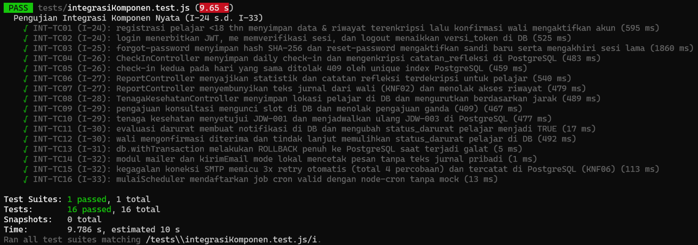* |
| *UC01-TC01* | *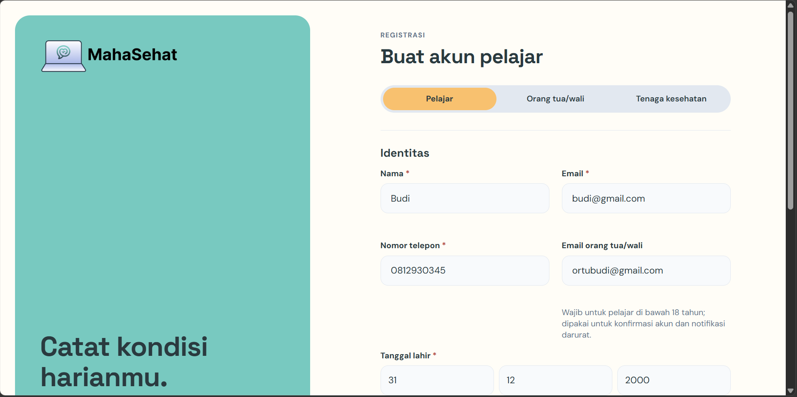<br><br>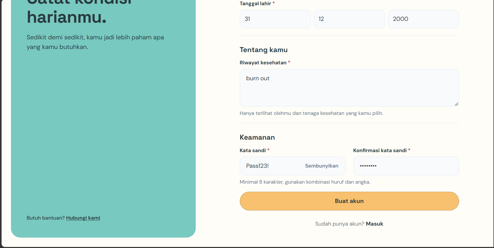* |
| *UC01-TC02* | *<br><br>* |
| *UC02-TC01* | *<br><br>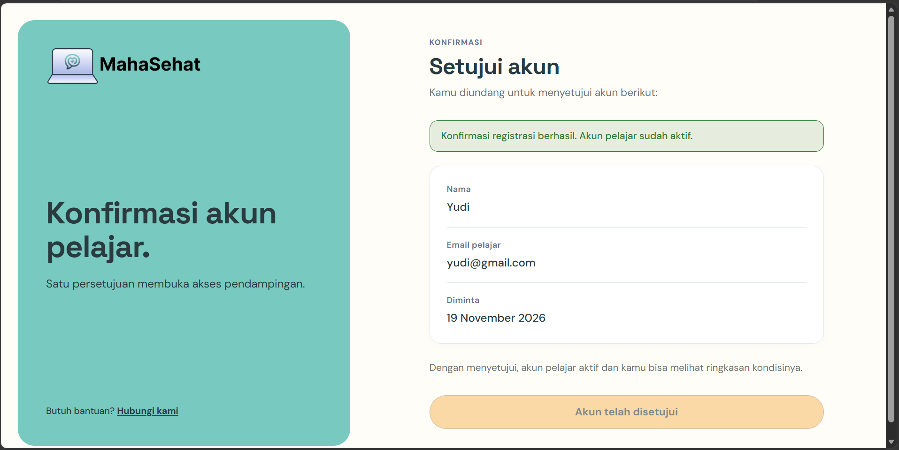<br><br>* |
| *UC02-TC02* | ** |
| *UC03-TC01* | *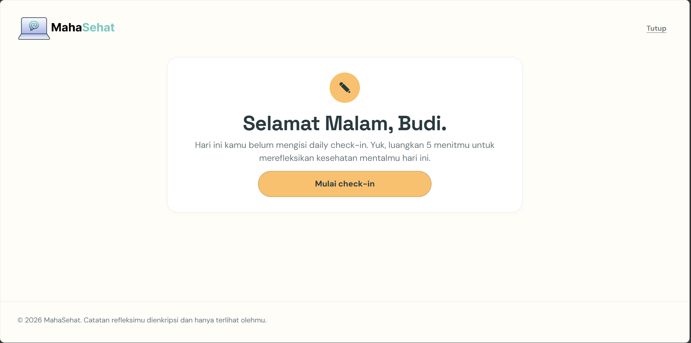<br><br>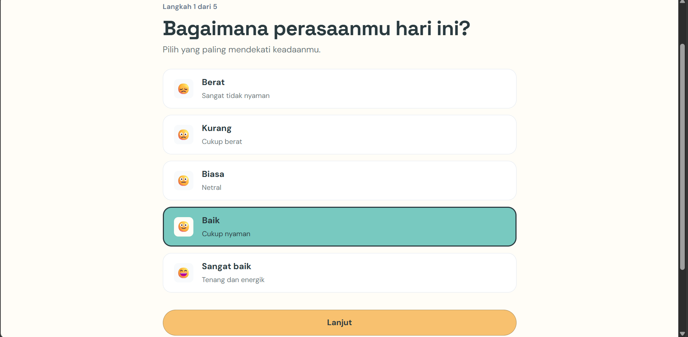<br><br><br><br><br><br><br><br><br><br>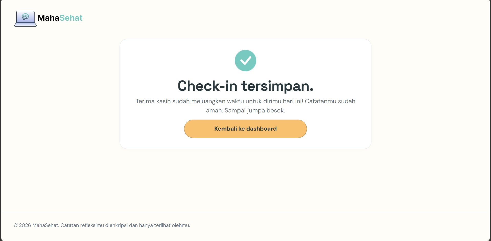* |
| *UC03-TC02* | *<br><br><br><br>[UC03-TC02-3](./assets/UC03-TC02-3.png)* |
| *UC08-TC01* | *<br><br>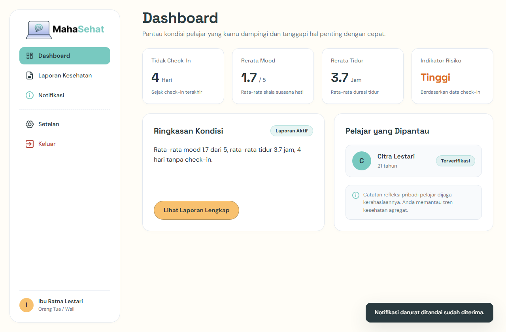<br><br>* |
| *UC08-TC02* | ** |
| *UC09-TC01* | *<br><br>* |
| *UC09-TC02* | *<br><br>* |
| *UC09-TC03* | ** |
| *UC09-TC04* | *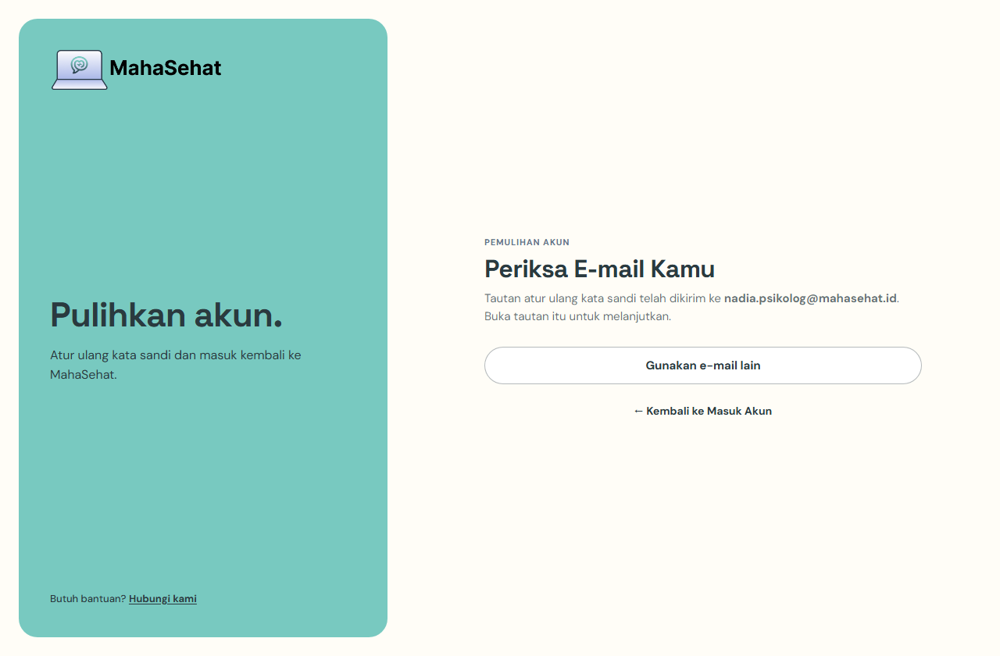<br><br>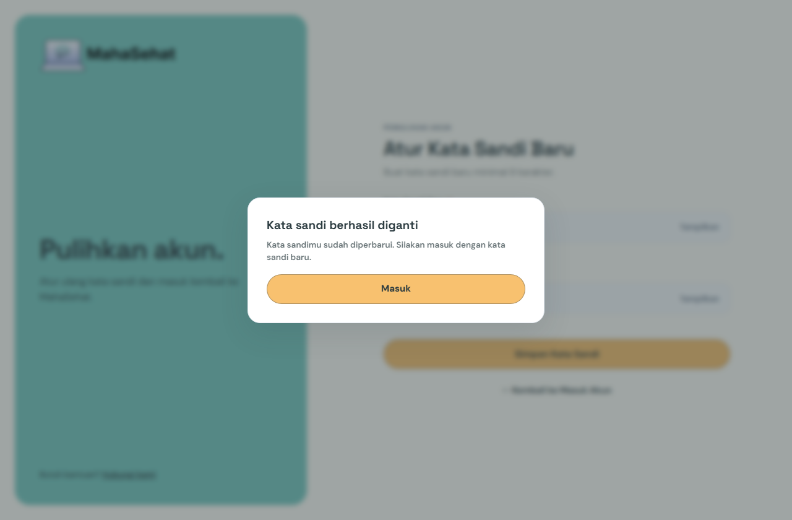<br><br>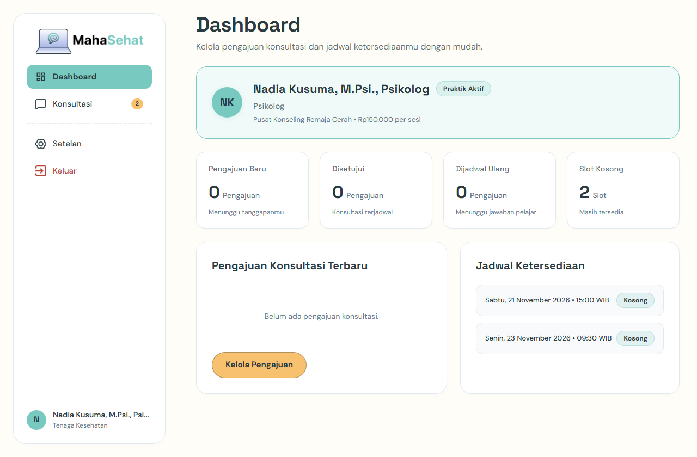* |
| *UC10-TC01* | *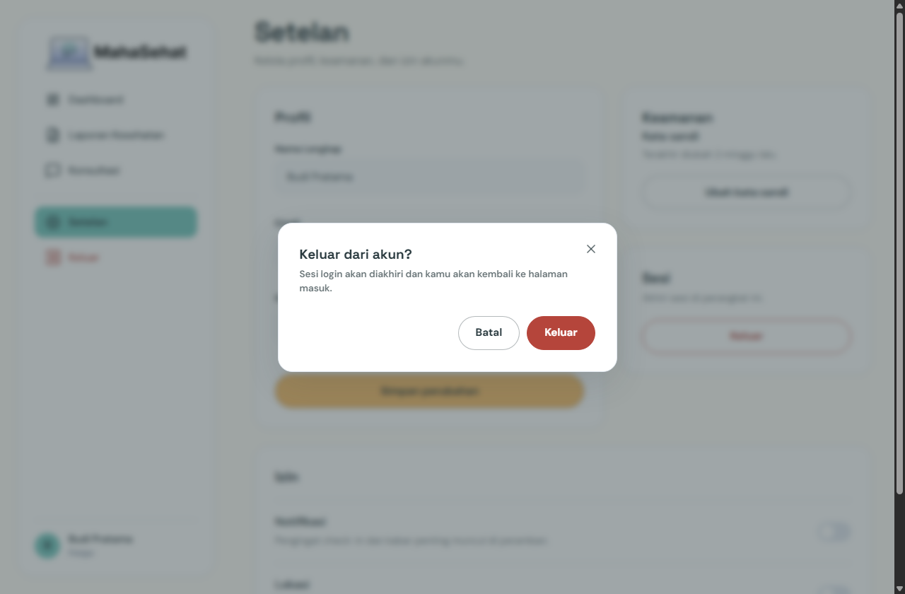<br><br>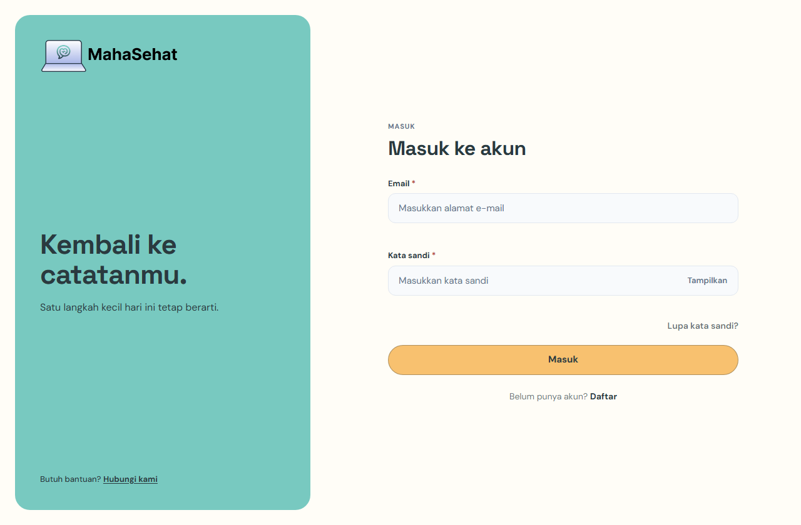* |
| *UC10-TC02* | ** |
| *KNF01-TC01* | *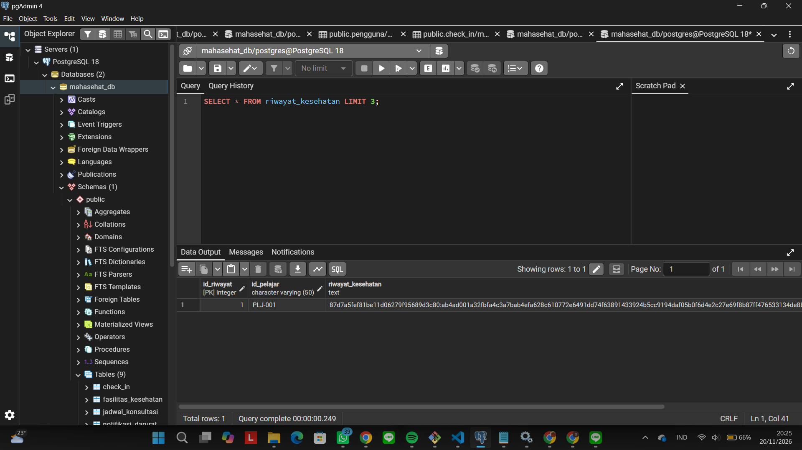* |
| *KNF02-TC01* | ** |
| *KNF03-TC01* | ** |
| *KNF04-TC01* | ** |
| *KNF05-TC01* | *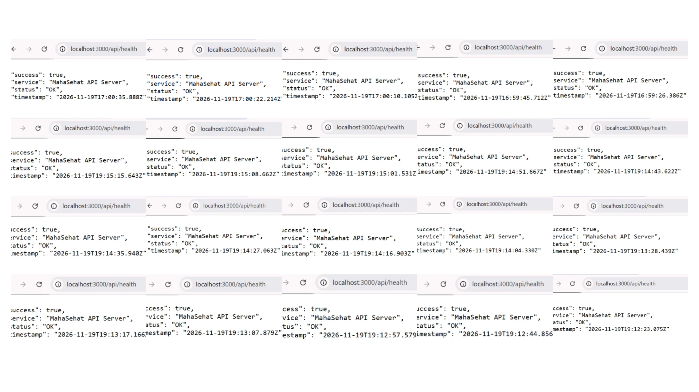* |
| *KNF06-TC01* | ** |
| *KNF07-TC01* | *<br><br><br><br><br><br>* |
| *KNF08-TC01* | ** |
| *KNF09-TC01* | ** |
| *KNF10-TC01* | *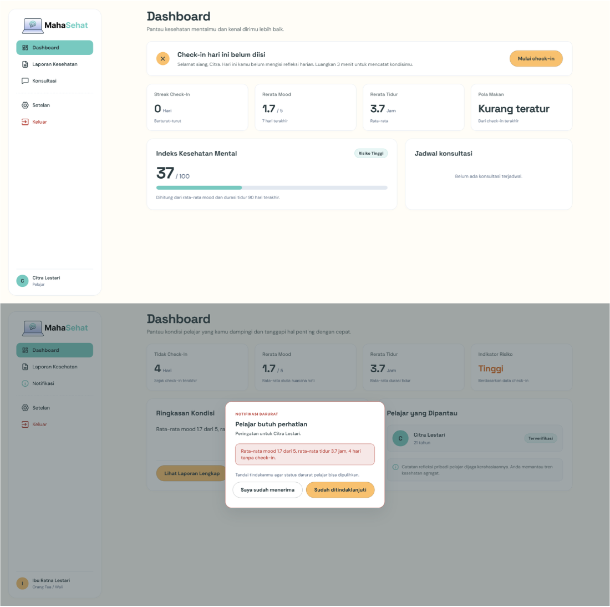* |
| *KNF11-TC01* | *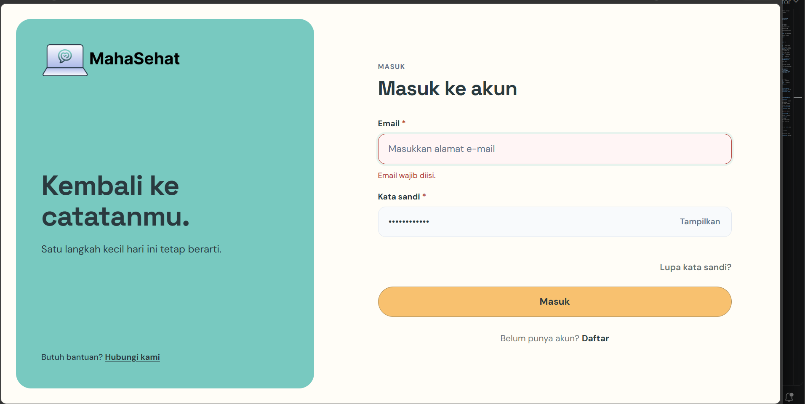<br><br>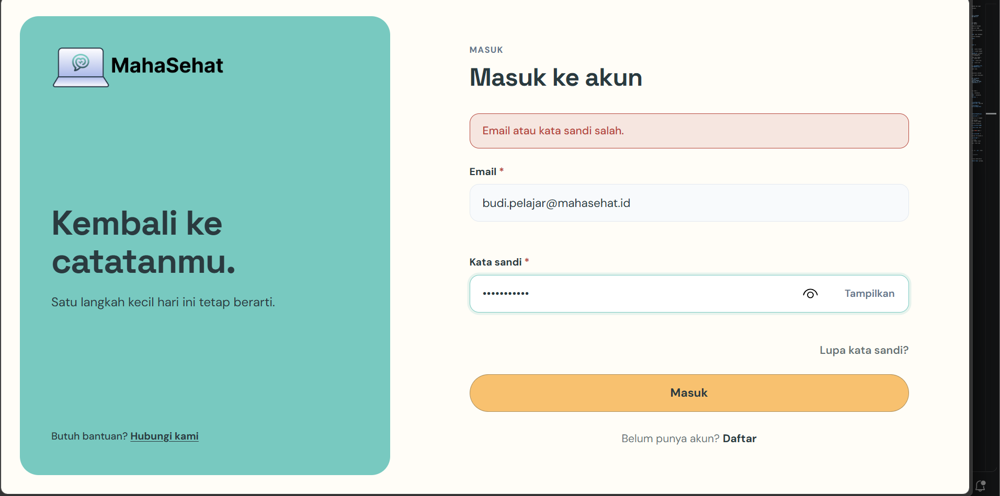* |
| *KNF12-TC01* | ** |
| *...* | *...* |

<br>

---

# BAB 5: Traceability

Petakan setiap KF ke KNF, use case, kelas perancangan, file implementasi, dan test case. Tabel traceability berikut akan menjadi sarana verifikasi KF. Setiap KF memiliki minimal satu test case dan dinyatakan terpenuhi apabila **seluruh** test case terkaitnya berkesimpulan `Pass`. KF yang tidak diimplementasikan tetap dicantumkan beserta alasannya.

Tabel 5.1. Matriks Kerunutan KF terhadap Implementasi dan Pengujian

| KF ID | KNF Terkait | Use Case ID | Kelas Terkait | Implementasi File Terkait | Test Case (UC) | Test Case (Unit/Integrasi/KNF) |
| :--- | :--- | :--- | :--- | :--- | :--- | :--- |
| *KF05* | *KNF01* | *UC03* | *C02 - Pesanan* | *`src/...`* | *UC03-TC01* | *C02-UT05, INT-TC04, KNF01-TC01* |
| *KF01* | *-* | *UC01<br>UC02* | *[C01 - Nama kelas]<br>[C02 - Nama kelas]* | *[path/ke/file1]<br>[path/ke/file2]* | *UC01-TC01, UC01-TC02<br>UC02-TC01* | *-* |
| *KF02* | *[KNFXX atau -]* | *[UCXX]* | *[CXX - Nama kelas]* | *[path/ke/file]* | *[UCXX-TCYY]* | *[CXX-UTYY, INT-TCYY, KNFXX-TCYY atau -]* |
| *KFXX* | *-* | *[UCXX atau -]* | *[CXX - Nama kelas atau -]* | *Tidak diimplementasikan: [alasan]* | *-* | *-* |
| *...* | *...* | *...* | *...* | *...* | *...* | *...* |

Tabel 5.2. Matriks Kerunutan KNF terhadap Pengujian

| ID KNF | Parameter | KF/UC Terkait | Test Case |
| :--- | :--- | :--- | :--- |
| *KNF01* | *Reliability* | *KF05 / UC03* | *KNF01-TC01* |
| *KNFXX* | *[Parameter]* | *[KFXX / UCXX atau -]* | *[KNFXX-TCYY]* |
| *...* | *...* | *...* | *...* |
