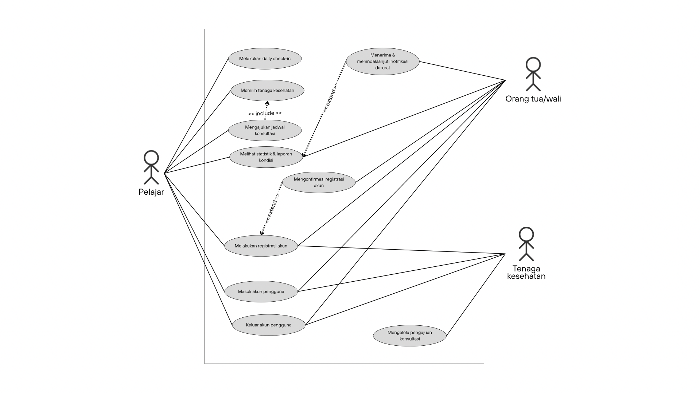
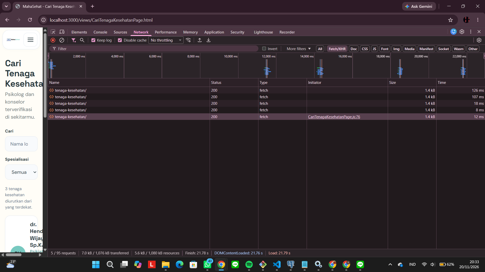
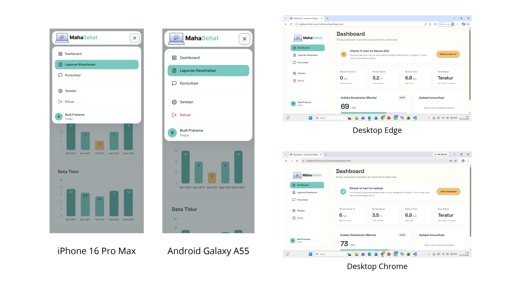
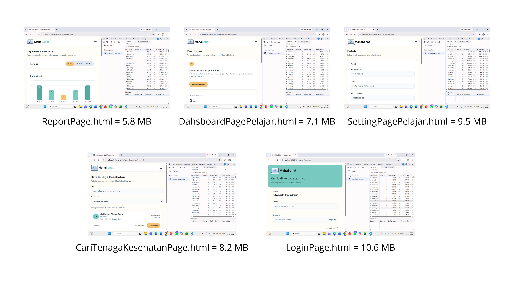

<h1>
IF2150 REKAYASA PERANGKAT LUNAK
<br>
TUGAS 10
<br>
HASIL IMPLEMENTASI DAN UJI PERANGKAT LUNAK (HIUPL)
</h1>
<br>

## *Mahasehat: Mental Health Monitoring App for Students*


### Untuk: *Stefani Angeline Oroh*

Dipersiapkan oleh:
| Informasi | Keterangan |
| --- | --- |
| Kelas | *03* |
| Kelompok | *04* |

| NIM | Nama |
|---|---|
| *13525021* | *Haikal Muhammad Royyan* |
| *13525066* | *Cynthia Winda Wijaya* |
| *13525081* | *Rendy Salastra Putra* |
| *13525090* | *Sophia Imelda Rogate Marpaung* |
| *13525141* | *Christabelcyne Costan* |
---

## Daftar Isi

- [BAB 1: Pendahuluan](#bab-1-pendahuluan)
  - [1.1 Tujuan Penulisan Dokumen](#11-tujuan-penulisan-dokumen)
  - [1.2 Lingkup Masalah](#12-lingkup-masalah)
  - [1.3 Definisi, Istilah, dan Singkatan](#13-definisi-istilah-dan-singkatan)
  - [1.4 Aturan Penomoran](#14-aturan-penomoran)
  - [1.5 Referensi](#15-referensi)
  - [1.6 Deskripsi Umum Dokumen (Ikhtisar)](#16-deskripsi-umum-dokumen-ikhtisar)
- [BAB 2: Deskripsi Umum Perangkat Lunak](#bab-2-deskripsi-umum-perangkat-lunak)
- [BAB 3: Implementasi](#bab-3-implementasi)
  - [3.1 Lingkungan Implementasi](#31-lingkungan-implementasi)
  - [3.2 Implementasi Modul](#32-implementasi-modul)
  - [3.3 Implementasi Antarmuka](#33-implementasi-antarmuka)
  - [3.4 File Lain](#34-file-lain)
- [BAB 4: Hasil Pengujian](#bab-4-hasil-pengujian)
  - [4.1 Strategi dan Kedalaman Pengujian Kelas](#41-strategi-dan-kedalaman-pengujian-kelas)
  - [4.2 Pengujian Unit Kelas](#42-pengujian-unit-kelas)
  - [4.3 Pengujian Integrasi](#43-pengujian-integrasi)
  - [4.4 Pengujian Use Case](#44-pengujian-use-case)
  - [4.5 Pengujian Kebutuhan Non-Fungsional (KNF)](#45-pengujian-kebutuhan-non-fungsional-knf)
  - [4.6 Tangkapan Layar dan Bukti Hasil Pengujian](#46-tangkapan-layar-dan-bukti-hasil-pengujian)
- [BAB 5: Traceability](#bab-5-traceability)

---

## Daftar Perubahan

| Revisi | Deskripsi |
| :--- | :--- |
| ... | ... |

---

# BAB 1: Pendahuluan

## 1.1 Tujuan Penulisan Dokumen
Dokumen ini menjelaskan deskripsi umum perangkat lunak, implementasi, hasil pengujian perangkat lunak, dan traceability. HIUPL digunakan sebagai acuan teknis bagi pengembang perangkat lunak untuk melakukan pengujian perangkat lunak.
Tuliskan uraian ringkas mengenai isi dokumen, tujuan pembuatan dokumen HIUPL ini, dan siapa saja target pembacanya.

## 1.2 Lingkup Masalah
Mahasehat merupakan aplikasi berbasis web yang membantu pelajar dalam memantau dan memahami kondisi kesehatan mental sehari-hari serta memperoleh akses terhadap layanan kesehatan mental. Aplikasi ini menyediakan fitur pencatatan suasana hati, pola tidur, aktivitas fisik, pola makan, tingkat stres, dan refleksi harian. Data tersebut digunakan dan disajikan dalam bentuk statistik dan laporan untuk melihat perkembangan kondisi pelajar sehingga pelajar dapat mengenali pola atau perubahan pada kondisi kesehatan mentalnya. Selain pemantauan mandiri, Mahasehat menyediakan akses terhadap layanan kesehatan mental melalui tenaga kesehatan. Pelajar dapat mencari tenaga kesehatan sesuai kebutuhan, melihat jadwal yang tersedia, serta mengajukan konsultasi. Selain itu, orang tua/wali dilibatkan dalam pemantauan kondisi pelajar melalui informasi dan notifikasi tertentu, sementara tenaga kesehatan dapat mengakses informasi kesehatan yang relevan untuk mendukung proses konsultasi.

## 1.3 Definisi, Istilah, dan Singkatan
Semua definisi dan singkatan yang digunakan dalam dokumen ini beserta penjelasannya.

Tabel 1.3. Definisi Istilah dan Singkatan

| Singkatan, Akronim, atau Istilah | Penjelasan |
| :--- | :--- |
| *P/L* | *Singkatan dari Perangkat Lunak, yaitu aplikasi yang memberikan perintah kepada komputer untuk menjalankan tugas tertentu.* |
| *SKPL* | *Singkatan dari Spesifikasi Kebutuhan Perangkat Lunak, yaitu dokumen yang merangkum kriteria-kriteria yang diperlukan untuk membangun aplikasi menjalankan tugasnya.* |
| *DPPL* | *Singkatan dari Deskripsi Perancangan Perangkat Lunak, yaitu dokumen yang menjelaskan rancangan arsitektur, kelas, dan antarmuka P/L.* |
| *HIUPL* | *Singkatan dari Hasil Implementasi dan Uji Perangkat Lunak, yaitu dokumen yang melaporkan hasil implementasi dan pengujian P/L.* |
| *KF* | *Singkatan dari Kebutuhan Fungsional.* |
| *KNF* | *Singkatan dari Kebutuhan Non-Fungsional.* |
| *UC* | *Singkatan dari Use Case.* |
| *TC* | *Singkatan dari Test Case, yaitu satu kasus uji untuk skenario tertentu.* |
| *UT* | *Singkatan dari Unit Test, yaitu test case tingkat kelas/operasi.* |
| *INT* | *Singkatan dari Integration Test, yaitu test case yang menguji interaksi antarkomponen.* |
| *Boundary* | *Kasus uji pada nilai batas masukan, misalnya nilai minimum, maksimum, atau tepat di ambang aturan.* |
| *Coverage* | *Persentase baris/cabang kode yang dieksekusi oleh pengujian.* |

## 1.4 Aturan Penomoran

Tabel 1.4. Aturan Penomoran

| Hal/Bagian | Penomoran | Keterangan |
| :--- | :--- | :--- |
| *Kebutuhan Fungsional* | *KFXX* | *Mewakili singkatan kata "Kebutuhan Fungsional", diikuti dua digit unik untuk membedakan tiap KF.* |
| *Kebutuhan Non-Fungsional* | *KNFXX* | *Mewakili singkatan kata "Kebutuhan Non-Fungsional", diikuti dua digit unik untuk membedakan tiap KNF.* |
| *Use Case* | *UCXX* | *Mewakili singkatan kata "Use Case", diikuti dua digit unik untuk membedakan tiap UC.* |
| *Kelas* | *CXX* | *Mewakili singkatan kata "Class", diikuti dua digit unik untuk membedakan tiap kelas.* |
| *Antarmuka* | *I-XX* | *Mewakili singkatan kata "Interface", diikuti dua digit unik untuk membedakan tiap layar antarmuka.* |
| *Test Case Unit* | *CXX-UTYY* | *XX adalah nomor kelas, YY adalah nomor urut test case unit pada kelas tersebut* |
| *Test Case Integrasi* | *INT-TCYY* | *YY adalah nomor urut test case integrasi* |
| *Test Case Use Case* | *UCXX-TCYY* | *XX adalah nomor use case, YY adalah nomor urut test case pada use case tersebut* |
| *Test Case KNF* | *KNFXX-TCYY* | *XX adalah nomor KNF, YY adalah nomor urut test case pada KNF tersebut* |
| *...* | *...* | *...* |
| *Algoritma* | *Algo-CXX-XX* | *Mewakili singkatan kata "Algoritma", diikuti ID kelas dan dua digit unik untuk membedakan tiap algoritma.* |

## 1.5 Referensi
- Dokumen APL: https://github.com/cynthiawinda/IF2150-RPL-K03-G04/blob/main/docs/M6/K03_G04_APL.md
- Dokumen SKPL: https://github.com/cynthiawinda/IF2150-RPL-K03-G04/blob/main/docs/M5/K03_G04_SKPL.md
- Dokumen DPPL: https://github.com/cynthiawinda/IF2150-RPL-K03-G04/blob/main/docs/M8/K03_G04_DPPL2.md
- Dokumen Implementasi: https://github.com/cynthiawinda/IF2150-RPL-K03-G04/blob/main/docs/M9/K03_G04_Implementasi.md
- Diagram UML: [https://www.drawio.com/](https://www.drawio.com/)
- https://nodejs.org/docs/latest-v20.x/api/
- https://expressjs.com/
- https://www.postgresql.org/docs/15/
- https://developers.google.com/maps/documentation/geolocation/
- https://developers.google.com/calendar/api
- Undang-Undang Republik Indonesia Nomor 27 Tahun 2022 tentang Pelindungan Data Pribadi: https://peraturan.bpk.go.id/Details/229798/uu-no-27-tahun-2022

## 1.6 Deskripsi Umum Dokumen (Ikhtisar)
BAB 1 membahas pendahuluan yang berisi tujuan, lingkup masalah, definisi, istilah serta singkatan, aturan penomoran, referensi, dan deskripsi umum dokumen. BAB 2 membahas deskripsi umum perangkat lunak. BAB 3 membahas implementasi meliputi lingkungan implementasi, implementasi modul, implementasi antarmuka, dan file lain. BAB 4 membahas hasil pengujian yang meliputi strategi dan kedalaman pengujian, pengujian unit kelas, pengujian integrasi, pengujian use case, pengujian kebutuhan nonfungsional, dan tangkapan layar hasil pengujian. BAB 5 berisi traceability.

<br>

---

# BAB 2: Deskripsi Umum Perangkat Lunak
Mahasehat merupakan sistem pemantauan kesehatan mental berbasis web responsif yang dirancang untuk kalangan pelajar, termasuk siswa dan mahasiswa. Sistem ini dikembangkan untuk menjawab permasalahan nyata di lingkungan pendidikan, di mana banyak pelajar cenderung memendam stres akademik maupun masalah pribadi seorang diri. Di sisi lain, orang tua/wali sering terlambat menyadari penurunan kondisi psikologis anak karena minimnya komunikasi atau keterbatasan jarak, khususnya bagi mahasiswa rantau. Mahasehat memadukan pencatatan mandiri oleh pelajar, dasbor pemantauan bagi orang tua/wali, serta alur rujukan bantuan profesional ke dalam satu sistem yang tetap mengutamakan kerahasiaan data pribadi pengguna. 
Dari sisi batasan sistem, MahaSehat mengelola autentikasi dan manajemen peran pengguna, pencatatan check-in harian, pengolahan statistik dan laporan kondisi, evaluasi notifikasi darurat, serta penjadwalan konsultasi dengan tenaga kesehatan. Catatan pribadi pelajar dijaga privasinya dari pihak luar. Adapun keterkaitan layanan eksternal meliputi pengiriman e-mail melalui server SMTP (via 'nodemailer') serta integrasi pendukung seperti Google Maps API dan Google Calendar API sesuai kebutuhan fitur, sementara penanganan kondisi darurat langsung di luar kendali otomatis aplikasi.

<p align="center">

</p>
<p align="center">
<i>Gambar 2.1. Use Case Diagram MahaSehat</i>
</p>

Gambar 2.1 menggambarkan interaksi tiga aktor utama dengan sistem MahaSehat. Pelajar dapat melakukan registrasi dan masuk/keluar akun, mengisi daily check-in, melihat statistik dan laporan kondisi, memilih tenaga kesehatan, serta mengajukan jadwal konsultasi. Orang tua/wali dapat melakukan registrasi dan konfirmasi akun pelajar, masuk/keluar akun, memantau statistik dan laporan kondisi pelajar, serta menerima dan menindaklanjuti notifikasi darurat. Tenaga kesehatan dapat registrasi akun, masuk/keluar akun, dan mengelola pengajuan konsultasi yang masuk.
<br>

---

# BAB 3: Implementasi

Bagian ini diisi dengan informasi tentang elemen P/L yang dikembangkan (*executable files*, *configuration files*, *data files*, dan sebagainya) serta perubahannya terhadap rancangan pada DPPL (jika ada).

## 3.1 Lingkungan Implementasi

Tuliskan *hardware* dan *software* yang digunakan untuk implementasi, mencakup *operating system*, bahasa pemrograman beserta versinya, *framework*/*library*, DBMS, *development tools*, dan *version control*. Lingkungan ini harus konsisten dengan **Subbab 2.1 DPPL**; jelaskan jika ada perubahan. Cantumkan juga *framework* dan alat pengujian yang dipakai.

Tabel 3.1. Lingkungan Implementasi

| Aspek | Keterangan |
| :--- | :--- |
| *Hardware* | *[Spesifikasi perangkat keras]* |
| *Operating System* | *[Nama dan versi OS]* |
| *Bahasa Pemrograman* | *[Bahasa dan versi]* |
| *Framework/Library* | *[Daftar framework/library beserta versi]* |
| *DBMS* | *[Nama dan versi DBMS]* |
| *Development Tools* | *[IDE, version control, tools lain]* |
| *Testing Tools* | *[Framework unit test, alat ukur performa, alat coverage]* |

## 3.2 Implementasi Modul

Daftar modul/kelas yang **TELAH** diimplementasikan. Gunakan nama dan ID kelas yang sama dengan DPPL, dan konsisten dengan Tabel B.5 pada dokumen Implementasi (Tugas 9).

Tabel 3.2. Implementasi Modul

| No | ID Kelas | Nama Modul/Kelas | Nama File Fisik | Nama File Executable |
| :--- | :--- | :--- | :--- | :--- |
| 1 | *[C01]* | *[Nama modul/kelas]* | *[path/ke/file]* | *[Nama file executable, atau - jika tidak ada]* |
| 2 | *[C02]* | *[Nama modul/kelas]* | *[path/ke/file]* | *[...]* |
| ... | *...* | *...* | *...* | *...* |

## 3.3 Implementasi Antarmuka

Daftar antarmuka yang telah diimplementasikan. Gunakan ID dan nama layar yang sama dengan ID dan nama layar pada tugas DPPL.

Tabel 3.3. Implementasi Antarmuka

| No | ID Antarmuka | Nama Antarmuka | Nama File Fisik | Nama File Executable |
| :--- | :--- | :--- | :--- | :--- |
| 1 | *[I-01]* | *[Nama layar]* | *[path/ke/file]* | *[Nama file executable, atau - jika tidak ada]* |
| 2 | *[I-02]* | *[Nama layar]* | *[path/ke/file]* | *[...]* |
| ... | *...* | *...* | *...* | *...* |

## 3.4 File Lain

Daftar file lain yang dibuat selain file kelas dan antarmuka, misalnya file *utility*, *configuration*, *database schema/seed*, *file test*, atau *data*.

Tabel 3.4. File Lain

| No | Nama File | Keterangan |
| :--- | :--- | :--- |
| 1 | *[Nama file]* | *[Fungsi file]* |
| ... | *...* | *...* |

<br>

---

# BAB 4: Hasil Pengujian

Bab ini melaporkan hasil pengujian P/L pada level unit, integrasi, dan sistem. Pengujian dilakukan pada tag release terakhir Tugas 9. Hasil aktual diisi berdasarkan pengamatan saat pengujian. Kesimpulan diisi `Pass` atau `Fail`, dan untuk `Fail` dilengkapi penyebab serta usulan perbaikan.

## 4.1 Strategi dan Kedalaman Pengujian Kelas

Tabel 4.1.1. Identifikasi Tingkat Pengujian Kelas

| ID Kelas | Nama Kelas | Tingkat | Alasan | Test Case Terkait |
| :--- | :--- | :--- | :--- | :--- |
| *C01* | *Pengguna* | *Mendalam* | *Hash password (bcrypt), verifikasi password, dan token akun* | *C01-UTYY* |
| *C02* | *Pelajar* | *Sedang* | *Hanya mendelegasikan check-in dan konsultasi ke kelas lain* | *C02-UTYY, INT-TCYY* |
| *C03* | *OrangTuaWali* | *Sedang* | *Mengambil data pelajar dan ringkasan laporan, tanpa perhitungan sendiri* | *C03-UTYY, INT-TCYY* |
| *C04* | *TenagaKesehatan* | *Sedang* | *Mengambil jadwal dan memperbarui profil, tanpa algoritma kompleks* | *C04-UTYY* |
| *C05* | *RiwayatKesehatan* | *Sedang* | *Hanya memanggil enkripsi AES-256 (logikanya diuji di `encryption.js`)* | *C05-UTYY, KNF01-TC01* |
| *C06* | *CheckIn* | *Mendalam* | *Validasi data check-in dan enkripsi catatan refleksi* | *C06-UTYY* |
| *C07* | *LaporanKesehatan* | *Mendalam* | *Logika ambang batas dan deteksi kondisi darurat* | *C07-UTYY* |
| *C08* | *FasilitasKesehatan* | *Sedang* | *Hanya mengambil data lokasi dan estimasi biaya* | *C08-UTYY* |
| *C09* | *JadwalKonsultasi* | *Mendalam* | *Aturan perubahan status ketersediaan dan pengajuan* | *C09-UTYY* |
| *C10* | *RegistrationPage* | *Tidak perlu* | *Hanya tampilan form dan mengirim ke API* | *UC01-TCYY* |
| *C11* | *AuthController* | *Mendalam* | *Validasi kredensial, status akun, dan sesi (JWT)* | *C11-UTYY, INT-TCYY, KNF12-TC01* |
| *C12* | *KonfirmasiRegistrasiPage* | *Tidak perlu* | *Hanya tampilan, data dari API konfirmasi* | *UC02-TCYY* |
| *C13* | *CheckInPage* | *Tidak perlu* | *Hanya tampilan form, validasi ada di C06 dan C14* | *UC03-TCYY, KNF07-TC01* |
| *C14* | *CheckInController* | *Mendalam* | *Validasi format masukan dan enkripsi jurnal* | *C14-UTYY, INT-TCYY, KNF01-TC01* |
| *C15* | *NotifikasiPengingatController* | *Tidak perlu* | *Tidak diimplementasikan, jadi tidak ada kode yang diuji* | *-* |
| *C16* | *ReportPage* | *Tidak perlu* | *Hanya menampilkan grafik dan filter periode* | *UC04-TCYY, KNF04-TC01* |
| *C17* | *ReportController* | *Mendalam* | *Agregasi statistik dan pembatasan data wali (tanpa teks jurnal)* | *C17-UTYY, INT-TCYY, KNF02-TC01* |
| *C18* | *CariTenagaKesehatanPage* | *Tidak perlu* | *Hanya tampilan pencarian, filter, dan modal* | *UC05-TCYY, KNF03-TC01* |
| *C19* | *ProfilTenagaKesehatanPage* | *Tidak perlu* | *Hanya dialog dalam halaman Cari, tanpa logika* | *UC05-TCYY, UC06-TCYY* |
| *C20* | *TenagaKesehatanController* | *Mendalam* | *Izin lokasi, perhitungan jarak, dan integrasi lokasi eksternal* | *C20-UTYY, INT-TCYY, KNF03-TC01* |
| *C21* | *PengajuanKonsultasiPage* | *Tidak perlu* | *Dihapus dan digabung ke modal halaman Cari, logikanya ada di C23* | *UC06-TCYY, UC07-TCYY* |
| *C22* | *JadwalKonsultasiController* | *Tidak perlu* | *Digabung ke C23, operasinya diuji bersama C23* | *C23-UTYY, UC06-TCYY* |
| *C23* | *KonsultasiController* | *Mendalam* | *Aturan status pengajuan, reschedule, dan hak akses per peran* | *C23-UTYY, INT-TCYY, UC07-TCYY* |
| *C24* | *NotifikasiDaruratController* | *Mendalam* | *Evaluasi darurat, kirim e-mail, dan retry maksimal 3 kali* | *C24-UTYY, INT-TCYY, KNF06-TC01* |
| *C25* | *LoginPage* | *Tidak perlu* | *Hanya tampilan form login* | *UC09-TCYY, KNF11-TC01* |
| *C26* | *ResetPasswordPage* | *Tidak perlu* | *Hanya tampilan dua langkah reset password* | *UC09-TCYY* |
| *C27* | *PasswordController* | *Mendalam* | *Pembuatan dan validasi token reset, validasi password baru, kirim e-mail* | *C27-UTYY, INT-TCYY, UC09-TCYY* |
| *C28* | *DashboardPage* | *Tidak perlu* | *Hanya menampilkan data dari API sesuai peran* | *UC09-TCYY* |
| *C29* | *SettingPage* | *Tidak perlu* | *Hanya tampilan pengaturan dan modal logout* | *UC10-TCYY* |

## 4.2 Pengujian Unit Kelas

Pengujian unit dilakukan pada kelas bertingkat Mendalam dan Sedang. Kelas Mendalam diuji pada seluruh operasi public dengan kasus normal, batas, dan negatif, serta mencapai *coverage* minimal 70%. Kelas Sedang diuji minimal dengan satu kasus normal dan satu kasus gagal pada operasi public utama.

Cara menjalankan unit test: *[tuliskan perintah, mis. `pytest src/tests/`]*.

Lokasi file test: *[path, mis. `src/tests/`]*.

### 4.2.1 Kelas [Nama Kelas 1]

**ID Kelas:** *[C02]*  
**Nama Kelas:** *[Pesanan]*  
**Tingkat:** *[Mendalam]*

Tabel 4.2.1. Hasil Pengujian Unit Kelas [C02]

| ID Pengujian | Operasi yang Diuji | Jenis Kasus | Prosedur/Masukan | Hasil yang Diharapkan | Hasil Pengujian | Kesimpulan |
| :--- | :--- | :--- | :--- | :--- | :--- | :--- |
| *C02-UT01* | *`hitungTotal(): Decimal`* | *Normal* | *Pesanan berisi 2 item: 10.000 x 2 dan 5.000 x 1* | *Total = 25.000* | *[Hasil aktual]* | *Pass/Fail* |
| *C02-UT02* | *`hitungTotal(): Decimal`* | *Batas* | *Pesanan berisi tepat 1 item dengan jumlah 1* | *Total = harga item tersebut* | *[...]* | *Pass/Fail* |
| *C02-UT03* | *`hitungTotal(): Decimal`* | *Negatif* | *Pesanan tanpa item* | *Total = 0 atau melempar kesalahan sesuai rancangan* | *[...]* | *Pass/Fail* |
| *...* | *...* | *...* | *...* | *...* | *...* | *...* |

Khusus kelas **Mendalam**:

Tabel 4.2.1b. Ringkasan Cakupan Kelas [C02]

| Informasi | Keterangan |
| :--- | :--- |
| Daftar operasi public pada DPPL | *[op1(), op2(), ...]* |
| Operasi yang diuji | *[op1(), op2(), ...]* |
| ID Algoritma yang tercakup | *[Algo-001, ...]* |
| Coverage (wajib ≥ 70%) | *[% baris / % cabang, alat dan bukti pada 4.6]* |

### 4.2.2 Kelas [Nama Kelas 2]

*[Ulangi pola 4.2.1 untuk setiap kelas bertingkat Mendalam atau Sedang.]*

<br>

## 4.3 Pengujian Integrasi

Pengujian integrasi memeriksa interaksi antarkomponen yang melewati batas, yaitu *Controller* ke *Model*, aplikasi ke basis data, dan aplikasi ke sistem eksternal. Daftar antarmuka mengacu pada dokumen DPPL, dengan minimal satu test case untuk setiap antarmuka. Pengujian memakai komponen nyata, bukan *mock*. Apabila ada antarmuka tambahan yang belum didaftarkan pada dokumen DPPL, cantumkan juga.

Tabel 4.3.1. Daftar Antarmuka Antarkomponen

| ID Antarmuka | Komponen Asal | Komponen Tujuan | Jenis Batas | Test Case |
| :--- | :--- | :--- | :--- | :--- |
| *I-01* | *KeranjangController* | *Keranjang (Model)* | *Controller - Model* | *INT-TC01, INT-TC02* |
| *I-02* | *Pesanan (Model)* | *Database* | *Aplikasi - Basis data* | *INT-TC03* |
| *I-03* | *PaymentGatewayAdapter* | *Payment Gateway (dummy)* | *Aplikasi - Sistem eksternal* | *INT-TC04, INT-TC05* |
| *[I-XX]* | *[Komponen asal]* | *[Komponen tujuan]* | *[Jenis batas]* | *[ID test case]* |
| *...* | *...* | *...* | *...* | *...* |

Tabel 4.3.2. Hasil Pengujian Integrasi

| ID Pengujian | ID Antarmuka | Skenario | Prosedur/Masukan | Hasil yang Diharapkan | Hasil Pengujian | Kesimpulan |
| :--- | :--- | :--- | :--- | :--- | :--- | :--- |
| *INT-TC01* | *I-01* | *Normal: tambah item ke keranjang* | *Panggil `tambahItem()` melalui KeranjangController dengan produk valid* | *Item tersimpan pada Keranjang dan tampil pada daftar item* | *[Hasil aktual]* | *Pass/Fail* |
| *INT-TC03* | *I-02* | *Normal: simpan pesanan* | *Buat pesanan, lalu baca ulang langsung dari basis data* | *Baris pesanan ada dengan nilai total dan status yang sama* | *[...]* | *Pass/Fail* |
| *INT-TC05* | *I-03* | *Gagal: gateway mengembalikan status gagal* | *Kirim otorisasi dengan saldo dummy tidak cukup* | *Status pesanan tidak berubah menjadi "Lunas", pesan gagal diteruskan ke pengguna* | *[...]* | *Pass/Fail* |
| *...* | *...* | *...* | *...* | *...* | *...* | *...* |

<br>

## 4.4 Pengujian Use Case

Pengujian use case dilakukan pada seluruh skenario normal dan alternatif sesuai Subbab 4.4 SKPL, dengan minimal satu test case untuk setiap skenario. Kolom ID KF menunjukkan KF yang diverifikasi oleh test case tersebut.

### 4.4.1 Use Case Melakukan Registrasi Akun

**ID Use Case:** *UC01*  
**Nama Use Case:** *Melakukan Registrasi Akun*

Tabel 4.4.1. Hasil Pengujian Use Case [UC01]

| ID Pengujian | ID KF | Skenario | Prosedur Pengujian | Masukan | Hasil yang Diharapkan | Hasil Pengujian | Kesimpulan |
| :--- | :--- | :--- | :--- | :--- | :--- | :--- | :--- |
| *UC01-TC01* | *KF01* | *Normal* | *1. Buka halaman Registrasi.<br>2. Masukkan data diri, riwayat kesehatan mental, dan kontak orang tua/wali bagi pelajar.<br>3. Klik tombol "Daftar".* | *User: rpl@gmail.com<br>Pass: 123456* | *Pengguna diarahkan ke Halaman Dashboard.* | *Pengguna diarahkan ke Halaman Dashboard sesuai hasil yang diharapkan.* | *Pass* |
| *UC01-TC02* | *KF01* | *Alternatif 1: [Nama skenario]* | *[Langkah-langkah pengujian]* | *[Data masukan]* | *[Hasil yang diharapkan]* | *[Hasil aktual]* | *[Pass/Fail. Jika Fail: penjelasan dan solusi]* |
| *...* | *...* | *...* | *...* | *...* | *...* | *...* | *...* |

### 4.4.2 Use Case [Nama Use Case 2]

*[Lanjutkan untuk seluruh use case dengan pola yang sama, hingga 4.4.N.]*

<br>

## 4.5 Pengujian Kebutuhan Non-Fungsional (KNF)

Setiap KNF pada Tabel 3.2 SKPL diuji secara terukur berdasarkan parameter yang telah didefinisikan. Setiap pengujian memuat target terukur, metode dan alat yang sesuai dengan parameter (misalnya Chrome DevTools untuk *response time* dan inspeksi basis data untuk *security*), serta hasil aktual berupa angka atau data. KNF yang belum dipenuhi atau tidak diimplementasikan dicantumkan beserta alasan dan rencana perbaikan.

Tabel 4.5. Hasil Pengujian KNF

| ID Pengujian | ID KNF | Parameter | Target Terukur | Metode dan Alat | Hasil Aktual | Kesimpulan |
| :--- | :--- | :--- | :--- | :--- | :--- | :--- |
| *KNF01-TC01* | *KNF01* | *Security* | *Seluruh riwayat check-in dan catatan kesehatan pengguna tersimpan terenkripsi menggunakan algoritma AES-256 (bukan plain-text)* | *Inspeksi langsung tabel data check-in dan catatan kesehatan pada basis data PostgreSQL melalui ```psql```* | *[Hasil aktual]* | *Pass/Fail* |
| *KNF02-TC01* | *KNF02* | *Security* | *Akun orang tua/wali hanya dapat mengakses ringkasan data kondisi yang ditentukan dan tidak memiliki akses ke teks jurnal pribadi pelajar* | *Uji akses antarmuka dan endpoint API menggunakan akun wali (```santoso.wali@mahasehat.id```) melalui Google Chrome & DevTools Network* | *[...]* | *Pass/Fail* |
| *KNF03-TC01* | *KNF03* | *Response time* | *Hasil rekomendasi tenaga kesehatan berdasarkan lokasi tampil dalam waktu <= 2.000 ms* | *Chrome DevTools pada halaman ```CariTenagaKesehatanPage.html```, 5 kali ukur, ambil rata-rata* | *[Rata-rata ... detik, maks ... detik]* | *Pass/Fail* |
| *KNF04-TC01* | *KNF04* | *Response time* | *Grafik perkembangan kesehatan dihasilkan dan ditampilkan dalam waktu <= 1.500 ms* | *Chrome DevTools pada halaman ```ReportPagePelajar.html```, 5 kali ukur, ambil rata-rata* | *[Rata-rata ... detik, maks ... detik]* | *Pass/Fail* |
| *KNF05-TC01* | *KNF05* | *Availability* | *Tingkat ketersediaan minimal 99,5% (24/7, downtime maksimal 3,6 jam/bulan)* | *Pengujian ketersediaan layanan (healthcheck) dengan mengakses endpoint ```/api/health``` serta halaman utama aplikasi secara langsung melalui peramban Google Chrome pada lingkungan lokal (```localhost:3000```), sebanyak 20 kali* | *Layanan aktif dan merespons normal (20/20, 100% berhasil diakses) dengan keluaran JSON ```"success": true, "service": "MahaSehat API Server", "status": "OK"``` tanpa galat atau downtime selama sesi pengujian* | *Pass/Fail* |
| *KNF06-TC01* | *KNF06* | *Reliability* | *Sistem melakukan percobaan pengiriman ulang (retry attempt) notifikasi darurat secara otomatis hingga 3 kali apabila terjadi gangguan koneksi/transmisi* | *Simulasi kegagalan koneksi/SMTP saat notifikasi darurat terpicu dan inspeksi log terminal server* | *[...]* | *Pass/Fail* |
| *KNF07-TC01* | *KNF07* | *Ergonomy* | *Pengisian daily check-in oleh pengguna pelajar selesai dalam waktu <= 60 detik dengan <= 4 langkah navigasi antarmuka* | *Pengujian alur pengisian daily check-in dan pencatatan waktu menggunakan stopwatch serta penghitungan langkah antarmuka, 3 kali pengulangan* | *[...]* | *Pass/Fail* |
| *KNF08-TC01* | *KNF08* | *Portability* | *Dapat diakses dan berjalan secara responsif pada Google Chrome 100+, Safari 15+, dan Firefox 100+ di perangkat Android 8.0+, iOS 14+, dan Windows 10/11* | *Pengujian fungsional dan tampilan responsif lintas peramban pada Windows 11 (Google Chrome & Microsoft Edge) serta emulasi perangkat mobile Android (Samsung Galaxy A55) dan iOS (iPhone 16 Pro Max) melalui Chrome DevTools Device Toolbar* | *Pass pada Windows 11 (Google Chrome & Microsoft Edge), emulasi Android (Samsung Galaxy A55), dan emulasi iOS (iPhone 16 Pro Max) dengan tata letak dan navigasi responsif (Peramban Safari 15+ serta Firefox 100+ fisik belum diuji karena keterbatasan perangkat uji)* | *Pass* |
| *KNF09-TC01* | *KNF09* | *Memory* | *Penggunaan memori lokal (client-side memory usage) pada peramban maksimal sebesar 150 MB* | *Pengukuran JS Heap Snapshot menggunakan Chrome DevTools (tab Memory) pada 5 halaman utama (```ReportPagePelajar```, ```DashboardPagePelajar```, ```CariTenagaKesehatanPage```, ```SettingPagePelajar```, ```LoginPage```)* | *Rata-rata 8,24 MB, minimum 5,8 MB, dan maksimum 10,6 MB (seluruhnya jauh di bawah batas 150 MB)* | *Pass* |
| *KNF10-TC01* | *KNF10* | *Safety* | *Menampilkan pop-up tombol rujukan darurat resmi saat kondisi ambang batas darurat terpenuhi tanpa menghalangi pengguna menutup tampilan atau mencari bantuan* | *Simulasi pengisian check-in dengan nilai di atas ambang batas darurat pada antarmuka pelajar* | *[...]* | *Pass/Fail* |
| *KNF11-TC01* | *KNF11* | *Ergonomy* | *Halaman login menampilkan formulir masuk yang sederhana dan mudah digunakan (kolom email/username, kata sandi, dan tombol masuk)* | *Inspeksi antarmuka dan uji kegunaan formulir login pada ```LoginPage.html``` melalui Google Chrome* | *[...]* | *Pass/Fail* |
| *KNF12-TC01* | *KNF12* | *Security* | *Sistem memvalidasi autentikasi, membatasi akses dashboard sesuai role pengguna, dan mengakhiri sesi saat logout sehingga token tidak dapat dipakai kembali* | *Uji login multi-peran (Pelajar/Wali/Nakes), percobaan akses route lintas peran tanpa otorisasi, serta pengujian logout dan pemakaian ulang token lama* | *[...]* | *Pass/Fail* |

<br>

## 4.6 Tangkapan Layar dan Bukti Hasil Pengujian

Bukti pengujian dilampirkan sesuai ID Pengujian pada Subbab 4.2 sampai 4.5, berupa tangkapan layar aplikasi, keluaran *test runner*, laporan *coverage* untuk setiap kelas Mendalam, atau hasil alat ukur.

Tabel 4.6. Bukti Hasil Pengujian

| ID Pengujian | Bukti Hasil Pengujian |
| :--- | :--- |
| *C02-UT01 – C02-UT08* | *[Sisipkan hasil keluaran unit test]* |
| *C02 (coverage)* | *[Sisipkan laporan coverage kelas C02]* |
| *INT-TC01* | *[Sisipkan bukti pengujian integrasi]* |
| *UC01-TC01* | *[Sisipkan tangkapan layar UC01-TC01 sesuai prosedur pengujian]* |
| *UC01-TC02* | *[Sisipkan tangkapan layar UC01-TC02 sesuai prosedur pengujian]* |
| *KNF01-TC01* | ** |
| *KNF02-TC01* | ** |
| *KNF03-TC01* | ** |
| *KNF04-TC01* | ** |
| *KNF05-TC01* | ** |
| *KNF06-TC01* | ** |
| *KNF07-TC01* | ** |
| *KNF08-TC01* | ** |
| *KNF09-TC01* | ** |
| *KNF10-TC01* | ** |
| *KNF11-TC01* | ** |
| *KNF12-TC01* | ** |
| *...* | *...* |

<br>

---

# BAB 5: Traceability

Petakan setiap KF ke KNF, use case, kelas perancangan, file implementasi, dan test case. Tabel traceability berikut akan menjadi sarana verifikasi KF. Setiap KF memiliki minimal satu test case dan dinyatakan terpenuhi apabila **seluruh** test case terkaitnya berkesimpulan `Pass`. KF yang tidak diimplementasikan tetap dicantumkan beserta alasannya.

Tabel 5.1. Matriks Kerunutan KF terhadap Implementasi dan Pengujian

| KF ID | KNF Terkait | Use Case ID | Kelas Terkait | Implementasi File Terkait | Test Case (UC) | Test Case (Unit/Integrasi/KNF) |
| :--- | :--- | :--- | :--- | :--- | :--- | :--- |
| *KF05* | *KNF01* | *UC03* | *C02 - Pesanan* | *`src/...`* | *UC03-TC01* | *C02-UT05, INT-TC04, KNF01-TC01* |
| *KF01* | *-* | *UC01<br>UC02* | *[C01 - Nama kelas]<br>[C02 - Nama kelas]* | *[path/ke/file1]<br>[path/ke/file2]* | *UC01-TC01, UC01-TC02<br>UC02-TC01* | *-* |
| *KF02* | *[KNFXX atau -]* | *[UCXX]* | *[CXX - Nama kelas]* | *[path/ke/file]* | *[UCXX-TCYY]* | *[CXX-UTYY, INT-TCYY, KNFXX-TCYY atau -]* |
| *KFXX* | *-* | *[UCXX atau -]* | *[CXX - Nama kelas atau -]* | *Tidak diimplementasikan: [alasan]* | *-* | *-* |
| *...* | *...* | *...* | *...* | *...* | *...* | *...* |

Tabel 5.2. Matriks Kerunutan KNF terhadap Pengujian

| ID KNF | Parameter | KF/UC Terkait | Test Case |
| :--- | :--- | :--- | :--- |
| *KNF01* | *Reliability* | *KF05 / UC03* | *KNF01-TC01* |
| *KNFXX* | *[Parameter]* | *[KFXX / UCXX atau -]* | *[KNFXX-TCYY]* |
| *...* | *...* | *...* | *...* |
