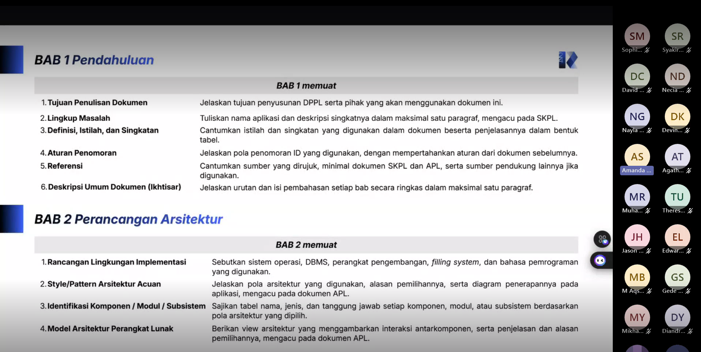

# Form Asistensi

## Tugas Besar IF2150 - Rekayasa Perangkat Lunak

| Informasi | Keterangan |
| --- | --- |
| **Hari** | *Jumat* |
| **Tanggal** | *09/10/2026* |
| **Kelas** | *K-03* |
| **Nomor Kelompok** | *4*  |
| **Nama Kelompok** | *pakespinwheel*  |
| **Nama Perangkat Lunak** | *Mahasehat: Mental Health Monitoring App for Students*  |
| **Dokumen** | *K03_G04_DPPL*  |

### Anggota Kelompok

| NIM       | Nama               |
| --------- | ------------------ |
| *13525021* | *Haikal Muhammad Royyan* |
| *13525066* | *Cynthia Winda Wijaya* |
| *13525081* | *Rendy Salastra Putra* |
| *13525090* | *Sophia Imelda Rogate Marpaung* |
| *13525141* | *Christabelcyne Costan* |

### Catatan

| Catatan |
| --- |
| 1. *Struktur DPPL terdiri dari pendahuluan, perancangan arsitektur, realisasi use case, diagram kelas keseluruhan, dan matriks kerunutan*  |
| 2. *Setiap use case harus dibuat diagram kelasnya lengkap dengan atribut dan metode* |
| 3. *Notasi dasar sequence diagram terdiri dari aktor, entity class, control class, boundary class, lifeline, dan activation bar* |
| 4. *Jenis message ada synchronous message, asynchronous message, return message, create message, destroy message, self message, recursive message, dan found message* |
| 5. *Fragment operators ada alt, opt, par, loop, critical, neg, dan ref* |

## Dokumentasi

  

  <i>Gambar 1. Dokumentasi kegiatan asistensi.</i>

