<h1>
IF2150 REKAYASA PERANGKAT LUNAK
<br>
TUGAS 5
<br>
DESKRIPSI PERANCANGAN PERANGKAT LUNAK (DPPL)
</h1>
<br>

## *Mahasehat: Mental Health Monitoring App for Students*


### Untuk: *Stefani Angeline Oroh*

Dipersiapkan oleh:
| Informasi | Keterangan |
| --- | --- |
| Kelas | *03* |
| Kelompok | *04* |

| NIM | Nama |
|---|---|
| *13525021* | *Haikal Muhammad Royyan* |
| *13525066* | *Cynthia Winda Wijaya* |
| *13525081* | *Rendy Salastra Putra* |
| *13525090* | *Sophia Imelda Rogate Marpaung* |
| *13525141* | *Christabelcyne Costan* |
---

## Daftar Perubahan

| Revisi | Deskripsi |
| :--- | :--- |
| *A* | *Menyesuaikan beberapa atribut dan metode/aplikasi pada daftar kelas perancangan keseluruhan dengan diagram sekuens.* |
| *B* |  |
| *C* |  |
| ... |  |

---

<br>

> **Petunjuk pengerjaan:** *[Silahkan hapus bagian ini setelah selesai mengerjakan]*
>
> Dokumen ini melanjutkan **Deskripsi Perancangan Perangkat Lunak**. Gunakan nama, ID, kebutuhan, dan use case yang konsisten dengan kedua dokumen tersebut. Contoh pola ID baru di bawah dapat disesuaikan dengan kesepakatan kelompok, ID yang sudah ada tetap dipertahankan.

<br>

---


# BAB 1: Pendahuluan

## 1.1 Tujuan Penulisan Dokumen
Dokumen Deskripsi Perangkat Lunak (DPPL) merupakan lanjutan dari SKPL yang berisi rancangan atau desain teknis bagaimana perangkat lunak tersebut akan dibangun. DPPL digunakan sebagai acuan bagi tim pengembang dalam proses implementasi sistem, serta bagi pihak terkait untuk memahami fitur dan kebutuhan perangkat lunak yang telah ditentukan.

## 1.2 Lingkup Masalah
Mahasehat merupakan aplikasi berbasis web yang membantu pelajar dalam memantau dan memahami kondisi kesehatan mental sehari-hari serta memperoleh akses terhadap layanan kesehatan mental. Aplikasi ini menyediakan fitur pencatatan suasana hati, pola tidur, aktivitas fisik, pola makan, tingkat stres, dan refleksi harian. Data tersebut digunakan dan disajikan dalam bentuk statistik dan laporan untuk melihat perkembangan kondisi pelajar sehingga pelajar dapat mengenali pola atau perubahan pada kondisi kesehatan mentalnya. Selain pemantauan mandiri, Mahasehat menyediakan akses terhadap layanan kesehatan mental melalui tenaga kesehatan. Pelajar dapat mencari tenaga kesehatan sesuai kebutuhan, melihat jadwal yang tersedia, serta mengajukan konsultasi. Selain itu, orang tua/wali dilibatkan dalam pemantauan kondisi pelajar melalui informasi dan notifikasi tertentu, sementara tenaga kesehatan dapat mengakses informasi kesehatan yang relevan untuk mendukung proses konsultasi.

## 1.3 Definisi, Istilah, dan Singkatan

Tabel 1.3. Definisi Istilah dan Singkatan

| Singkatan, Akronim, atau Istilah | Penjelasan |
| :--- | :--- |
| *P/L* | *Singkatan dari Perangkat Lunak, yaitu aplikasi yang memberikan perintah kepada komputer untuk menjalankan tugas tertentu.* |
| *SKPL* | *Singkatan dari Spesifikasi Kebutuhan Perangkat Lunak, yaitu dokumen yang merangkum kriteria-kriteria yang diperlukan untuk membangun aplikasi menjalankan tugasnya.* |
| *DPPL* | *Singkatan dari Deskripsi Perancangan Perangkat Lunak, yaitu dokumen lanjutan SKPL yang berisi rancangan teknis dan arsitektur perangkat lunak.* |
| *KF* | *Singkatan dari Kebutuhan Fungsional, yaitu layanan yang harus disediakan dan respon atas masukan, kadang termasuk yang tidak boleh dilakukan.* |
| *KNF* | *Singkatan dari Kebutuhan Non-Fungsional, yaitu batasan atas layanan yang harus disediakan, seberapa baik, dalam kondisi apa, dengan jaminan apa.* |
| *UC* | *Singkatan dari Use Case, yaitu pemodelan cara aktor berinteraksi dengan sistem.* |
| *Aktor* | *Merepresentasikan entitas di luar batas sistem yang berinteraksi dengan sistem.* |
| *Skenario* | *Merepresentasikan satu penelusuran konkret melalui sebuah use case, menyatakan apa saja yang terjadi pada sistem.* |
| *Kelas* | *Merepresentasikan suatu jenis objek yang memiliki atribut dan metode/operasi untuk menjalankan tanggung jawabnya.* |
| *Entity Class* | *Kelas yang merepresentasikan data inti atau objek dunia nyata yang sifatnya bertahan lama dalam sistem.* |
| *Boundary Class* | *Kelas yang mengatur komunikasi antara pengguna (aktor) atau sistem luar dengan sistem utama.* |
| *Controller Class* | *Kelas yang mengatur alur kerja dan aturan bisnis (menghubungkan Boundary dan Entity).* |
| *Kebutuhan* | *Merepresentasikan persyaratan atau ketentuan wajib yang harus dipenuhi untuk mencapai suatu tujuan dalam pembuatan sistem atau Perangkat Lunak.* |

## 1.4 Aturan Penomoran

Tabel 1.4. Aturan Penomoran

| Hal/Bagian | Penomoran | Keterangan |
| :--- | :--- | :--- |
| *Kebutuhan Fungsional* | *KFXX* | *Mewakili singkatan kata "Kebutuhan Fungsional", diikuti dua digit unik untuk membedakan tiap KF.* |
| *Kebutuhan Non-Fungsional* | *KNFXX* | *Mewakili singkatan kata "Kebutuhan Non-Fungsional", diikuti dua digit unik untuk membedakan tiap KNF.* |
| *Aktor* | *AXX* | *Mewakili singkatan kata "Aktor", diikuti dua digit unik untuk membedakan tiap aktor.* |
| *Use Case* | *UCXX* | *Mewakili singkatan kata "Use Case", diikuti dua digit unik untuk membedakan tiap UC.* |
| *Kelas* | *CXX* | *Mewakili singkatan kata "Class", diikuti dua digit unik untuk membedakan tiap kelas.* |
| *Kebutuhan* | *RXX* | *Mewakili singkatan kata "Requirement", diikuti dua digit unik untuk membedakan tiap kebutuhan.* |
| *Algoritma* | *Algo-CXX-XX* | *Mewakili singkatan kata "Algoritma", diikuti ID kelas dan dua digit unik untuk membedakan tiap algoritma.* |
| *Query* | *Q-CXX-XX* | *Mewakili singkatan kata "Query", diikuti ID kelas dan dua digit unik untuk membedakan tiap query.* |
| *Antarmuka* | *I-XX* | *Mewakili singkatan kata "Interface", diikuti dua digit unik untuk membedakan tiap layar antarmuka.* |

## 1.5 Referensi

- Dokumen APL: https://github.com/cynthiawinda/IF2150-RPL-K03-G04/blob/main/docs/M6/K03_G04_APL.md
- Dokumen SKPL: https://github.com/cynthiawinda/IF2150-RPL-K03-G04/blob/main/docs/M5/K03_G04_SKPL.md
- Diagram UML: [https://www.drawio.com/](https://www.drawio.com/)
- https://nodejs.org/docs/latest-v20.x/api/
- https://expressjs.com/
- https://www.postgresql.org/docs/15/
- https://developers.google.com/maps/documentation/geolocation/
- https://developers.google.com/calendar/api
- Undang-Undang Republik Indonesia Nomor 27 Tahun 2022 tentang Pelindungan Data Pribadi: https://peraturan.bpk.go.id/Details/229798/uu-no-27-tahun-2022

## 1.6 Deskripsi Umum Dokumen (Ikhtisar)
BAB 1 membahas pendahuluan, yang berisi tujuan, lingkup masalah, definisi, istilah, serta singkatan, aturan penomoran, referensi, dan deskripsi umum dokumen. BAB 2 membahas perancangan arsitektur, yang mencakup rancangan lingkungan implementasi, style/pattern arsitektur acuan, identifikasi komponen, serta model arsitektur perangkat lunak. BAB 3 membahas realisasi use case yang mencakup identifikasi kelas tiap use case, sequence diagram, serta class diagram. BAB 4 membahas diagram kelas keseluruhan, dan BAB 5 membahas matriks kerunutan.

<br>

---

# BAB 2: Perancangan Arsitektur

## 2.1 Rancangan Lingkungan Implementasi

Perangkat lunak Mahasehat dirancang dan diimplementasikan berbasis web (*web-based*) menggunakan model *client-server*.

Tabel 2.1. Rancangan Lingkungan Implementasi

| Komponen Lingkungan | Perangkat / Teknologi |
| :--- | :--- |
| *OS (Server)* | Ubuntu Server 22.04 LTS |
| *OS (Client)* | Multiplatform (Android, iOS, Windows, macOS) |
| *Backend* | JavaScript / TypeScript (Node.js, Express.js) |
| *Frontend* | HTML5, CSS3, JavaScript |
| *DBMS* | PostgreSQL 15+ |
| *Filing System* | ext4 & JWT |
| *Dev Tools* | VS Code, Git, GitHub, Postman, pgAdmin 4, PlantUML |
| *External APIs* | Google Maps API, Google Calendar API, Nodemailer (SMTP) |

## 2.2 Style/Pattern Arsitektur Acuan

Arsitektur acuan yang dipilih untuk pengembangan perangkat lunak Mahasehat adalah **MVC (_Model-View-Controller_)**. Pola ini memisahkan logika aplikasi ke dalam tiga komponen utama yang saling terhubung, yaitu _Model_, _View_, dan _Controller_.
1. _Model (`<<entity>>`)_
Bertanggung jawab dalam merepresentasikan dan mengelola data serta logika yang berkaitan dengan entitas pada sistem. Model menangani data yang digunakan dalam proses bisnis dan menyediakan akses terhadap data tanpa bergantung pada bagaimana data tersebut ditampilkan kepada pengguna.
2. _View (`<<boundary>>`)_
Bertanggung jawab dalam menyajikan antarmuka pengguna (_User Interface_) berbasis web responsif kepada aktor, yaitu Pelajar, Orang Tua/Wali, dan Tenaga Kesehatan. View menerima masukan dari pengguna, meneruskannya kepada _Controller_, serta menampilkan hasil pemrosesan dalam bentuk formulir, grafik, informasi, maupun notifikasi.
3. _Controller (`<<control>>`)_
Bertanggung jawab sebagai perantara antara _View_ dan _Model_. _Controller_ menerima request atau aksi dari pengguna melalui _View_, mengatur alur pemrosesan, melakukan validasi yang diperlukan, memanggil _Model_ untuk mengakses atau mengolah data, serta mengembalikan hasil pemrosesan kepada _View_.

<br><br>
Pemilihan pola MVC didasarkan pada karakteristik sistem Mahasehat, terutama keberagaman aktor, pemisahan hak akses, pengolahan data kesehatan, serta kebutuhan keamanan dan responsivitas sistem yang telah didefinisikan pada SKPL:
1. Pemisahan antarmuka dan hak akses pengguna
Mahasehat memiliki tiga jenis aktor, yaitu Pelajar, Orang Tua/Wali, dan Tenaga Kesehatan, yang memiliki kebutuhan serta hak akses berbeda. MVC memungkinkan antarmuka pengguna dipisahkan dari proses pengolahan data sehingga setiap kebutuhan pengguna dapat ditangani melalui _View_ dan _Controller_ yang sesuai. Contohnya pada UC04 (Melihat Statistik dan Laporan Kondisi), Pelajar dapat melihat laporan kondisi personal, sedangkan Orang Tua/Wali hanya memperoleh data ringkasan sesuai hak aksesnya. Pemisahan ini didukung oleh ReportPage sebagai View dan ReportController sebagai Controller yang mengatur kalkulasi statistik serta pembatasan akses data berdasarkan peran pengguna. Hal ini juga selaras dengan KNF02 yang mengharuskan data yang diberikan kepada Orang Tua/Wali tidak mencakup teks jurnal pribadi Pelajar.
2. Pemisahan pengolahan data dan antarmuka
Mahasehat mengolah berbagai data dari _daily check-in_, seperti skala mood dan pola tidur, menjadi grafik tren, rangkuman kondisi, serta indikator risiko. Pemisahan antara _Model_, _View_, dan _Controller_ memungkinkan proses pengolahan data tersebut dilakukan tanpa mencampurkannya dengan kode antarmuka pengguna. Sebagai contoh, LaporanKesehatan berperan dalam merepresentasikan hasil pengolahan laporan, sedangkan ReportController mengatur kalkulasi statistik, pembuatan grafik, serta evaluasi ambang batas. Sementara itu, ReportPage bertanggung jawab menampilkan hasil tersebut kepada pengguna.
3. Mendukung keamanan dan kebutuhan non-fungsional
Mahasehat menangani data kesehatan dan catatan _daily check-in_ yang bersifat sensitif. Pemisahan tanggung jawab dalam MVC memudahkan pengelolaan akses dan pemrosesan data secara terstruktur sehingga logika keamanan tidak perlu ditempatkan langsung pada antarmuka pengguna. Hal ini mendukung KNF01 mengenai enkripsi data kesehatan dan check-in menggunakan AES-256 serta KNF02 mengenai pembatasan akses data berdasarkan hak pengguna.
4. Mendukung aplikasi _web_ responsif
Mahasehat dirancang sebagai aplikasi web responsif yang digunakan oleh pengguna melalui peramban pada berbagai perangkat. Pemisahan View dari proses bisnis memungkinkan antarmuka dikembangkan secara responsif tanpa mengubah logika pengolahan data pada _Controller_ dan _Model_. Hal ini sesuai dengan KNF07 dan KNF08 yang menekankan kemudahan dan kecepatan proses _daily check-in_ serta kompatibilitas pada berbagai peramban dan perangkat.

<br><br>
<p align="center">
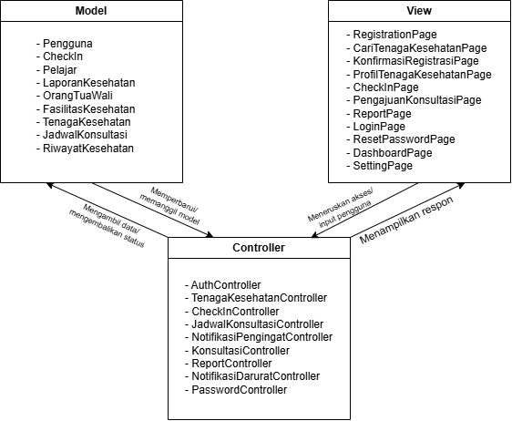
</p>
<p align="center">
<i>Gambar 1. Arsitektur MVC</i>
</p>
<br><br>

Tabel 1.1. Spesifikasi Lingkungan Operasi Perangkat Lunak
| Komponen | Spesifikasi |
| :--- | :--- |
| *Server Application* | Node.js v20.x LTS or Express.js |
| *Database Management System (DBMS)* | PostgreSQL 15+ |
| *Client Side (Perangkat Pengguna)* | Web browser modern |
| *External APIs & Services* | Geolocation API & Google Maps Platform |
| *External APIs & Services* | Google Calendar API |
| *External APIs & Services* | SMTP or Mail Service (Nodemailer/SendGrid) |
| *Operating System for Server* | Ubuntu Server 22.04 LTS or Linux Cloud Environment |
| *Protokol Keamanan* | HTTPS dengan sertifikat SSL/TLS & enkripsi AES-256 |

Kaitan teknologi dengan pola MVC yang dipilih:
1. Node.js dan Express.js sebagai lingkungan _Controller_
Node.js dan Express.js digunakan sebagai lingkungan _server-side_ untuk menjalankan logika aplikasi. Pada implementasi MVC, _route handler_ dan komponen _Controller_ yang dibangun menggunakan Express.js menangani _request_ dari _View_, mengatur alur pemrosesan, serta menghubungkan _View_ dengan _Model_.
2. PostgreSQL sebagai penyimpanan data _Model_
PostgreSQL digunakan sebagai DBMS untuk menyimpan data yang direpresentasikan oleh _Model_, seperti data pengguna, _daily check-in_, laporan kesehatan, fasilitas kesehatan, dan jadwal konsultasi. Dengan demikian, _Model_ menjadi bagian yang mengelola representasi dan akses terhadap data sistem.
3. Web UI sebagai _View_
Antarmuka berbasis _web_ responsif pada peramban pengguna berperan sebagai _View_ dalam pola MVC. Komponen seperti CheckInPage, ReportPage, dan PengajuanKonsultasiPage menyediakan antarmuka untuk menerima masukan pengguna serta menampilkan hasil pemrosesan sistem.
4. External APIs & Services sebagai integrasi yang diakses melalui _Controller_
Layanan eksternal seperti Geolocation API, Google Maps Platform, Google Calendar API, dan Mail Service digunakan untuk mendukung fungsi pencarian tenaga kesehatan, penjadwalan konsultasi, serta pengiriman notifikasi. Integrasi tersebut ditangani melalui alur pemrosesan pada _Controller_ sehingga detail layanan eksternal tidak perlu ditangani langsung oleh _View_.

## 2.3 Identifikasi Komponen / Modul / Subsistem

Tabel 2.3. Identifikasi Komponen/Modul/Subsistem

| Nama Komponen/Modul/Subsistem | Jenis                 | Penjelasan                                                                                                           |
| :---------------------------- | :-------------------- | :------------------------------------------------------------------------------------------------------------------- |
| *Pengguna*                 | *Model*                | *Merepresentasikan data akun pengguna yang dimiliki ketiga aktor.*     |
| *CheckIn*                 | *Model*                | *Merepresentasikan data hasil daily check-in pelajar berupa skala mood, durasi tidur, pola makan, faktor pemicu stress, catatan jurnal, dan tanggal pencatatannya.*     |
| *Pelajar*                 | *Model*                | *Merepresentasikan data akun pelajar yang melakukan registrasi, check-in harian, melihat statistik kondisi kesehatan, dan menentukan jadwal konsultasi dengan tenaga kesehatan.*     |
| *LaporanKesehatan*                 | *Model*                | *Menyimpan dan mengolah data hasil check-in menjadi data tren mingguan/bulanan, menyusun rangkuman kondisi kesehatan, dan menerapkan logika ambang batas untuk mendeteksi kondisi darurat pada pelajar.*     |
| *OrangTuaWali*                 | *Model*                | *Merepresentasikan data akun pengguna orang tua/wali yang mengonfirmasi registrasi akun pelajar di bawah umur, memantau laporan kondisi kesehatan pelajar, dan menerima serta menindaklanjuti notifikasi darurat.*     |
| *FasilitasKesehatan*                 | *Model*                | *Merepresentasikan data fasilitas kesehatan atau klinik yang direkomendasikan pada fitur pencarian, termasuk lokasi dan estimasi biaya konsultasi.*     |
| *TenagaKesehatan*                 | *Model*                | *Merepresentasikan data akun pengguna psikolog/psikiater yang dapat dipilih pelajar dari daftar rekomendasi dan meninjau pengajuan konsultasi yang masuk.*     |
| *JadwalKonsultasi*                 | *Model*                | *Merepresentasikan data pengajuan jadwal konsultasi antara pelajar dan tenaga kesehatan beserta statusnya.*     |
| *RiwayatKesehatan*                 | *Model*                | *Merepresentasikan data riwayat kesehatan mental dan kontak orang tua/wali yang diisi pelajar ketika proses registrasi akun.*     |
| *RegistrationPage*                 | *View*                | *Menampilkan formulir registrasi akun bagi pelajar.*     |
| *CariTenagaKesehatanPage*                 | *View*                | *Menampilkan daftar tenaga kesehatan, lokasi fasilitas kesehatan, estimasi biaya konsultasi, dan informasi jarak.*     |
| *ProfilTenagaKesehatanPage*               | *View*                | *Menampilkan profil tenaga kesehatan yang dipilih pelajar.*     |
| *CheckInPage*               | *View*                | *Menampilkan formulir pengisian daily check-in bagi pelajar.*     |
| *PengajuanKonsultasiPage*               | *View*                | *Menampilkan formulir pengajuan konsultasi serta jadwal yang dipilih oleh pelajar.*     |
| *ReportPage*                         | *View*                 | *Merepresentasikan antarmuka visualisasi grafik statistik, tren mingguan/bulanan, dan rangkuman kondisi.*                                                                                                                |
| *LoginPage*                         | *View*                 | *Merepresentasikan antarmuka login untuk pengguna serta fitur lupa password.*                                                                                                                |
| *ResetPasswordPage*                         | *View*                 | *Merepresentasikan antarmuka untuk memasukkan e-mail serta password baru.*                                                                                                                |
| *DashboardPage*                         | *View*                 | *Merepresentasikan antarmuka halaman utama setelah pengguna berhasil masuk akun.*                                                                                                                |
| *SettingPage*                         | *View*                 | *Merepresentasikan antarmuka halaman pengaturan/profil yang menyediakan opsi keluar akun.*                                                                                                                |
| *AuthController*                         | *Controller*                 | *Mengatur proses registrasi,login, dan logout, memvalidasi data akun pengguna, mengatur proses konfirmasi, perubahan status registrasi akun, sesi login, dan mengakhiri sesi login pengguna.*                                                                                                                |
| *TenagaKesehatanController*                         | *Controller*                 | *Mengatur proses pencarian tenaga kesehatan, pemrosesan izin akses lokasi, perhitungan jarak ke fasilitas kesehatan, dan pemilihan tenaga kesehatan.*                                                                                                                |
| *CheckInController*                         | *Controller*                 | *Mengatur proses penerimaan masukan, validasi format masukan, dan penyimpanan data check-in.*                                                                                                                |
| *JadwalKonsultasiController*                         | *Controller*                 | *Mengatur proses pemuatan jadwal, pengecekan dan pembaruan ketersediaan, dan pemilihan jadwal.*                                                                                                                |
| *NotifikasiPengingatController*                         | *Controller*                 | *Mengatur penjadwalan dan pengiriman notifikasi pengingat harian ke peramban pengguna.*                                                                                                                |
| *KonsultasiController*                         | *Controller*                 | *Mengatur proses pengelolaan pengajuan konsultasi, termasuk persetujuan dan perubahan jadwal.*                                                                                                                |
| *ReportController*                         | *Controller*                 | *Mengatur kalkulasi data statistik, pembuatan grafik, pembatasan filter privasi wali, serta evaluasi ambang batas.*                                                                                                                |
| *NotifikasiDaruratController*                         | *Controller*                 | *Mengatur pengiriman notifikasi darurat, pengambilan detail kondisi darurat, pencatatan konfirmasi penerimaan, dan pencatatan tindak lanjut.*                                                                                                                |
| *PasswordController*                         | *Controller*                 | *Mengatur reset password, termasuk pengiriman tautan reset.*                                                                                                                |

## 2.4 Model Arsitektur Perangkat Lunak

Pada bab ini, arsitektur perangkat lunak Mahasehat dimodelkan melalui dua *architectural view* yang saling melengkapi. *Logical View* (3.1) memperlihatkan pembagian komponen dan hubungan antarkomponen yang menyediakan fitur aplikasi, sedangkan *Physical View* (3.2) memperlihatkan perangkat atau *node* tempat setiap komponen dijalankan beserta jalur komunikasinya. Kedua *view* memuat 29 komponen pada Tabel 2.1 dengan nama yang sama persis, yaitu 9 *Model*, 10 *View*, dan 9 *Controller*, serta mengikuti pola MVC yang dipilih pada BAB 1. Setiap garis pada diagram diberi label agar hubungan antarkomponen dapat dipahami tanpa penjelasan tambahan.

### 2.4.1 View Logical

Logical View digunakan untuk mendeskripsikan abstraksi utama dalam aplikasi Mahasehat beserta hubungan antarobjek/kelas yang mendukung kebutuhan fungsional sistem. View ini berfokus pada hubungan antarobjek yang digunakan untuk menyediakan fitur dalam aplikasi.

Logical View cocok digunakan pada Mahasehat karena dapat membantu pembaca memahami pembagian fungsi dan hubungan layanan yang mendukung kebutuhan aplikasi. Mahasehat memiliki berbagai objek yang saling berhubungan dalam mendukung fungsi utamanya, salah satunya pemantauan kesehatan mental dan layanan konsultasi. Objek seperti Pelajar, OrangTuaWali, TenagaKesehatan, RiwayatKesehatan, dan JadwalKonsultasi memiliki keterhubungan satu sama lain dalam menyediakan layanan dalam aplikasi

<p align="center">
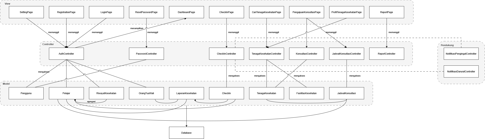
</p>
<p align="center">
<i>Gambar 2. Logical View</i>
</p>

### 2.4.2 View Physical

*Physical View* menggambarkan pemetaan komponen perangkat lunak ke perangkat (*node*) tempat komponen dijalankan beserta jalur komunikasinya.

*Physical View* dipilih untuk Mahasehat karena aplikasi ini adalah aplikasi web *client-server* yang bergantung pada layanan eksternal (lokasi, kalender, e-mail) dan menangani data kesehatan sensitif yang harus dilindungi saat transmisi dan penyimpanan. Pertanyaan yang dijawab oleh *view* ini adalah: di perangkat atau *node* mana setiap komponen dijalankan, dan melalui protokol apa komponen-komponen itu berkomunikasi. Jawabannya menunjukkan lingkungan operasi pada Tabel 1.1 dan penempatan komponen yang mendukung KNF01, KNF05, KNF08, dan KNF09. *View* ini menggambarkan seluruh sistem dan memuat 29 komponen pada Tabel 2.1 dengan nama yang sama persis, yaitu 9 *Model*, 11 *View*, dan 9 *Controller*, serta mengikuti pola MVC yang dipilih pada BAB 1.

<p align="center">
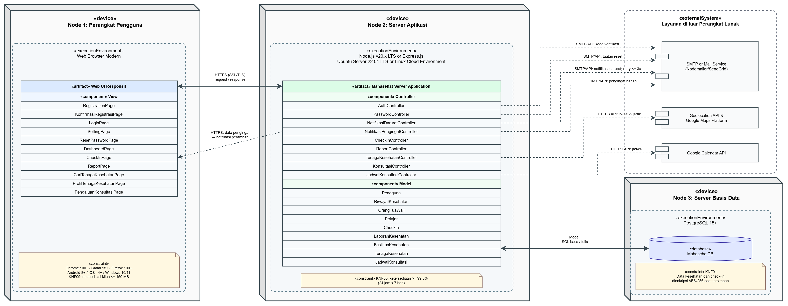
</p>
<p align="center">
<i>Gambar 3. Physical View Mahasehat (UML Deployment Diagram)</i>
</p>

Gambar 3 menggambarkan lingkungan operasi pada Tabel 1.1 dalam tiga *deployment node*. Ketiga layanan pihak ketiga ditempatkan pada batas `«externalSystem»`, bukan dianggap sebagai satu *node* milik Mahasehat, karena perangkat dan lingkungan eksekusinya berada di luar kendali perangkat lunak. Pembagian MVC terlihat pada artefak: *View* berada pada artefak sisi klien, sedangkan *Controller* dan *Model* berada pada artefak sisi server. Basis data diletakkan sejajar dengan *Model* sebagai pemilik akses data, dan layanan eksternal diletakkan sejajar dengan *Controller* sebagai pemilik integrasi, sehingga setiap jalur komunikasi dapat ditelusuri ke komponen asalnya tanpa garis yang saling bersilangan.

Notasi pada Gambar 3:

| Elemen UML | Penggunaan pada Mahasehat |
| :--- | :--- |
| `«device»` | Perangkat pengguna, server aplikasi, dan server basis data sebagai tiga *deployment node*. |
| `«executionEnvironment»` | Web browser modern, Node.js v20.x LTS or Express.js pada Linux, dan PostgreSQL 15+. |
| `«artifact»` | `Web UI Responsif` dan `Mahasehat Server Application` sebagai artefak yang dideploy. |
| `«component»` | Seluruh 29 komponen Tabel 2.1 yang diwujudkan oleh kedua artefak. |
| `«database»` | `MahasehatDB` sebagai penyimpanan persisten bagi seluruh *Model*. Nama ini adalah nama artefak deployment, bukan komponen tambahan pada Tabel 2.1. |
| `«externalSystem»` | Batas bagi Geolocation API/Google Maps, Google Calendar, dan Mail Service yang tidak dikelola Mahasehat. |
| `«constraint»` | Batas kompatibilitas dan memori klien (KNF08–KNF09), ketersediaan server aplikasi (KNF05), serta enkripsi data saat tersimpan (KNF01). |
| Garis berpanah | *Communication path* yang diberi protokol dan, untuk layanan eksternal, keluar dari *controller* yang bertanggung jawab. Garis putus-putus menunjukkan komunikasi event atau pemanggilan layanan eksternal. |

Komponen pada tiap artefak disusun berurutan satu per satu sesuai Tabel 2.1 hanya untuk mencantumkan seluruh komponen; urutan baris tidak menyatakan relasi antarkomponen. Hubungan logis antarkomponen dijelaskan pada Logical View (3.1) dan diagram kelas M4.

### 2.4.2.1 Pemetaan Komponen ke *Node*

Tabel 3.4. Pemetaan komponen ke *node*

| *Node* | *Execution environment* (Tabel 1.1) | Artefak | Keterangan (komponen Tabel 2.1 yang ditempatkan) |
| :--- | :--- | :--- | :--- |
| Node 1: Perangkat Pengguna (`«device»`) | *Client Side (Perangkat Pengguna)*: Web browser modern. Sesuai KNF08: Chrome 100+, Safari 15+, dan Firefox 100+ pada Android 8.0+, iOS 14+, dan Windows 10/11 | Antarmuka web responsif (halaman *View*) | Seluruh *View*: `RegistrationPage`, `KonfirmasiRegistrasiPage`, `LoginPage`, `ResetPasswordPage`, `DashboardPage`, `SettingPage`, `CheckInPage`, `ReportPage`, `CariTenagaKesehatanPage`, `ProfilTenagaKesehatanPage`, `PengajuanKonsultasiPage`. Kendala: memori sisi klien maksimal 150 MB (KNF09) |
| Node 2: Server Aplikasi (`«device»`) | *Server Application*: Node.js v20.x LTS or Express.js; *Operating System for Server*: Ubuntu Server 22.04 LTS or Linux Cloud Environment | Aplikasi *server-side* berisi *route handler* dan logika *Controller* | Seluruh *Controller*: `AuthController`, `PasswordController`, `NotifikasiDaruratController`, `NotifikasiPengingatController`, `CheckInController`, `ReportController`, `TenagaKesehatanController`, `KonsultasiController`, `JadwalKonsultasiController`. Kendala: ketersediaan minimal 99,5% (KNF05) |
| Node 2: Server Aplikasi (`«device»`) | Sama dengan baris di atas | Kelas *Model* yang merepresentasikan dan mengakses data | Seluruh *Model*: `Pengguna`, `RiwayatKesehatan`, `OrangTuaWali`, `Pelajar`, `CheckIn`, `LaporanKesehatan`, `FasilitasKesehatan`, `TenagaKesehatan`, `JadwalKonsultasi` |
| Node 3: Server Basis Data (`«device»`) | *Database Management System (DBMS)*: PostgreSQL 15+ | Skema basis data dan data persisten milik seluruh *Model* | Data kesehatan dan *check-in* dienkripsi AES-256 saat tersimpan sesuai KNF01 |
| Batas sistem eksternal (`«externalSystem»`, di luar P/L) | *External APIs & Services*; bukan lingkungan eksekusi yang dikelola Mahasehat | Antarmuka API dan layanan pihak ketiga | Geolocation API & Google Maps Platform, Google Calendar API, SMTP or Mail Service (Nodemailer/SendGrid). Tidak termasuk Tabel 2.1 |

### 2.4.2.2 Jalur Komunikasi

Tabel 3.5. Jalur komunikasi antar-*node*

| Dari → Ke | Label pada Gambar 3 | Keterangan |
| :--- | :--- | :--- |
| Node 1 ↔ Node 2 | HTTPS (SSL/TLS): *request/response* | *View* di peramban mengirim *request* ke *route handler Controller*, kemudian server mengembalikan hasil pemrosesan melalui kanal terenkripsi yang sama. |
| Node 2 → Node 1 | HTTPS: data pengingat → notifikasi peramban | `NotifikasiPengingatController` mengirim data pengingat harian ke peramban pelajar sesuai spesifikasi komponen pada SKPL dan Tabel 2.1, dan peramban mengarahkan pelajar ke `CheckInPage` (UC03). Jalur ini tidak menambahkan layanan *push* eksternal yang tidak disebutkan dalam SKPL. |
| Node 2 ↔ Node 3 | Model: SQL baca / tulis | *Model* membaca dan menulis data ke PostgreSQL. Panah ini berasal dari *Model*, bukan dari *Controller*, karena *Controller* hanya mengakses data melalui *Model*. SKPL menetapkan AES-256 untuk data kesehatan dan *check-in* saat tersimpan, bukan untuk seluruh data tanpa pengecualian. |
| Controller → Geolocation API & Google Maps Platform | HTTPS API: lokasi & jarak | `TenagaKesehatanController` memanggil Geolocation API dan Google Maps Platform untuk lokasi dan jarak ke fasilitas kesehatan (KNF03). |
| Controller → Google Calendar API | HTTPS API: jadwal | `JadwalKonsultasiController` memanggil Google Calendar API untuk ketersediaan dan pengajuan jadwal. |
| Controller → SMTP or Mail Service | SMTP/API: kode verifikasi | `AuthController` mengirim kode verifikasi dan konfirmasi registrasi melalui Mail Service. |
| Controller → SMTP or Mail Service | SMTP/API: tautan reset | `PasswordController` mengirim tautan reset *password* melalui Mail Service. |
| Controller → SMTP or Mail Service | SMTP/API: notifikasi darurat; retry <= 3x | `NotifikasiDaruratController` mengirim notifikasi darurat melalui Mail Service. Saat transmisi gagal, *controller* ini mengulang pengiriman otomatis maksimal tiga kali sesuai KNF06. |
| Controller → SMTP or Mail Service | SMTP/API: pengingat harian | `NotifikasiPengingatController` juga mengirim pengingat harian melalui Mail Service, karena SKPL pada bagian lingkungan operasi menyebut *Mail Server* digunakan untuk mengirim pengingat, notifikasi darurat, dan informasi akun. Pengingat ini melengkapi jalur notifikasi peramban di atas. |

### 2.4.2.3 Alasan Penempatan

1. ***View* di sisi klien, *Controller* dan *Model* di sisi server.** *View* berupa antarmuka web responsif yang dijalankan pada kombinasi peramban dan sistem operasi dalam KNF08. Logika bisnis dan akses data ditempatkan di server agar tidak bergantung pada perangkat pengguna. Batas memori sisi klien maksimal 150 MB (KNF09) dicantumkan sebagai kendala deployment; penempatan ini membantu mengurangi beban klien, tetapi pemenuhannya tetap harus diukur saat implementasi.
2. **Hak akses dan privasi ditegakkan di server (KNF02).** Pembatasan data orang tua/wali, termasuk tidak diberikannya teks jurnal pelajar, dijalankan oleh *Controller* pada Node 2, bukan oleh *View* di perangkat pengguna yang berada di luar kendali sistem.
3. **Basis data dipisahkan dari server aplikasi.** Pemisahan ini memberi batas perlindungan dan pengelolaan tersendiri untuk data kesehatan (AES-256, KNF01), sekaligus memungkinkan strategi pencadangan dan penskalaan diterapkan secara terpisah. Pemisahan *node* saja belum menjamin ketersediaan 99,5% (KNF05); pencapaiannya tetap memerlukan pemantauan, pencadangan, dan mekanisme pemulihan pada tahap implementasi dan operasi.
4. **Layanan eksternal hanya diakses dari server.** Kunci API dan detail layanan eksternal tidak ditangani langsung oleh *View*, sesuai pernyataan pada BAB 1 bahwa integrasi layanan eksternal ditangani melalui *Controller*. Setiap koneksi ke layanan eksternal pada Gambar 3 keluar dari baris *controller* pemilik integrasinya agar keputusan deployment dapat ditelusuri kembali ke Tabel 2.1.
5. **Komunikasi peramban ke server memakai kanal terenkripsi.** Jalur Node 1 ↔ Node 2 memakai HTTPS dengan sertifikat SSL/TLS sesuai protokol keamanan pada Tabel 1.1, sedangkan data kesehatan dan *check-in* yang tersimpan di basis data dienkripsi AES-256 (KNF01). Pengamanan koneksi antara server aplikasi dan basis data tidak ditetapkan pada SKPL sehingga diputuskan pada tahap implementasi.

<br>

---


# BAB 3: Realisasi Use Case

## 3.1 Use Case Melakukan Registrasi Akun

**ID Use Case:** *UC01*  
**Nama Use Case:** *Melakukan Registrasi Akun*

### 3.1.1 Identifikasi Kelas

Tabel 3.1. Identifikasi Kelas Use Case [UC01]

| No | Nama Kelas Perancangan | Nama Kelas Analisis Terkait |
|:--- | :--- | :--- |
| 1 | *RegistrasiPage* | *RegistrasiPage* |
| 2 | *AuthController* | *AuthController* |
| 3 | *Pengguna* | *Pengguna* |

### 3.1.2 Sequence Diagram

- **Skenario Normal**

<p align="center">
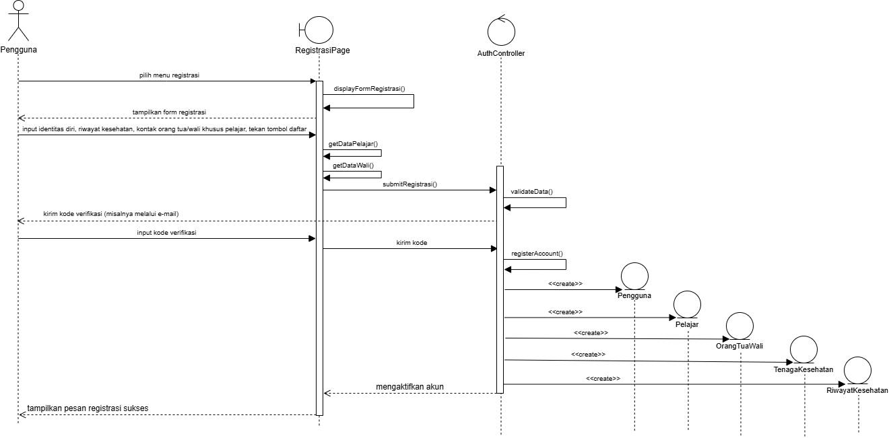
</p>
<p align="center">
<i>Gambar 3.1.1. Sequence Diagram [UC01]</i>
</p>

- **Skenario Alternatif 1: Masukan Pengguna Tidak Valid**

<p align="center">
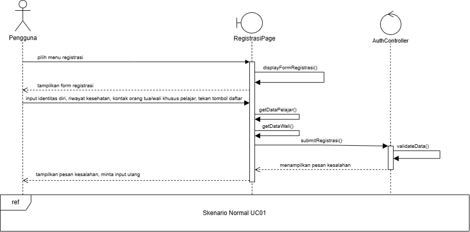
</p>
<p align="center">
<i>Gambar 3.1.2. Sequence Diagram [UC01] - [Masukan Pengguna Tidak Valid]</i>
</p>

### 3.1.3 Diagram Kelas

<p align="center">
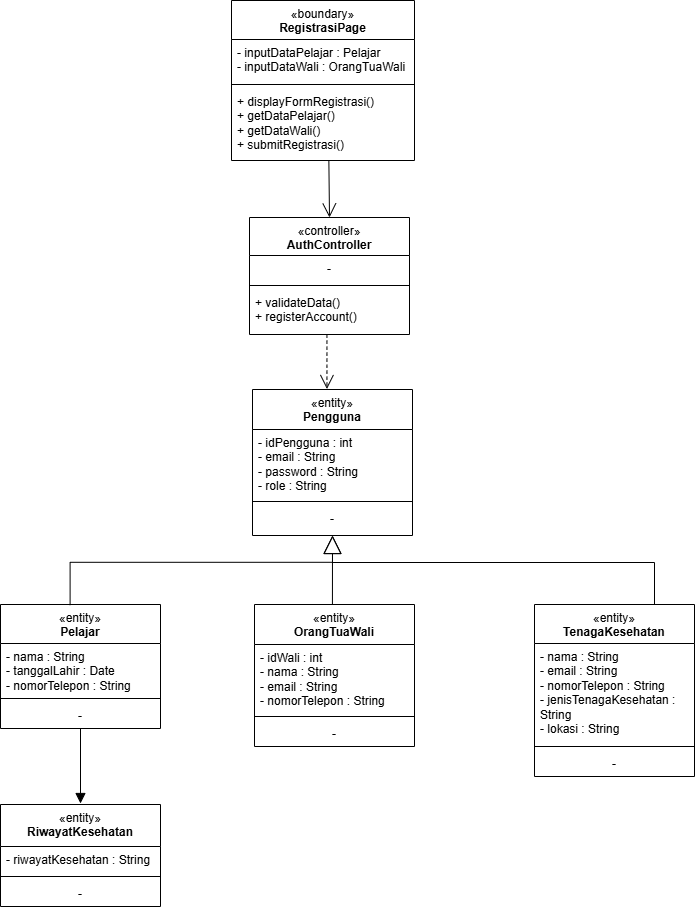
</p>
<p align="center">
<i>Gambar 3.1.3. Diagram Kelas [Melakukan Registrasi Akun]</i>
</p>

## 3.2 Use Case Mengonfirmasi Registrasi Akun

**ID Use Case:** *UC02*  
**Nama Use Case:** *Mengonfirmasi Registrasi Akun*

### 3.2.1 Identifikasi Kelas

Tabel 3.2. Identifikasi Kelas Use Case [UC02]

| No | Nama Kelas Perancangan | Nama Kelas Analisis Terkait |
|:--- | :--- | :--- |
| 1 | *KonfirmasiRegistrasiPage* | *KonfirmasiRegistrasiPage* |
| 2 | *AuthController* | *AuthController* |
| 3 | *OrangTuaWali* | *OrangTuaWali* |
| 4 | *Pelajar* | *Pelajar* |

### 3.2.2 Sequence Diagram

- **Skenario Normal**

<p align="center">
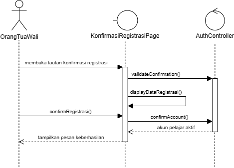
</p>
<p align="center">
<i>Gambar 3.2.1. Sequence Diagram [UC02]</i>
</p>

- **Skenario Alternatif 1: Orang Tua/Wali Tidak Mengonfirmasi Registrasi Akun**

<p align="center">
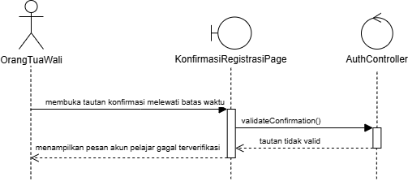
</p>
<p align="center">
<i>Gambar 3.2.2. Sequence Diagram [UC02] - [Orang Tua/Wali Tidak Mengonfirmasi Registrasi Akun]</i>
</p>

### 3.2.3 Diagram Kelas

<p align="center">
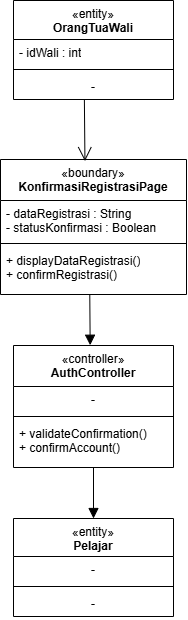
</p>
<p align="center">
<i>Gambar 3.2.3. Diagram Kelas [Mengonfirmasi Registrasi Akun]</i>
</p>


## 3.3 Use Case Melakukan Daily Check-in

**ID Use Case:** *UC03*  
**Nama Use Case:** *Melakukan Daily Check-in*

### 3.3.1 Identifikasi Kelas


Tabel 3.1. Identifikasi Kelas Use Case [UC03]

| No | Nama Kelas Perancangan | Nama Kelas Analisis Terkait |
|:--- | :--- | :--- |
| 1 | *Pelajar* | *Pelajar* |
| 2 | *CheckIn* | *CheckIn* |
| 3 | *CheckInPage* | *CheckInPage* |
| 4 | *CheckInController* | *CheckInController* |
| 5 | *NotificationPengingatController* | *NotificationPengingatController* |

### 3.3.2 Sequence Diagram

- **Skenario Normal**

<p align="center">
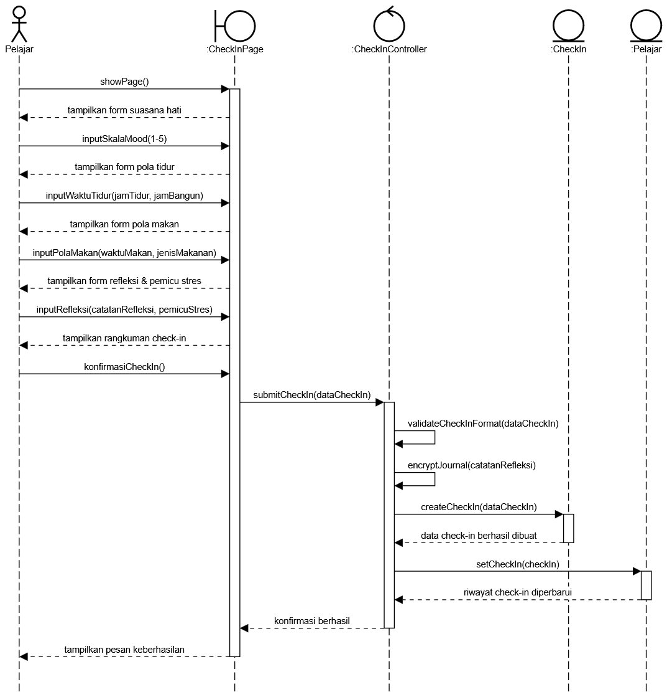
</p>
<p align="center">
<i>Gambar 3.3.1. Sequence Diagram [UC03]</i>
</p>

- **Skenario Alternatif 1: Pelajar Tidak Mengisi Catatan Refleksi Harian**

<p align="center">
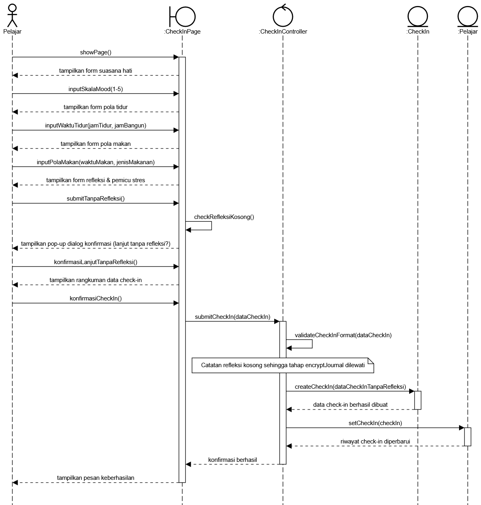
</p>
<p align="center">
<i>Gambar 3.3.2. Sequence Diagram [UC03] - [Pelajar Tidak Mengisi Catatan Refleksi Harian]</i>
</p>

### 3.3.3 Diagram Kelas

<p align="center">
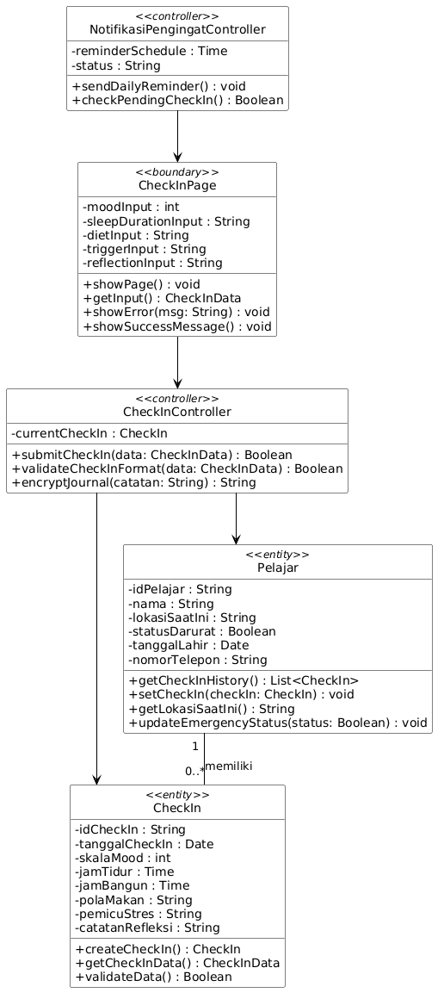
</p>
<p align="center">
<i>Gambar 3.3.3. Diagram Kelas [Melakukan Daily Check-In]</i>
</p>

## 3.4 Use Case Melihat Statistik dan Laporan Kondisi

**ID Use Case:** *UC04*  
**Nama Use Case:** *Melihat Statistik dan Laporan Kondisi*

### 3.4.1 Identifikasi Kelas

Tabel 3.4. Identifikasi Kelas Use Case [UC04]

| No | Nama Kelas Perancangan | Nama Kelas Analisis Terkait |
|:--- | :--- | :--- |
| 1 | *Pelajar* | *Pelajar* |
| 2 | *OrangTuaWali* | *OrangTuaWali* |
| 3 | *CheckIn* | *CheckIn* |
| 4 | *LaporanKesehatan* | *LaporanKesehatan* |
| 5 | *ReportPage* | *ReportPage* |
| 6 | *ReportController* | *ReportController* |

### 3.4.2 Sequence Diagram

- **Skenario Normal**

<p align="center">
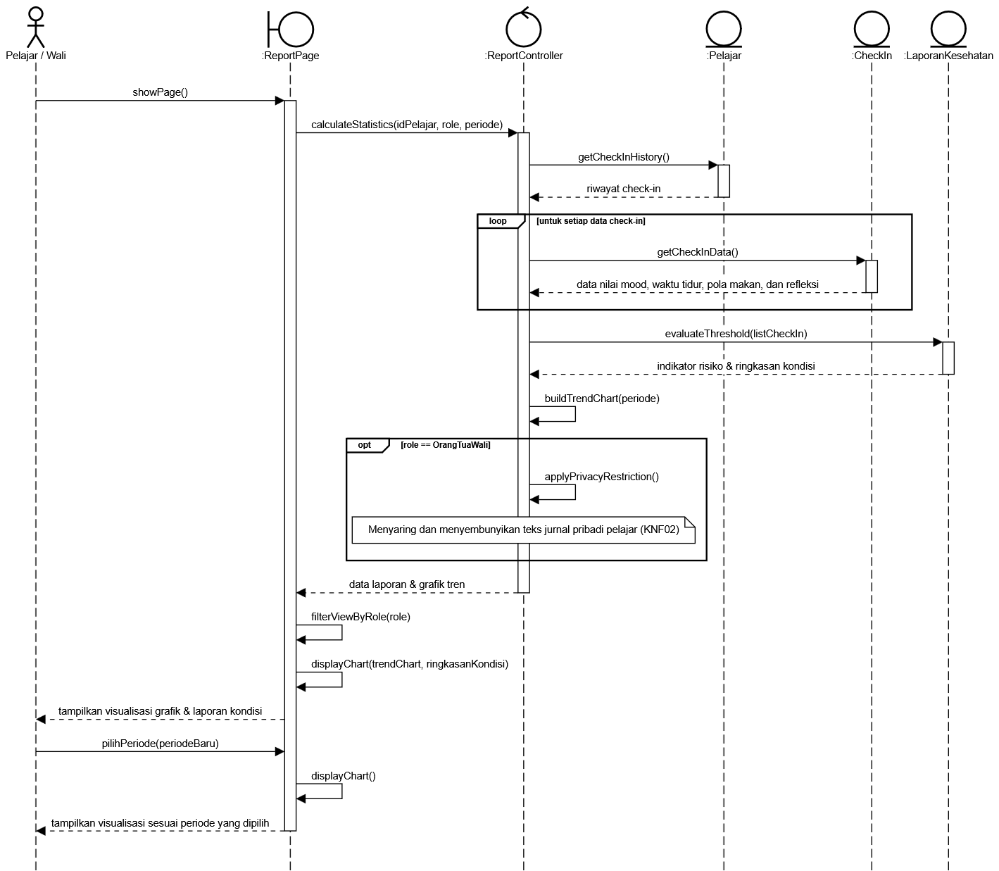
</p>
<p align="center">
<i>Gambar 3.4.1. Sequence Diagram [UC04]</i>
</p>

- **Skenario Alternatif 1: Data Check-In Belum Dapat Divisualisasikan**

<p align="center">
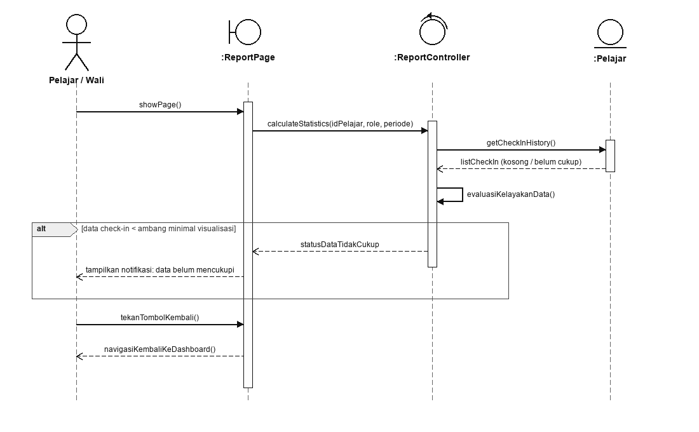
</p>
<p align="center">
<i>Gambar 3.4.2. Sequence Diagram [UC04] - [Data Check-In Belum Dapat Divisualisasikan]</i>
</p>

### 3.4.3 Diagram Kelas

<p align="center">
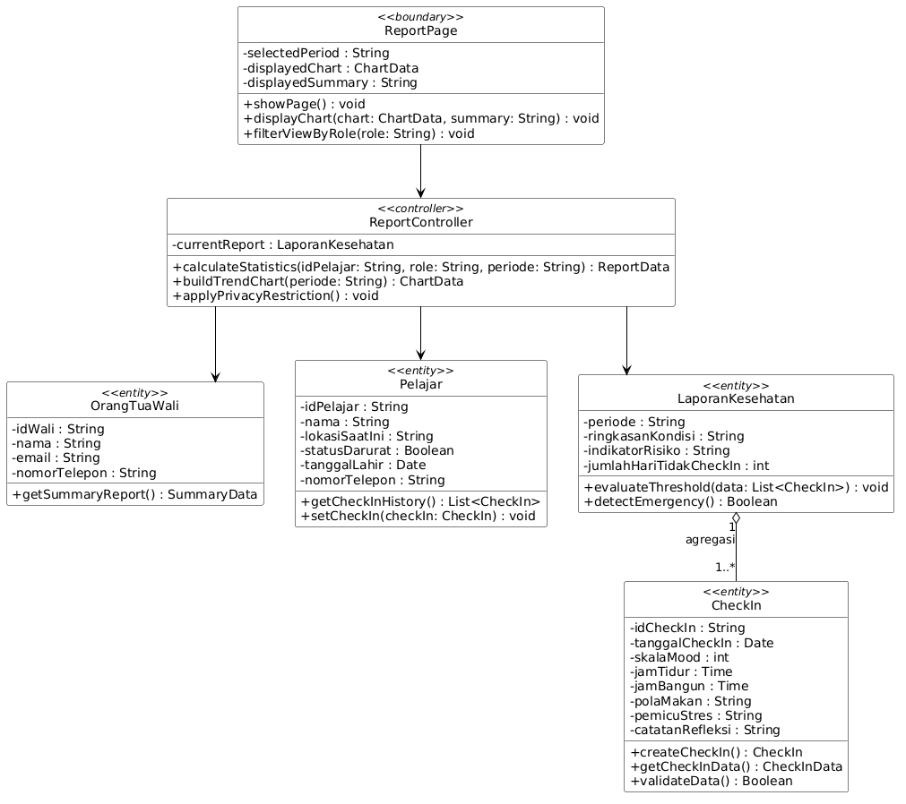
</p>
<p align="center">
<i>Gambar 3.4.3. Diagram Kelas [Melihat Statistik dan Laporan Kondisi]</i>
</p>

## 3.5 Use Case Menentukan Tenaga Kesehatan

**ID Use Case:** *UC05*  
**Nama Use Case:** *Menentukan Tenaga Kesehatan*

### 3.5.1 Identifikasi Kelas

Tabel 3.5. Identifikasi Kelas Use Case [UC05]

| No | Nama Kelas Perancangan | Nama Kelas Analisis Terkait |
|:--- | :--- | :--- |
| 1 | *CariTenagaKesehatanPage* | *CariTenagaKesehatanPage* |
| 2 | *ProfilTenagaKesehatanPage* | *ProfilTenagaKesehatanPage* |
| 3 | *TenagaKesehatanController* | *TenagaKesehatanController* |
| 4 | *Pelajar* | *Pelajar* |
| 5 | *TenagaKesehatan* | *TenagaKesehatan* |
| 6 | *FasilitasKesehatan* | *FasilitasKesehatan* |

### 3.5.2 Sequence Diagram

- **Skenario Normal**

<p align="center">
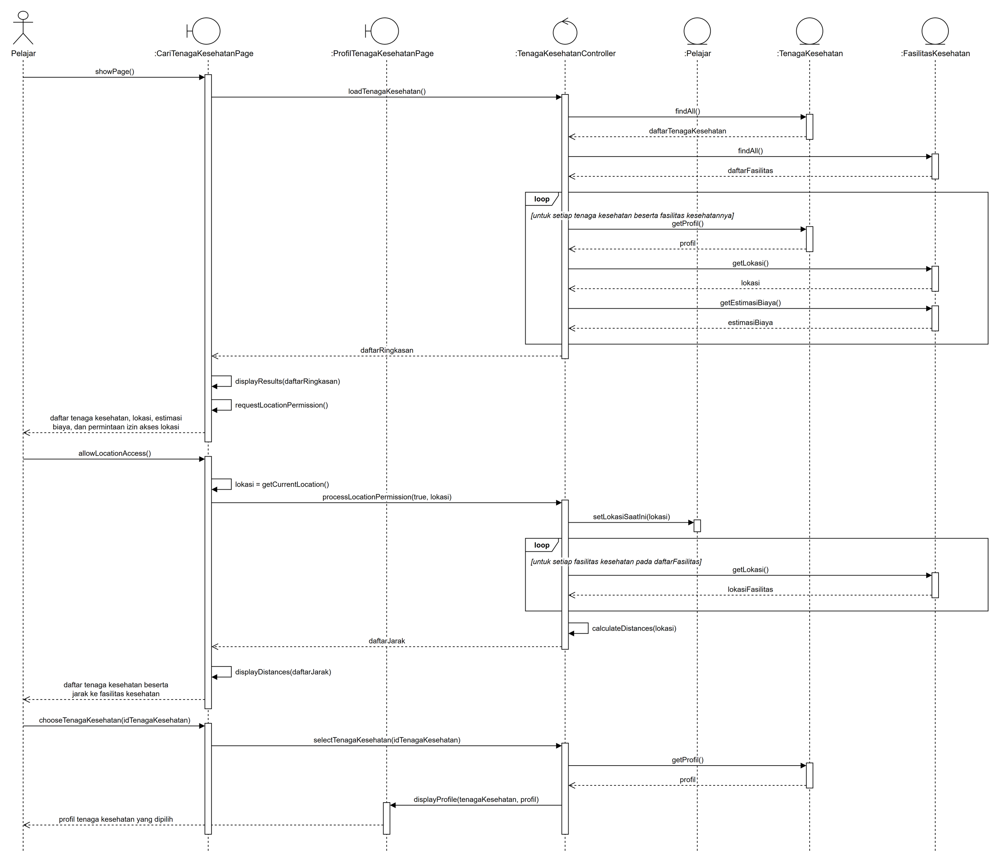
</p>
<p align="center">
<i>Gambar 3.5.1. Sequence Diagram [UC05]</i>
</p>

Pelajar membuka halaman pencarian, lalu `TenagaKesehatanController` memuat daftar `TenagaKesehatan` dan `FasilitasKesehatan`, kemudian mengambil profil, lokasi, dan estimasi biaya konsultasi untuk disusun menjadi daftar ringkasan. Setelah pelajar memberikan izin akses lokasi, lokasi perangkat dicatat pada `Pelajar`, lalu controller mengambil lokasi setiap fasilitas kesehatan dan menghitung jaraknya melalui `calculateDistances()`. Ketika pelajar memilih salah satu tenaga kesehatan, controller mengambil profilnya dan menampilkannya melalui `ProfilTenagaKesehatanPage`.

- **Skenario Alternatif 1: Akses Lokasi Tidak Diberikan**

<p align="center">
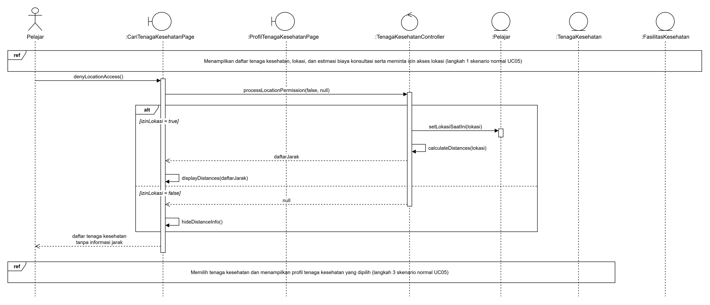
</p>
<p align="center">
<i>Gambar 3.5.2. Sequence Diagram [UC05] - [Akses Lokasi Tidak Diberikan]</i>
</p>

Langkah 1 dan langkah 3 sama dengan skenario normal sehingga dirujuk dengan fragmen `ref`. Ketika pelajar menolak izin akses lokasi, `processLocationPermission(false, null)` masuk ke cabang `[izinLokasi = false]`: lokasi tidak disimpan dan jarak tidak dihitung, sehingga halaman tetap menampilkan daftar tenaga kesehatan tanpa informasi jarak.

### 3.5.3 Diagram Kelas

<p align="center">
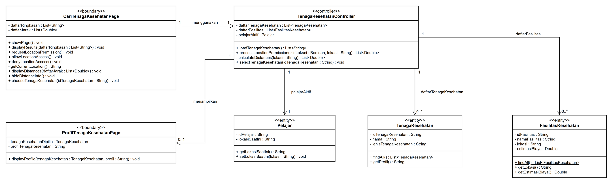
</p>
<p align="center">
<i>Gambar 3.5.3. Diagram Kelas [Menentukan Tenaga Kesehatan]</i>
</p>

## 3.6 Use Case Mengajukan Jadwal Konsultasi

**ID Use Case:** *UC06*  
**Nama Use Case:** *Mengajukan Jadwal Konsultasi*

### 3.6.1 Identifikasi Kelas

Tabel 3.6. Identifikasi Kelas Use Case [UC06]

| No | Nama Kelas Perancangan | Nama Kelas Analisis Terkait |
|:--- | :--- | :--- |
| 1 | *ProfilTenagaKesehatanPage* | *ProfilTenagaKesehatanPage* |
| 2 | *PengajuanKonsultasiPage* | *PengajuanKonsultasiPage* |
| 3 | *JadwalKonsultasiController* | *JadwalKonsultasiController* |
| 4 | *Pelajar* | *Pelajar* |
| 5 | *TenagaKesehatan* | *TenagaKesehatan* |
| 6 | *JadwalKonsultasi* | *JadwalKonsultasi* |

### 3.6.2 Sequence Diagram

- **Skenario Normal**

<p align="center">
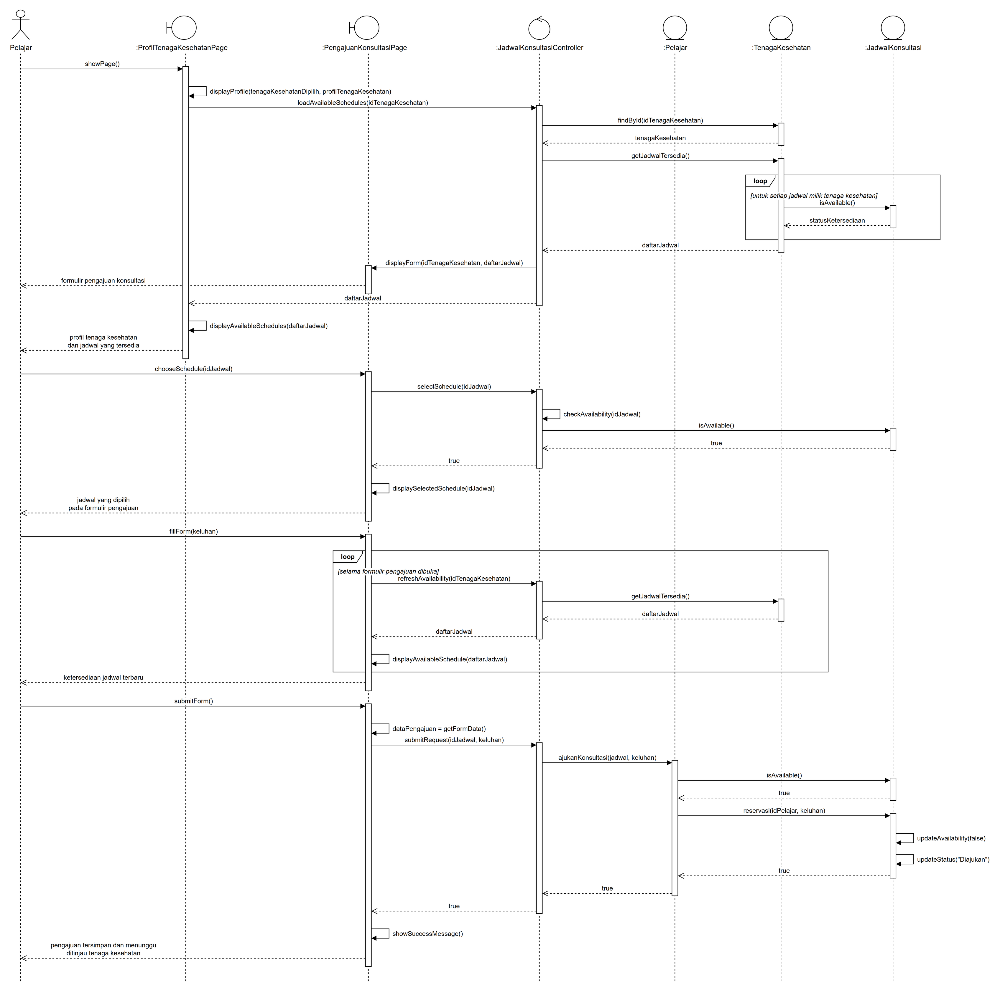
</p>
<p align="center">
<i>Gambar 3.6.1. Sequence Diagram [UC06]</i>
</p>

`ProfilTenagaKesehatanPage` meminta jadwal yang tersedia kepada `JadwalKonsultasiController`, dan `TenagaKesehatan` menyusun daftar jadwalnya dengan menanyakan ketersediaan setiap `JadwalKonsultasi`. Controller kemudian menampilkan formulir pengajuan pada `PengajuanKonsultasiPage`, sedangkan profil dan jadwal yang tersedia ditampilkan pada halaman profil. Jadwal yang dipilih pelajar diperiksa kembali sebelum ditampilkan pada formulir, dan selama formulir dibuka ketersediaan jadwal diperbarui berulang (fragmen `loop`). Saat pengajuan dikirim, `Pelajar` yang mengajukan konsultasi: `JadwalKonsultasi` memeriksa ketersediaannya sendiri, lalu mengubah status ketersediaan dan status pengajuannya menjadi "Diajukan" agar dapat ditinjau tenaga kesehatan.

- **Skenario Alternatif 1: Jadwal Konsultasi Tidak Lagi Tersedia**

<p align="center">
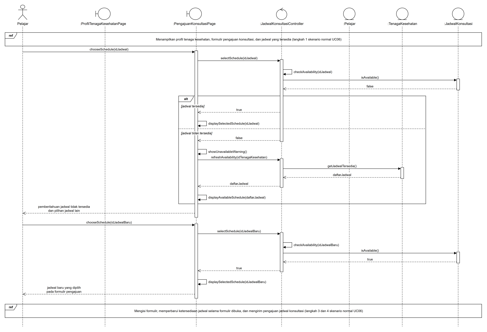
</p>
<p align="center">
<i>Gambar 3.6.2. Sequence Diagram [UC06] - [Jadwal Konsultasi Tidak Lagi Tersedia]</i>
</p>

Ketika `isAvailable()` mengembalikan `false`, cabang `[jadwal tidak tersedia]` menampilkan pemberitahuan dan memuat ulang pilihan jadwal lain. Pelajar kemudian memilih jadwal baru yang diperiksa ulang hingga tersedia. Langkah awal serta pengisian dan pengiriman formulir sama dengan skenario normal sehingga dirujuk dengan fragmen `ref`.

### 3.6.3 Diagram Kelas

<p align="center">
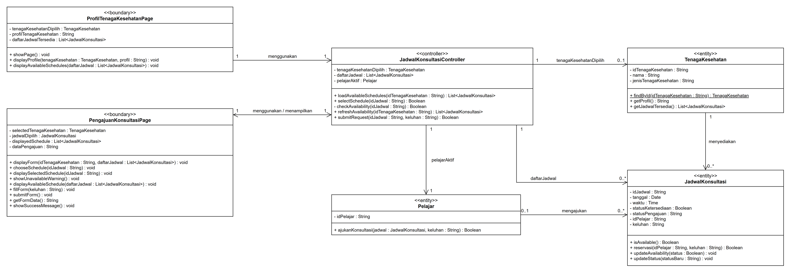
</p>
<p align="center">
<i>Gambar 3.6.3. Diagram Kelas [Mengajukan Jadwal Konsultasi]</i>
</p>

## 3.7 Use Case Mengelola Pengajuan Konsultasi

**ID Use Case:** *UC07*  
**Nama Use Case:** *Mengelola Pengajuan Konsultasi*

### 3.7.1 Identifikasi Kelas

Tabel 3.7. Identifikasi Kelas Use Case [UC07]

| No | Nama Kelas Perancangan | Nama Kelas Analisis Terkait |
|:--- | :--- | :--- |
| 1 | *PengajuanKonsultasiPage* | *PengajuanKonsultasiPage* |
| 2 | *KonsultasiController* | *KonsultasiController* |
| 3 | *JadwalKonsultasi* | *JadwalKonsultasi* |
| 4 | *Pelajar* | *Pelajar* |
| 5 | *TenagaKesehatan* | *TenagaKesehatan* |

### 3.7.2 Sequence Diagram

- **Skenario Normal**

<p align="center">
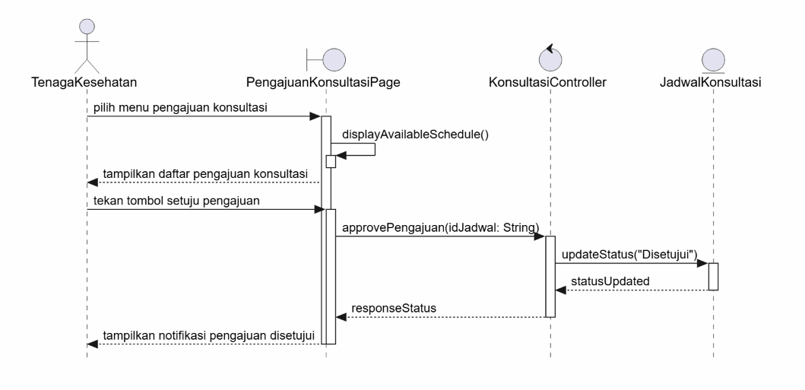
</p>
<p align="center">
<i>Gambar 3.7.1. Sequence Diagram [UC07]</i>
</p>

- **Skenario Alternatif 1: Reschedule Jadwal Konsultasi**

<p align="center">
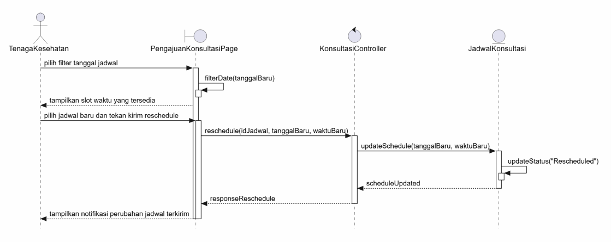
</p>
<p align="center">
<i>Gambar 3.7.2. Sequence Diagram [UC07] - [Reschedule Jadwal Konsultasi]</i>
</p>

### 3.7.3 Diagram Kelas
<p align="center">
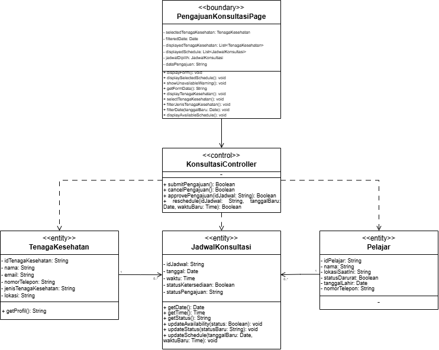
</p>
<p align="center">
<i>Gambar 3.7.3. Diagram Kelas [Mengelola Pengajuan Konsultasi]</i>
</p>

## 3.8 Use Case Menerima dan Menindaklanjuti Notifikasi Darurat

**ID Use Case:** *UC08*
**Nama Use Case:** *Menerima dan Menindaklanjuti Notifikasi Darurat*

### 3.8.1 Identifikasi Kelas

Tabel 3.8. Identifikasi Kelas Use Case [UC08]

| No | Nama Kelas Perancangan | Nama Kelas Analisis Terkait |
|:--- | :--- | :--- |
| 1 | *Pelajar* | *Pelajar* |
| 2 | *OrangTuaWali* | *OrangTuaWali* |
| 3 | *LaporanKesehatan* | *LaporanKesehatan* |
| 4 | *NotifikasiDaruratController* | *NotifikasiDaruratController* |

### 3.8.2 Sequence Diagram

- **Skenario Normal**

<p align="center">
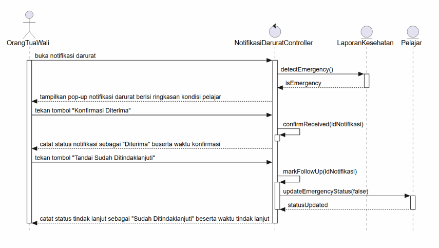
</p>
<p align="center">
<i>Gambar 3.8.1. Sequence Diagram [UC08]</i>
</p>

- **Skenario Alternatif 1: Notifikasi Darurat Tidak Direspon**

<p align="center">
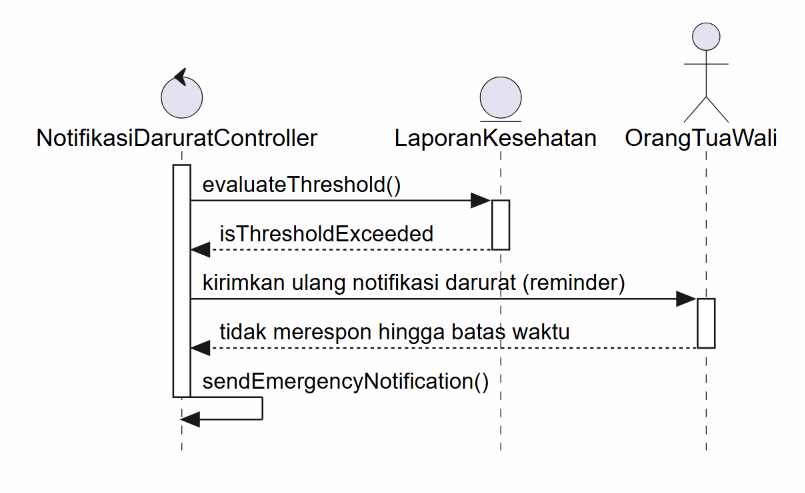
</p>
<p align="center">
<i>Gambar 3.8.2. Sequence Diagram [UC08] - Notifikasi Darurat Tidak Direspon</i>
</p>

### 3.8.3 Diagram Kelas
<p align="center">
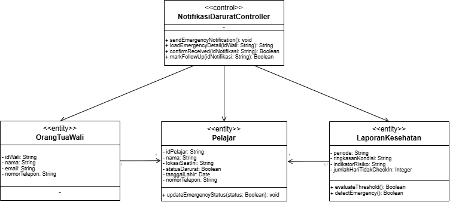
</p>
<p align="center">
<i>Gambar 3.8.3. Diagram Kelas [Menerima dan Menindaklanjuti Notifikasi Darurat]</i>
</p>

## 3.9 Use Case Masuk Akun Pengguna

**ID Use Case:** *UC09*  
**Nama Use Case:** *Masuk Akun Pengguna*

### 3.9.1 Identifikasi Kelas

Tabel 3.9. Identifikasi Kelas Use Case [UC09]

| No | Nama Kelas Perancangan | Nama Kelas Analisis Terkait |
|:--- | :--- | :--- |
| 1 | *Pengguna* | *Pengguna* |
| 2 | *LoginPage* | *LoginPage* |
| 3 | *AuthController* | *AuthController* |
| 4 | *ResetPasswordPage* | *ResetPasswordPage* |
| 5 | *PasswordController* | *PasswordController* |
| 6 | *DashboardPage* | *DashboardPage* |

### 3.9.2 Sequence Diagram

- **Skenario Normal**

<p align="center">
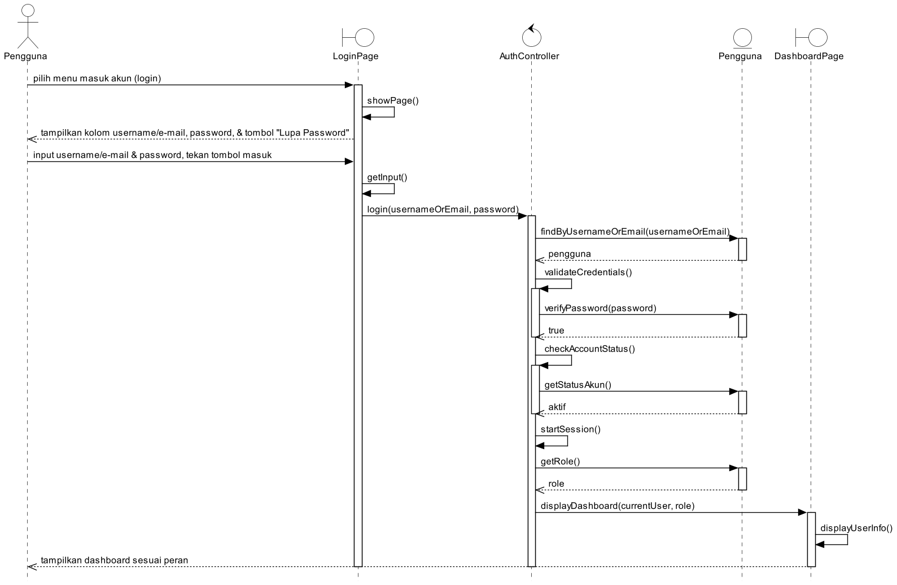
</p>
<p align="center">
<i>Gambar 3.9.1. Sequence Diagram [UC09]</i>
</p>

- **Skenario Alternatif 1: Kredensial Tidak Valid**

<p align="center">
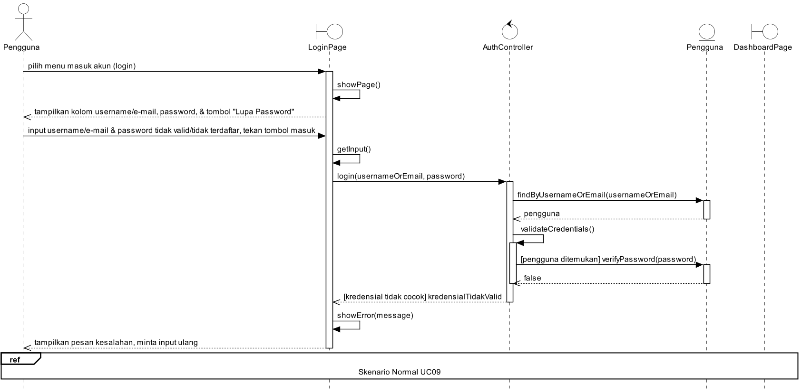
</p>
<p align="center">
<i>Gambar 3.9.2. Sequence Diagram [UC09] - [Kredensial Tidak Valid]</i>
</p>

- **Skenario Alternatif 2: Akun Belum Terverifikasi**

<p align="center">
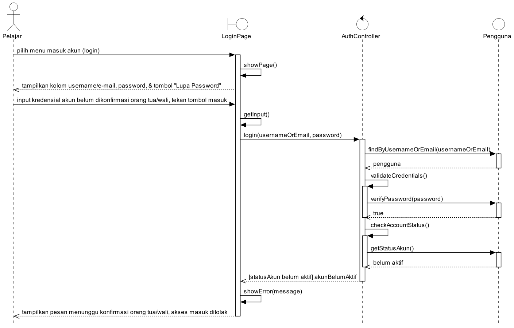
</p>
<p align="center">
<i>Gambar 3.9.3. Sequence Diagram [UC09] - [Akun Belum Terverifikasi]</i>
</p>

- **Skenario Alternatif 3: Lupa Password**

<p align="center">
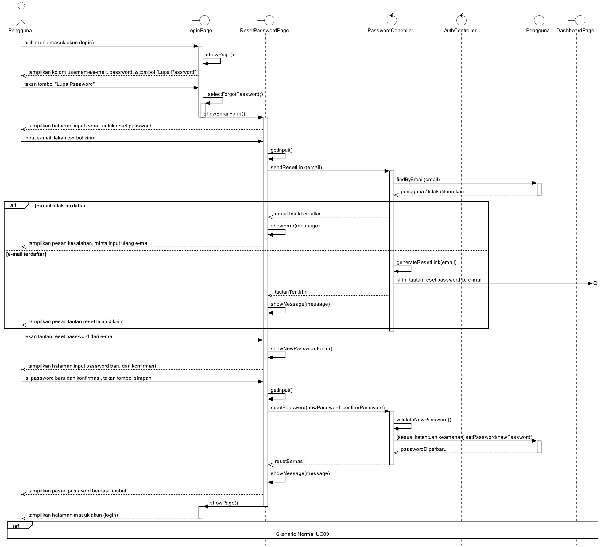
</p>
<p align="center">
<i>Gambar 3.9.4. Sequence Diagram [UC09] - [Lupa Password]</i>
</p>

### 3.9.3 Diagram Kelas

<p align="center">
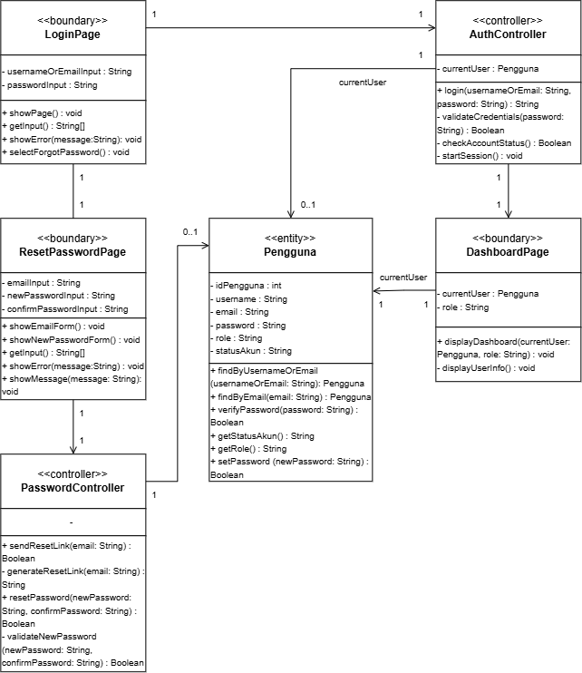
</p>
<p align="center">
<i>Gambar 3.9.5. Diagram Kelas [Masuk Akun Pengguna]</i>
</p>

## 3.10 Use Case Keluar Akun Pengguna

**ID Use Case:** *UC10*  
**Nama Use Case:** *Keluar Akun Pengguna*

### 3.10.1 Identifikasi Kelas

Tabel 3.10. Identifikasi Kelas Use Case [UC10]

| No | Nama Kelas Perancangan | Nama Kelas Analisis Terkait |
|:--- | :--- | :--- |
| 1 | *Pengguna* | *Pengguna* |
| 2 | *SettingPage* | *SettingPage* |
| 3 | *AuthController* | *AuthController* |
| 4 | *LoginPage* | *LoginPage* |

### 3.10.2 Sequence Diagram

- **Skenario Normal**

<p align="center">
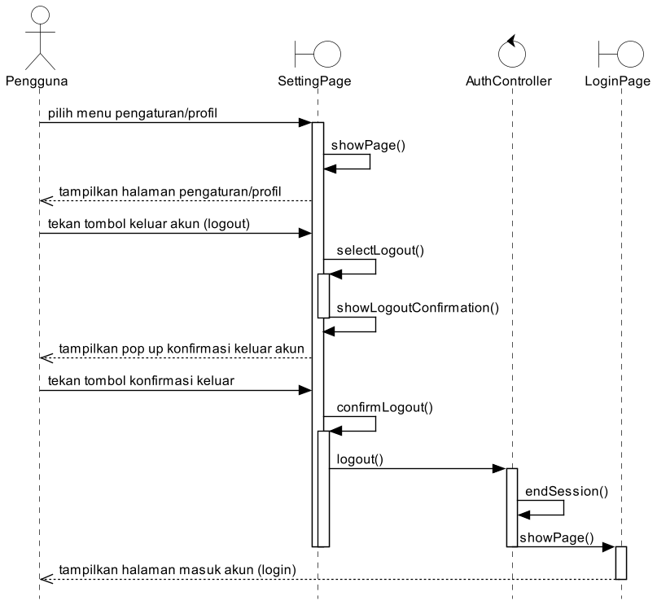
</p>
<p align="center">
<i>Gambar 3.10.1. Sequence Diagram [UC10]</i>
</p>

- **Skenario Alternatif 1: Membatalkan Keluar Akun**

<p align="center">
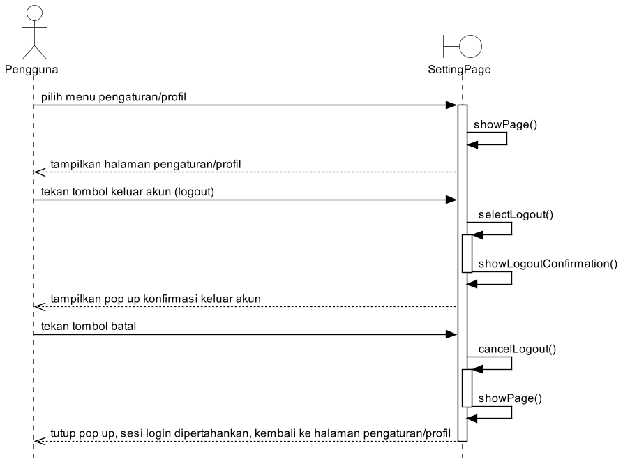
</p>
<p align="center">
<i>Gambar 3.10.2. Sequence Diagram [UC10] - [Membatalkan Keluar Akun]</i>
</p>

### 3.10.3 Diagram Kelas

<p align="center">
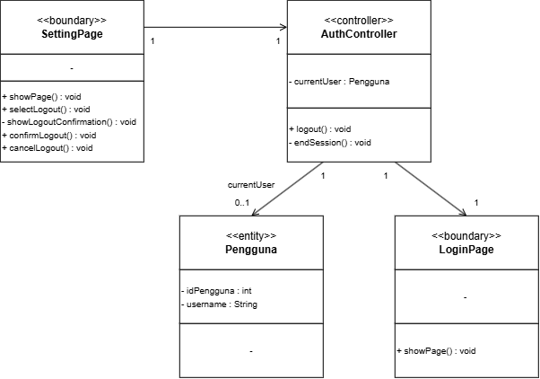
</p>
<p align="center">
<i>Gambar 3.10.3. Diagram Kelas [Keluar Akun Pengguna]</i>
</p>

<br>

---

# BAB 4: Diagram Kelas Keseluruhan

## 4.1 Diagram Kelas

<p align="center">
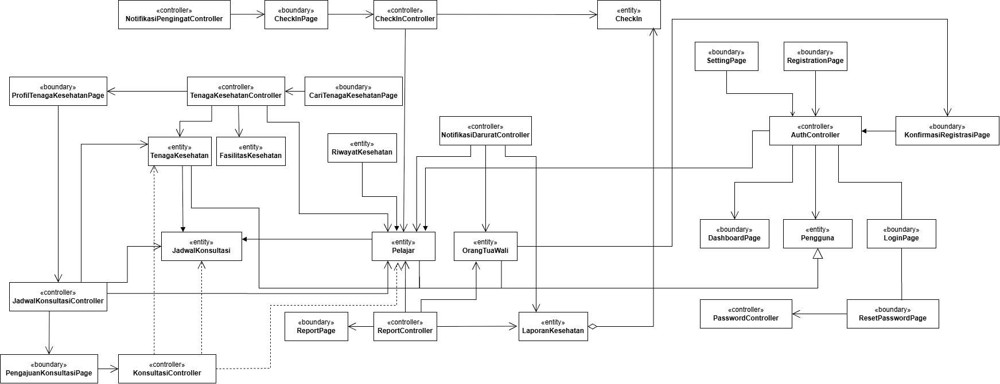
</p>
<p align="center">
<i>Gambar 4.1. Diagram Kelas Perancangan Keseluruhan Mahasehat</i>
</p>

Tabel 4.1. Daftar Kelas Perancangan Keseluruhan

| ID Kelas | Nama Kelas | Atribut | Metode/Operasi |
| :--- | :--- | :--- | :--- |
| *C01* | *Pengguna* | *idPengguna, username, email, password, role, statusAkun* | *findByUsernameorEmail(), findByEmail(), verifyPassword(), setPassword(), getRole(), getStatusAkun()* |
| *C02* | *Pelajar* | *idPelajar, nama, lokasiSaatIni, statusDarurat, tanggalLahir, nomorTelepon* | *getCheckInHistory(), setCheckIn(), getLokasiSaatIni(), updateEmergencyStatus()* |
| *C03* | *OrangTuaWali* | *idWali, nama, email, nomorTelepon* | *-* |
| *C04* | *TenagaKesehatan* | *idTenagaKesehatan, nama, email, nomorTelepon, jenisTenagaKesehatan, lokasi* | *getProfil()* |
| *C05* | *RiwayatKesehatan* | *riwayatKesehatan* | *-* |
| *C06* | *CheckIn* | *idCheckIn, tanggalCheckIn, skalaMood, jamTidur, jamBangun, polaMakan, pemicuStres, catatanRefleksi* | *createCheckIn(), getCheckInData(), validateData()* |
| *C07* | *LaporanKesehatan* | *periode, ringkasanKondisi, indikatorRisiko, jumlahHariTidakCheckIn* | *evaluateThreshold(), detectEmergency()* |
| *C08* | *FasilitasKesehatan* | *idFasilitas, namaFasilitas, lokasi, estimasiBiaya* | *getLokasi(), getEstimasiBiaya()* |
| *C09* | *JadwalKonsultasi* | *idJadwal, tanggal, waktu, statusKetersediaan, statusPengajuan* | *getDate(), getTime(), getStatus(), updateAvailability(), updateStatus()* |
| *C10* | *RegistrationPage* | *inputDataPelajar, inputDataWali* | *displayFormRegistrasi(), getDataPelajar(), getDataWali(), submitRegistrasi()* |
| *C11* | *AuthController* | *currentUser* | *validateData(), registerAccount(), login(), logout(), validateConfirmation(), confirmAccount(), validateCredentials(), checkAccountStatus(), startSession(), endSession()* |
| *C12* | *KonfirmasiRegistrasiPage* | *dataRegistrasi, statusKonfirmasi* | *displayDataRegistrasi(), confirmRegistrasi()* |
| *C13* | *CheckInPage* | *moodInput, sleepDurationInput, dietInput, triggerInput, reflectionInput* | *showPage(), getInput(), showError(), showSuccessMessage()* |
| *C14* | *CheckInController* | *currentCheckIn* | *submitCheckIn(), validateCheckInFormat(), encryptJournal()* |
| *C15* | *NotifikasiPengingatController* | *reminderSchedule, status* | *sendDailyReminder(), checkPendingCheckIn()* |
| *C16* | *ReportPage* | *selectedPeriod, displayedChart, displayedSummary* | *showPage(), displayChart(), filterViewByRole()* |
| *C17* | *ReportController* | *currentReport* | *calculateStatistics(), buildTrendChart(), applyPrivacyRestriction()* |
| *C18* | *CariTenagaKesehatanPage* | *-* | *showPage(), requestLocationPermission(), displayResults()* |
| *C19* | *ProfilTenagaKesehatanPage* | *tenagaKesehatanDipilih* | *displayProfile(), displayAvailableSchedules()* |
| *C20* | *TenagaKesehatanController* | *-* | *loadTenagaKesehatan(), processLocationPermission(), calculateDistances(), selectTenagaKesehatan()* |
| *C21* | *PengajuanKonsultasiPage* | *selectedTenagaKesehatan, filteredDate, displayedSchedule, jadwalDipilih, dataPengajuan* | *displayForm(), displaySelectedSchedule(), showUnavailableWarning(), getFormData(), filterDate(), displayAvailableSchedule(), chooseSchedule(), fillForm(), submitForm(), showSuccessMessage()* |
| *C22* | *JadwalKonsultasiController* | *tenagaKesehatanDipilih, daftarJadwal, pelajarAktif* | *loadAvailableSchedules(), checkAvailability(), selectSchedule(), submitRequest(), refreshAvailability()* |
| *C23* | *KonsultasiController* | *-* | *approvePengajuan(), reschedule()* |
| *C24* | *NotifikasiDaruratController* | *-* | *sendEmergencyNotification(), loadEmergencyDetail(), confirmReceived(), markFollowUp()* |
| *C25* | *LoginPage* | *usernameOrEmailInput, passwordInput* | *showPage(), getInput(), showError(), selectForgotPassword()* |
| *C26* | *ResetPasswordPage* | *emailInput, newPasswordInput, confirmPasswordInput* | *getInput(), showError(), showEmailForm(), showNewPasswordForm(), showMessage()* |
| *C27* | *PasswordController* | *-* | *sendResetLink(), resetPassword(), generateResetLink(), validateNewPassword()* |
| *C28* | *DashboardPage* | *currentUser, role* | *displayDashboard(), displayUserInfo()* |
| *C29* | *SettingPage* | *-* | *showPage(), selectLogout(), showLogoutConfirmation(), confirmLogout(), cancelLogout()* |

---

# BAB 5: Perancangan Rinci Kelas

Seluruh kelas perancangan Mahasehat beserta kelas analisis terkait pada SKPL ditunjukkan pada tabel berikut.

Tabel 5.1. Daftar Kelas Perancangan dan Kelas Analisis Terkait

| No | Nama Kelas Perancangan | Nama Kelas Analisis Terkait |
| :--- | :--- | :--- |
| 1 | *Pengguna* | *Pengguna* |
| 2 | *Pelajar* | *Pelajar* |
| 3 | *OrangTuaWali* | *OrangTuaWali* |
| 4 | *TenagaKesehatan* | *TenagaKesehatan* |
| 5 | *RiwayatKesehatan* | *RiwayatKesehatan* |
| 6 | *CheckIn* | *CheckIn* |
| 7 | *LaporanKesehatan* | *LaporanKesehatan* |
| 8 | *FasilitasKesehatan* | *FasilitasKesehatan* |
| 9 | *JadwalKonsultasi* | *JadwalKonsultasi* |
| 10 | *RegistrationPage* | *RegistrationPage* |
| 11 | *AuthController* | *AuthController* |
| 12 | *KonfirmasiRegistrasiPage* | *KonfirmasiRegistrasiPage* |
| 13 | *CheckInPage* | *CheckInPage* |
| 14 | *CheckInController* | *CheckInController* |
| 15 | *NotifikasiPengingatController* | *NotifikasiPengingatController* |
| 16 | *ReportPage* | *ReportPage* |
| 17 | *ReportController* | *ReportController* |
| 18 | *CariTenagaKesehatanPage* | *CariTenagaKesehatanPage* |
| 19 | *ProfilTenagaKesehatanPage* | *ProfilTenagaKesehatanPage* |
| 20 | *TenagaKesehatanController* | *TenagaKesehatanController* |
| 21 | *PengajuanKonsultasiPage* | *PengajuanKonsultasiPage* |
| 22 | *JadwalKonsultasiController* | *JadwalKonsultasiController* |
| 23 | *KonsultasiController* | *KonsultasiController* |
| 24 | *NotifikasiDaruratController* | *NotifikasiDaruratController* |
| 25 | *LoginPage* | *LoginPage* |
| 26 | *ResetPasswordPage* | *ResetPasswordPage* |
| 27 | *PasswordController* | *PasswordController* |
| 28 | *DashboardPage* | *DashboardPage* |
| 29 | *SettingPage* | *SettingPage* |

Setiap kelas pada Tabel 5.1 dirinci pada subbab tersendiri, berisi operasi beserta *visibility*-nya, atribut beserta *visibility* dan tipenya, serta algoritma dan query untuk operasi yang dianggap penting.

## 5.1 Kelas Pengguna

**Nama Kelas:** *Pengguna*  
**ID Kelas:** *C01*

Pengguna adalah kelas abstrak (*entity*) yang menyimpan data akun bersama milik ketiga aktor. Kelas Pelajar, OrangTuaWali, dan TenagaKesehatan mewarisi kelas ini. Atribut `password` menyimpan hasil *hash* bcrypt, bukan teks password asli. Formulir registrasi (I-01 s.d. I-03) dan formulir masuk akun (I-07) memakai e-mail, sehingga `username` diisi sama dengan e-mail. Nilai `statusAkun` adalah "Aktif", "Belum Terverifikasi" (pelajar di bawah 18 tahun yang menunggu persetujuan wali), atau "Ditolak" (wali menekan Btn_TidakSetuju pada I-06).

Tabel 5.1.1. Operasi Kelas Pengguna

| Nama Operasi | Visibility (private, public) | Keterangan |
| :--- | :--- | :--- |
| *findByUsernameOrEmail(usernameOrEmail: String): Pengguna* | *public* | *Operasi statis. Mencari akun berdasarkan username atau e-mail saat login (UC09) dan mengembalikan objek subkelas sesuai role, atau null bila akun tidak ditemukan. Algo-C01-01.* |
| *findByEmail(email: String): Pengguna* | *public* | *Operasi statis. Mencari akun berdasarkan e-mail saat permintaan reset password (UC09 skenario alternatif 3). Algo-C01-02.* |
| *verifyPassword(password: String): Boolean* | *public* | *Mencocokkan password masukan dengan hash yang tersimpan. Algo-C01-03.* |
| *getStatusAkun(): String* | *public* | *Mengembalikan status akun ("Aktif", "Belum Terverifikasi", atau "Ditolak") untuk pemeriksaan status saat login (UC09 skenario alternatif 2).* |
| *getRole(): String* | *public* | *Mengembalikan peran pengguna ("Pelajar", "OrangTuaWali", atau "TenagaKesehatan") untuk menentukan isi dashboard.* |
| *setPassword(newPassword: String): Boolean* | *public* | *Menyimpan password baru dalam bentuk hash setelah divalidasi oleh PasswordController. Algo-C01-04.* |

Tabel 5.1.2. Atribut Kelas Pengguna

| Nama Atribut | Visibility (private, public) | Tipe |
| :--- | :--- | :--- |
| *idPengguna* | *private* | *int* |
| *username* | *private* | *String* |
| *email* | *private* | *String* |
| *password* | *private* | *String* |
| *role* | *private* | *String* |
| *statusAkun* | *private* | *String* |

### 5.1.1 Algoritma/Query

**Nama Kelas:** *Pengguna*  
**Nama Operasi:** *findByUsernameOrEmail(usernameOrEmail: String): Pengguna*  
**ID Algoritma:** *Algo-C01-01*

```text
Function findByUsernameOrEmail(usernameOrEmail: String) → Pengguna
    kunci ← lowercase(trim(usernameOrEmail))
    if kunci = "" then
        return null
    end if

    baris ← jalankan Q-C01-01 dengan parameter (kunci)
    if baris tidak ditemukan then
        return null                                  // ditangani AuthController sebagai kredensial tidak valid
    end if

    // Pengguna adalah kelas abstrak, sehingga objek yang dibentuk adalah subkelasnya
    depend on baris.role
        "Pelajar"         : pengguna ← objek Pelajar baru
        "OrangTuaWali"    : pengguna ← objek OrangTuaWali baru
        "TenagaKesehatan" : pengguna ← objek TenagaKesehatan baru
    end depend
    isi atribut idPengguna, username, email, password, role, statusAkun pada pengguna dari baris
    return pengguna
end Function
```

Tabel 5.1.1.1. Query Operasi findByUsernameOrEmail

| No Query | Query | Keterangan |
| :--- | :--- | :--- |
| *Q-C01-01* | *SELECT id_pengguna, username, email, password_hash, role, status_akun FROM pengguna WHERE LOWER(username) = @kunci OR LOWER(email) = @kunci LIMIT 1;* | *Mengambil satu akun yang username atau e-mailnya sama dengan masukan. Perbandingan tidak membedakan huruf besar dan kecil.* |

### 5.1.2 Algoritma/Query

**Nama Kelas:** *Pengguna*  
**Nama Operasi:** *findByEmail(email: String): Pengguna*  
**ID Algoritma:** *Algo-C01-02*

```text
Function findByEmail(email: String) → Pengguna
    kunci ← lowercase(trim(email))
    if kunci tidak berformat e-mail then
        return null
    end if

    baris ← jalankan Q-C01-02 dengan parameter (kunci)
    if baris tidak ditemukan then
        return null                                  // PasswordController menampilkan "e-mail tidak terdaftar"
    end if

    bentuk objek subkelas sesuai baris.role, sama seperti Algo-C01-01
    return pengguna
end Function
```

Tabel 5.1.2.1. Query Operasi findByEmail

| No Query | Query | Keterangan |
| :--- | :--- | :--- |
| *Q-C01-02* | *SELECT id_pengguna, username, email, password_hash, role, status_akun FROM pengguna WHERE LOWER(email) = @email LIMIT 1;* | *Mengambil akun yang terdaftar dengan e-mail tersebut.* |

### 5.1.3 Algoritma/Query

**Nama Kelas:** *Pengguna*  
**Nama Operasi:** *verifyPassword(password: String): Boolean*  
**ID Algoritma:** *Algo-C01-03*

```text
Function verifyPassword(password: String) → Boolean
    if password = "" then
        return false
    end if
    // this.password berisi hash bcrypt; bcrypt.compare membandingkan dalam waktu konstan
    return bcrypt.compare(password, this.password)
end Function
```

### 5.1.4 Algoritma/Query

**Nama Kelas:** *Pengguna*  
**Nama Operasi:** *setPassword(newPassword: String): Boolean*  
**ID Algoritma:** *Algo-C01-04*

```text
Function setPassword(newPassword: String) → Boolean
    // aturan panjang dan kecocokan konfirmasi sudah diperiksa PasswordController.validateNewPassword()
    hashBaru ← bcrypt.hash(newPassword, 12)          // cost factor 12
    jumlahBaris ← jalankan Q-C01-03 dengan parameter (hashBaru, this.idPengguna)
    if jumlahBaris = 1 then
        this.password ← hashBaru
        return true
    else
        return false
    end if
end Function
```

Tabel 5.1.4.1. Query Operasi setPassword

| No Query | Query | Keterangan |
| :--- | :--- | :--- |
| *Q-C01-03* | *UPDATE pengguna SET password_hash = @hashBaru WHERE id_pengguna = @idPengguna;* | *Mengganti hash password akun.* |

## 5.2 Kelas Pelajar

**Nama Kelas:** *Pelajar*  
**ID Kelas:** *C02*

Pelajar adalah subkelas Pengguna (*entity*) yang dipakai pada UC01, UC03, UC04, UC05, UC06, dan UC08. Atribut `lokasiSaatIni` menyimpan koordinat `"lat,lng"` dan bernilai string kosong (`NULL` pada basis data) sampai pelajar memberikan izin lokasi.

Tabel 5.2.1. Operasi Kelas Pelajar

| Nama Operasi | Visibility (private, public) | Keterangan |
| :--- | :--- | :--- |
| *getCheckInHistory(): List&lt;CheckIn>* | *public* | *Mengembalikan riwayat check-in pelajar dari yang terbaru, dipakai untuk statistik dan laporan (UC04). Algo-C02-01.* |
| *setCheckIn(checkIn: CheckIn): void* | *public* | *Menyimpan check-in baru sebagai riwayat milik pelajar (UC03). Algo-C02-02.* |
| *getLokasiSaatIni(): String* | *public* | *Mengembalikan lokasi terakhir pelajar dalam format "lat,lng".* |
| *setLokasiSaatIni(lokasi: String): void* | *public* | *Mencatat lokasi perangkat setelah pelajar mengizinkan akses lokasi (UC05). Algo-C02-03.* |
| *updateEmergencyStatus(status: Boolean): void* | *public* | *Mengubah status darurat pelajar, menjadi true saat ambang darurat terlampaui dan false setelah ditindaklanjuti wali (UC08). Algo-C02-04.* |
| *ajukanKonsultasi(jadwal: JadwalKonsultasi, keluhan: String): Boolean* | *public* | *Mengajukan konsultasi pada jadwal yang dipilih dan mengembalikan false bila jadwal sudah tidak tersedia (UC06). Algo-C02-05.* |

Tabel 5.2.2. Atribut Kelas Pelajar

| Nama Atribut | Visibility (private, public) | Tipe |
| :--- | :--- | :--- |
| *idPelajar* | *private* | *String* |
| *nama* | *private* | *String* |
| *lokasiSaatIni* | *private* | *String* |
| *statusDarurat* | *private* | *Boolean* |
| *tanggalLahir* | *private* | *Date* |
| *nomorTelepon* | *private* | *String* |

### 5.2.1 Algoritma/Query

**Nama Kelas:** *Pelajar*  
**Nama Operasi:** *getCheckInHistory(): List&lt;CheckIn>*  
**ID Algoritma:** *Algo-C02-01*

```text
Function getCheckInHistory() → List<CheckIn>
    daftar ← []
    barisHasil ← jalankan Q-C02-01 dengan parameter (this.idPelajar)
    for each baris in barisHasil do
        checkIn ← objek CheckIn yang atributnya diisi dari baris
        // catatanRefleksi tetap terenkripsi (KNF01); dekripsi dan pembatasan
        // akses wali (KNF02) dilakukan oleh controller yang memakai data ini
        tambahkan checkIn ke daftar
    end for
    return daftar                                    // daftar kosong memicu UC04 skenario alternatif 1
end Function
```

Tabel 5.2.1.1. Query Operasi getCheckInHistory

| No Query | Query | Keterangan |
| :--- | :--- | :--- |
| *Q-C02-01* | *SELECT id_check_in, tanggal_check_in, skala_mood, jam_tidur, jam_bangun, pola_makan, pemicu_stres, catatan_refleksi FROM check_in WHERE id_pelajar = @idPelajar ORDER BY tanggal_check_in DESC;* | *Mengambil seluruh riwayat check-in seorang pelajar. Indeks (id_pelajar, tanggal_check_in) dipakai agar pembuatan grafik memenuhi KNF04 (maksimal 1.500 ms).* |

### 5.2.2 Algoritma/Query

**Nama Kelas:** *Pelajar*  
**Nama Operasi:** *setCheckIn(checkIn: CheckIn): void*  
**ID Algoritma:** *Algo-C02-02*

```text
Procedure setCheckIn(checkIn: CheckIn)
    data ← checkIn.getCheckInData()
    // data.catatanRefleksi sudah berupa ciphertext dari CheckInController.encryptJournal(),
    // atau null bila pelajar melewati refleksi (UC03 skenario alternatif 1)
    jalankan Q-C02-02 dengan parameter (data.idCheckIn, this.idPelajar, data.tanggalCheckIn,
        data.skalaMood, data.jamTidur, data.jamBangun, data.polaMakan,
        data.pemicuStres, data.catatanRefleksi)
end Procedure
```

Tabel 5.2.2.1. Query Operasi setCheckIn

| No Query | Query | Keterangan |
| :--- | :--- | :--- |
| *Q-C02-02* | *INSERT INTO check_in (id_check_in, id_pelajar, tanggal_check_in, skala_mood, jam_tidur, jam_bangun, pola_makan, pemicu_stres, catatan_refleksi) VALUES (@idCheckIn, @idPelajar, @tanggalCheckIn, @skalaMood, @jamTidur, @jamBangun, @polaMakan, @pemicuStres, @catatanRefleksi);* | *Menyimpan satu data check-in milik pelajar.* |

### 5.2.3 Algoritma/Query

**Nama Kelas:** *Pelajar*  
**Nama Operasi:** *setLokasiSaatIni(lokasi: String): void*  
**ID Algoritma:** *Algo-C02-03*

```text
Procedure setLokasiSaatIni(lokasi: String)
    // lokasi berformat "lat,lng" dari Geolocation API
    lat, lng ← pisahkan lokasi berdasarkan tanda koma
    if lat atau lng bukan angka or lat di luar [-90, 90] or lng di luar [-180, 180] then
        lempar galat "Format lokasi tidak valid"
    end if
    jalankan Q-C02-03 dengan parameter (lokasi, this.idPelajar)
    this.lokasiSaatIni ← lokasi
end Procedure
```

Tabel 5.2.3.1. Query Operasi setLokasiSaatIni

| No Query | Query | Keterangan |
| :--- | :--- | :--- |
| *Q-C02-03* | *UPDATE pelajar SET lokasi_saat_ini = @lokasi WHERE id_pelajar = @idPelajar;* | *Menyimpan lokasi terakhir pelajar.* |

### 5.2.4 Algoritma/Query

**Nama Kelas:** *Pelajar*  
**Nama Operasi:** *updateEmergencyStatus(status: Boolean): void*  
**ID Algoritma:** *Algo-C02-04*

```text
Procedure updateEmergencyStatus(status: Boolean)
    if this.statusDarurat = status then
        return                                       // tidak ada perubahan
    end if
    jalankan Q-C02-04 dengan parameter (status, this.idPelajar)
    this.statusDarurat ← status
end Procedure
```

Tabel 5.2.4.1. Query Operasi updateEmergencyStatus

| No Query | Query | Keterangan |
| :--- | :--- | :--- |
| *Q-C02-04* | *UPDATE pelajar SET status_darurat = @status WHERE id_pelajar = @idPelajar;* | *Mengubah status darurat pelajar (KF18).* |

### 5.2.5 Algoritma/Query

**Nama Kelas:** *Pelajar*  
**Nama Operasi:** *ajukanKonsultasi(jadwal: JadwalKonsultasi, keluhan: String): Boolean*  
**ID Algoritma:** *Algo-C02-05*

```text
Function ajukanKonsultasi(jadwal: JadwalKonsultasi, keluhan: String) → Boolean
    if trim(keluhan) = "" then
        // galat terpisah agar tidak tertukar dengan nilai false (jadwal tidak tersedia)
        lempar galat "Keluhan wajib diisi"
    end if
    if not jadwal.isAvailable() then
        return false                                 // UC06 skenario alternatif 1: jadwal tidak lagi tersedia
    end if
    // reservasi() mengunci baris jadwal sehingga dua pelajar tidak dapat memesan slot yang sama
    return jadwal.reservasi(this.idPelajar, trim(keluhan))
end Function
```

## 5.3 Kelas OrangTuaWali

**Nama Kelas:** *OrangTuaWali*  
**ID Kelas:** *C03*

OrangTuaWali adalah subkelas Pengguna (*entity*) yang terhubung dengan pelajar melalui proses registrasi (UC01) dan konfirmasi (UC02). Pelajar mengisi nomor telepon orang tua/wali pada formulir I-01; data wali dilengkapi ketika orang tua/wali mendaftar sendiri melalui formulir I-02 dengan nomor telepon yang sama.

Tabel 5.3.1. Operasi Kelas OrangTuaWali

| Nama Operasi | Visibility (private, public) | Keterangan |
| :--- | :--- | :--- |
| *getSummaryReport(): SummaryData* | *public* | *Menyusun ringkasan kondisi pelajar yang diwalikan untuk 7 hari terakhir tanpa teks jurnal pribadi pelajar (KNF02). Algo-C03-01.* |

Tabel 5.3.2. Atribut Kelas OrangTuaWali

| Nama Atribut | Visibility (private, public) | Tipe |
| :--- | :--- | :--- |
| *idWali* | *private* | *String* |
| *nama* | *private* | *String* |
| *email* | *private* | *String* |
| *nomorTelepon* | *private* | *String* |

Struktur data `SummaryData` yang dikembalikan `getSummaryReport()`:

```text
SummaryData
    namaPelajar            : String
    periode                : String     // "Mingguan"
    ringkasanKondisi       : String
    indikatorRisiko        : String     // "Rendah", "Sedang", "Tinggi", atau "Belum Dapat Dinilai"
    jumlahHariTidakCheckIn : int
```

### 5.3.1 Algoritma/Query

**Nama Kelas:** *OrangTuaWali*  
**Nama Operasi:** *getSummaryReport(): SummaryData*  
**ID Algoritma:** *Algo-C03-01*

```text
Function getSummaryReport() → SummaryData
    pelajar ← jalankan Q-C03-01 dengan parameter (this.idWali)
    if pelajar tidak ditemukan then
        lempar galat "Akun wali belum terhubung dengan pelajar"
    end if

    // Q-C03-02 tidak mengambil kolom catatan_refleksi sehingga teks jurnal tidak pernah sampai ke wali (KNF02)
    daftar ← objek CheckIn dari setiap baris hasil Q-C03-02 dengan parameter (pelajar.id_pelajar)
    laporan ← objek LaporanKesehatan baru
    hasil ← laporan.evaluateThreshold(daftar)        // Algo-C07-01

    return SummaryData {
        namaPelajar            ← pelajar.nama,
        periode                ← hasil.periode,
        ringkasanKondisi       ← hasil.ringkasanKondisi,
        indikatorRisiko        ← hasil.indikatorRisiko,
        jumlahHariTidakCheckIn ← hasil.jumlahHariTidakCheckIn
    }
end Function
```

Tabel 5.3.1.1. Query Operasi getSummaryReport

| No Query | Query | Keterangan |
| :--- | :--- | :--- |
| *Q-C03-01* | *SELECT id_pelajar, nama FROM pelajar WHERE id_wali = @idWali LIMIT 1;* | *Mencari pelajar yang terhubung dengan wali. Satu wali terhubung dengan satu pelajar sesuai alur registrasi UC01.* |
| *Q-C03-02* | *SELECT id_check_in, tanggal_check_in, skala_mood, jam_tidur, jam_bangun, pola_makan, pemicu_stres FROM check_in WHERE id_pelajar = @idPelajar AND tanggal_check_in >= CURRENT_DATE - 6 ORDER BY tanggal_check_in DESC;* | *Mengambil check-in 7 hari terakhir tanpa kolom catatan_refleksi.* |

## 5.4 Kelas TenagaKesehatan

**Nama Kelas:** *TenagaKesehatan*  
**ID Kelas:** *C04*

TenagaKesehatan adalah subkelas Pengguna (*entity*) untuk psikolog atau psikiater yang dapat dipilih pelajar (UC05), menyediakan jadwal konsultasi (UC06), dan meninjau pengajuan (UC07). Atribut `lokasi` menyimpan lokasi kerja yang diisi tenaga kesehatan saat registrasi (Input_Lokasi pada I-03). Jarak ke pelajar dihitung dari lokasi FasilitasKesehatan (UC05).

Tabel 5.4.1. Operasi Kelas TenagaKesehatan

| Nama Operasi | Visibility (private, public) | Keterangan |
| :--- | :--- | :--- |
| *findAll(): List&lt;TenagaKesehatan>* | *public* | *Operasi statis. Mengambil seluruh tenaga kesehatan untuk daftar pencarian (UC05). Algo-C04-01.* |
| *findById(idTenagaKesehatan: String): TenagaKesehatan* | *public* | *Operasi statis. Mengambil tenaga kesehatan yang dipilih pelajar (UC06). Algo-C04-02.* |
| *getProfil(): String* | *public* | *Menyusun teks profil berisi nama, jenis tenaga kesehatan, dan kontak untuk halaman profil dan daftar ringkasan. Algo-C04-03.* |
| *getJadwalTersedia(): List&lt;JadwalKonsultasi>* | *public* | *Mengembalikan jadwal milik tenaga kesehatan ini yang belum lewat dan masih tersedia (UC06). Algo-C04-04.* |

Tabel 5.4.2. Atribut Kelas TenagaKesehatan

| Nama Atribut | Visibility (private, public) | Tipe |
| :--- | :--- | :--- |
| *idTenagaKesehatan* | *private* | *String* |
| *nama* | *private* | *String* |
| *email* | *private* | *String* |
| *nomorTelepon* | *private* | *String* |
| *jenisTenagaKesehatan* | *private* | *String* |
| *lokasi* | *private* | *String* |

### 5.4.1 Algoritma/Query

**Nama Kelas:** *TenagaKesehatan*  
**Nama Operasi:** *findAll(): List&lt;TenagaKesehatan>*  
**ID Algoritma:** *Algo-C04-01*

```text
Function findAll() → List<TenagaKesehatan>
    daftar ← []
    for each baris in hasil Q-C04-01 do
        tambahkan objek TenagaKesehatan yang diisi dari baris ke daftar
    end for
    return daftar                                    // daftar kosong ditampilkan sebagai "belum ada tenaga kesehatan"
end Function
```

Tabel 5.4.1.1. Query Operasi findAll

| No Query | Query | Keterangan |
| :--- | :--- | :--- |
| *Q-C04-01* | *SELECT id_tenaga_kesehatan, nama, email, nomor_telepon, jenis_tenaga_kesehatan, lokasi FROM tenaga_kesehatan ORDER BY nama;* | *Mengambil seluruh tenaga kesehatan berurutan nama.* |

### 5.4.2 Algoritma/Query

**Nama Kelas:** *TenagaKesehatan*  
**Nama Operasi:** *findById(idTenagaKesehatan: String): TenagaKesehatan*  
**ID Algoritma:** *Algo-C04-02*

```text
Function findById(idTenagaKesehatan: String) → TenagaKesehatan
    baris ← jalankan Q-C04-02 dengan parameter (idTenagaKesehatan)
    if baris tidak ditemukan then
        return null
    end if
    return objek TenagaKesehatan yang diisi dari baris
end Function
```

Tabel 5.4.2.1. Query Operasi findById

| No Query | Query | Keterangan |
| :--- | :--- | :--- |
| *Q-C04-02* | *SELECT id_tenaga_kesehatan, nama, email, nomor_telepon, jenis_tenaga_kesehatan, lokasi FROM tenaga_kesehatan WHERE id_tenaga_kesehatan = @idTenagaKesehatan;* | *Mengambil satu tenaga kesehatan berdasarkan ID.* |

### 5.4.3 Algoritma/Query

**Nama Kelas:** *TenagaKesehatan*  
**Nama Operasi:** *getProfil(): String*  
**ID Algoritma:** *Algo-C04-03*

```text
Function getProfil() → String
    return this.nama + " (" + this.jenisTenagaKesehatan + ")" + baris baru
         + "E-mail: " + this.email + baris baru
         + "Telepon: " + this.nomorTelepon
end Function
```

### 5.4.4 Algoritma/Query

**Nama Kelas:** *TenagaKesehatan*  
**Nama Operasi:** *getJadwalTersedia(): List&lt;JadwalKonsultasi>*  
**ID Algoritma:** *Algo-C04-04*

```text
Function getJadwalTersedia() → List<JadwalKonsultasi>
    tersedia ← []
    for each baris in hasil Q-C04-03 dengan parameter (this.idTenagaKesehatan) do
        jadwal ← objek JadwalKonsultasi yang diisi dari baris
        if jadwal.isAvailable() then                 // Algo-C09-02
            tambahkan jadwal ke tersedia
        end if
    end for
    return tersedia
end Function
```

Tabel 5.4.4.1. Query Operasi getJadwalTersedia

| No Query | Query | Keterangan |
| :--- | :--- | :--- |
| *Q-C04-03* | *SELECT id_jadwal, tanggal, waktu, status_ketersediaan, status_pengajuan, id_pelajar, keluhan FROM jadwal_konsultasi WHERE id_tenaga_kesehatan = @idTenagaKesehatan AND tanggal >= CURRENT_DATE ORDER BY tanggal, waktu;* | *Mengambil jadwal tenaga kesehatan mulai hari ini, berurutan waktu. Kondisi pada kolom tanggal dapat memakai indeks (id_tenaga_kesehatan, tanggal, waktu); slot hari ini yang jamnya sudah lewat disaring oleh isAvailable().* |

## 5.5 Kelas RiwayatKesehatan

**Nama Kelas:** *RiwayatKesehatan*  
**ID Kelas:** *C05*

RiwayatKesehatan (*entity*) menyimpan riwayat kesehatan mental yang diisi pelajar saat registrasi (UC01). Data ini dibuat dan disimpan oleh AuthController pada proses registrasi dan dienkripsi dengan AES-256 sebelum masuk ke basis data (KNF01), sehingga atribut `riwayatKesehatan` berisi *ciphertext*.

Tabel 5.5.1. Operasi Kelas RiwayatKesehatan

| Nama Operasi | Visibility (private, public) | Keterangan |
| :--- | :--- | :--- |
| *-* | - | Kelas ini tidak memiliki operasi selain pembentukan objek pada UC01. |

Tabel 5.5.2. Atribut Kelas RiwayatKesehatan

| Nama Atribut | Visibility (private, public) | Tipe |
| :--- | :--- | :--- |
| *riwayatKesehatan* | *private* | *String* |

## 5.6 Kelas CheckIn

**Nama Kelas:** *CheckIn*  
**ID Kelas:** *C06*

CheckIn (*entity*) merepresentasikan satu pengisian *daily check-in*. Atribut `jamTidur` dan `jamBangun` bertipe Time (jam dan menit). Perlindungan data mengikuti dua lapis. Seluruh riwayat check-in disimpan pada media penyimpanan server basis data yang terenkripsi AES-256 (KF07, KNF01). Selain itu, `catatanRefleksi` sebagai teks jurnal pribadi dienkripsi lagi di tingkat aplikasi oleh `CheckInController.encryptJournal()`, sehingga atribut ini berisi *ciphertext*, atau `null` bila pelajar tidak mengisi refleksi.

Tabel 5.6.1. Operasi Kelas CheckIn

| Nama Operasi | Visibility (private, public) | Keterangan |
| :--- | :--- | :--- |
| *createCheckIn(data: CheckInData): CheckIn* | *public* | *Membentuk data check-in baru dari masukan CheckInPage yang sudah diproses CheckInController, lalu memvalidasinya (UC03). Penyimpanan dilakukan oleh Pelajar.setCheckIn(). Algo-C06-01.* |
| *getCheckInData(): CheckInData* | *public* | *Mengembalikan isi check-in dalam bentuk CheckInData untuk disimpan (UC03) atau diolah menjadi statistik (UC04).* |
| *validateData(): Boolean* | *public* | *Memeriksa kelengkapan dan rentang nilai data check-in. Algo-C06-02.* |

Tabel 5.6.2. Atribut Kelas CheckIn

| Nama Atribut | Visibility (private, public) | Tipe |
| :--- | :--- | :--- |
| *idCheckIn* | *private* | *String* |
| *tanggalCheckIn* | *private* | *Date* |
| *skalaMood* | *private* | *int* |
| *jamTidur* | *private* | *Time* |
| *jamBangun* | *private* | *Time* |
| *polaMakan* | *private* | *String* |
| *pemicuStres* | *private* | *String* |
| *catatanRefleksi* | *private* | *String* |

Struktur data `CheckInData` yang dipakai CheckInPage, CheckInController, dan CheckIn:

```text
CheckInData
    idCheckIn       : String     // kosong saat dikirim dari CheckInPage, diisi oleh createCheckIn()
    tanggalCheckIn  : Date       // kosong saat dikirim dari CheckInPage, diisi oleh createCheckIn()
    skalaMood       : int        // 1–5
    jamTidur        : Time
    jamBangun       : Time
    polaMakan       : String
    pemicuStres     : String
    catatanRefleksi : String     // ciphertext setelah encryptJournal(), null bila tanpa refleksi
```

### 5.6.1 Algoritma/Query

**Nama Kelas:** *CheckIn*  
**Nama Operasi:** *createCheckIn(data: CheckInData): CheckIn*  
**ID Algoritma:** *Algo-C06-01*

```text
Function createCheckIn(data: CheckInData) → CheckIn
    this.idCheckIn       ← UUID baru
    this.tanggalCheckIn  ← tanggal hari ini (zona waktu Asia/Jakarta)
    this.skalaMood       ← data.skalaMood
    this.jamTidur        ← data.jamTidur
    this.jamBangun       ← data.jamBangun
    this.polaMakan       ← trim(data.polaMakan)
    this.pemicuStres     ← trim(data.pemicuStres)
    this.catatanRefleksi ← data.catatanRefleksi      // null pada UC03 skenario alternatif 1

    if not this.validateData() then                  // Algo-C06-02
        lempar galat "Data check-in tidak valid"
    end if
    return this
end Function
```

### 5.6.2 Algoritma/Query

**Nama Kelas:** *CheckIn*  
**Nama Operasi:** *validateData(): Boolean*  
**ID Algoritma:** *Algo-C06-02*

```text
Function validateData() → Boolean
    if this.skalaMood bukan bilangan bulat or this.skalaMood < 1 or this.skalaMood > 5 then
        return false
    end if
    if this.jamTidur atau this.jamBangun tidak sesuai pola "HH:mm" (00:00–23:59) then
        return false
    end if
    if this.jamTidur = this.jamBangun then
        return false                                 // durasi tidur nol
    end if
    if this.polaMakan = "" then
        return false
    end if
    if this.tanggalCheckIn > tanggal hari ini then
        return false
    end if
    if this.catatanRefleksi ≠ null and this.catatanRefleksi = "" then
        return false                                 // refleksi kosong harus dikirim sebagai null
    end if
    return true
end Function
```

## 5.7 Kelas LaporanKesehatan

**Nama Kelas:** *LaporanKesehatan*  
**ID Kelas:** *C07*

LaporanKesehatan (*entity*) mengolah sekumpulan data check-in menjadi ringkasan kondisi, indikator risiko, dan penilaian kondisi darurat (UC04, UC08). Nilai atribut dihitung ulang setiap kali `evaluateThreshold()` dipanggil sehingga kelas ini tidak disimpan sebagai tabel tersendiri.

Tabel 5.7.1. Operasi Kelas LaporanKesehatan

| Nama Operasi | Visibility (private, public) | Keterangan |
| :--- | :--- | :--- |
| *evaluateThreshold(data: List&lt;CheckIn>): ThresholdResult* | *public* | *Menghitung ringkasan kondisi, indikator risiko, dan jumlah hari tidak check-in, lalu menilai apakah ambang batas terlampaui (KF10). Dipakai ReportController (UC04) dan NotifikasiDaruratController (UC08). Algo-C07-01.* |
| *detectEmergency(): Boolean* | *public* | *Menentukan apakah kondisi pelajar termasuk darurat berdasarkan hasil evaluateThreshold() terakhir (KF18). Algo-C07-02.* |

Tabel 5.7.2. Atribut Kelas LaporanKesehatan

| Nama Atribut | Visibility (private, public) | Tipe |
| :--- | :--- | :--- |
| *periode* | *private* | *String* |
| *ringkasanKondisi* | *private* | *String* |
| *indikatorRisiko* | *private* | *String* |
| *jumlahHariTidakCheckIn* | *private* | *int* |

Struktur data `ThresholdResult` yang dikembalikan `evaluateThreshold()`:

```text
ThresholdResult
    periode                : String     // "Mingguan" atau "Bulanan"
    ringkasanKondisi       : String
    indikatorRisiko        : String     // "Rendah", "Sedang", "Tinggi", atau "Belum Dapat Dinilai"
    jumlahHariTidakCheckIn : int
    ambangTerlampaui       : Boolean
```

Konstanta ambang batas yang dipakai Algo-C07-01 dan Algo-C07-02:

| Konstanta | Nilai | Dasar |
| :--- | :--- | :--- |
| *BATAS_MOOD_RENDAH* | *2* | *Skala mood 1–5 pada CheckInPage; nilai 1–2 dianggap mood rendah* |
| *HARI_MOOD_RENDAH_BERUNTUN* | *3* | *Pola tidak biasa yang ditandai laporan (KF10)* |
| *BATAS_RATA_MOOD_SEDANG* | *2,5* | *Rata-rata mood periode di bawah titik tengah skala* |
| *BATAS_RATA_TIDUR_JAM* | *5* | *Rata-rata durasi tidur kurang dari 5 jam per malam* |
| *BATAS_HARI_TIDAK_CHECKIN* | *3* | *Pelajar dianggap tidak aktif check-in (KF18)* |

### 5.7.1 Algoritma/Query

**Nama Kelas:** *LaporanKesehatan*  
**Nama Operasi:** *evaluateThreshold(data: List&lt;CheckIn>): ThresholdResult*  
**ID Algoritma:** *Algo-C07-01*

```text
Function evaluateThreshold(data: List<CheckIn>) → ThresholdResult
    if data kosong then
        this.periode ← "Mingguan"
        this.ringkasanKondisi ← "Belum ada data check-in pada periode ini."
        this.indikatorRisiko ← "Belum Dapat Dinilai"
        this.jumlahHariTidakCheckIn ← 0
        return hasil dengan ambangTerlampaui ← false
    end if

    urutkan data dari tanggalCheckIn terbaru ke terlama
    rentangHari ← selisih hari antara tanggal terlama dan terbaru + 1
    this.periode ← "Mingguan" if rentangHari ≤ 7 else "Bulanan"
    // KF06: selisih tanggal hari ini dengan tanggal check-in terakhir
    this.jumlahHariTidakCheckIn ← selisih hari antara hari ini dan tanggal check-in terbaru

    totalMood ← 0; totalTidur ← 0
    moodRendahBeruntun ← 0; masihBeruntun ← true; tanggalSebelumnya ← null
    for each c in data do                            // dari yang terbaru
        isi ← c.getCheckInData()
        totalMood ← totalMood + isi.skalaMood
        durasi ← menit(isi.jamBangun) − menit(isi.jamTidur)
        if durasi ≤ 0 then durasi ← durasi + 24 × 60 end if   // tidur melewati tengah malam
        totalTidur ← totalTidur + durasi / 60

        // hitung hari berturut-turut dengan mood rendah mulai dari check-in terbaru;
        // rangkaian putus bila mood tidak rendah atau ada tanggal yang terlewat
        berurutan ← tanggalSebelumnya = null or selisih hari(isi.tanggalCheckIn, tanggalSebelumnya) = 1
        if masihBeruntun and berurutan and isi.skalaMood ≤ BATAS_MOOD_RENDAH then
            moodRendahBeruntun ← moodRendahBeruntun + 1
        else
            masihBeruntun ← false
        end if
        tanggalSebelumnya ← isi.tanggalCheckIn
    end for
    rataMood ← totalMood / jumlah(data)
    rataTidur ← totalTidur / jumlah(data)

    if moodRendahBeruntun ≥ HARI_MOOD_RENDAH_BERUNTUN then
        this.indikatorRisiko ← "Tinggi"
    else if rataMood ≤ BATAS_RATA_MOOD_SEDANG or rataTidur < BATAS_RATA_TIDUR_JAM then
        this.indikatorRisiko ← "Sedang"
    else
        this.indikatorRisiko ← "Rendah"
    end if

    this.ringkasanKondisi ← "Rata-rata mood " + bulatkan(rataMood, 1) + " dari 5, rata-rata tidur "
        + bulatkan(rataTidur, 1) + " jam, " + this.jumlahHariTidakCheckIn + " hari tanpa check-in."

    ambang ← this.indikatorRisiko = "Tinggi" or this.jumlahHariTidakCheckIn ≥ BATAS_HARI_TIDAK_CHECKIN
    return ThresholdResult { periode, ringkasanKondisi, indikatorRisiko, jumlahHariTidakCheckIn dari this,
                             ambangTerlampaui ← ambang }
end Function
```

### 5.7.2 Algoritma/Query

**Nama Kelas:** *LaporanKesehatan*  
**Nama Operasi:** *detectEmergency(): Boolean*  
**ID Algoritma:** *Algo-C07-02*

```text
Function detectEmergency() → Boolean
    if this.indikatorRisiko belum diisi or this.indikatorRisiko = "Belum Dapat Dinilai" then
        return false                                 // evaluateThreshold() belum dijalankan atau data belum cukup
    end if
    // KF18: status darurat bila pelajar tidak aktif check-in DAN kondisinya memburuk
    tidakAktif ← this.jumlahHariTidakCheckIn ≥ BATAS_HARI_TIDAK_CHECKIN
    memburuk ← this.indikatorRisiko = "Tinggi" or this.indikatorRisiko = "Sedang"
    return tidakAktif and memburuk
end Function
```

## 5.8 Kelas FasilitasKesehatan

**Nama Kelas:** *FasilitasKesehatan*  
**ID Kelas:** *C08*

FasilitasKesehatan (*entity*) menyimpan data klinik atau fasilitas tempat tenaga kesehatan berpraktik. Atribut `lokasi` menyimpan koordinat `"lat,lng"` agar jarak ke lokasi pelajar dapat dihitung (UC05).

Tabel 5.8.1. Operasi Kelas FasilitasKesehatan

| Nama Operasi | Visibility (private, public) | Keterangan |
| :--- | :--- | :--- |
| *findAll(): List&lt;FasilitasKesehatan>* | *public* | *Operasi statis. Mengambil seluruh fasilitas kesehatan untuk daftar pencarian (UC05). Algo-C08-01.* |
| *getLokasi(): String* | *public* | *Mengembalikan koordinat fasilitas untuk perhitungan jarak.* |
| *getEstimasiBiaya(): Double* | *public* | *Mengembalikan estimasi biaya konsultasi dalam rupiah.* |

Tabel 5.8.2. Atribut Kelas FasilitasKesehatan

| Nama Atribut | Visibility (private, public) | Tipe |
| :--- | :--- | :--- |
| *idFasilitas* | *private* | *String* |
| *namaFasilitas* | *private* | *String* |
| *lokasi* | *private* | *String* |
| *estimasiBiaya* | *private* | *Double* |

### 5.8.1 Algoritma/Query

**Nama Kelas:** *FasilitasKesehatan*  
**Nama Operasi:** *findAll(): List&lt;FasilitasKesehatan>*  
**ID Algoritma:** *Algo-C08-01*

```text
Function findAll() → List<FasilitasKesehatan>
    daftar ← []
    for each baris in hasil Q-C08-01 do
        tambahkan objek FasilitasKesehatan yang diisi dari baris ke daftar
    end for
    return daftar
end Function
```

Tabel 5.8.1.1. Query Operasi findAll

| No Query | Query | Keterangan |
| :--- | :--- | :--- |
| *Q-C08-01* | *SELECT id_fasilitas, nama_fasilitas, lokasi, estimasi_biaya FROM fasilitas_kesehatan ORDER BY nama_fasilitas;* | *Mengambil seluruh fasilitas kesehatan berurutan nama.* |

## 5.9 Kelas JadwalKonsultasi

**Nama Kelas:** *JadwalKonsultasi*  
**ID Kelas:** *C09*

JadwalKonsultasi (*entity*) merepresentasikan satu slot konsultasi milik tenaga kesehatan beserta status pengajuannya. Nilai `statusPengajuan` adalah `"Belum Diajukan"`, `"Diajukan"` (UC06), `"Disetujui"` (UC07), atau `"Rescheduled"` (UC07 skenario alternatif 1). Atribut `idPelajar` dan `keluhan` bernilai `null` selama slot belum diajukan.

Tabel 5.9.1. Operasi Kelas JadwalKonsultasi

| Nama Operasi | Visibility (private, public) | Keterangan |
| :--- | :--- | :--- |
| *findById(idJadwal: String): JadwalKonsultasi* | *public* | *Operasi statis. Mengambil satu jadwal berdasarkan ID, dipakai KonsultasiController saat tenaga kesehatan menyetujui atau menjadwalkan ulang pengajuan (UC07). Mengembalikan null bila jadwal tidak ditemukan. Algo-C09-01.* |
| *isAvailable(): Boolean* | *public* | *Memeriksa apakah slot masih tersedia dan belum lewat waktunya (UC06). Algo-C09-02.* |
| *reservasi(idPelajar: String, keluhan: String): Boolean* | *public* | *Memesan slot untuk pelajar dalam satu transaksi, lalu mengubah ketersediaan dan status pengajuan menjadi "Diajukan" (UC06). Mengembalikan false bila slot sudah diambil. Algo-C09-03.* |
| *getDate(): Date* | *public* | *Mengembalikan tanggal konsultasi.* |
| *getTime(): Time* | *public* | *Mengembalikan waktu konsultasi berformat "HH:mm".* |
| *getStatus(): String* | *public* | *Mengembalikan status pengajuan.* |
| *updateAvailability(status: Boolean): void* | *public* | *Mengubah status ketersediaan slot. Algo-C09-04.* |
| *updateStatus(statusBaru: String): void* | *public* | *Mengubah status pengajuan, misalnya menjadi "Disetujui" saat tenaga kesehatan menyetujui pengajuan (UC07). Algo-C09-05.* |
| *updateSchedule(tanggalBaru: Date, waktuBaru: Time): void* | *public* | *Memindahkan konsultasi ke tanggal dan waktu baru, lalu mengubah status menjadi "Rescheduled" (UC07 skenario alternatif 1). Algo-C09-06.* |

Tabel 5.9.2. Atribut Kelas JadwalKonsultasi

| Nama Atribut | Visibility (private, public) | Tipe |
| :--- | :--- | :--- |
| *idJadwal* | *private* | *String* |
| *tanggal* | *private* | *Date* |
| *waktu* | *private* | *Time* |
| *statusKetersediaan* | *private* | *Boolean* |
| *statusPengajuan* | *private* | *String* |
| *idPelajar* | *private* | *String* |
| *keluhan* | *private* | *String* |

### 5.9.1 Algoritma/Query

**Nama Kelas:** *JadwalKonsultasi*  
**Nama Operasi:** *findById(idJadwal: String): JadwalKonsultasi*  
**ID Algoritma:** *Algo-C09-01*

```text
Function findById(idJadwal: String) → JadwalKonsultasi
    baris ← jalankan Q-C09-01 dengan parameter (idJadwal)
    if baris tidak ditemukan then
        return null
    end if
    return objek JadwalKonsultasi yang diisi dari baris
end Function
```

Tabel 5.9.1.1. Query Operasi findById

| No Query | Query | Keterangan |
| :--- | :--- | :--- |
| *Q-C09-01* | *SELECT id_jadwal, tanggal, waktu, status_ketersediaan, status_pengajuan, id_pelajar, keluhan FROM jadwal_konsultasi WHERE id_jadwal = @idJadwal;* | *Mengambil satu jadwal konsultasi berdasarkan ID.* |

### 5.9.2 Algoritma/Query

**Nama Kelas:** *JadwalKonsultasi*  
**Nama Operasi:** *isAvailable(): Boolean*  
**ID Algoritma:** *Algo-C09-02*

```text
Function isAvailable() → Boolean
    waktuMulai ← gabungkan(this.tanggal, this.waktu)
    // memakai nilai yang sudah dimuat; perebutan slot oleh dua pelajar dicegah di reservasi()
    return this.statusKetersediaan and waktuMulai > sekarang
end Function
```

### 5.9.3 Algoritma/Query

**Nama Kelas:** *JadwalKonsultasi*  
**Nama Operasi:** *reservasi(idPelajar: String, keluhan: String): Boolean*  
**ID Algoritma:** *Algo-C09-03*

```text
Function reservasi(idPelajar: String, keluhan: String) → Boolean
    MULAI TRANSAKSI
        baris ← jalankan Q-C09-02 dengan parameter (this.idJadwal)      // mengunci baris jadwal
        if baris tidak ditemukan or baris.status_ketersediaan = false then
            BATALKAN TRANSAKSI
            this.statusKetersediaan ← false
            return false                             // UC06 skenario alternatif 1
        end if
        jalankan Q-C09-03 dengan parameter (idPelajar, keluhan, this.idJadwal)
        this.idPelajar ← idPelajar
        this.keluhan ← keluhan
        // kedua operasi berikut berjalan pada koneksi transaksi yang sama
        this.updateAvailability(false)               // Algo-C09-04
        this.updateStatus("Diajukan")                // Algo-C09-05
    SIMPAN TRANSAKSI (COMMIT)
    return true
end Function
```

Tabel 5.9.3.1. Query Operasi reservasi

| No Query | Query | Keterangan |
| :--- | :--- | :--- |
| *Q-C09-02* | *SELECT status_ketersediaan FROM jadwal_konsultasi WHERE id_jadwal = @idJadwal FOR UPDATE;* | *Membaca ketersediaan terbaru sekaligus mengunci baris sampai transaksi selesai, sehingga pengajuan lain pada slot yang sama harus menunggu.* |
| *Q-C09-03* | *UPDATE jadwal_konsultasi SET id_pelajar = @idPelajar, keluhan = @keluhan WHERE id_jadwal = @idJadwal;* | *Mencatat pelajar yang mengajukan dan keluhannya.* |

### 5.9.4 Algoritma/Query

**Nama Kelas:** *JadwalKonsultasi*  
**Nama Operasi:** *updateAvailability(status: Boolean): void*  
**ID Algoritma:** *Algo-C09-04*

```text
Procedure updateAvailability(status: Boolean)
    jalankan Q-C09-04 dengan parameter (status, this.idJadwal)
    this.statusKetersediaan ← status
end Procedure
```

Tabel 5.9.4.1. Query Operasi updateAvailability

| No Query | Query | Keterangan |
| :--- | :--- | :--- |
| *Q-C09-04* | *UPDATE jadwal_konsultasi SET status_ketersediaan = @status WHERE id_jadwal = @idJadwal;* | *Mengubah ketersediaan slot.* |

### 5.9.5 Algoritma/Query

**Nama Kelas:** *JadwalKonsultasi*  
**Nama Operasi:** *updateStatus(statusBaru: String): void*  
**ID Algoritma:** *Algo-C09-05*

```text
Procedure updateStatus(statusBaru: String)
    if statusBaru not in {"Belum Diajukan", "Diajukan", "Disetujui", "Rescheduled"} then
        lempar galat "Status pengajuan tidak dikenal"
    end if
    if statusBaru = "Disetujui" and this.statusPengajuan not in {"Diajukan", "Rescheduled"} then
        lempar galat "Hanya pengajuan yang sudah diajukan yang dapat disetujui"
    end if
    if statusBaru = "Rescheduled" and this.statusPengajuan not in {"Diajukan", "Disetujui", "Rescheduled"} then
        lempar galat "Slot yang belum diajukan tidak dapat dijadwalkan ulang"
    end if
    jalankan Q-C09-05 dengan parameter (statusBaru, this.idJadwal)
    this.statusPengajuan ← statusBaru
end Procedure
```

Tabel 5.9.5.1. Query Operasi updateStatus

| No Query | Query | Keterangan |
| :--- | :--- | :--- |
| *Q-C09-05* | *UPDATE jadwal_konsultasi SET status_pengajuan = @statusBaru WHERE id_jadwal = @idJadwal;* | *Mengubah status pengajuan konsultasi.* |

### 5.9.6 Algoritma/Query

**Nama Kelas:** *JadwalKonsultasi*  
**Nama Operasi:** *updateSchedule(tanggalBaru: Date, waktuBaru: Time): void*  
**ID Algoritma:** *Algo-C09-06*

```text
Procedure updateSchedule(tanggalBaru: Date, waktuBaru: Time)
    if gabungkan(tanggalBaru, waktuBaru) ≤ sekarang then
        lempar galat "Jadwal baru harus setelah waktu sekarang"
    end if
    bentrok ← jalankan Q-C09-06 dengan parameter (tanggalBaru, waktuBaru, this.idJadwal)
    if bentrok ditemukan then
        lempar galat "Tenaga kesehatan sudah memiliki jadwal pada waktu tersebut"
    end if
    jalankan Q-C09-07 dengan parameter (tanggalBaru, waktuBaru, this.idJadwal)
    this.tanggal ← tanggalBaru
    this.waktu ← waktuBaru
    this.updateStatus("Rescheduled")                 // Algo-C09-05
end Procedure
```

Tabel 5.9.6.1. Query Operasi updateSchedule

| No Query | Query | Keterangan |
| :--- | :--- | :--- |
| *Q-C09-06* | *SELECT 1 FROM jadwal_konsultasi j WHERE j.id_tenaga_kesehatan = (SELECT id_tenaga_kesehatan FROM jadwal_konsultasi WHERE id_jadwal = @idJadwal) AND j.tanggal = @tanggalBaru AND j.waktu = @waktuBaru AND j.id_jadwal != @idJadwal LIMIT 1;* | *Memeriksa apakah tenaga kesehatan yang sama sudah memiliki slot lain pada tanggal dan waktu baru.* |
| *Q-C09-07* | *UPDATE jadwal_konsultasi SET tanggal = @tanggalBaru, waktu = @waktuBaru WHERE id_jadwal = @idJadwal;* | *Memindahkan jadwal konsultasi ke tanggal dan waktu baru.* |

## 5.10 Kelas RegistrationPage

**Nama Kelas:** *RegistrationPage*  
**ID Kelas:** *C10*

RegistrationPage (*boundary*) menampilkan formulir registrasi akun dan meneruskan data yang diisi ke AuthController (UC01). Halaman ini memiliki tiga tab peran sesuai rancangan antarmuka I-01 (Pelajar), I-02 (Orang Tua/Wali), dan I-03 (Tenaga Kesehatan). Pada tab Pelajar, nomor telepon orang tua/wali wajib diisi bila usia pelajar di bawah 18 tahun (KF02). Setelah pendaftaran berhasil, halaman menampilkan pop-up I-04 bila akun menunggu persetujuan wali, atau pop-up I-05 bila akun langsung aktif.

Tabel 5.10.1. Operasi Kelas RegistrationPage

| Nama Operasi | Visibility (private, public) | Keterangan |
| :--- | :--- | :--- |
| *displayFormRegistrasi(): void* | *public* | *Menampilkan formulir registrasi sesuai tab peran yang aktif. Tab Pelajar menjadi tampilan awal.* |
| *selectRole(role: String): void* | *public* | *Menerima aksi pengguna yang memilih tab Tab_Role_Pelajar, Tab_Role_OrangTuawali, atau Tab_Role_TenagaKesehatan, lalu menampilkan formulir peran tersebut.* |
| *getDataPelajar(): Pelajar* | *public* | *Membaca isian formulir I-01: nama, e-mail, nomor telepon, tanggal lahir, riwayat kesehatan, dan kata sandi.* |
| *getDataWali(): OrangTuaWali* | *public* | *Membaca data orang tua/wali. Pada tab Pelajar hanya nomor telepon wali yang terisi; pada tab Orang Tua/Wali seluruh isian formulir I-02 dibaca.* |
| *getDataTenagaKesehatan(): TenagaKesehatan* | *public* | *Membaca isian formulir I-03: nama, e-mail, nomor telepon, jenis tenaga kesehatan, lokasi, dan kata sandi.* |
| *submitRegistrasi(): void* | *public* | *Memeriksa isian formulir, mengirim data registrasi sesuai peran ke AuthController, lalu menampilkan pop-up I-04 (pelajar di bawah 18 tahun) atau I-05 (akun langsung aktif). Dijalankan saat Btn_Daftar ditekan. Algo-C10-01.* |

Tabel 5.10.2. Atribut Kelas RegistrationPage

| Nama Atribut | Visibility (private, public) | Tipe |
| :--- | :--- | :--- |
| *selectedRole* | *private* | *String* |
| *inputDataPelajar* | *private* | *Pelajar* |
| *inputDataWali* | *private* | *OrangTuaWali* |
| *inputDataTenagaKesehatan* | *private* | *TenagaKesehatan* |

### 5.10.1 Algoritma/Query

**Nama Kelas:** *RegistrationPage*  
**Nama Operasi:** *submitRegistrasi(): void*  
**ID Algoritma:** *Algo-C10-01*

```text
Procedure submitRegistrasi()
    // pemeriksaan cepat di sisi klien; validasi utama tetap dilakukan AuthController.validateData()
    kolomKosong ← daftar kolom wajib pada tab selectedRole yang belum diisi
    if Input_KataSandi ≠ Input_KonfirmasiKataSandi then
        tambahkan "Konfirmasi Kata Sandi" ke kolomKosong
    end if

    depend on selectedRole
        "Pelajar":
            this.inputDataPelajar ← this.getDataPelajar()
            this.inputDataWali ← this.getDataWali()           // hanya berisi nomor telepon wali
            usia ← selisih tahun antara this.inputDataPelajar.tanggalLahir dan hari ini
            if usia < 18 and nomor telepon wali kosong then
                tambahkan "Nomor Telepon Orang Tua/Wali" ke kolomKosong        // KF02
            end if
            data ← { peran: "Pelajar", pelajar: inputDataPelajar, wali: inputDataWali }
        "OrangTuaWali":
            this.inputDataWali ← this.getDataWali()
            data ← { peran: "OrangTuaWali", wali: inputDataWali }
        "TenagaKesehatan":
            this.inputDataTenagaKesehatan ← this.getDataTenagaKesehatan()
            data ← { peran: "TenagaKesehatan", tenagaKesehatan: inputDataTenagaKesehatan }
    end depend

    if kolomKosong tidak kosong then
        tandai kolomKosong pada formulir
        return
    end if

    // formulir I-01 sampai I-03 tidak memiliki kolom username, sehingga username akun diisi dengan e-mail
    nonaktifkan Btn_Daftar agar data tidak terkirim dua kali
    respons ← kirim data ke AuthController melalui HTTPS
    aktifkan kembali Btn_Daftar
    if respons gagal then
        tampilkan pesan kesalahan dari respons dan minta pengguna memperbaiki isian   // UC01 skenario alternatif 1
    else if selectedRole = "Pelajar" and usia < 18 then
        tampilkan pop-up I-04 "Pendaftaran Berhasil Dikirim!"    // akun menunggu persetujuan wali (KF02, UC02)
    else
        tampilkan pop-up I-05 "Akun Berhasil Dibuat!"            // Btn_Masuk mengarah ke LoginPage (I-07)
    end if
end Procedure
```
## 5.11 Kelas AuthController
**Nama Kelas:** AuthController

**ID Kelas:** C11

Tabel 5.11.1 Operasi Kelas AuthController

| Nama Operasi | Visibility | Keterangan |
|---|---|---|
| *validateData(data: Object): Boolean* | *public* | *Memvalidasi kelengkapan dan format data registrasi.* |
| *registerAccount(data: Object): Boolean* | *public* | *Menyimpan akun baru dan mengirimkan konfirmasi registrasi.* |
| *login(usernameOrEmail: String, pass: String): Boolean* | *public* | *Melakukan autentikasi kredensial pengguna.* |
| *logout(): void* | *public* | *Mengakhiri sesi login pengguna.* |
| *validateConfirmation(token: String): Boolean* | *public* | *Memeriksa keabsahan token konfirmasi registrasi.* |
| *confirmAccount(token: String): Boolean* | *public* | *Mengonfirmasi registrasi akun pelajar oleh orang tua/wali.* |
| *validateCredentials(usernameOrEmail: String, pass: String): Boolean* | *private* | *Memeriksa kesesuaian kredensial pengguna.* |
| *checkAccountStatus(usernameOrEmail: String): String* | *private* | *Memeriksa status akun pengguna.* |
| *startSession(pengguna: Pengguna): void* | *private* | *Membuat sesi login baru.* |
| *endSession(): void* | *private* | *Mengakhiri sesi login yang berjalan.* |

Tabel 5.11.2 Atribut Kelas AuthController
| Nama Atribut | Visibility | Tipe |
|---|---|---|
| *currentUser* | *private* | *Pengguna* |

### 5.11.1 Algoritma/Query

**Nama Kelas:** AuthController

**Nama Operasi:** validateData(data)

**ID Algoritma:** Algo-C11-01

```text
Function validateData(data) → Boolean
    if (data.username = NULL) or (data.email = NULL) or (data.password = NULL) then
        hasil ← false
    else if (data.password.length < 8) then
        hasil ← false
    else
        hasil ← true
    → hasil
```

Tabel 5.11.1.1 Query Operasi validateData(data)
| No Query | Query | Keterangan |
|---|---|---|
| *-* | *-* | *Validasi dilakukan terhadap data masukan tanpa mengakses basis data.* |

**Nama Kelas:** AuthController

**Nama Operasi:** registerAccount(data)

**ID Algoritma:** Algo-C11-02

```text
Function registerAccount(data) → Boolean
    if (validateData(data) = false) then
        hasil ← false
    else
        encryptedPassword ← ENCRYPT_AES256(data.password)
        newUser ← new Pengguna(data.username, data.email, encryptedPassword, data.role, "PENDING")
        DB_SERVICE.saveUser(newUser)
        EMAIL_SERVICE.sendConfirmation(data.emailWali)
        hasil ← true
    → hasil
```

Tabel 5.11.1.2 Query Operasi registerAccount(data)
| No Query | Query | Keterangan |
|---|---|---|
| *Q-C11-01* | *INSERT INTO tbl_pengguna (username, email, password, role, status_akun) VALUES (@username, @email, @encryptedPassword, @role, 'PENDING');* | *Menyimpan data pendaftaran akun baru ke basis data.* |

**Nama Kelas:** AuthController

**Nama Operasi:** login(usernameOrEmail, pass)

**ID Algoritma:** Algo-C11-03

```text
Function login(usernameOrEmail, pass) → Boolean
    if (validateCredentials(usernameOrEmail, pass) = false) then
        LoginPage.showError("Kredensial tidak valid.")
        hasil ← false
    else
        status ← checkAccountStatus(usernameOrEmail)
        if (status = "PENDING") then
            LoginPage.showError("Akun belum dikonfirmasi oleh orang tua/wali.")
            hasil ← false
        else
            pengguna ← Pengguna.findByUsernameOrEmail(usernameOrEmail)
            startSession(pengguna)
            DashboardPage.displayDashboard(currentUser, pengguna.getRole())
            hasil ← true
    → hasil
```

Tabel 5.11.1.3 Query Operasi login(usernameOrEmail, pass)

| No Query | Query | Keterangan |
|---|---|---|
| *-* | *-* | *Operasi mengatur alur autentikasi dan memanggil operasi lain yang menangani akses basis data.* |

**Nama Kelas:** AuthController

**Nama Operasi:** logout()

**ID Algoritma:** Algo-C11-04

```text
Procedure logout()
    endSession()
    LoginPage.showPage()
```

Tabel 5.11.1.4 Query Operasi logout()
| No Query | Query | Keterangan |
|---|---|---|
| *-* | *-* | Mengakhiri sesi aplikasi tanpa menjalankan query SQL secara langsung. |

**Nama Kelas:** AuthController

**Nama Operasi:** validateConfirmation(token)

**ID Algoritma:** Algo-C11-05

```text
Function validateConfirmation(token) → Boolean
    if (token = NULL) or (token = "") then
        hasil ← false
    else
        hasil ← DB_SERVICE.checkConfirmationToken(token)
    → hasil
```

Tabel 5.11.1.5 Query Operasi validateConfirmation(token)
| No Query | Query | Keterangan |
|---|---|---|
| *Q-C11-02* | *SELECT token_konfirmasi FROM tbl_pengguna WHERE token_konfirmasi = @token AND status_akun = 'PENDING';* | *Memeriksa token konfirmasi untuk akun yang belum aktif.* |

**Nama Kelas:** AuthController

**Nama Operasi:** confirmAccount(token)

**ID Algoritma:** Algo-C11-06

```text
Function confirmAccount(token) → Boolean
    if (validateConfirmation(token) = false) then
        hasil ← false
    else
        DB_SERVICE.activateAccountByToken(token)
        hasil ← true
    → hasil
```

Tabel 5.11.1.6 Query Operasi confirmAccount(token)
| No Query | Query | Keterangan |
|---|---|---|
| *Q-C11-03* | *UPDATE tbl_pengguna SET status_akun = 'AKTIF' WHERE token_konfirmasi = @token AND status_akun = 'PENDING';* | *Mengaktifkan akun setelah token dinyatakan valid.* |

**Nama Kelas:** AuthController

**Nama Operasi:** validateCredentials(usernameOrEmail, pass)

**ID Algoritma:** Algo-C11-07

```text
Function validateCredentials(usernameOrEmail, pass) → Boolean
    pengguna ← Pengguna.findByUsernameOrEmail(usernameOrEmail)
    if (pengguna = NULL) then
        hasil ← false
    else
        hasil ← pengguna.verifyPassword(pass)
    → hasil
```

Tabel 5.11.1.7 Query Operasi validateCredentials(usernameOrEmail, pass)
| No Query | Query | Keterangan |
|---|---|---|
| *Q-C11-04* | *SELECT * FROM tbl_pengguna WHERE username = @usernameOrEmail OR email = @usernameOrEmail;* | *Mengambil data pengguna untuk memeriksa kredensial.* |

**Nama Kelas:** AuthController

**Nama Operasi:** checkAccountStatus(usernameOrEmail)

**ID Algoritma:** Algo-C11-08

```text
Function checkAccountStatus(usernameOrEmail) → String
    pengguna ← Pengguna.findByUsernameOrEmail(usernameOrEmail)
    if (pengguna = NULL) then
        hasil ← ""
    else
        hasil ← pengguna.getStatusAkun()
    → hasil
```

Tabel 5.11.1.8 Query Operasi checkAccountStatus(usernameOrEmail)
| No Query | Query | Keterangan |
|---|---|---|
| *Q-C11-05* | *SELECT status_akun FROM tbl_pengguna WHERE username = @usernameOrEmail OR email = @usernameOrEmail;* | *Mengambil status akun berdasarkan username atau email.* |

**Nama Kelas:** AuthController

**Nama Operasi:** startSession(pengguna)

**ID Algoritma:** Algo-C11-09

```text
Procedure startSession(pengguna)
    currentUser ← pengguna
    SESSION.set("USER_SESSION", currentUser)
```

Tabel 5.11.1.9 Query Operasi startSession(pengguna)
| No Query | Query | Keterangan |
|---|---|---|
| *-* | *-* | *Menyimpan informasi sesi melalui pengelola sesi aplikasi.* |

**Nama Kelas:** AuthController

**Nama Operasi:** endSession()

**ID Algoritma:** Algo-C11-10

```text
Procedure endSession()
    currentUser ← NULL
    SESSION.destroy()
```

Tabel 5.11.1.10 Query Operasi endSession()
| No Query | Query | Keterangan |
|---|---|---|
| *-* | *-* | *Menghapus sesi aplikasi tanpa menjalankan query SQL secara langsung.* |

## 5.12 Kelas KonfirmasiRegistrasiPage

**Nama Kelas:** KonfirmasiRegistrasiPage

**ID Kelas:** C12

Tabel 5.12.1 Operasi Kelas KonfirmasiRegistrasiPage
| Nama Operasi | Visibility | Keterangan |
|---|---|---|
| displayDataRegistrasi(): void | public | Menampilkan detail registrasi pelajar kepada orang tua/wali. |
| confirmRegistrasi(): void | public | Meneruskan konfirmasi orang tua/wali ke AuthController. |

Tabel 5.12.2 Atribut Kelas KonfirmasiRegistrasiPage
| Nama Atribut | Visibility | Tipe |
|---|---|---|
| *dataRegistrasi* | *private* | *Object* |
| *statusKonfirmasi* | *private* | *Boolean* |

### 5.12.1 Algoritma/Query
**Nama Kelas:** KonfirmasiRegistrasiPage

**Nama Operasi:** displayDataRegistrasi()

**ID Algoritma:** Algo-C12-01

```text
Procedure displayDataRegistrasi()
    UI.showRegistrationDetails(dataRegistrasi)
```

Tabel 5.12.1.1 Query Operasi displayDataRegistrasi()

| No Query | Query | Keterangan |
|---|---|---|
| *-* | *-* | *Menampilkan data registrasi yang telah tersedia pada halaman.* |

**Nama Kelas:** KonfirmasiRegistrasiPage

**Nama Operasi:** confirmRegistrasi()

**ID Algoritma:** Algo-C12-02

```text
Procedure confirmRegistrasi()
    token ← UI.getQueryParams("token")
    statusKonfirmasi ← AuthController.confirmAccount(token)
    if (statusKonfirmasi = true) then
        UI.showMessage("Konfirmasi registrasi berhasil.")
    else
        UI.showError("Konfirmasi registrasi gagal atau token kedaluwarsa.")
```

Tabel 5.12.1.2 Query Operasi confirmRegistrasi()
| No Query | Query | Keterangan |
|---|---|---|
| *-* | *-* | Akses basis data ditangani oleh AuthController. |

## 5.13 Kelas CheckInPage

**Nama Kelas:** CheckInPage

**ID Kelas:** C13

Tabel 5.13.1 Operasi Kelas CheckInPage

| Nama Operasi | Visibility | Keterangan |
|---|---|---|
| *showPage(): void* | *public* | *Menampilkan formulir daily check-in.* |
| *getInput(): Object* | *public* | *Mengambil indikator harian dan catatan refleksi dari formulir.* |
| *showError(message: String): void* | *public* | *Menampilkan pesan kesalahan jika masukan tidak valid.* |
| *showSuccessMessage(): void* | *public* | *Menampilkan pesan sukses setelah check-in disimpan.* |

Tabel 5.13.2 Atribut Kelas CheckInPage

| Nama Atribut | Visibility | Tipe |
|---|---|---|
| *moodInput* | *private* | *Integer* |
| *sleepDurationInput* | *private* | *Float* |
| *dietInput* | *private* | *String* |
| *triggerInput* | *private* | *String* |
| *reflectionInput* | *private* | *String* |

### 5.13.1 Algoritma/Query

**Nama Kelas:** CheckInPage

**Nama Operasi:** showPage()

**ID Algoritma:** Algo-C13-01

```text
Procedure showPage()
    UI.showCheckInForm()
```

Tabel 5.13.1.1 Query Operasi showPage()

| No Query | Query | Keterangan |
|---|---|---|
| *-* | *-* | Menampilkan formulir check-in. |

**Nama Kelas:** CheckInPage

**Nama Operasi:** getInput()

**ID Algoritma:** Algo-C13-02

```text
Function getInput() → Object
    moodInput ← UI.getFieldValue("mood")
    sleepDurationInput ← UI.getFieldValue("sleepDuration")
    dietInput ← UI.getFieldValue("diet")
    triggerInput ← UI.getFieldValue("trigger")
    reflectionInput ← UI.getFieldValue("reflection")
    → {
        moodInput: moodInput,
        sleepDurationInput: sleepDurationInput,
        dietInput: dietInput,
        triggerInput: triggerInput,
        reflectionInput: reflectionInput
      }
```

Tabel 5.13.1.2 Query Operasi getInput()

| No Query | Query | Keterangan |
|---|---|---|
| *-* | *-* | *Mengambil nilai formulir tanpa mengakses basis data.* |

**Nama Kelas:** CheckInPage

**Nama Operasi:** showError(message)

**ID Algoritma:** Algo-C13-03

```text
Procedure showError(message)
    UI.showError(message)
```

Tabel 5.13.1.3 Query Operasi showError(message)

| No Query | Query | Keterangan |
|---|---|---|
| *-* | *-* | *Menampilkan pesan kesalahan pada antarmuka.* |

**Nama Kelas:** CheckInPage

**Nama Operasi:** showSuccessMessage()

**ID Algoritma:** Algo-C13-04

```text
Procedure showSuccessMessage()
    UI.showMessage("Daily check-in berhasil disimpan!")
```

Tabel 5.13.1.4 Query Operasi showSuccessMessage()

| No Query | Query | Keterangan |
|---|---|---|
| *-* | *-* | *Menampilkan pesan keberhasilan pada antarmuka.* |

## 5.14 Kelas CheckInController

**Nama Kelas:** CheckInController

**ID Kelas:** C14

Tabel 5.14.1 Operasi Kelas CheckInController
| Nama Operasi | Visibility | Keterangan |
|---|---|---|
| *submitCheckIn(data: Object): Boolean* | *public* | *Memvalidasi, mengenkripsi, dan menyimpan data check-in.* |
| *validateCheckInFormat(data: Object): Boolean* | *private | *Memeriksa rentang nilai mood dan durasi tidur.* |
| *encryptJournal(reflectionText: String): String* | *private* | *Mengenkripsi catatan refleksi menggunakan AES-256.* |

Tabel 5.14.2 Atribut Kelas CheckInController
| Nama Atribut | Visibility | Tipe |
|---|---|---|
| *currentCheckIn* | *private* | *CheckIn* |

### 5.14.1 Algoritma/Query

**Nama Kelas:** CheckInController

**Nama Operasi:** submitCheckIn(data)

**ID Algoritma:** Algo-C14-01

```text
Function submitCheckIn(data) → Boolean
    if (validateCheckInFormat(data) = false) then
        CheckInPage.showError("Format masukan check-in tidak valid.")
        hasil ← false
    else
        encryptedMood ← ENCRYPT_AES256(data.moodInput)
        encryptedSleep ← ENCRYPT_AES256(data.sleepDurationInput)
        encryptedDiet ← ENCRYPT_AES256(data.dietInput)
        encryptedTrigger ← ENCRYPT_AES256(data.triggerInput)
        encryptedJournal ← encryptJournal(data.reflectionInput)
        currentCheckIn ← new CheckIn(
            data.idPelajar,
            CURRENT_DATE(),
            encryptedMood,
            encryptedSleep,
            encryptedDiet,
            encryptedTrigger,
            encryptedJournal
        )
        DB_SERVICE.saveCheckIn(currentCheckIn)
        CheckInPage.showSuccessMessage()
        hasil ← true
    → hasil
```

Tabel 5.14.1.1 Query Operasi submitCheckIn(data)

| No Query | Query | Keterangan |
|---|---|---|
| *Q-C14-01* | *INSERT INTO tbl_check_in (id_pelajar, tanggal, skala_mood, jam_tidur, pola_makan, pemicu_stres, catatan_refleksi) VALUES (@idPelajar, CURRENT_DATE, @encryptedMood, @encryptedSleep, @encryptedDiet, @encryptedTrigger, @encryptedJournal);* | *Menyimpan data daily check-in ke basis data dalam bentuk terenkripsi.* |

**Nama Kelas:** CheckInController

**Nama Operasi:** validateCheckInFormat(data)

**ID Algoritma:** Algo-C14-02

```text
Function validateCheckInFormat(data) → Boolean
    if (data.moodInput < 1) or (data.moodInput > 5) then
        hasil ← false
    else if (data.sleepDurationInput < 0) or (data.sleepDurationInput > 24) then
        hasil ← false
    else
        hasil ← true
    → hasil
```

Tabel 5.14.1.2 Query Operasi validateCheckInFormat(data)

| No Query | Query | Keterangan |
|---|---|---|
| *-* | *-* | *Memvalidasi nilai masukan tanpa mengakses basis data.* |

**Nama Kelas:** CheckInController

**Nama Operasi:** encryptJournal(reflectionText)

**ID Algoritma:** Algo-C14-03

```text
Function encryptJournal(reflectionText) → String
    if (reflectionText = NULL) or (reflectionText = "") then
        hasil ← ""
    else
        hasil ← ENCRYPT_AES256(reflectionText)
    → hasil
```

Tabel 5.14.1.3 Query Operasi encryptJournal(reflectionText)

| No Query | Query | Keterangan |
|---|---|---|
| *-* | *-* | *Mengenkripsi catatan di memori tanpa menjalankan query SQL.* |

## 5.15 Kelas NotifikasiPengingatController

**Nama Kelas:** NotifikasiPengingatController

**ID Kelas:** C15

Tabel 5.15.1 Operasi Kelas NotifikasiPengingatController

| Nama Operasi | Visibility | Keterangan |
|---|---|---|
| *sendDailyReminder(idPelajar: String): void* | *public* | *Mengirim pengingat daily check-in melalui peramban dan email.* |
| *checkPendingCheckIn(): List<String>* | *public* | *Mengambil daftar ID pelajar yang belum melakukan check-in hari ini.* |

Tabel 5.15.2 Atribut Kelas NotifikasiPengingatController
| Nama Atribut | Visibility | Tipe |
|---|---|---|
| *reminderSchedule* | *private* | *Time* |
| *status* | *private* | *String* |

### 5.15.1 Algoritma/Query
**Nama Kelas:** NotifikasiPengingatController

**Nama Operasi:** sendDailyReminder(idPelajar)

**ID Algoritma:** Algo-C15-01

```text
Procedure sendDailyReminder(idPelajar)
    if (idPelajar ≠ NULL) then
        NOTIFICATION_SERVICE.pushWebNotification(idPelajar, "Waktunya Daily Check-in!")
        EMAIL_SERVICE.sendReminderEmail(idPelajar)
```

Tabel 5.15.1.1 Query Operasi sendDailyReminder(idPelajar)
| No Query | Query | Keterangan |
|---|---|---|
| *-* | *-* | *Mengirim notifikasi melalui layanan eksternal tanpa menjalankan query SQL secara langsung.* |

**Nama Kelas:** NotifikasiPengingatController

**Nama Operasi:** checkPendingCheckIn()

**ID Algoritma:** Algo-C15-02

```text
Function checkPendingCheckIn() → List<String>
    daftarPelajar ← DB_SERVICE.getUncheckedStudentsToday()
    → daftarPelajar
```

Tabel 5.15.1.2 Query Operasi checkPendingCheckIn()
| No Query | Query | Keterangan |
|---|---|---|
| *Q-C15-01* | *SELECT p.id_pelajar FROM tbl_pelajar p WHERE NOT EXISTS (SELECT 1 FROM tbl_check_in c WHERE c.id_pelajar = p.id_pelajar AND c.tanggal = CURRENT_DATE);* | *Mengambil ID pelajar yang belum melakukan daily check-in pada hari berjalan.* |

## 5.16 Kelas ReportPage

**Nama Kelas:** ReportPage

**ID Kelas:** C16

Tabel 5.16.1 Operasi Kelas ReportPage
| Nama Operasi | Visibility | Keterangan |
|---|---|---|
| *showPage(): void* | *public* | *Menampilkan antarmuka laporan dan statistik.* |
| *displayChart(chartData: Object): void* | *public* | *Menampilkan grafik tren kondisi kesehatan.* |
| *filterViewByRole(userRole: String): void* | *public* | *Menyesuaikan tampilan berdasarkan peran pengguna.* |

Tabel 5.16.2 Atribut Kelas ReportPage
| Nama Atribut | Visibility | Tipe |
|---|---|---|
| *selectedPeriod* | *private* | *String* |
| *displayedChart* | *private* | *Object* |
| *displayedSummary* | *private* | *String* |

### 5.16.1 Algoritma/Query
**Nama Kelas:** ReportPage

**Nama Operasi:** showPage()

**ID Algoritma:** Algo-C16-01

```text
Procedure showPage()
    UI.showReportDashboard()
```

Tabel 5.16.1.1 Query Operasi showPage()
| No Query | Query | Keterangan |
|---|---|---|
| *-* | *-* | *Menampilkan halaman laporan.* |

**Nama Kelas:** ReportPage

**Nama Operasi:** displayChart(chartData)

**ID Algoritma:** Algo-C16-02

```text
Procedure displayChart(chartData)
    displayedChart ← chartData
    UI.renderChart(displayedChart)
```

Tabel 5.16.1.2 Query Operasi displayChart(chartData)
| No Query | Query | Keterangan |
|---|---|---|
| *-* | *-* | *Menampilkan grafik dari data yang telah disiapkan controller.* |

**Nama Kelas:** ReportPage

**Nama Operasi:** filterViewByRole(userRole)

**ID Algoritma:** Algo-C16-03

```text
Procedure filterViewByRole(userRole)
    if (userRole = "OrangTuaWali") then
        UI.hideElement("catatanRefleksiJurnal")
    else
        UI.showElement("catatanRefleksiJurnal")
```

Tabel 5.16.1.3 Query Operasi filterViewByRole(userRole)
| No Query | Query | Keterangan |
|---|---|---|
| *-* | *-* | *Menyesuaikan tampilan tanpa query SQL. Pembatasan data tetap harus diterapkan pada controller/backend.* |

## 5.17 Kelas ReportController

**Nama Kelas:** ReportController

**ID Kelas:** C17

Tabel 5.17.1 Operasi Kelas ReportController

| Nama Operasi | Visibility | Keterangan |
|---|---|---|
| *calculateStatistics(idPelajar: String, period: String): Object* | *public* | *Mengambil dan mengolah riwayat check-in untuk menghasilkan statistik kesehatan.* |
| *buildTrendChart(rawData: Object): Object* | *private* | *Menyusun data grafik tren mingguan atau bulanan.* |
| *applyPrivacyRestriction(userRole: String, rawData: Object): Object* | *private* | *Membatasi tampilan jurnal pribadi sesuai KNF02.* |

Tabel 5.17.2 Atribut Kelas ReportController

| Nama Atribut | Visibility | Tipe |
|---|---|---|
| *currentReport* | *private* | *LaporanKesehatan* |

### 5.17.1 Algoritma/Query
**Nama Kelas:** ReportController

**Nama Operasi:** calculateStatistics(idPelajar, period)

**ID Algoritma:** Algo-C17-01

```text
Function calculateStatistics(idPelajar, period) → Object
    startDate ← calculateStartDate(period)
    rawData ← DB_SERVICE.fetchCheckInByPeriod(idPelajar, startDate)

    if (rawData = NULL) or (rawData.isEmpty()) then
        hasil ← NULL
    else
        decryptedData ← decryptHealthData(rawData)
        restrictedData ← applyPrivacyRestriction(SESSION.getRole(), decryptedData)
        statistics ← calculateAverages(restrictedData)
        chartObj ← buildTrendChart(restrictedData)

        hasil ← {
            statistics: statistics,
            chart: chartObj,
            data: restrictedData
        }
    → hasil
```

Tabel 5.17.1.1 Query Operasi calculateStatistics(idPelajar, period)
| No Query | Query | Keterangan |
|---|---|---|
| *Q-C17-01* | *SELECT tanggal, skala_mood, jam_tidur, pola_makan, pemicu_stres, catatan_refleksi FROM tbl_check_in WHERE id_pelajar = @idPelajar AND tanggal >= @startDate ORDER BY tanggal ASC;* | *Mengambil riwayat check-in pelajar dalam periode tertentu. Data terenkripsi perlu didekripsi melalui proses yang berwenang sebelum diolah atau ditampilkan.* |

**Nama Kelas:** ReportController

**Nama Operasi:** buildTrendChart(rawData)

**ID Algoritma:** Algo-C17-02

```text
Function buildTrendChart(rawData) → Object
    chartConfig ← CHART_ENGINE.createConfig()
    chartConfig.addSeries("Mood", rawData.skalaMood)
    chartConfig.addSeries("JamTidur", rawData.jamTidur)
    → chartConfig
```

Tabel 5.17.1.2 Query Operasi buildTrendChart(rawData)
| No Query | Query | Keterangan |
|---|---|---|
| *-* | *-* | *Menyusun grafik dari data yang sudah tersedia di memori.* |

**Nama Kelas:** ReportController

**Nama Operasi:** applyPrivacyRestriction(userRole, rawData)

**ID Algoritma:** Algo-C17-03

```text
Function applyPrivacyRestriction(userRole, rawData) → Object
    if (userRole = "OrangTuaWali") then
        rawData.catatanRefleksi ← NULL
    → rawData
```

Tabel 5.17.1.3 Query Operasi applyPrivacyRestriction(userRole, rawData)
| No Query | Query | Keterangan |
|---|---|---|
| *-* | *-* | *Memodifikasi objek data yang sudah tersedia tanpa query SQL.* |

## 5.18 Kelas CariTenagaKesehatanPage
**Nama Kelas:** CariTenagaKesehatanPage

**ID Kelas:** C18

Tabel 5.18.1 Operasi Kelas CariTenagaKesehatanPage
| Nama Operasi | Visibility | Keterangan |
|---|---|---|
| *showPage(): void* | *public* | *Menampilkan halaman pencarian tenaga kesehatan.* |
| *requestLocationPermission(): Boolean* | *public* | *Meminta izin akses lokasi dari pengguna.* |
| *displayResults(listTenagaKesehatan: List<TenagaKesehatan>): void* | *public* | *Menampilkan daftar ringkas tenaga kesehatan.* |

Tabel 5.18.2 Atribut Kelas CariTenagaKesehatanPage
| Nama Atribut | Visibility | Tipe |
|---|---|---|
| *searchQuery* | *private* | *String* |
| *userLocation* | *private* | *Object* |

### 5.18.1 Algoritma/Query
**Nama Kelas:** CariTenagaKesehatanPage

**Nama Operasi:** showPage()

**ID Algoritma:** Algo-C18-01

```text
Procedure showPage()
    UI.showSearchDoctorPage()
    listTenagaKesehatan ← TenagaKesehatanController.loadTenagaKesehatan()
    displayResults(listTenagaKesehatan)
```

Tabel 5.18.1.1 Query Operasi showPage()
| No Query | Query | Keterangan |
|---|---|---|
| *-* | *-* | *Query basis data dicatat pada operasi controller yang mengambil data.* |

**Nama Kelas:** CariTenagaKesehatanPage

**Nama Operasi:** requestLocationPermission()

**ID Algoritma:** Algo-C18-02

```text
Function requestLocationPermission() → Boolean
    permission ← UI.promptLocationAccess()

    if (permission = true) then
        userLocation ← UI.getCurrentCoordinates()
        TenagaKesehatanController.processLocationPermission(true, userLocation)
        hasil ← true
    else
        TenagaKesehatanController.processLocationPermission(false, NULL)
        hasil ← false
    → hasil
```

Tabel 5.18.1.2 Query Operasi requestLocationPermission()
| No Query | Query | Keterangan |
|---|---|---|
| *-* | *-* | *Meminta izin lokasi dan meneruskan hasilnya ke controller tanpa query SQL.* |

**Nama Kelas:** CariTenagaKesehatanPage

**Nama Operasi:** displayResults(listTenagaKesehatan)

**ID Algoritma:** Algo-C18-03

```text
Procedure displayResults(listTenagaKesehatan)
    UI.renderDoctorCards(listTenagaKesehatan)
```

Tabel 5.18.1.3 Query Operasi displayResults(listTenagaKesehatan)
| No Query | Query | Keterangan |
|---|---|---|
| *-* | *-* | *Menampilkan daftar tenaga kesehatan pada antarmuka.* |

## 5.19 Kelas ProfilTenagaKesehatanPage
**Nama Kelas:** ProfilTenagaKesehatanPage

**ID Kelas:** C19

Tabel 5.19.1 Operasi Kelas ProfilTenagaKesehatanPage
| Nama Operasi | Visibility | Keterangan |
|---|---|---|
| *displayProfile(dataDokter: TenagaKesehatan): void* | *public* | *Menampilkan detail profil tenaga kesehatan dan fasilitas kesehatan.* |
| *displayAvailableSchedules(schedules: List<JadwalKonsultasi>): void* | *public* | *Menampilkan slot jadwal konsultasi yang tersedia.* |

Tabel 5.19.2 Atribut Kelas ProfilTenagaKesehatanPage
| Nama Atribut | Visibility | Tipe |
|---|---|---|
| *tenagaKesehatanDipilih* | *private* | *TenagaKesehatan* |

### 5.19.1 Algoritma/Query

**Nama Kelas:** ProfilTenagaKesehatanPage

**Nama Operasi:** displayProfile(dataDokter)

**ID Algoritma:** Algo-C19-01

```text
Procedure displayProfile(dataDokter)
    tenagaKesehatanDipilih ← dataDokter
    UI.showDoctorProfile(tenagaKesehatanDipilih)
    schedules ← JadwalKonsultasiController.loadAvailableSchedules(dataDokter.idTenagaKesehatan)
    displayAvailableSchedules(schedules)
```

Tabel 5.19.1.1 Query Operasi displayProfile(dataDokter)
| No Query | Query | Keterangan |
|---|---|---|
| *-* | *-* | Pengambilan jadwal ditangani oleh JadwalKonsultasiController. |

**Nama Kelas:** ProfilTenagaKesehatanPage

**Nama Operasi:** displayAvailableSchedules(schedules)

**ID Algoritma:** Algo-C19-02

```text
Procedure displayAvailableSchedules(schedules)
    UI.showScheduleSlots(schedules)
```

Tabel 5.19.1.2 Query Operasi displayAvailableSchedules(schedules)
| No Query | Query | Keterangan |
|---|---|---|
| *-* | *-* | *Menampilkan jadwal yang telah tersedia tanpa query SQL.* |

## 5.20 Kelas TenagaKesehatanController
**Nama Kelas:** TenagaKesehatanController

**ID Kelas:** C20

Tabel 5.20.1 Operasi Kelas TenagaKesehatanController
| Nama Operasi | Visibility | Keterangan |
|---|---|---|
| *loadTenagaKesehatan(): List<TenagaKesehatan>* | *public* | *Mengambil daftar tenaga kesehatan beserta fasilitas kesehatannya.* |
| *processLocationPermission(granted: Boolean, loc: Object): void* | *public* | *Menyimpan koordinat lokasi pengguna di memori jika izin diberikan.* |
| *calculateDistances(userLoc: Object, faskesLoc: Object): Float* | *public* | *Menghitung jarak pengguna ke fasilitas kesehatan melalui layanan peta.* |
| *selectTenagaKesehatan(idTenagaKesehatan: String): TenagaKesehatan* | *public* | *Mengambil detail profil tenaga kesehatan berdasarkan ID.* |

Tabel 5.20.2 Atribut Kelas TenagaKesehatanController
| Nama Atribut | Visibility | Tipe |
|---|---|---|
| *currentLocation* | *private* | *Object* |

### 5.20.1 Algoritma/Query
**Nama Kelas:** TenagaKesehatanController

**Nama Operasi:** loadTenagaKesehatan()

**ID Algoritma:** Algo-C20-01

```text
Function loadTenagaKesehatan() → List<TenagaKesehatan>
    listDokter ← DB_SERVICE.getAllTenagaKesehatanWithFaskes()
    → listDokter
```

Tabel 5.20.1.1 Query Operasi loadTenagaKesehatan()
| No Query | Query | Keterangan |
|---|---|---|
| *Q-C20-01* | *SELECT tk.id_tenaga_kesehatan, tk.nama, tk.jenis_tenaga_kesehatan, fk.nama_fasilitas, fk.lokasi, fk.estimasi_biaya FROM tbl_tenaga_kesehatan tk JOIN tbl_fasilitas_kesehatan fk ON tk.id_fasilitas = fk.id_fasilitas;* | *Mengambil daftar tenaga kesehatan beserta fasilitas kesehatan terkait.* |

**Nama Kelas:** TenagaKesehatanController

**Nama Operasi:** processLocationPermission(granted, loc)

**ID Algoritma:** Algo-C20-02

```text
Procedure processLocationPermission(granted, loc)
    if (granted = true) then
        currentLocation ← loc
        Pelajar.setLokasiSaatIni(loc)
    else
        currentLocation ← NULL
```

Tabel 5.20.1.2 Query Operasi processLocationPermission(granted, loc)
| No Query | Query | Keterangan |
|---|---|---|
| *-* | *-* | *Menangani koordinat lokasi tanpa query SQL secara langsung.* |

**Nama Kelas:** TenagaKesehatanController

**Nama Operasi:** calculateDistances(userLoc, faskesLoc)

**ID Algoritma:** Algo-C20-03

```text
Function calculateDistances(userLoc, faskesLoc) → Float
    if (userLoc = NULL) or (faskesLoc = NULL) then
        jarak ← -1.0
    else
        jarak ← MAPS_SERVICE.getDistance(userLoc, faskesLoc)
    → jarak
```

Tabel 5.20.1.3 Query Operasi calculateDistances(userLoc, faskesLoc)
| No Query | Query | Keterangan |
|---|---|---|
| *-* | *-* | *Menggunakan layanan peta eksternal, bukan query SQL.* |

**Nama Kelas:** TenagaKesehatanController

**Nama Operasi:** selectTenagaKesehatan(idTenagaKesehatan)

**ID Algoritma:** Algo-C20-04

```text
Function selectTenagaKesehatan(idTenagaKesehatan) → TenagaKesehatan
    dokter ← DB_SERVICE.findTenagaKesehatanById(idTenagaKesehatan)
    → dokter
```

Tabel 5.20.1.4 Query Operasi selectTenagaKesehatan(idTenagaKesehatan)
| No Query | Query | Keterangan |
|---|---|---|
| *Q-C20-02* | *SELECT tk.*, fk.* FROM tbl_tenaga_kesehatan tk JOIN tbl_fasilitas_kesehatan fk ON tk.id_fasilitas = fk.id_fasilitas WHERE tk.id_tenaga_kesehatan = @idTenagaKesehatan;* | *Mengambil detail profil tenaga kesehatan dan fasilitasnya berdasarkan ID.* |

## 5.21 Kelas PengajuanKonsultasiPage

**Nama Kelas:** *PengajuanKonsultasiPage*  

**ID Kelas:** *C21*

Tabel 5.21.1. Operasi Kelas PengajuanKonsultasiPage

| Nama Operasi | Visibility (private, public) | Keterangan |
| :--- | :--- | :--- |
| *displayForm(idTenagaKesehatan: String, daftarJadwal: List<JadwalKonsultasi>): void* | *public* | *Menampilkan formulir pengajuan konsultasi beserta daftar jadwal tenaga kesehatan yang dipilih. Dipanggil oleh JadwalKonsultasiController setelah daftar jadwal berhasil dimuat.* |
| *displaySelectedSchedule(idJadwal: String): void* | *public* | *Menampilkan jadwal yang dipilih pelajar pada formulir pengajuan. Dipanggil setelah jadwal terbukti tersedia.* |
| *showUnavailableWarning(): void* | *public* | *Menampilkan peringatan bahwa jadwal yang dipilih tidak tersedia dan meminta pelajar memilih jadwal lain. Dipanggil jika pemeriksaan ketersediaan mengembalikan false.* |
| *getFormData(): String* | *public* | *Mengambil data yang diisi pelajar pada formulir pengajuan (jadwal dan keluhan) untuk dikirim ke JadwalKonsultasiController. Dipanggil saat pelajar menekan tombol kirim.* |
| *filterDate(tanggalBaru: Date): void* | *public* | *Menyaring jadwal berdasarkan tanggal yang dipilih tenaga kesehatan, lalu menampilkan slot waktu yang tersedia. Dipanggil pada proses reschedule jadwal konsultasi.* |
| *displayAvailableSchedule(daftarJadwal: List<JadwalKonsultasi>): void* | *public* | *Menampilkan daftar jadwal konsultasi yang tersedia. Dipanggil saat tenaga kesehatan membuka menu pengajuan konsultasi (UC07), saat ketersediaan jadwal diperbarui selama formulir dibuka, dan saat jadwal yang dipilih pelajar tidak tersedia (UC06).* |
| *chooseSchedule(idJadwal: String): void* | *public* | *Menerima aksi pelajar yang memilih jadwal konsultasi, lalu meneruskannya ke JadwalKonsultasiController untuk diperiksa ketersediaannya. Dipanggil juga saat pelajar memilih jadwal pengganti.* |
| *fillForm(keluhan: String): void* | *public* | *Menerima keluhan yang diisi pelajar pada formulir pengajuan.* |
| *submitForm(): void* | *public* | *Menerima aksi pelajar yang menekan tombol kirim, lalu mengambil data formulir dan mengirimkannya ke JadwalKonsultasiController.* |
| *showSuccessMessage(): void* | *public* | *Menampilkan pesan bahwa pengajuan tersimpan dan menunggu ditinjau tenaga kesehatan. Dipanggil setelah pengajuan berhasil dikirim.* |

Tabel 5.21.2. Atribut Kelas PengajuanKonsultasiPage

| Nama Atribut | Visibility (private, public) | Tipe |
| :--- | :--- | :--- |
| *selectedTenagaKesehatan* | *private* | *TenagaKesehatan* |
| *filteredDate* | *private* | *Date* |
| *displayedSchedule* | *private* | *List<JadwalKonsultasi>* |
| *jadwalDipilih* | *private* | *JadwalKonsultasi* |
| *dataPengajuan* | *private* | *String* |

### 5.21.1 Algoritma/Query

**Nama Kelas:** *PengajuanKonsultasiPage*

**Nama Operasi:** *displayForm(idTenagaKesehatan, daftarJadwal)*

**ID Algoritma:** *Algo-C21-01*

```text
Procedure displayForm(idTenagaKesehatan, daftarJadwal)
    selectedTenagaKesehatan.id ← idTenagaKesehatan
    displayedSchedule ← daftarJadwal
    UI.showConsultationForm(idTenagaKesehatan, displayedSchedule)
```

Tabel 5.21.1.1. Query Operasi displayForm(idTenagaKesehatan, daftarJadwal)

| No Query | Query | Keterangan |
| :--- | :--- | :--- |
| *-* | *-* | *-* |


### 5.21.2 Algoritma/Query

**Nama Kelas:** *PengajuanKonsultasiPage*  
**Nama Operasi:** *displaySelectedSchedule(idJadwal)*  
**ID Algoritma:** *Algo-C21-02*

```text
Procedure displaySelectedSchedule(idJadwal)
    jadwalDipilih ← NULL
    i ← 1
    while (i ≤ length(displayedSchedule)) and (jadwalDipilih = NULL) do
        if (displayedSchedule[i].idJadwal = idJadwal) then
            jadwalDipilih ← displayedSchedule[i]
        i ← i + 1
    if (jadwalDipilih ≠ NULL) then
        UI.showSelectedSchedule(jadwalDipilih)
```

Tabel 5.21.2.1. Query Operasi displaySelectedSchedule(idJadwal)

| No Query | Query | Keterangan |
| :--- | :--- | :--- |
| *-* | *-* | *-* |


### 5.21.3 Algoritma/Query

**Nama Kelas:** *PengajuanKonsultasiPage*  
**Nama Operasi:** *showUnavailableWarning()*  
**ID Algoritma:** *Algo-C21-03*

```text
Procedure showUnavailableWarning()
    UI.showWarning("Jadwal yang dipilih tidak tersedia, silakan pilih jadwal lain.")
```

Tabel 5.21.3.1. Query Operasi showUnavailableWarning()

| No Query | Query | Keterangan |
| :--- | :--- | :--- |
| *-* | *-* | *-* |


### 5.21.4 Algoritma/Query

**Nama Kelas:** *PengajuanKonsultasiPage*  
**Nama Operasi:** *getFormData()*  
**ID Algoritma:** *Algo-C21-04*

```text
Function getFormData() → String
    dataPengajuan ← UI.getFieldValue("keluhan")
    → dataPengajuan
```

Tabel 5.21.4.1. Query Operasi getFormData()

| No Query | Query | Keterangan |
| :--- | :--- | :--- |
| *-* | *-* | *-* |


### 5.21.5 Algoritma/Query

**Nama Kelas:** *PengajuanKonsultasiPage*  
**Nama Operasi:** *filterDate(tanggalBaru)*  
**ID Algoritma:** *Algo-C21-05*

```text
Procedure filterDate(tanggalBaru)
    filteredDate ← tanggalBaru
    CreateList(hasil)
    i traversal [1..length(displayedSchedule)]
        if (displayedSchedule[i].tanggal = filteredDate) then
            InsertLast(hasil, displayedSchedule[i])
    UI.showTimeSlots(hasil)
```

Tabel 5.21.5.1. Query Operasi filterDate(tanggalBaru)

| No Query | Query | Keterangan |
| :--- | :--- | :--- |
| *-* | *-* | *-* |


### 5.21.6 Algoritma/Query

**Nama Kelas:** *PengajuanKonsultasiPage*  
**Nama Operasi:** *displayAvailableSchedule(daftarJadwal)*  
**ID Algoritma:** *Algo-C21-06*

```text
Procedure displayAvailableSchedule(daftarJadwal)
    displayedSchedule ← daftarJadwal
    UI.showScheduleList(displayedSchedule)
```

Tabel 5.21.6.1. Query Operasi displayAvailableSchedule(daftarJadwal)

| No Query | Query | Keterangan |
| :--- | :--- | :--- |
| *-* | *-* | *-* |


### 5.21.7 Algoritma/Query

**Nama Kelas:** *PengajuanKonsultasiPage*  
**Nama Operasi:** *chooseSchedule(idJadwal)*  
**ID Algoritma:** *Algo-C21-07*

```text
Procedure chooseSchedule(idJadwal)
    tersedia ← JadwalKonsultasiController.selectSchedule(idJadwal)
    if (tersedia = true) then
        displaySelectedSchedule(idJadwal)
    else
        showUnavailableWarning()
        daftarJadwal ← JadwalKonsultasiController.refreshAvailability(selectedTenagaKesehatan.id)
    displayAvailableSchedule(daftarJadwal)
```

Tabel 5.21.7.1. Query Operasi chooseSchedule(idJadwal)

| No Query | Query | Keterangan |
| :--- | :--- | :--- |
| *-* | *-* | *-* |


### 5.21.8 Algoritma/Query

**Nama Kelas:** *PengajuanKonsultasiPage*  
**Nama Operasi:** *fillForm(keluhan)*  
**ID Algoritma:** *Algo-C21-08*

```text
Procedure fillForm(keluhan)
    UI.setFieldValue("keluhan", keluhan)
    while (UI.isFormOpen() = true) do
        daftarJadwal ← JadwalKonsultasiController.refreshAvailability(selectedTenagaKesehatan.id)
        displayAvailableSchedule(daftarJadwal)
```

Tabel 5.21.8.1. Query Operasi fillForm(keluhan)

| No Query | Query | Keterangan |
| :--- | :--- | :--- |
| *-* | *-* | *-* |


### 5.21.9 Algoritma/Query

**Nama Kelas:** *PengajuanKonsultasiPage*  
**Nama Operasi:** *submitForm()*  
**ID Algoritma:** *Algo-C21-09*

```text
Procedure submitForm()
    dataPengajuan ← getFormData()
    berhasil ← JadwalKonsultasiController.submitRequest(jadwalDipilih.idJadwal, dataPengajuan)
    if (berhasil = true) then
        showSuccessMessage()
    else
        UI.showWarning("Pengajuan gagal dikirim, silakan coba lagi.")
```

Tabel 5.21.9.1. Query Operasi submitForm()

| No Query | Query | Keterangan |
| :--- | :--- | :--- |
| *-* | *-* | *-* |


### 5.21.10 Algoritma/Query

**Nama Kelas:** *PengajuanKonsultasiPage*  
**Nama Operasi:** *showSuccessMessage()*  
**ID Algoritma:** *Algo-C21-09*

```text
Procedure showSuccessMessage()
    UI.showMessage("Pengajuan tersimpan dan menunggu ditinjau tenaga kesehatan.")
```

Tabel 5.21.9.1. Query Operasi showSuccessMessage()

| No Query | Query | Keterangan |
| :--- | :--- | :--- |
| *-* | *-* | *-* |


## 5.22 Kelas JadwalKonsultasiController

**Nama Kelas:** *JadwalKonsultasiController*  
**ID Kelas:** *C22*

Tabel 5.22.1. Operasi Kelas JadwalKonsultasiController

| Nama Operasi | Visibility (private, public) | Keterangan |
| :--- | :--- | :--- |
| *loadAvailableSchedules(idTenagaKesehatan: String): List<JadwalKonsultasi>* | *public* | *Mengambil daftar jadwal yang tersedia milik tenaga kesehatan berdasarkan ID tenaga kesehatan, lalu menampilkannya pada formulir pengajuan konsultasi. Dipanggil oleh ProfilTenagaKesehatanPage saat pelajar membuka profil tenaga kesehatan.* |
| *checkAvailability(idJadwal: String): Boolean* | *private* | *Memeriksa apakah jadwal masih tersedia melalui JadwalKonsultasi. Hanya dipanggil secara internal oleh selectSchedule().* |
| *selectSchedule(idJadwal: String): Boolean* | *public* | *Memproses jadwal yang dipilih pelajar dengan memeriksa ketersediaannya. Mengembalikan true jika jadwal tersedia dan false jika tidak tersedia. Dipanggil oleh PengajuanKonsultasiPage saat pelajar memilih jadwal.* |
| *submitRequest(idJadwal: String, keluhan: String): Boolean* | *public* | *Mengirim pengajuan konsultasi pelajar dengan jadwal dan keluhan yang diisi, lalu meneruskannya ke Pelajar untuk direservasi. Mengembalikan true jika pengajuan berhasil disimpan. Dipanggil oleh PengajuanKonsultasiPage saat pelajar menekan tombol kirim.* |
| *refreshAvailability(idTenagaKesehatan: String): List<JadwalKonsultasi>* | *public* | *Memperbarui daftar jadwal tersedia milik tenaga kesehatan. Dipanggil oleh PengajuanKonsultasiPage selama formulir pengajuan dibuka, atau saat jadwal yang dipilih ternyata tidak tersedia.* |

Tabel 5.22.2. Atribut Kelas JadwalKonsultasiController

| Nama Atribut | Visibility (private, public) | Tipe |
| :--- | :--- | :--- |
| *-* | *-* | *-* |
| *tenagaKesehatanDipilih* | *private* | *TenagaKesehatan* |
| *daftarJadwal* | *private* | *List<JadwalKonsultasi>* |
| *pelajarAktif* | *private* | *Pelajar* |

### 5.22.1 Algoritma/Query

**Nama Kelas:** *JadwalKonsultasiController*  
**Nama Operasi:** *loadAvailableSchedules(idTenagaKesehatan)*  
**ID Algoritma:** *Algo-C22-01*

```text
Function loadAvailableSchedules(idTenagaKesehatan) → List
    tenagaKesehatanDipilih ← TenagaKesehatan.findById(idTenagaKesehatan)
    daftarJadwal ← tenagaKesehatanDipilih.getJadwalTersedia()
    PengajuanKonsultasiPage.displayForm(idTenagaKesehatan, daftarJadwal)
    → daftarJadwal
```

Tabel 5.22.1.1. Query Operasi loadAvailableSchedules(idTenagaKesehatan)

| No Query | Query | Keterangan |
| :--- | :--- | :--- |
| *-* | *-* | *-* |


### 5.22.2 Algoritma/Query

**Nama Kelas:** *JadwalKonsultasiController*  
**Nama Operasi:** *checkAvailability(idJadwal)*  
**ID Algoritma:** *Algo-C22-02*

```text
Function checkAvailability(idJadwal: String) → Boolean
    jadwal ← NULL
    i ← 1
    while (i ≤ length(daftarJadwal)) and (jadwal = NULL) do
        if (daftarJadwal[i].idJadwal = idJadwal) then
            jadwal ← daftarJadwal[i]
        i ← i + 1
    if (jadwal = NULL) then
        hasil ← false
    else
        hasil ← jadwal.isAvailable()
    → hasil
```

Tabel 5.22.2.1. Query Operasi checkAvailability(idJadwal)

| No Query | Query | Keterangan |
| :--- | :--- | :--- |
| *-* | *-* | *-* |


### 5.22.3 Algoritma/Query

**Nama Kelas:** *JadwalKonsultasiController*  
**Nama Operasi:** *selectSchedule(idJadwal)*  
**ID Algoritma:** *Algo-C22-03*

```text
Function selectSchedule(idJadwal) → Boolean
    hasil ← checkAvailability(idJadwal)
    → hasil
``` 

Tabel 5.22.3.1. Query Operasi selectSchedule(idJadwal)

| No Query | Query | Keterangan |
| :--- | :--- | :--- |
| *-* | *-* | *-* |


### 5.22.4 Algoritma/Query

**Nama Kelas:** *JadwalKonsultasiController*  
**Nama Operasi:** *submitRequest(idJadwal, keluhan)*  
**ID Algoritma:** *Algo-C22-04*

```text
Function submitRequest(idJadwal, keluhan) → Boolean
    jadwal ← NULL
    i ← 1
    while (i ≤ length(daftarJadwal)) and (jadwal = NULL) do
        if (daftarJadwal[i].idJadwal = idJadwal) then
            jadwal ← daftarJadwal[i]
        i ← i + 1
    if (jadwal = NULL) then
        hasil ← false
    else
        hasil ← pelajarAktif.ajukanKonsultasi(jadwal, keluhan)
    → hasil
```

Tabel 5.22.4.1. Query Operasi submitRequest(idJadwal, keluhan)

| No Query | Query | Keterangan |
| :--- | :--- | :--- |
| *-* | *-* | *-* |


### 5.22.5 Algoritma/Query

**Nama Kelas:** *JadwalKonsultasiController*  
**Nama Operasi:** *refreshAvailability(idTenagaKesehatan)*  
**ID Algoritma:** *Algo-C22-05*

```text
Function refreshAvailability(idTenagaKesehatan) → List
    daftarJadwal ← tenagaKesehatanDipilih.getJadwalTersedia()
    → daftarJadwal
```

Tabel 5.22.5.1. Query Operasi refreshAvailability(idTenagaKesehatan)

| No Query | Query | Keterangan |
| :--- | :--- | :--- |
| *-* | *-* | *-* |


## 5.23 Kelas KonsultasiController

**Nama Kelas:** *KonsultasiController*  
**ID Kelas:** *C23*

Tabel 5.23.1. Operasi Kelas KonsultasiController

| Nama Operasi | Visibility (private, public) | Keterangan |
| :--- | :--- | :--- |
| *approvePengajuan(idJadwal: String): Boolean* | *public* | *Menyetujui pengajuan konsultasi berdasarkan ID jadwal, dengan mengubah status jadwal konsultasi menjadi “Disetujui”. Dipanggil oleh PengajuanKonsultasiPage saat tenaga kesehatan menekan tombol setuju pengajuan. Mengembalikan true jika status berhasil diperbarui.* |
| *reschedule(idJadwal: String, tanggalBaru: Date, waktuBaru: Time): Boolean* | *public* | *Mengubah jadwal konsultasi berdasarkan ID jadwal ke tanggal dan waktu baru, lalu mengubah status jadwal menjadi “Rescheduled”. Dipanggil oleh PengajuanKonsultasiPage saat tenaga kesehatan memilih jadwal baru dan menekan tombol kirim reschedule. Mengembalikan true jika jadwal berhasil diperbarui.* |

Tabel 5.23.2. Atribut Kelas KonsultasiController

| Nama Atribut | Visibility (private, public) | Tipe |
| :--- | :--- | :--- |
| *-* | *-* | *-* |


### 5.23.1 Algoritma/Query

**Nama Kelas:** *KonsultasiController*  
**Nama Operasi:** *approvePengajuan(idJadwal)*  
**ID Algoritma:** *Algo-C23-01*

```text
Function approvePengajuan(idJadwal) → Boolean
    if (idJadwal = NULL) then
        raise Error("ID jadwal harus diisi.")
    hasil ← JadwalKonsultasi.updateStatus(idJadwal, "Disetujui")
    → hasil
```

Tabel 5.23.1.1. Query Operasi approvePengajuan(idJadwal)

| No Query | Query | Keterangan |
| :--- | :--- | :--- |
| *-* | *-* | *-* |


### 5.23.2 Algoritma/Query

**Nama Kelas:** *KonsultasiController*  
**Nama Operasi:** *reschedule(idJadwal, tanggalBaru, waktuBaru)*  
**ID Algoritma:** *Algo-C23-02*

```text
Function reschedule(idJadwal, tanggalBaru, waktuBaru) → Boolean
    if (idJadwal = NULL) or (tanggalBaru = NULL) or (waktuBaru = NULL) then
        raise Error("ID jadwal, tanggal baru, dan waktu baru harus diisi.")
    hasil ← JadwalKonsultasi.updateSchedule(idJadwal, tanggalBaru, waktuBaru)
    → hasil
```

Tabel 5.23.2.1. Query Operasi reschedule(idJadwal, tanggalBaru, waktuBaru)

| No Query | Query | Keterangan |
| :--- | :--- | :--- |
| *-* | *-* | *-* |


## 5.24 Kelas NotifikasiDaruratController

**Nama Kelas:** *NotifikasiDaruratController*  
**ID Kelas:** *C24*

Tabel 5.24.1. Operasi Kelas NotifikasiDaruratController

| Nama Operasi | Visibility (private, public) | Keterangan |
| :--- | :--- | :--- |
| *sendEmergencyNotification(): void* | *public* | *Mengirim notifikasi darurat kepada orang tua/wali. Dipanggil saat orang tua/wali tidak merespons notifikasi darurat hingga batas waktu, setelah pengiriman ulang (reminder).* |
| *loadEmergencyDetail(idWali: String): String* | *public* | *Mengambil detail notifikasi darurat untuk orang tua/wali tertentu, berupa ringkasan kondisi pelajar yang ditampilkan pada pop-up notifikasi darurat. Dipanggil saat orang tua/wali membuka notifikasi darurat.* |
| *confirmReceived(idNotifikasi: String): Boolean* | *public* | *Mencatat status notifikasi sebagai “Diterima” beserta waktu konfirmasi. Dipanggil saat orang tua/wali menekan tombol “Konfirmasi Diterima”. Mengembalikan true jika status berhasil dicatat.* |
| *markFollowUp(idNotifikasi: String): Boolean* | *public* | *Mencatat status tindak lanjut sebagai “Sudah Ditindaklanjuti” beserta waktu tindak lanjut, lalu memperbarui status darurat pelajar menjadi tidak darurat. Dipanggil saat orang tua/wali menekan tombol “Tandai Sudah Ditindaklanjuti”. Mengembalikan true jika berhasil.* |

Tabel 5.24.2. Atribut Kelas NotifikasiDaruratController

| Nama Atribut | Visibility (private, public) | Tipe |
| :--- | :--- | :--- |
| *-* | *-* | *-* |

### 5.24.1 Algoritma/Query

**Nama Kelas:** *NotifikasiDaruratController*  
**Nama Operasi:** *sendEmergencyNotification()*  
**ID Algoritma:** *Algo-C24-01*

```text
Procedure sendEmergencyNotification()
    NOTIFICATION_SERVICE.sendEmergencyToOrangTuaWali()
```

Tabel 5.24.1.1. Query Operasi sendEmergencyNotification()

| No Query | Query | Keterangan |
| :--- | :--- | :--- |
| *-* | *-* | *-* |


### 5.24.2 Algoritma/Query

**Nama Kelas:** *NotifikasiDaruratController*  
**Nama Operasi:** *loadEmergencyDetail(idWali)*  
**ID Algoritma:** *Algo-C24-02*

```text
Function loadEmergencyDetail(idWali) → String
    if (idWali = NULL) then
        raise Error("ID wali harus diisi.")
    isEmergency ← LaporanKesehatan.detectEmergency()
    if (isEmergency = true) then
        hasil ← LaporanKesehatan.ringkasanKondisi
    else
        hasil ← ""
    → hasil
```

Tabel 5.24.2.1. Query Operasi loadEmergencyDetail(idWali)

| No Query | Query | Keterangan |
| :--- | :--- | :--- |
| *-* | *-* | *-* |


### 5.24.3 Algoritma/Query

**Nama Kelas:** *NotifikasiDaruratController*  
**Nama Operasi:** *confirmReceived(idNotifikasi)*  
**ID Algoritma:** *Algo-C24-03*

```text
Function confirmReceived(idNotifikasi) → Boolean
    if (idNotifikasi = NULL) then
        raise Error("ID notifikasi harus diisi.")
    DB_SERVICE.updateStatusDiterima(idNotifikasi)
    → true
```

Tabel 5.24.3.1. Query Operasi confirmReceived(idNotifikasi)

| No Query | Query | Keterangan |
| :--- | :--- | :--- |
| *Q-C24-01* | *UPDATE notifikasi_darurat<br>SET status = 'Diterima',<br>waktu_konfirmasi = NOW()<br>WHERE id = @idNotifikasi;* | *Mencatat status notifikasi sebagai “Diterima” beserta waktu konfirmasi. Digunakan oleh confirmReceived() saat orang tua/wali menekan tombol “Konfirmasi Diterima”.* |


### 5.24.4 Algoritma/Query

**Nama Kelas:** *NotifikasiDaruratController*  
**Nama Operasi:** *markFollowUp(idNotifikasi)*  
**ID Algoritma:** *Algo-C24-04*

```text
Function markFollowUp(idNotifikasi) → Boolean
    if (idNotifikasi = NULL) then
        raise Error("ID notifikasi harus diisi.")
    DB_SERVICE.updateStatusTindakLanjut(idNotifikasi)
    Pelajar.updateEmergencyStatus(false)
    → true
``` 

Tabel 5.24.4.1. Query Operasi markFollowUp(idNotifikasi)

| No Query | Query | Keterangan |
| :--- | :--- | :--- |
| *Q-C24-02* | *UPDATE notifikasi_darurat<br>SET status_tindak_lanjut = 'Sudah Ditindaklanjuti',<br>waktu_tindak_lanjut = NOW()<br>WHERE id = @idNotifikasi;* | *Mencatat status tindak lanjut sebagai “Sudah Ditindaklanjuti” beserta waktu tindak lanjut. Digunakan oleh markFollowUp() saat orang tua/wali menekan tombol “Tandai Sudah Ditindaklanjuti”.* |


## 5.25 Kelas LoginPage

**Nama Kelas:** *LoginPage*  
**ID Kelas:** *C25*

Tabel 5.25.1. Operasi Kelas LoginPage

| Nama Operasi | Visibility (private, public) | Keterangan |
| :--- | :--- | :--- |
| *showPage(): void* | *public* | *Menampilkan halaman masuk akun beserta kolom username/e-mail, password, dan tombol “Lupa Password”. Dipanggil saat pengguna memilih menu masuk akun dan saat pengguna kembali dari proses reset password.* |
| *getInput(): String[]* | *public* | *Mengambil username/e-mail dan password yang diisi pengguna setelah menekan tombol masuk. Hasilnya dipakai untuk memanggil login() di AuthController.* |
| *showError(message: String): void* | *public* | *Menampilkan pesan kesalahan kepada pengguna. Dipanggil jika kredensial tidak valid (pengguna diminta input ulang) atau jika akun belum aktif karena menunggu konfirmasi orang tua/wali (akses masuk ditolak).* |
| *selectForgotPassword(): void* | *public* | *Menerima aksi pengguna yang menekan tombol “Lupa Password”, lalu memicu penampilan halaman input e-mail pada ResetPasswordPage.* |

Tabel 5.25.2. Atribut Kelas LoginPage

| Nama Atribut | Visibility (private, public) | Tipe |
| :--- | :--- | :--- |
| *usernameOrEmailInput* | *private* | *String* |
| *passwordInput* | *private* | *String* |

### 5.25.1 Algoritma/Query

**Nama Kelas:** *LoginPage*  
**Nama Operasi:** *showPage()*  
**ID Algoritma:** *Algo-C25-01*

```text
Procedure showPage()
    UI.showLoginPage()
```

Tabel 5.25.1.1. Query Operasi showPage()

| No Query | Query | Keterangan |
| :--- | :--- | :--- |
| *-* | *-* | *-* |


### 5.25.2 Algoritma/Query

**Nama Kelas:** *LoginPage*  
**Nama Operasi:** *getInput()*  
**ID Algoritma:** *Algo-C25-02*

```text
Function getInput() → String[]
    usernameOrEmailInput ← UI.getFieldValue("usernameOrEmail")
    passwordInput ← UI.getFieldValue("password")
    → [usernameOrEmailInput, passwordInput]
``` 

Tabel 5.25.2.1. Query Operasi getInput()

| No Query | Query | Keterangan |
| :--- | :--- | :--- |
| *-* | *-* | *-* |


### 5.25.3 Algoritma/Query

**Nama Kelas:** *LoginPage*  
**Nama Operasi:** *showError(message)*  
**ID Algoritma:** *Algo-C25-03*

```text
Procedure showError(message)
    UI.showError(message)
``` 

Tabel 5.25.3.1. Query Operasi showError(message)

| No Query | Query | Keterangan |
| :--- | :--- | :--- |
| *-* | *-* | *-* |


### 5.25.4 Algoritma/Query

**Nama Kelas:** *LoginPage*  
**Nama Operasi:** *selectForgotPassword()*  
**ID Algoritma:** *Algo-C25-04*

```text
Procedure selectForgotPassword()
    ResetPasswordPage.showEmailForm()
```

Tabel 5.25.4.1. Query Operasi selectForgotPassword()

| No Query | Query | Keterangan |
| :--- | :--- | :--- |
| *-* | *-* | *-* |


## 5.26 Kelas ResetPasswordPage

**Nama Kelas:** *ResetPasswordPage*  
**ID Kelas:** *C26*

Tabel 5.26.1. Operasi Kelas ResetPasswordPage

| Nama Operasi | Visibility (private, public) | Keterangan |
| :--- | :--- | :--- |
| *getInput(): String[]* | *public* | *Mengambil data yang diisi pengguna pada formulir, yaitu e-mail atau password baru beserta konfirmasinya. Dipanggil setelah pengguna menekan tombol kirim atau simpan.* |
| *showError(message: String): void* | *public* | *Menampilkan pesan kesalahan dan meminta pengguna menginput ulang e-mail. Dipanggil jika e-mail tidak terdaftar.* |
| *showEmailForm(): void* | *public* | *Menampilkan halaman input e-mail untuk reset password. Dipanggil oleh LoginPage setelah pengguna menekan tombol “Lupa Password”.* |
| *showNewPasswordForm(): void* | *public* | *Menampilkan halaman input password baru dan konfirmasi password. Dipanggil saat pengguna membuka tautan reset password dari e-mail.* |
| *showMessage(message: String): void* | *public* | *Menampilkan pesan informasi kepada pengguna, yaitu pesan tautan reset telah dikirim atau pesan password berhasil diubah.* |

Tabel 5.26.2. Atribut Kelas ResetPasswordPage

| Nama Atribut | Visibility (private, public) | Tipe |
| :--- | :--- | :--- |
| *emailInput* | *private* | *String* |
| *newPasswordInput* | *private* | *String* |
| *confirmPasswordInput* | *private* | *String* |

### 5.26.1 Algoritma/Query

**Nama Kelas:** *ResetPasswordPage*  
**Nama Operasi:** *getInput()*  
**ID Algoritma:** *Algo-C26-01*

```text
Function getInput() → String[]
    emailInput ← UI.getFieldValue("email")
    newPasswordInput ← UI.getFieldValue("newPassword")
    confirmPasswordInput ← UI.getFieldValue("confirmPassword")
    → [emailInput, newPasswordInput, confirmPasswordInput]
```

Tabel 5.26.1.1. Query Operasi getInput()

| No Query | Query | Keterangan |
| :--- | :--- | :--- |
| *-* | *-* | *-* |


### 5.26.2 Algoritma/Query

**Nama Kelas:** *ResetPasswordPage*  
**Nama Operasi:** *showError(message)*  
**ID Algoritma:** *Algo-C26-02*

```text
Procedure showError(message)
    UI.showError(message)
```

Tabel 5.26.1.1. Query Operasi showError(message)

| No Query | Query | Keterangan |
| :--- | :--- | :--- |
| *-* | *-* | *-* |


### 5.26.3 Algoritma/Query

**Nama Kelas:** *ResetPasswordPage*  
**Nama Operasi:** *showEmailForm()*  
**ID Algoritma:** *Algo-C26-03*

```text
Procedure showEmailForm()
    UI.showEmailForm()
``` 

Tabel 5.26.1.1. Query Operasi showEmailForm()

| No Query | Query | Keterangan |
| :--- | :--- | :--- |
| *-* | *-* | *-* |


### 5.26.4 Algoritma/Query

**Nama Kelas:** *ResetPasswordPage*  
**Nama Operasi:** *showNewPasswordForm()*  
**ID Algoritma:** *Algo-C26-04*

```text
Procedure showNewPasswordForm()
    UI.showNewPasswordForm()
```

Tabel 5.26.1.1. Query Operasi showNewPasswordForm()

| No Query | Query | Keterangan |
| :--- | :--- | :--- |
| *-* | *-* | *-* |


### 5.26.5 Algoritma/Query

**Nama Kelas:** *ResetPasswordPage*  
**Nama Operasi:** *showMessage(message)*  
**ID Algoritma:** *Algo-C26-05*

```text
Procedure showMessage(message)
    UI.showMessage(message)
```

Tabel 5.26.1.1. Query Operasi showMessage(message)

| No Query | Query | Keterangan |
| :--- | :--- | :--- |
| *-* | *-* | *-* |


## 5.27 Kelas PasswordController

**Nama Kelas:** *PasswordController*  
**ID Kelas:** *C27*

Tabel 5.27.1. Operasi Kelas PasswordController

| Nama Operasi | Visibility (private, public) | Keterangan |
| :--- | :--- | :--- |
| *sendResetLink(email: String): Boolean* | *public* | *Memeriksa apakah e-mail terdaftar, lalu mengirim tautan reset password ke e-mail tersebut. Mengembalikan true jika tautan terkirim dan false jika e-mail tidak terdaftar. Dipanggil oleh ResetPasswordPage setelah pengguna mengirim e-mail.* |
| *resetPassword(newPassword: String, confirmPassword: String): Boolean* | *public* | *Memperbarui password pengguna dengan password baru. Mengembalikan true jika password berhasil diperbarui. Dipanggil oleh ResetPasswordPage setelah pengguna menyimpan password baru.* |
| *generateResetLink(email: String): String* | *private* | *Membuat tautan reset password untuk e-mail yang terdaftar. Hanya dipanggil secara internal oleh sendResetLink().* |
| *validateNewPassword(newPassword: String, confirmPassword: String): Boolean* | *private* | *Memeriksa apakah password baru sesuai ketentuan keamanan dan sama dengan konfirmasi password. Hanya dipanggil secara internal oleh resetPassword() sebelum password disimpan.* |

Tabel 5.27.2. Atribut Kelas PasswordController

| Nama Atribut | Visibility (private, public) | Tipe |
| :--- | :--- | :--- |
| *-* | *-* | *-* |

### 5.27.1 Algoritma/Query

**Nama Kelas:** *PasswordController*  
**Nama Operasi:** *sendResetLink(email)*  
**ID Algoritma:** *Algo-C27-01*

```text
Function sendResetLink(email) → Boolean
    if (email = NULL) then
        raise Error("E-mail harus diisi.")
    pengguna ← Pengguna.findByEmail(email)
    if (pengguna = NULL) then
        hasil ← false
    else
        resetLink ← generateResetLink(email)
        EMAIL_SERVICE.sendResetLinkEmail(email, resetLink)
        hasil ← true
    → hasil
```

Tabel 5.27.1.1. Query Operasi sendResetLink(email)

| No Query | Query | Keterangan |
| :--- | :--- | :--- |
| *-* | *-* | *-* |


### 5.27.2 Algoritma/Query

**Nama Kelas:** *PasswordController*  
**Nama Operasi:** *resetPassword(newPassword, confirmPassword)*  
**ID Algoritma:** *Algo-C27-02*

```text
Function resetPassword(newPassword, confirmPassword) → Boolean
    if (newPassword = NULL) or (confirmPassword = NULL) then
        raise Error("Password baru dan konfirmasi harus diisi.")
    if (validateNewPassword(newPassword, confirmPassword) = false) then
        hasil ← false
    else
        pengguna ← SECURITY.getUserFromResetToken()
        hasil ← pengguna.setPassword(newPassword)
    → hasil
```

Tabel 5.27.2.1. Query Operasi resetPassword(newPassword, confirmPassword)

| No Query | Query | Keterangan |
| :--- | :--- | :--- |
| *-* | *-* | *-* |


### 5.27.3 Algoritma/Query

**Nama Kelas:** *PasswordController*  
**Nama Operasi:** *generateResetLink(email)*  
**ID Algoritma:** *Algo-C27-03*

```text
Function generateResetLink(email) → String
    token ← SECURITY.createResetToken(email)
    resetLink ← APP_URL + "/reset-password?token=" + token
    → resetLink
```

Tabel 5.27.3.1. Query Operasi generateResetLink(email)

| No Query | Query | Keterangan |
| :--- | :--- | :--- |
| *-* | *-* | *-* |


### 5.27.4 Algoritma/Query

**Nama Kelas:** *PasswordController*  
**Nama Operasi:** *validateNewPassword(newPassword, confirmPassword)*  
**ID Algoritma:** *Algo-C27-04*

```text
Function validateNewPassword(newPassword, confirmPassword) → Boolean
    if (newPassword ≠ confirmPassword) then
        hasil ← false
    else if (newPassword.length < 8) then
        hasil ← false
    else
        hasil ← true
    → hasil
```

Tabel 5.27.4.1. Query Operasi validateNewPassword(newPassword, confirmPassword)

| No Query | Query | Keterangan |
| :--- | :--- | :--- |
| *-* | *-* | *-* |


## 5.28 Kelas DashboardPage

**Nama Kelas:** *DashboardPage*  
**ID Kelas:** *C28*

Tabel 5.28.1. Operasi Kelas DashboardPage

| Nama Operasi | Visibility (private, public) | Keterangan |
| :--- | :--- | :--- |
| *displayDashboard(currentUser: Pengguna, role: String): void* | *public* | *Menampilkan dashboard sesuai peran pengguna. Dipanggil oleh AuthController setelah sesi login berhasil dimulai, dengan data pengguna dan perannya sebagai parameter.* |
| *displayUserInfo(): void* | *private* | *Menampilkan informasi pengguna yang sedang login pada dashboard. Hanya dipanggil secara internal oleh displayDashboard().* |

Tabel 5.28.2. Atribut Kelas DashboardPage

| Nama Atribut | Visibility (private, public) | Tipe |
| :--- | :--- | :--- |
| *currentUser* | *private* | *Pengguna* |
| *role* | *private* | *String* |

### 5.28.1 Algoritma/Query

**Nama Kelas:** *DashboardPage*  
**Nama Operasi:** *displayDashboard(currentUser, role)*  
**ID Algoritma:** *Algo-C28-01*

```text
Procedure displayDashboard(currentUser, role)
    if (currentUser = NULL) or (role = NULL) then
        raise Error("Data pengguna dan peran harus diisi.")
    this.currentUser ← currentUser
    this.role ← role
    UI.showDashboard(role)
    displayUserInfo()
```

Tabel 5.28.1.1. Query Operasi displayDashboard(currentUser, role)

| No Query | Query | Keterangan |
| :--- | :--- | :--- |
| *-* | *-* | *-* |


### 5.28.2 Algoritma/Query

**Nama Kelas:** *DashboardPage*  
**Nama Operasi:** *displayUserInfo()*  
**ID Algoritma:** *Algo-C28-02*

```text
Procedure displayUserInfo()
	UI.showUserInfo(currentUser)
```

Tabel 5.28.2.1. Query Operasi displayUserInfo()

| No Query | Query | Keterangan |
| :--- | :--- | :--- |
| *-* | *-* | *-* |


## 5.29 Kelas SettingPage

**Nama Kelas:** *SettingPage*  
**ID Kelas:** *C29*

Tabel 5.29.1. Operasi Kelas SettingPage

| Nama Operasi | Visibility (private, public) | Keterangan |
| :--- | :--- | :--- |
| *showPage(): void* | *public* | *Menampilkan halaman pengaturan/profil kepada pengguna. Dipanggil saat pengguna memilih menu pengaturan/profil dan saat pengguna kembali ke halaman ini setelah membatalkan keluar akun.* |
| *selectLogout(): void* | *public* | *Menerima aksi pengguna yang menekan tombol keluar akun (logout), lalu memicu penampilan konfirmasi keluar akun.* |
| *showLogoutConfirmation(): void* | *private* | *Menampilkan pop up konfirmasi keluar akun kepada pengguna. Hanya dipanggil secara internal oleh selectLogout().* |
| *confirmLogout(): void* | *public* | *Memproses aksi pengguna yang menekan tombol konfirmasi keluar, lalu meneruskan permintaan logout ke AuthController.* |
| *cancelLogout(): void* | *public* | *Memproses aksi pengguna yang menekan tombol batal, menutup pop up konfirmasi, dan mempertahankan sesi login pengguna.* |

Tabel 5.29.2. Atribut Kelas SettingPage

| Nama Atribut | Visibility (private, public) | Tipe |
| :--- | :--- | :--- |
| *-* | *-* | *-* |

### 5.29.1 Algoritma/Query

**Nama Kelas:** *SettingPage*  
**Nama Operasi:** *showPage()*  
**ID Algoritma:** *Algo-C29-01*

```text
Procedure showPage()
	UI.showSettingPage()
```

Tabel 5.29.1.1. Query Operasi showPage()

| No Query | Query | Keterangan |
| :--- | :--- | :--- |
| *-* | *-* | *-* |


### 5.29.2 Algoritma/Query

**Nama Kelas:** *SettingPage*  
**Nama Operasi:** *selectLogout()*  
**ID Algoritma:** *Algo-C29-02*

```text
Procedure selectLogout()
	showLogoutConfirmation()
```

Tabel 5.29.2.1. Query Operasi selectLogout()

| No Query | Query | Keterangan |
| :--- | :--- | :--- |
| *-* | *-* | *-* |


### 5.29.3 Algoritma/Query

**Nama Kelas:** *SettingPage*  
**Nama Operasi:** *showLogoutConfirmation()*  
**ID Algoritma:** *Algo-C29-03*

```text
Procedure showLogoutConfirmation()
	UI.showPopup(“Apakah Anda yakin ingin keluar akun?”)
```

Tabel 5.29.3.1. Query Operasi showLogoutConfirmation()

| No Query | Query | Keterangan |
| :--- | :--- | :--- |
| *-* | *-* | *-* |


### 5.29.4 Algoritma/Query

**Nama Kelas:** *SettingPage*  
**Nama Operasi:** *confirmLogout(): void*  
**ID Algoritma:** *Algo-C29-04*

```text
Procedure confirmLogout()
    AuthController.logout()
```

Tabel 5.29.4.1. Query Operasi confirmLogout()

| No Query | Query | Keterangan |
| :--- | :--- | :--- |
| *-* | *-* | *-* |


### 5.29.5 Algoritma/Query

**Nama Kelas:** *SettingPage*  
**Nama Operasi:** *cancelLogout()*  
**ID Algoritma:** *Algo-C29-05*

```text
Procedure cancelLogout()
	UI.closePopup()
	showPage()
```

Tabel 5.29.5.1. Query Operasi cancelLogout()

| No Query | Query | Keterangan |
| :--- | :--- | :--- |
| *-* | *-* | *-* |

<br>

---

# BAB 6: Perancangan Antarmuka

## 6.1 Rancangan Antarmuka I-01

**Antarmuka:** *I-01*  
**Nama Layar:** *RegistrationPagePelajar*

<p align="center">
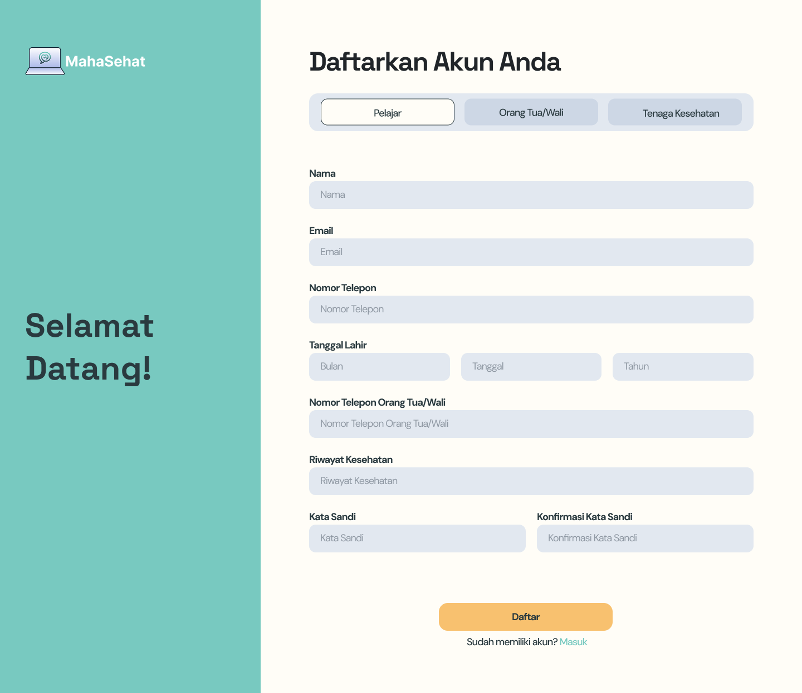
</p>
<p align="center">
<i>Gambar 6.1. Rancangan Antarmuka I-01 - RegistrationPagePelajar</i>
</p>

Tabel 6.1. Spesifikasi Objek Antarmuka I-01

| Id_Objek | Jenis | Konten | Keterangan |
| :--- | :--- | :--- | :--- |
| *Panel_Right* | *Side Panel/Container* | *Berisi semua elemen formulir registrasi* | *Wadah(container) utama di sisi kanan untuk menampung semua komponen interaktif formulir registrasi pelajar.* |
| *Panel_Left* | *Side Panel/Container* | *Berisi logo MahaSehat dan teks sapaan* | *Wadah (container) visual di sisi kiri layar untuk branding dan teks penyambutan pengguna.* |
| *Logo_App* | *Image/Logo* | *Logo MahaSehat* | *Menampilkan identitas/logo aplikasi MahaSehat di bagian atas panel kiri.* |
| *Text_Greeting* | *Label/Text Header* | *Teks "Selamat Datang!"* | *Teks judul sapaan pembuka bagi pengguna yang membuka halaman registrasi.* |
| *Title_Registrasi* | *Text* | *Teks "Daftarkan Akun Anda"* | *Judul halaman yang menandakan ini adalah halaman pendaftaran akun.* |
| *Tab_Role_Pelajar* | *Button/Tab* | *Teks "Pelajar"* | *Menampilkan formulir pendaftaran khusus peran Pelajar (keadaan aktif).* |
| *Label_Nama* | *Text* | *Teks "Nama"* | *Label untuk field input nama.* |
| *Input_Nama* | *Input Text Field* | *Placeholder "Nama"* | *Tempat pengguna (pelajar) memasukkan nama mereka.* |
| *Label_Email* | *Text* | *Teks "Email"* | *Label untuk field input email.* |
| *Input_Email* | *Input Text Field* | *Placeholder "Email"* | *Tempat pengguna (pelajar) memasukkan alamat email mereka.* |
| *Label_NomorTelp* | *Text* | *Teks "Nomor Telepon"* | *Label untuk field input nomor telepon.* |
| *Input_NomorTelp* | *Input Text Field* | *Placeholder "Nomor Telepon"* | *Tempat pengguna (pelajar) memasukkan nomor telepon mereka.* |
| *Group_TglLahir* | *Group/Container* | *Label "Tanggal Lahir" dan 3 input field (Bulan, Tanggal, Tahun)* | *Kelompok elemen untuk mengumpulkan data tanggal lahir pengguna (pelajar).* |
| *Input_BulanLahir* | *Input Text Field* | *Placeholder "Bulan"* | *Tempat pengguna (pelajar) memasukkan bulan lahir mereka.* |
| *Input_TanggalLahir* | *Input Text Field* | *Placeholder "Tanggal"* | *Tempat pengguna (pelajar) memasukkan tanggal lahir mereka.* |
| *Input_TahunLahir* | *Input Text Field* | *Placeholder "Tahun"* | *Tempat pengguna (pelajar) memasukkan tahun lahir mereka.* |
| *Label_NomorTelpOrangTuaWali* | *Text* | *Teks "Nomor Telepon Orang Tua/Wali"* | *Label untuk field input nomor telepon orang tua/wali pelajar.* |
| *Input_NomorTelpOrangTuaWali* | *Input Text Field* | *Placeholder "Nomor Telepon Orang Tua/Wali"* | *Tempat pengguna (pelajar) memasukkan nomor telepon orang tua/wali mereka.* |
| *Label_RiwayatKesehatan* | *Text* | *Teks "Riwayat Kesehatan"* | *Label untuk field input riwayat kesehatan.* |
| *Input_RiwayatKesehatan* | *Input Text Field* | *Placeholder "Riwayat Kesehatan"* | *Tempat pengguna (pelajar) memasukkan riwayat kesehatan mereka.* |
| *Label_KataSandi* | *Text* | *Teks "Kata Sandi"* | *Label untuk field kata sandi.* |
| *Input_KataSandi* | *Input Text Field* | *Placeholder "Kata Sandi"* | *Tempat pengguna (pelajar) memasukkan kata sandi mereka. Tipe input "password".* |
| *Label_KonfirmasiKataSandi* | *Text* | *Teks "Konfirmasi Kata Sandi"* | *Label untuk field konfirmasi kata sandi.* |
| *Input_KonfirmasiKataSandi* | *Input Text Field* | *Placeholder "Konfirmasi Kata Sandi"* | *Tempat pengguna (pelajar) memasukkan ulang kata sandi mereka untuk memastikan kecocokan dengan input sebelumnya. Tipe input "password".* |
| *Btn_Daftar* | *Button* | *"Daftar"* | *Jika diklik, akan memulai validasi data. Jika valid, akun pelajar berhasil diajukan dan konfirmasi persetujuan orang tua/wali akan dikirim bagi pelajar di bawah umur.* |
| *Link_Masuk* | *Link Text* | *"Sudah memiliki akun? Masuk"* | *Mengarahkan pengguna yang sudah memiliki akun ke masuk akun.* |

## 6.2 Rancangan Antarmuka I-02
**Antarmuka:** *I-02*  
**Nama Layar:** *RegistrationPageOrangTuaWali*

<p align="center">
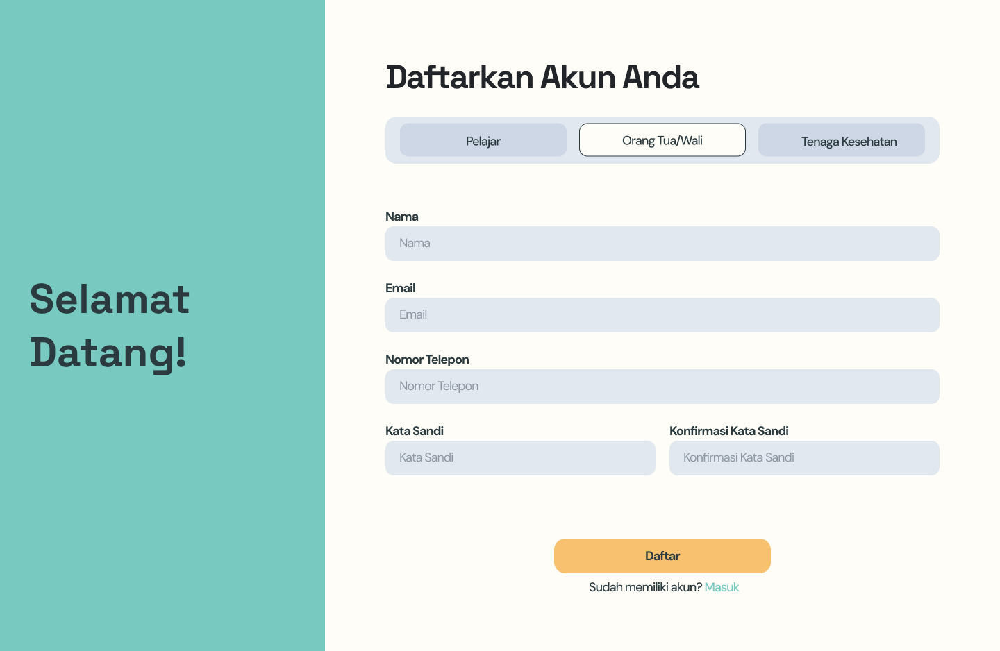
</p>
<p align="center">
<i>Gambar 6.2. Rancangan Antarmuka I-02 - RegistrationPageOrangTuaWali</i>
</p>

Tabel 6.2. Spesifikasi Objek Antarmuka I-02

| Id_Objek | Jenis | Konten | Keterangan |
| :--- | :--- | :--- | :--- |
| *Panel_Right* | *Side Panel/Container* | *Berisi semua elemen formulir registrasi* | *Wadah(container) utama di sisi kanan untuk menampung semua komponen interaktif formulir registrasi orang tua/wali.* |
| *Panel_Left* | *Side Panel/Container* | *Berisi logo MahaSehat dan teks sapaan* | *Wadah (container) visual di sisi kiri layar untuk branding dan teks penyambutan pengguna.* |
| *Logo_App* | *Image/Logo* | *Logo MahaSehat* | *Menampilkan identitas/logo aplikasi MahaSehat di bagian atas panel kiri.* |
| *Text_Greeting* | *Label/Text Header* | *Teks "Selamat Datang!"* | *Teks judul sapaan pembuka bagi pengguna yang membuka halaman registrasi.* |
| *Title_Registrasi* | *Text* | *Teks "Daftarkan Akun Anda"* | *Judul halaman yang menandakan ini adalah halaman pendaftaran akun.* |
| *Tab_Role_OrangTuawali* | *Button/Tab* | *Teks "Orang Tua/Wali"* | *Menampilkan formulir pendaftaran khusus peran Orang Tua/Wali (keadaan aktif).* |
| *Label_Nama* | *Text* | *Teks "Nama"* | *Label untuk field input nama.* |
| *Input_Nama* | *Input Text Field* | *Placeholder "Nama"* | *Tempat pengguna (orang tua/wali) memasukkan nama mereka.* |
| *Label_Email* | *Text* | *Teks "Email"* | *Label untuk field input email.* |
| *Input_Email* | *Input Text Field* | *Placeholder "Email"* | *Tempat pengguna (orang tua/wali) memasukkan alamat email mereka.* |
| *Label_NomorTelp* | *Text* | *Teks "Nomor Telepon"* | *Label untuk field input nomor telepon.* |
| *Input_NomorTelp* | *Input Text Field* | *Placeholder "Nomor Telepon"* | *Tempat pengguna (orang tua/wali) memasukkan nomor telepon mereka.* |
| *Label_KataSandi* | *Text* | *Teks "Kata Sandi"* | *Label untuk field kata sandi.* |
| *Input_KataSandi* | *Input Text Field* | *Placeholder "Kata Sandi"* | *Tempat pengguna (orang tua/wali) memasukkan kata sandi mereka. Tipe input "password".* |
| *Label_KonfirmasiKataSandi* | *Text* | *Teks "Konfirmasi Kata Sandi"* | *Label untuk field konfirmasi kata sandi.* |
| *Input_KonfirmasiKataSandi* | *Input Text Field* | *Placeholder "Konfirmasi Kata Sandi"* | *Tempat pengguna (orang tua/wali) memasukkan ulang kata sandi mereka untuk memastikan kecocokan dengan input sebelumnya. Tipe input "password".* |
| *Btn_Daftar* | *Button* | *"Daftar"* | *Jika diklik, akan memulai validasi data. Jika valid, akun orang tua/wali berhasil dibuat.* |
| *Link_Masuk* | *Link Text* | *"Sudah memiliki akun? Masuk"* | *Mengarahkan pengguna yang sudah memiliki akun ke masuk akun.* |

## 6.3 Rancangan Antarmuka I-03

**Antarmuka:** *I-03*  
**Nama Layar:** *RegistrationPageTenagaKesehatan*

<p align="center">
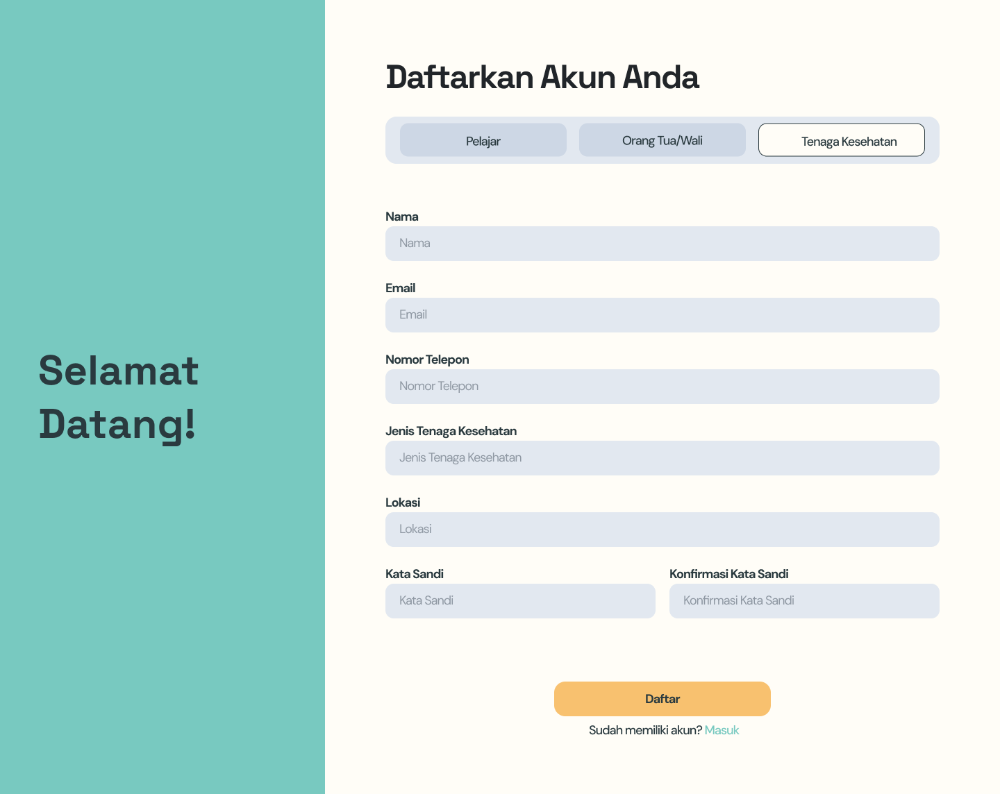
</p>
<p align="center">
<i>Gambar 6.3. Rancangan Antarmuka I-03 - RegistrationPageTenagaKesehatan</i>
</p>

Tabel 6.3. Spesifikasi Objek Antarmuka I-03

| Id_Objek | Jenis | Konten | Keterangan |
| :--- | :--- | :--- | :--- |
| *Panel_Right* | *Side Panel/Container* | *Berisi semua elemen formulir registrasi* | *Wadah(container) utama di sisi kanan untuk menampung semua komponen interaktif formulir registrasi tenaga kesehatan.* |
| *Panel_Left* | *Side Panel/Container* | *Berisi logo MahaSehat dan teks sapaan* | *Wadah (container) visual di sisi kiri layar untuk branding dan teks penyambutan pengguna.* |
| *Logo_App* | *Image/Logo* | *Logo MahaSehat* | *Menampilkan identitas/logo aplikasi MahaSehat di bagian atas panel kiri.* |
| *Text_Greeting* | *Label/Text Header* | *Teks "Selamat Datang!"* | *Teks judul sapaan pembuka bagi pengguna yang membuka halaman registrasi.* |
| *Title_Registrasi* | *Text* | *Teks "Daftarkan Akun Anda"* | *Judul halaman yang menandakan ini adalah halaman pendaftaran akun.* |
| *Tab_Role_TenagaKesehatan* | *Button/Tab* | *Teks "Tenaga Kesehatan"* | *Menampilkan formulir pendaftaran khusus peran Tenaga Kesehatan (keadaan aktif).* |
| *Label_Nama* | *Text* | *Teks "Nama"* | *Label untuk field input nama.* |
| *Input_Nama* | *Input Text Field* | *Placeholder "Nama"* | *Tempat pengguna (tenaga kesehatan) memasukkan nama mereka.* |
| *Label_Email* | *Text* | *Teks "Email"* | *Label untuk field input email.* |
| *Input_Email* | *Input Text Field* | *Placeholder "Email"* | *Tempat pengguna (tenaga kesehatan) memasukkan alamat email mereka.* |
| *Label_NomorTelp* | *Text* | *Teks "Nomor Telepon"* | *Label untuk field input nomor telepon.* |
| *Input_NomorTelp* | *Input Text Field* | *Placeholder "Nomor Telepon"* | *Tempat pengguna (tenaga kesehatan) memasukkan nomor telepon mereka.* |
| *Label_JenisTenagaKesehatan* | *Text* | *Teks "Jenis Tenaga Kesehatan"* | *Label untuk field input jenis tenaga kesehatan.* |
| *Input_JenisTenagaKesehatan* | *Input Text Field* | *Placeholder "Jenis Tenaga Kesehatan"* | *Tempat pengguna (tenaga kesehatan) memasukkan jenis pekerjaan mereka.* |
| *Label_Lokasi* | *Text* | *Teks "Lokasi"* | *Label untuk field input lokasi.* |
| *Input_Lokasi* | *Input Text Field* | *Teks "Lokasi"* | *Tempat pengguna (tenaga kesehatan) memasukkan lokasi kerja mereka.* |
| *Label_KataSandi* | *Text* | *Teks "Kata Sandi"* | *Label untuk field kata sandi.* |
| *Input_KataSandi* | *Input Text Field* | *Placeholder "Kata Sandi"* | *Tempat pengguna (tenaga kesehatan) memasukkan kata sandi mereka. Tipe input "password".* |
| *Label_KonfirmasiKataSandi* | *Text* | *Teks "Konfirmasi Kata Sandi"* | *Label untuk field konfirmasi kata sandi.* |
| *Input_KonfirmasiKataSandi* | *Input Text Field* | *Placeholder "Konfirmasi Kata Sandi"* | *Tempat pengguna (tenaga kesehatan) memasukkan ulang kata sandi mereka untuk memastikan kecocokan dengan input sebelumnya. Tipe input "password".* |
| *Btn_Daftar* | *Button* | *"Daftar"* | *Jika diklik, akan memulai validasi data. Jika valid, akun tenaga kesehatan berhasil dibuat.* |
| *Link_Masuk* | *Link Text* | *"Sudah memiliki akun? Masuk"* | *Mengarahkan pengguna yang sudah memiliki akun ke masuk akun.* |

## 6.4 Rancangan Antarmuka I-04

**Antarmuka:** *I-04*  
**Nama Layar:** *RegistrationSuccessPelajarPage*

<p align="center">
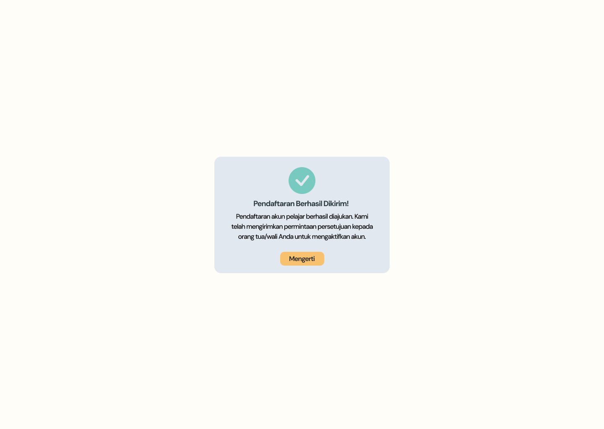
</p>
<p align="center">
<i>Gambar 6.4. Rancangan Antarmuka I-04 - RegistrationSuccessPelajarPage</i>
</p>

Tabel 6.4. Spesifikasi Objek Antarmuka I-04

| Id_Objek | Jenis | Konten | Keterangan |
| :--- | :--- | :--- | :--- |
| *Card_Success* | *Box/Card* | *Berisi semua elemen status registrasi* | *Wadah(container) untuk semua elemen notifikasi sukses.* |
| *Icon_Success* | *Icon* | *Ikon centang dalam lingkaran berwarna hijau* | *Ikon visual yang menandakan registrasi berhasil diajukan.* |
| *Title_Success* | *Text* | *Teks "Pendaftaran Berhasil Dikirim!"* | *Judul yang menginformasikan bahwa pembuatan akun berhasil diajukan.* |
| *Desc_Success* | *Text* | *Teks "Pendaftaran akun pelajar berhasil diajukan. Kami telah mengirimkan permintaan persetujuan kepada orang tua/wali Anda untuk mengaktifkan akun."* | *Penjelasan yang mengkonfirmasi pengajuan akun baru dan pengiriman konfirmasi persetujuan kepada orang tua/wali.* |
| *Btn_Mengerti* | *Button* | *Teks "Mengerti"* | *Jika diklik, akan mengarahkan pengguna (pelajar) kembali ke halaman "RegistrationPagePelajar".* |

## 6.5 Rancangan Antarmuka I-05

**Antarmuka:** *I-05*  
**Nama Layar:** *RegistrationSuccessPage*

<p align="center">
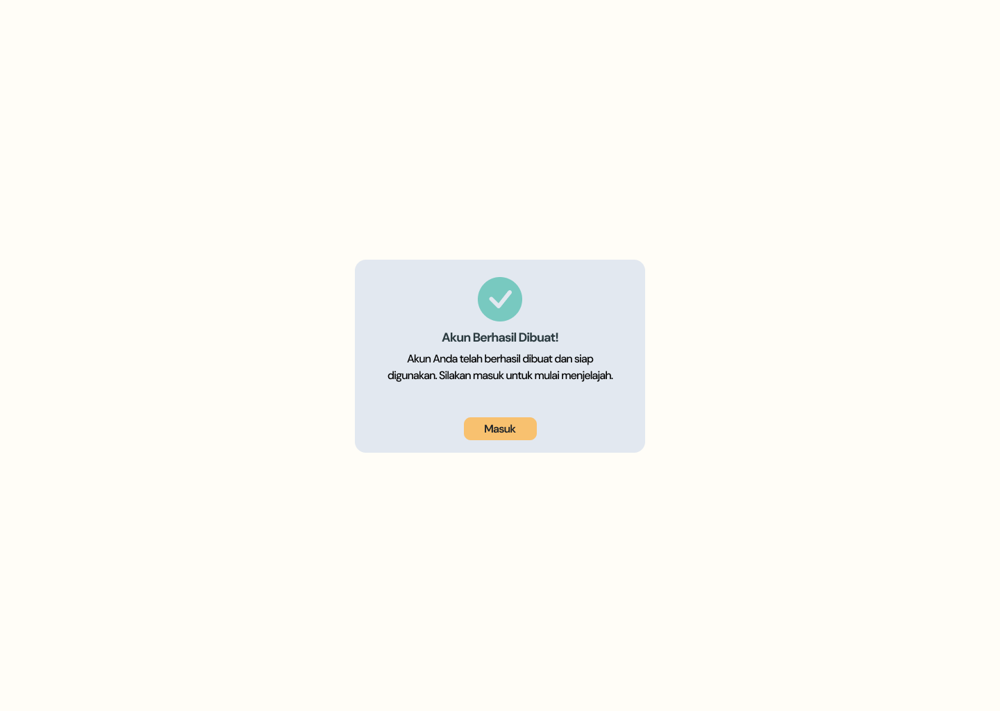
</p>
<p align="center">
<i>Gambar 6.5. Rancangan Antarmuka I-05 - RegistrationSuccessPage</i>
</p>

Tabel 6.5. Spesifikasi Objek Antarmuka I-05

| Id_Objek | Jenis | Konten | Keterangan |
| :--- | :--- | :--- | :--- |
| *Card_Success* | *Box/Card* | *Berisi semua elemen status registrasi* | *Wadah(container) untuk semua elemen notifikasi sukses.* |
| *Icon_Success* | *Icon* | *Ikon centang dalam lingkaran berwarna hijau* | *Ikon visual yang menandakan registrasi berhasil diajukan.* |
| *Title_Success* | *Text* | *Teks "Akun Berhasil Dibuat!"* | *Judul yang menginformasikan bahwa pembuatan akun berhasil.* |
| *Desc_Success* | *Text* | *Teks "Akun Anda telah berhasil dibuat dan siap digunakan. Silakan masuk untuk mulai menjelajah."* | *Penjelasan yang mengkonfirmasi pembuatan akun dan menginstruksikan pengguna untuk masuk akun.* |
| *Btn_Masuk* | *Button* | *Teks "Masuk"* | *Jika diklik, akan mengarahkan pengguna ke halaman "LoginPage".* |

## 6.6 Rancangan Antarmuka I-06
**Antarmuka:** *I-06*  
**Nama Layar:** *KonfirmasiRegistrasiPage*

<p align="center">
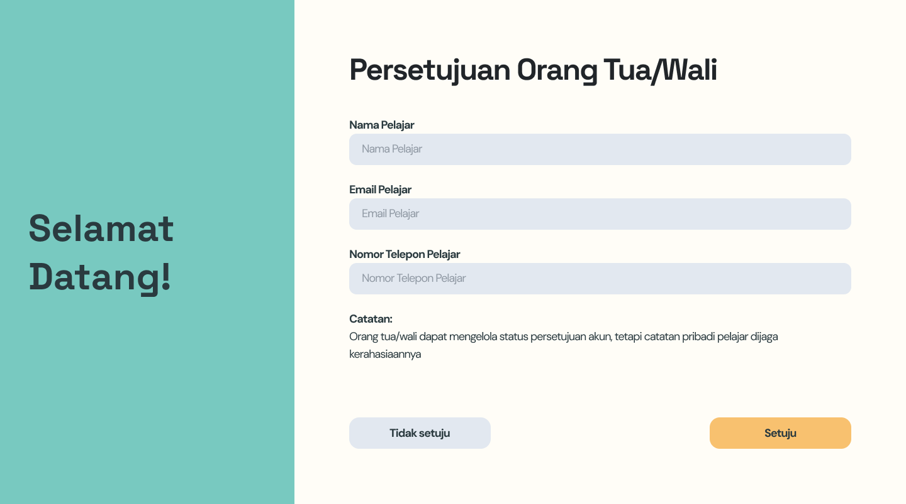
</p>
<p align="center">
<i>Gambar 6.6. Rancangan Antarmuka I-06 - KonfirmasiRegistrasiPage</i>
</p>

Tabel 6.6. Spesifikasi Objek Antarmuka I-06

| Id_Objek | Jenis | Konten | Keterangan |
| :--- | :--- | :--- | :--- |
| *Panel_Right* | *Side Panel/Container* | *Berisi semua elemen persetujuan orang tua/wali* | *Wadah(container) utama di sisi kanan untuk menampung rincian data pelajar dan tombol persetujuan.* |
| *Panel_Left* | *Side Panel/Container* | *Berisi logo MahaSehat dan teks sapaan* | *Wadah (container) visual di sisi kiri layar untuk branding dan teks penyambutan pengguna.* |
| *Logo_App* | *Image/Logo* | *Logo MahaSehat* | *Menampilkan identitas/logo aplikasi MahaSehat di bagian atas panel kiri.* |
| *Text_Greeting* | *Label/Text Header* | *Teks "Selamat Datang!"* | *Teks judul sapaan pembuka bagi pengguna yang membuka halaman registrasi.* |
| *Label_NamaPelajar* | *Text* | *Teks "Nama Pelajar"* | *Label judul untuk informasi nama pelajar.* |
| *Text_ValNamaPelajar* | *Text Value* | *Teks dinamik nama pelajar* | *Menampilkan nama pelajar yang mengajukan pembuatan akun.* |
| *Label_EmailPelajar* | *Text* | *Teks "Email Pelajar"* | *Label judul untuk informasi email pelajar.* |
| *Text_ValEmailPelajar* | *Text Value* | *Teks dinamik email pelajar* | *Menampilkan email pelajar yang mengajukan pembuatan akun.* |
| *Label_NomorTelpPelajar* | *Text* | *Teks "Nomor Telepon Pelajar"* | *Label judul untuk informasi nomor telepon pelajar.* |
| *Text_ValueNomorTelpPelajar* | *Text Value* | *Teks dinamik nomor telepon pelajar* | *Menampilkan nomor telepon pelajar yang mengajukan pembuatan akun.* |
| *Label_Catatan* | *Text* | *Teks "Catatan"* | *Label untuk teks catatan pemberitahuan batas akses.* |
| *Text_Catatan* | *Text* | *Teks "Orang tua/wali dapat mengelola status persetujuan akun, tetapi catatan pribadi pelajar dijaga kerahasiaannya"* | *Teks penjelas batas akses orang tua/wali untuk menjaga privasi pelajar.* |
| *Btn_Setuju* | *Button* | *"Setuju"* | *Jika diklik, akan mengubah status akun pelajar menjadi aktif dan siap digunakan.* |
| *Btn_TidakSetuju* | *Button* | *"Tidak setuju"* | *Mengubah status pengajuan menjadi ditolak.* |

## 6.7 Rancangan Antarmuka I-07
**Antarmuka:** *I-07*  
**Nama Layar:** *LoginPage*

<p align="center">
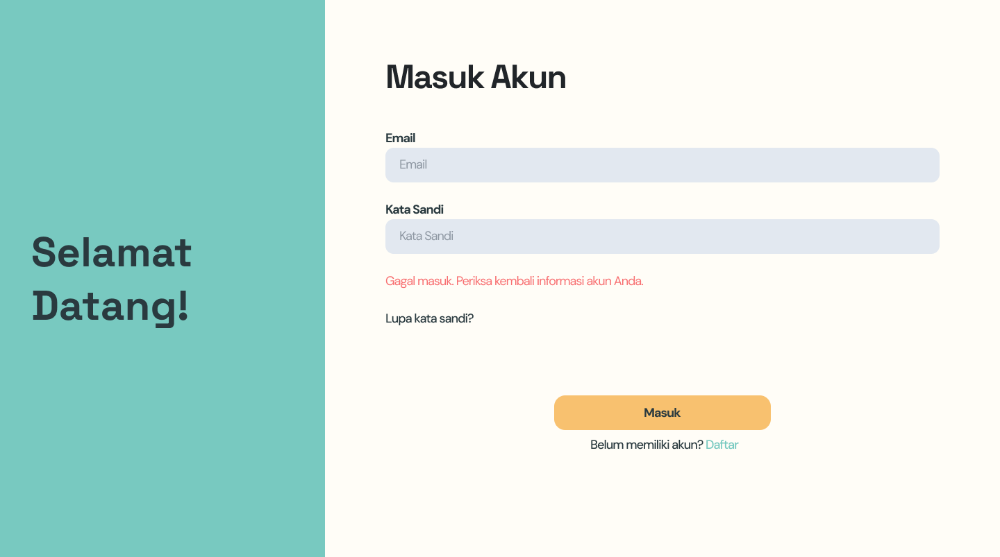
</p>
<p align="center">
<i>Gambar 6.7. Rancangan Antarmuka I-07 - LoginPage</i>
</p>

Tabel 6.7. Spesifikasi Objek Antarmuka I-07

| Id_Objek | Jenis | Konten | Keterangan |
| :--- | :--- | :--- | :--- |
| *Panel_Right* | *Side Panel/Container* | *Berisi semua elemen formulir masuk akun* | *Wadah(container) utama di sisi kanan untuk menampung semua komponen interaktif formulir masuk akun.* |
| *Panel_Left* | *Side Panel/Container* | *Berisi logo MahaSehat dan teks sapaan* | *Wadah (container) visual di sisi kiri layar untuk branding dan teks penyambutan pengguna.* |
| *Logo_App* | *Image/Logo* | *Logo MahaSehat* | *Menampilkan identitas/logo aplikasi MahaSehat di bagian atas panel kiri.* |
| *Text_Greeting* | *Label/Text Header* | *Teks "Selamat Datang!"* | *Teks judul sapaan pembuka bagi pengguna yang membuka halaman registrasi.* |
| *Title_Login* | *Text* | *Teks "Masuk Akun"* | *Judul halaman yang menandakan ini adalah halaman masuk akun.* |
| *Label_Email* | *Text* | *Teks "Email"* | *Label judul untuk field email pengguna.* |
| *Input_Email* | *Input Text Field* | *Placeholder "Email"* | *Tempat pengguna memasukkan alamat email mereka.* |
| *Label_KataSandi* | *Text* | *Teks "Kata Sandi"* | *Label untuk field input kata sandi.* |
| *Input_KataSandi* | *Input Text Field* | *Placeholder "Kata Sandi"* | *Tempat pengguna memasukkan kata sandi akun mereka.* |
| *Link_LupaPass* | *Link Text* | *"Lupa kata sandi?"* | *Jika diklik, akan mengarahkan pengguna ke halaman atau alur untuk mengganti kata sandi.* |
| *Btn_Masuk* | *Button* | *"Masuk"* | *Jika diklik, akan memvalidasi email dan password pengguna. Jika valid, pengguna akan masuk ke "Dashboard".* |
| *Link_Daftar* | *Button* | *"Belum memiliki akun? Daftar"* | *Mengarahkan pengguna yang belum memiliki akun ke halaman daftar akun.* |

## 6.8 Rancangan Antarmuka I-08
**Antarmuka:** *I-08*  
**Nama Layar:** *ResetPasswordPage*

<p align="center">

</p>
<p align="center">
<i>Gambar 6.8. Rancangan Antarmuka I-08 - ResetPasswordPage1</i>
</p>

Tabel 6.8. Spesifikasi Objek Antarmuka I-08

| Id_Objek | Jenis | Konten | Keterangan |
| :--- | :--- | :--- | :--- |
| *Panel_Right* | *Side Panel/Container* | *Berisi semua elemen formulir "Lupa Kata Sandi"* | *Wadah(container) utama di sisi kanan untuk menampung semua komponen interaktif formulir lupa kata sandi.* |
| *Panel_Left* | *Side Panel/Container* | *Berisi logo MahaSehat dan teks sapaan* | *Wadah (container) visual di sisi kiri layar untuk branding dan teks penyambutan pengguna.* |
| *Logo_App* | *Image/Logo* | *Logo MahaSehat* | *Menampilkan identitas/logo aplikasi MahaSehat di bagian atas panel kiri.* |
| *Text_Greeting* | *Label/Text Header* | *Teks "Pulihkan Akun"* | *Teks judul sapaan untuk pengguna yang lupa kata sandi.* |
| *Title_LupaPass* | *Text* | *Teks "Lupa Kata Sandi?"* | *Judul halaman yang menandakan ini adalah halaman untuk mengganti kata sandi.* |
| *Label_Email* | *Text* | *Teks "Email"* | *Label judul untuk field email pengguna.* |
| *Input_Email* | *Input Text Field* | *Placeholder "Email"* | *Tempat pengguna memasukkan alamat email mereka.* |
| *Btn_KirimLink* | *Button* | *"Kirim Tautan Atur Ulang"* | *Jika diklik, akan memvalidasi email dan jika valid akan mengirimkan tautan untuk mengatur ulang kata sandi.* |
| *Link_Masuk* | *Button* | *"Kembali ke Masuk Akun"* | *Mengarahkan pengguna kembali ke halaman masuk akun.* |

## 6.9 Rancangan Antarmuka I-09
**Antarmuka:** *I-09*  
**Nama Layar:** *ResetPasswordPage2*

<p align="center">
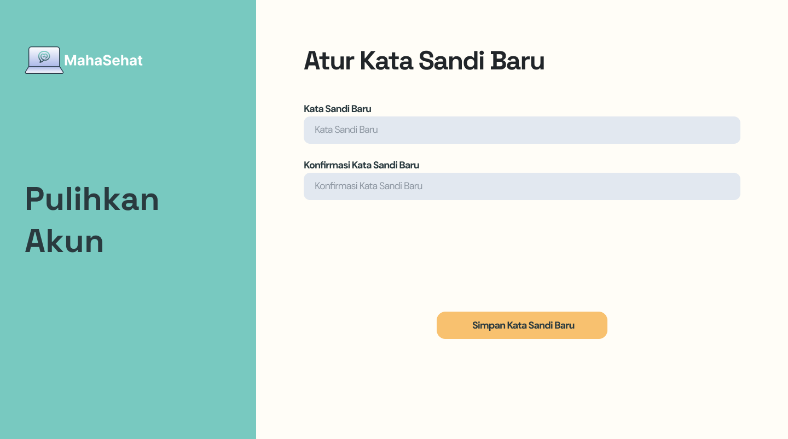
</p>
<p align="center">
<i>Gambar 6.9. Rancangan Antarmuka I-09 - ResetPasswordPage2</i>
</p>

Tabel 6.9. Spesifikasi Objek Antarmuka I-09

| Id_Objek | Jenis | Konten | Keterangan |
| :--- | :--- | :--- | :--- |
| *Panel_Right* | *Side Panel/Container* | *Berisi semua elemen formulir atur ulang kata sandi* | *Wadah(container) utama di sisi kanan untuk menampung semua komponen interaktif formulir atur ulang kata sandi.* |
| *Panel_Left* | *Side Panel/Container* | *Berisi logo MahaSehat dan teks sapaan* | *Wadah (container) visual di sisi kiri layar untuk branding dan teks penyambutan pengguna.* |
| *Logo_App* | *Image/Logo* | *Logo MahaSehat* | *Menampilkan identitas/logo aplikasi MahaSehat di bagian atas panel kiri.* |
| *Text_Greeting* | *Label/Text Header* | *Teks "Pulihkan Akun"* | *Teks judul sapaan untuk pengguna yang lupa kata sandi.* |
| *Title_AturKataSandi* | *Text* | *Teks "Atur Kata Sandi Baru"* | *Judul halaman yang menandakan ini adalah halaman pengaturan kata sandi baru.* |
| *Label_KataSandiBaru* | *Text* | *Teks "Kata Sandi Baru"* | *Label untuk field input kata sandi baru.* |
| *Input_KataSandiBaru* | *Input Text Field* | *Placeholder "Kata Sandi Baru"* | *Tempat pengguna memasukkan kata sandi baru akun mereka.* |
| *Label_KonfirmasiKataSandiBaru* | *Text* | *Teks "Konfirmasi Kata Sandi Baru"* | *Label untuk field input konfirmasi kata sandi baru.* |
| *Input_KonfirmasiKataSandiBaru* | *Input Text Field* | *Placeholder "Konfirmasi Kata Sandi Baru"* | *Tempat pengguna memasukkan ulang kata sandi baru akun mereka.* |
| *Btn_Simpan* | *Button* | *"Simpan Kata Sandi Baru"* | *Jika diklik, akan memvalidasi password baru pengguna. Jika valid, pengguna akan menerima pesan keberhasilan.* |

## 6.10 Rancangan Antarmuka I-10
**Antarmuka:** *I-10*  
**Nama Layar:** *PasswordChangedMessage*

<p align="center">
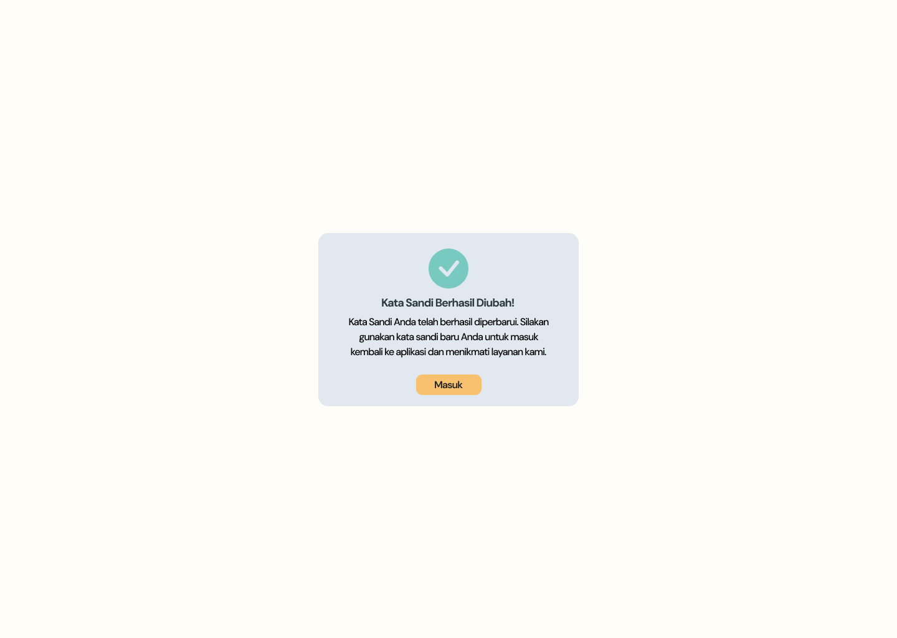
</p>
<p align="center">
<i>Gambar 6.10. Rancangan Antarmuka I-10 - PasswordChangedMessage</i>
</p>

Tabel 6.10. Spesifikasi Objek Antarmuka I-10

| Id_Objek | Jenis | Konten | Keterangan |
| :--- | :--- | :--- | :--- |
| *Card_Success* | *Box/Card* | *Berisi semua elemen konfirmasi* | *Wadah(container) untuk semua elemen notifikasi sukses.* |
| *Icon_Success* | *Icon* | *Ikon centang dalam lingkaran berwarna hijau* | *Ikon visual yang menandakan operasi berhasil.* |
| *Title_Success* | *Text* | *Teks "Kata Sandi Berhasil Diubah!"* | *Judul yang menginformasikan bahwa kata sandi berhasil diperbarui.* |
| *Desc_Success* | *Text* | *Teks "Kata Sandi Anda telah berhasil diperbarui. Silakan gunakan kata sandi baru Anda untuk masuk kembali ke aplikasi dan menikmati layanan kami."* | *Penjelasan yang mengkonfirmasi pembaruan dan menginstruksikan pengguna untuk masuk kembali.* |
| *Btn_Masuk* | *Button* | *"Masuk"* | *Jika diklik, akan mengarahkan pengguna kembali ke halaman masuk akun.* |

## 6.11 Rancangan Antarmuka I-11
**Antarmuka:** *I-11*  
**Nama Layar:** *IzinAksesLokasiPopUp*

<p align="center">
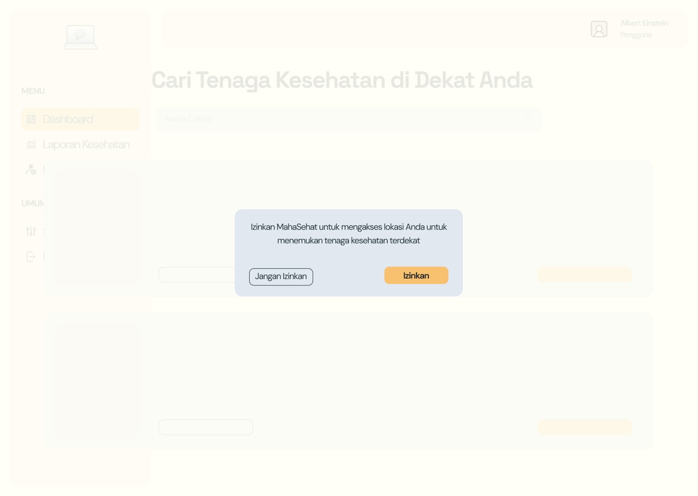
</p>
<p align="center">
<i>Gambar 6.11. Rancangan Antarmuka I-11 - IzinAksesLokasiPopUp</i>
</p>

Tabel 6.11. Spesifikasi Objek Antarmuka I-11

| Id_Objek | Jenis | Konten | Keterangan |
| :--- | :--- | :--- | :--- |
| *Card_IzinAksesLokasi* | *Box/Card* | *Berisi semua elemen untuk meminta izin akses lokasi pengguna* | *Wadah (container) untuk semua elemen izin akses lokasi pengguna.* |
| *Desc_IzinAksesLokasiPengguna* | *Text* | *Teks "Izinkan MahaSehat untuk mengakses lokasi Anda untuk menemukan tenaga kesehatan terdekat"* | *Penjelasan untuk meminta izin akses lokasi pengguna.* |
| *Btn_Izinkan* | *Button* | *"Izinkan"* | *Jika diklik, akan mengarahkan pengguna ke halaman pencarian tenaga kesehatan beserta informasi jarak fasilitas kesehatan tempat tenaga kesehatan tersebut bekerja.* |
| *Btn_JanganIzinkan* | *Button* | *"Jangan Izinkan"* | *Jika diklik, akan mengarahkan pengguna ke halaman pencarian tenaga kesehatan tanpa informasi jarak fasilitas kesehatan tempat tenaga kesehatan tersebut bekerja.* |

## 6.12 Rancangan Antarmuka I-12
**Antarmuka:** *I-12*  
**Nama Layar:** *CariTenagaKesehatanPage*

<p align="center">
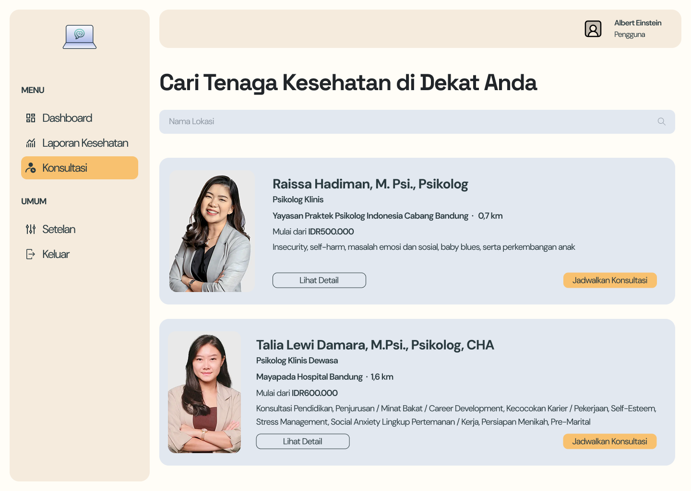
</p>
<p align="center">
<i>Gambar 6.12. Rancangan Antarmuka I-12 - CariTenagaKesehatanPage</i>
</p>

Tabel 6.12. Spesifikasi Objek Antarmuka I-12

| Id_Objek | Jenis | Konten | Keterangan |
| :--- | :--- | :--- | :--- |
| *Sidebar* | *Box* | *Berisi logo, menu, setelan, dan keluar* | *Panel navigasi di sisi kiri halaman.* |
| *Logo_App* | *Image/Logo* | *Logo MahaSehat* | *Menampilkan identitas/logo aplikasi MahaSehat.* |
| *Nav_Dashboard* | *Link Menu* | *"Dashboard"* | *Link navigasi ke halaman Dashboard, menandakan sedang aktif.* |
| *Nav_LaporanKesehatan* | *Link Menu* | *"Laporan Kesehatan"* | *Link navigasi ke halaman laporan kesehatan.* |
| *Nav_Konsultasi* | *Link Menu* | *"Konsultasi"* | *Link navigasi ke halaman konsultasi.* |
| *Nav_Setelan* | *Link Menu* | *"Setelan"* | *Link navigasi ke halaman setelan.* |
| *Nav_Keluar* | *Link Menu* | *"Keluar"* | *Link navigasi keluar.* |
| *Header_User* | *Container/Header Bar* | *Informasi profil (Nama: "Albert Einstein", Peran: "Pengguna", dan ikon profil)* | *Menampilkan identitas pengguna yang sedang masuk.* |
| *Title_Cari* | *Text* | *"Cari Tenaga Kesehatan di Dekat Anda"* | *Judul yang menginformasikan bahwa halaman ini untuk mencari tenaga kesehatan di dekat pengguna.* |
| *Input_Lokasi* | *Search Field* | *Placeholder "Nama Lokasi" dengan ikon pencarian* | *Tempat pengguna mengetikkan atau mencari lokasi spesifik untuk menyaring tenaga kesehatan terdekat.* |
| *Card_NakesItem* | *Box/Card Container* | *Informasi detail tenaga kesehatan (Foto profil, nama, spesialisasi, lokasi, jarak, tarif, dan keahlian)* | *Wadah (card) untuk menampilkan ringkasan profil setiap tenaga kesehatan.* |
| *Btn_LihatDetail* | *Button* | *"Lihat Detail"* | *Jika diklik akan mengarahkan pengguna ke profil yang lebih lengkap dan jadwal praktik.* |
| *Btn_JadwalkanKonsultasi* | *Button* | *"Jadwalkan Konsultasi"* | *Jika diklik akan mengarahkan pengguna untuk menjadwalkan sesi konsultasi dengan tenaga kesehatan terpilih.* |

## 6.13 Rancangan Antarmuka I-13
**Antarmuka:** *I-13*  
**Nama Layar:** *ProfilTenagaKesehatanPage*

<p align="center">
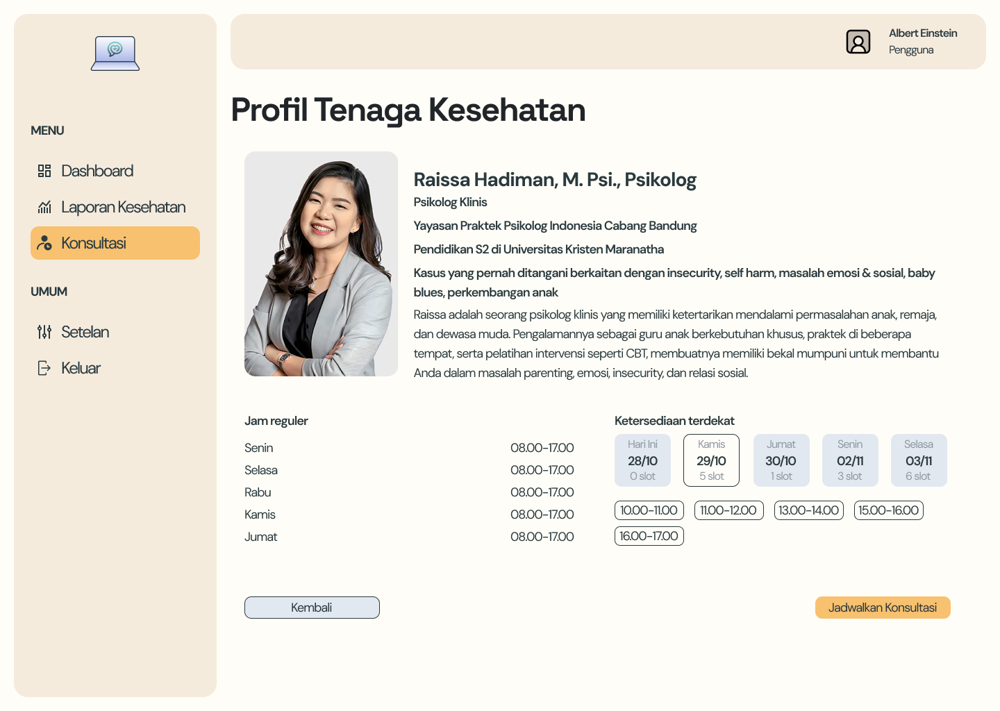
</p>
<p align="center">
<i>Gambar 6.13. Rancangan Antarmuka I-13 - ProfilTenagaKesehatanPage</i>
</p>

Tabel 6.13. Spesifikasi Objek Antarmuka I-13

| Id_Objek | Jenis | Konten | Keterangan |
| :--- | :--- | :--- | :--- |
| *Sidebar* | *Box* | *Berisi logo, menu, setelan, dan keluar* | *Panel navigasi di sisi kiri halaman.* |
| *Logo_App* | *Image/Logo* | *Logo MahaSehat* | *Menampilkan identitas/logo aplikasi MahaSehat.* |
| *Nav_Dashboard* | *Link Menu* | *"Dashboard"* | *Link navigasi ke halaman Dashboard, menandakan sedang aktif.* |
| *Nav_LaporanKesehatan* | *Link Menu* | *"Laporan Kesehatan"* | *Link navigasi ke halaman laporan kesehatan.* |
| *Nav_Konsultasi* | *Link Menu* | *"Konsultasi"* | *Link navigasi ke halaman konsultasi.* |
| *Nav_Setelan* | *Link Menu* | *"Setelan"* | *Link navigasi ke halaman setelan.* |
| *Nav_Keluar* | *Link Menu* | *"Keluar"* | *Link navigasi keluar.* |
| *Header_User* | *Container/Header Bar* | *Informasi profil (Nama: "Albert Einstein", Peran: "Pengguna", dan ikon profil)* | *Menampilkan identitas pengguna yang sedang masuk.* |
| *Title_Profil* | *Text* | *"Profil Tenaga Kesehatan"* | *Judul yang menginformasikan bahwa halaman ini menunjukkan profil tenaga kesehatan.* |
| *Image_ProfilNakes* | *Image* | *Foto profil tenaga kesehatan* | *Menampilkan foto resmi profesional tenaga kesehatan.* |
| *Text_NamaNakes* | *Label/Text* | *Teks nama dan gelar profesional tenaga kesehatan* | *Identitas utama tenaga kesehatan.* |
| *Text_Spesialisasi* | *Label/Text* | *Teks spesialisasi, afiliasi tempat praktik, dan latar belakang pendidikan* | *Informasi kredibilitas profesional.* |
| *Text_DeskripsiNakes* | *Label/Paragraph* | *Ringkasan kasus yang pernah ditangani* | *Memberikan gambaran keahlian kepada pengguna sebelum memesan sesi.* |
| *Card_JamReguler* | *Box/Container* | *Daftar jadwal operasional rutin (Senin-Jumat pukul 08.00-17.00)* | *Informasi jam kerja reguler tenaga kesehatan.* |
| *Group_Ketersediaan* | *Interactive Container* | *Pilihan tanggal ketersediaan (Hari ini 28/10, Kamis 29/10, Jumat 30/10, dst.) beserta indikator sisa slot* | *Komponen pemilihan tanggal konsultasi yang tersedia.* |
| *List_SlotJam* | *Label/Text Group* | *Teks rentang waktu spesifik (10.00-11.00, 11.00-12.00, dst.)* | *Menampilkan informasi jam slot yang tersedia pada tanggal yang dipilih (read-only).* |
| *Btn_JadwalkanKonsultasi* | *Button* | *"Jadwalkan Konsultasi"* | *Jika diklik akan mengarahkan pengguna ke halaman penjadwalan konsultasi.* |
| *Btn_Kembali* | *Button* | *"Kembali"* | *Jika diklik akan mengarahkan pengguna kembali ke halaman pencarian tenaga kesehatan.* |

## 6.14 Rancangan Antarmuka I-14
**Antarmuka:** *I-14*  
**Nama Layar:** *PengajuanKonsultasi*
<p align="center">
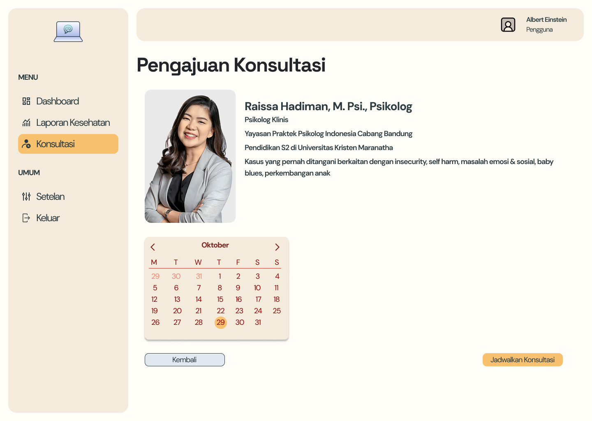
</p>
<p align="center">
<i>Gambar 6.14. Rancangan Antarmuka I-14 - PengajuanKonsultasi</i>
</p>

Tabel 6.14. Spesifikasi Objek Antarmuka I-14

| Id_Objek | Jenis | Konten | Keterangan |
| :--- | :--- | :--- | :--- |
| *Sidebar* | *Box* | *Berisi logo, menu, setelan, dan keluar* | *Panel navigasi di sisi kiri halaman.* |
| *Logo_App* | *Image/Logo* | *Logo MahaSehat* | *Menampilkan identitas/logo aplikasi MahaSehat.* |
| *Nav_Dashboard* | *Link Menu* | *"Dashboard"* | *Link navigasi ke halaman Dashboard, menandakan sedang aktif.* |
| *Nav_LaporanKesehatan* | *Link Menu* | *"Laporan Kesehatan"* | *Link navigasi ke halaman laporan kesehatan.* |
| *Nav_Konsultasi* | *Link Menu* | *"Konsultasi"* | *Link navigasi ke halaman konsultasi.* |
| *Nav_Setelan* | *Link Menu* | *"Setelan"* | *Link navigasi ke halaman setelan.* |
| *Nav_Keluar* | *Link Menu* | *"Keluar"* | *Link navigasi keluar.* |
| *Header_User* | *Container/Header Bar* | *Informasi profil (Nama: "Albert Einstein", Peran: "Pengguna", dan ikon profil)* | *Menampilkan identitas pengguna yang sedang masuk.* |
| *Title_Penjadwalan* | *Text* | *"Penjadwalan Konsultasi"* | *Judul yang menginformasikan bahwa halaman ini untuk menjadwalkan konsultasi.* |
| *Image_ProfilNakes* | *Image* | *Foto profil tenaga kesehatan* | *Menampilkan foto resmi profesional tenaga kesehatan.* |
| *Text_NamaNakes* | *Label/Text* | *Teks nama dan gelar profesional tenaga kesehatan* | *Identitas utama tenaga kesehatan.* |
| *Text_Spesialisasi* | *Label/Text* | *Teks spesialisasi, afiliasi tempat praktik, dan latar belakang pendidikan* | *Informasi kredibilitas profesional.* |
| *Text_DeskripsiNakes* | *Label/Paragraph* | *Ringkasan kasus yang pernah ditangani* | *Memberikan gambaran keahlian kepada pengguna sebelum memesan sesi.* |
| *Widget_Kalender* | *Calendar* | *Kalender interaktif bulan Oktober 2026 dengan penanda tanggal aktif* | *Komponen bagi pengguna untuk memilih tanggal sesi konsultasi.* |
| *Group_SlotJam* | *Button Group* | *Daftar tombol pilihan rentang waktu (10.00-11.00, dst.)* | *Pilihan jam konsultasi yang tersedia pada tanggal yang dipilih.* |
| *Text_Harga* | *Text Value* | *Informasi harga konsultasi (IDR300.000)* | *Menampilkan rincian biaya layanan konsultasi.* |
| *Btn_JadwalkanKonsultasi* | *Button* | *"Jadwalkan Konsultasi"* | *Jika diklik akan mengirimkan penjadwalan konsultasi ke tenaga kesehatan bersangkutan.* |
| *Btn_Kembali* | *Button* | *"Kembali"* | *Jika diklik akan mengarahkan pengguna kembali ke halaman profil tenaga kesehatan.* |

## 6.Y Rancangan Antarmuka Keseluruhan

Tuliskan daftar gambar seluruh antarmuka. Berikan ID unik untuk setiap tampilan dan gunakan ID yang sama pada subbab perancangan antarmuka masing-masing.

Tabel 6.Y. Rancangan Antarmuka Keseluruhan

| No | Tampilan Antarmuka |
| :--- | :--- |
| *[I-01]* |  |
| *[I-02]* |   |
| *[I-03]* |   |
| *[I-04]* |   |
| *[I-05]* |   |
| *[I-06]* |   |
| *[I-07]* |   |
| *[I-08]* | 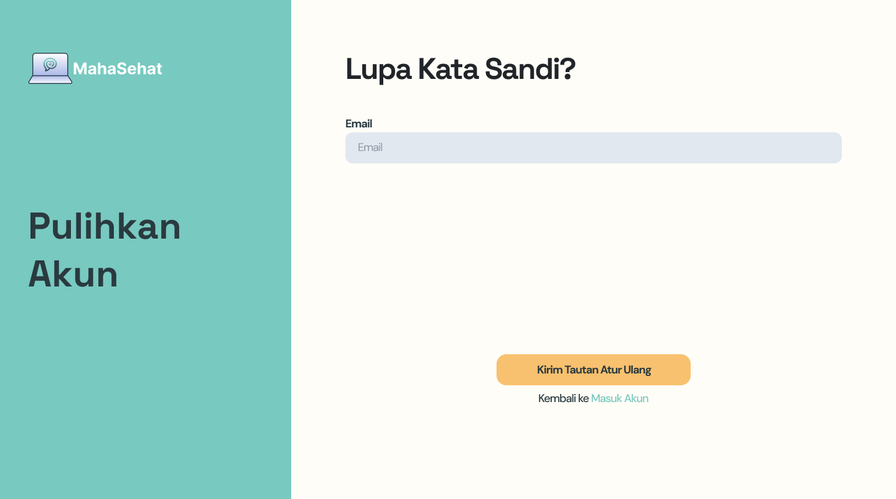  |
| *[I-09]* |   |
| *[I-10]* |   |
| *[I-11]* |   |
| *[I-12]* |   |
| *[I-13]* |   |
| *[I-14]* |   |

<br>

---

# BAB 7: Matriks Kerunutan

Tabel 7.1. Matriks Kerunutan Kelas terhadap Use Case

| Kelas | Use Case Terkait |
| :--- | :--- |
| *[C01 - Pengguna]* | *[UC01 - Melakukan Registrasi Akun, UC09 - Masuk Akun Pengguna, UC10 - Keluar Akun Pengguna]* |
| *[C02 - Pelajar]* | *[UC01 - Melakukan Registrasi Akun, UC03 - Melakukan Daily Check-In, UC04 - Melihat Statistik dan Laporan Kondisi, UC05 - Menentukan Tenaga Kesehatan, UC06 - Mengajukan Jadwal Konsultasi, UC08 - Menerima dan Menindaklanjuti Notifikasi Darurat, UC09 - Masuk Akun Pengguna, UC10 - Keluar Akun Pengguna]* |
| *[C03 - OrangTuaWali]* | *[UC02 - Mengonfirmasi Registrasi Akun, UC04 - Melihat Statistik dan Laporan Kondisi, UC08 - Menerima dan Menindaklanjuti Notifikasi Darurat, UC09 - Masuk Akun Pengguna, UC10 - Keluar Akun Penggua]* |
| *[C04 - TenagarKesehatan]* | *[UC05 - Menentukan Tenaga Kesehatan, UC07 - Mengelola Pengajuan Konsultasi, UC09 - Masuk Akun Pengguna, UC10 - Keluar Akun Pengguna]* |
| *[C05 - RiwayatKesehatan]* | *[UC01 - Melakukan Registrasi Akun]* |
| *[C06 - CheckIn]* | *[UC03 - Melakukan Daily Check-In, UC04 - Melihat Statistik dan Laporan Kondisi]* |
| *[C07 - LaporanKesehatan]* | *[UC04 - Melihat Statistik dan Laporan Kondisi, UC08 - Menerima dan Menindaklanjuti Notifikasi Darurat]* |
| *[C08 - FasilitasKesehatan]* | *[UC05 - Menentukan Tenaga Kesehatan]* |
| *[C09 - JadwalKonsultasi]* | *[UC06 - Mengajukan Jadwal Konsultasi, UC07 - Mengelola Pengajuan Konsultasi]* |
| *[C10 - RegistrationPage]* | *[UC01 - Melakukan Registrasi Akun]* |
| *[C11 - AuthController]* | *[UC01 - Melakukan Registrasi Akun, UC09 - Masuk Akun Pengguna, UC10 - Keluar Akun Pengguna]* |
| *[C12 - KonfirmasiRegistrasiPage]* | *[UC02 - Mengonfirmasi Registrasi Akun]* |
| *[C13 - CheckInPage]* | *[UC03 - Melakukan Daily Check-In]* |
| *[C14 - CheckInController]* | *[UC03 - Melakukan Daily Check-In]* |
| *[C15 - NotifikasiPengingatController]* | *[UC03 - Melakukan Daily Check-In]* |
| *[C16 - ReportPage]* | *[UC04 - Melihat Statistik dan Laporan Kondisi]* |
| *[C17 - ReportController]* | *[UC04 - Melihat Statistik dan Laporan Kondisi]* |
| *[C18 - CariTenagaKesehatanPage]* | *[UC05 - Menentukan Tenaga Kesehatan]* |
| *[C19 - ProfilTenagaKesehatanPage]* | *[UC05 - Menentukan Tenaga Kesehatan, UC06 - Mengajukan Jadwal Konsultasi]* |
| *[C20 - TenagaKesehatanController]* | *[UC05 - Menentukan Tenaga Kesehatan]* |
| *[C21 - PengajuanKonsultasiPage]* | *[UC06 - Mengajukan Jadwal Konsultasi, UC07 - Mengelola Pengajuan Konsultasi]* |
| *[C22 - JadwalKonsultasiController]* | *[UC06 - Mengajukan Jadwal Konsultasi]* |
| *[C23 - KonsultasiController]* | *[UC07 - Mengelola Pengajuan Konsultasi]* |
| *[C24 - NotifikasiDaruratController]* | *[UC08 - Menerima dan Menindaklanjuti Notifikasi Darurat]* |
| *[C25 - LoginPage]* | *[UC09 - Masuk Akun Pengguna, UC10 - Keluar Akun Pengguna]* |
| *[C26 - ResetPasswordPage]* | *[UC09 - Masuk Akun Pengguna]* |
| *[C27 - PasswordController]* | *[UC09 - Masuk Akun Pengguna]* |
| *[C28 - DashboardPage]* | *[UC09 - Masuk Akun Pnegguna]* |
| *[C29 - SettingPage]* | *[UC10 - Keluar Akun Pengguna]* |