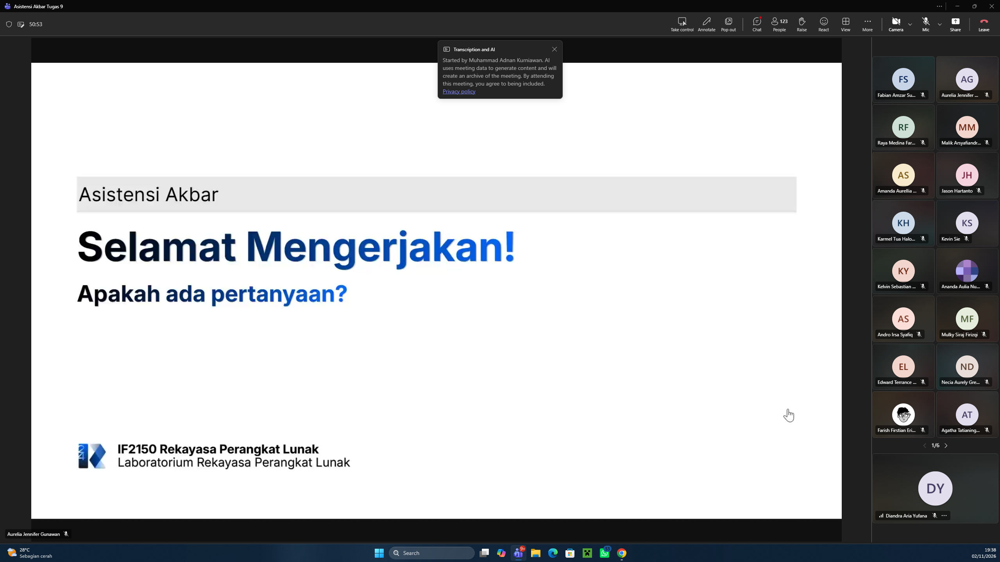

# Form Asistensi

## Tugas Besar IF2150 - Rekayasa Perangkat Lunak

| Informasi | Keterangan |
| --- | --- |
| **Hari** | *Selasa* |
| **Tanggal** | *27/10/2026* |
| **Kelas** | *03* |
| **Nomor Kelompok** | *04*  |
| **Nama Kelompok** | *pakespinwheel*  |
| **Nama Perangkat Lunak** | *Mahasehat*  |
| **Dokumen** | *K03_G04_Implementasi.md*  |

### Anggota Kelompok

| NIM | Nama |
| --- | --- |
| *13525021* | *Haikal Muhammad Royyan* |
| *13525066* | *Cynthia Winda Wijaya* |
| *13525081* | *Rendy Salastra Putra* |
| *13525090* | *Sophia Imelda Rogate Marpaung* |
| *13525141* | *Christabelcyne Costan* |

### Catatan

| Catatan |
| --- |
| 1. *Nulis perubahan dari DPPL, bukti best practices dan profiling, kendala, kontribusi anggota, traceability kelas ke implementasi, source code, serta README*  |
| 2. *Dalam implementasinya harus menuruti git workflow* |
| 3. *Dalam commit harus pakai semantic commit messages* |
| 4. *Membuat template issue yang jelas untuk setiap pekerjaan yang dilakukan* |
| 5. *Melakukan code review sebelum merge pull request* |

## Dokumentasi

<!--  -->

  

  <i>Gambar 1. Dokumentasi kegiatan asistensi.</i>

