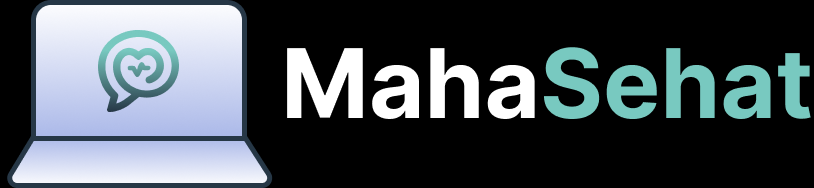

<h1>
IF2150 REKAYASA PERANGKAT LUNAK
<br>
TUGAS 9
<br>
IMPLEMENTASI PERANGKAT LUNAK
</h1>
<br>

## *Mahasehat: Mental Health Monitoring App for Students*


### Untuk: *Stefani Angeline Oroh*

Dipersiapkan oleh:
| Informasi | Keterangan |
| --- | --- |
| Kelas | *03* |
| Kelompok | *04* |

| NIM | Nama |
|---|---|
| *13525021* | *Haikal Muhammad Royyan* |
| *13525066* | *Cynthia Winda Wijaya* |
| *13525081* | *Rendy Salastra Putra* |
| *13525090* | *Sophia Imelda Rogate Marpaung* |
| *13525141* | *Christabelcyne Costan* |
---

# BAGIAN A: Ketentuan Implementasi

## A.1 Deskripsi Tugas

Pada tugas ini, kalian mengimplementasikan perangkat lunak yang telah dirancang pada tugas-tugas sebelumnya (SKPL, APL, DPPL) menjadi aplikasi yang **dapat dijalankan**. Platform bebas (web, desktop, atau mobile) selama aplikasi dapat dijalankan ulang oleh asisten mengikuti petunjuk kalian.

Ketentuan umum:
- Setiap anggota bertanggung jawab atas **minimal satu fitur atau modul** dan harus terlihat jelas di riwayat commit/PR.
- Implementasi harus **mengacu pada DPPL**. Jika ada yang berubah (kelas, layar, basis data, dsb.), catat di Bagian B.1. Perubahan itu wajar, tetapi harus tercatat dan beralasan.
- Implementasi **tidak harus berupa kelas** (misalnya fungsi, komponen, *route/handler*, *stored procedure*, atau skrip). Namun, setiap kelas perancangan pada DPPL **wajib dapat ditelusuri** ke implementasinya, dan penelusuran ini dicatat di Bagian B.5.
- Seluruh use case pada SKPL **diprioritaskan** untuk diimplementasikan. Status tiap use case akan dilaporkan pada HIUPL (Tugas 10).
- Seluruh mahasiswa **wajib** mengikuti asistensi akbar.

## A.2 Platform, Bahasa, dan Teknologi

Kalian **bebas** memilih bahasa, framework, library, dan basis data, dengan syarat:

1. **Dapat dijalankan ulang** oleh asisten pada mesin biasa dengan mengikuti README. Versi bahasa/runtime dan seluruh dependensi harus tertulis jelas.
2. **Dependensi dikelola lewat file standar**, misalnya `package.json` + lockfile, `requirements.txt`/`pyproject.toml`, `pom.xml`/`build.gradle`, `composer.json`, `pubspec.yaml`, dan sejenisnya. Jangan meng-commit folder hasil instalasi (`node_modules/`, `venv/`, `build/`, dll.).
3. **Jika memakai layanan eksternal** (basis data cloud, API pihak ketiga, auth, dll.), sediakan cara menjalankan tanpa akun pribadi kalian, atau sediakan data/akun uji pada README. Basis data **sangat disarankan** dapat dijalankan lokal (SQLite, atau Docker Compose untuk PostgreSQL/MySQL/MongoDB).
4. **Arsitektur sesuai DPPL.** Pola arsitektur yang kalian pilih di APL/DPPL (MVC, layered, client-server, dll.) harus terlihat pada struktur kode.

Ketentuan tambahan per platform:

| Platform | Ketentuan |
| :--- | :--- |
| **Web** | Berjalan lokal lewat satu-dua perintah yang terdokumentasi. Boleh juga di-*deploy*; jika ya, cantumkan URL, tetapi **tetap wajib bisa dijalankan lokal** (URL deploy bisa mati). |
| **Desktop** | Berjalan dari source lewat perintah yang terdokumentasi. Build/installer opsional. |
| **Mobile** | Berjalan di emulator/simulator atau perangkat. Sertakan langkah menjalankan, dan **sangat disarankan** melampirkan APK/build di Release. |

## A.3 Keamanan Repository

Repo fork kelompok bersifat **public**, sehingga:

- **Dilarang** meng-commit password, API key, token, `.env` asli, sertifikat/private key, atau data pribadi. Hal ini dapat mengurangi nilai.
- Sediakan `.env.example` berisi nama variabel tanpa nilai rahasia, dan masukkan `.env` ke `.gitignore`.
- Jika sudah terlanjur ter-commit, **cabut/ganti** kredensial tersebut. Menghapus commit saja tidak cukup.
- Data uji/seed harus berupa data fiktif.

## A.4 Struktur Folder

Seluruh kode ditempatkan di `src/` pada repo fork. Jangan mengubah folder milestone lama.

```
src/                              # SELURUH kode implementasi
	README.md                     # dokumentasi utama aplikasi (lihat A.5)
	.env.example                  # jika memakai environment variable
	<struktur kode kalian>        # bebas, mengikuti pola arsitektur DPPL
	tests/                        # test case (jika ada)
docs/
	M9/
		KXX_GYY_Implementasi.md   # laporan ini (Bagian B)
		KXX_GYY_Form-Asistensi.md
```

Catatan:
- `README.md` aplikasi diletakkan di **`src/README.md`**, bukan di root repo.
- Jika kerangka kerja kalian mewajibkan struktur tertentu (misalnya Maven `src/main/java`, Flutter `lib/`, monorepo `frontend/` dan `backend/`), letakkan semuanya **di dalam `src/`**.
- Nama file dan folder pada `docs/M9/` mengikuti aturan penamaan milestone sebelumnya (`KXX_GYY_...`).

## A.5 Isi Minimal `src/README.md`

README harus cukup bagi orang yang belum pernah melihat proyek kalian untuk menjalankan aplikasi dari nol. Minimal berisi:

1. **Deskripsi singkat** aplikasi.
2. **Teknologi yang digunakan** beserta versi (bahasa, framework, basis data).
3. **Prasyarat dan instalasi** (software yang harus ada, perintah instalasi dependensi).
4. **Konfigurasi** (environment variable, setup basis data, migrasi/seed) dan langkah demi langkah menjalankannya.
5. **Cara menjalankan aplikasi** (dan cara menjalankan test, jika ada).
6. **Akun/data uji** untuk mencoba tiap peran pengguna (jika ada login).
7. **Daftar modul/fitur yang diimplementasi** beserta pembagian anggota.
8. **Daftar tabel/koleksi basis data** beserta atributnya (atau tautan ke skema/ERD).

## A.6 Best Practices

Kalian dianjurkan menerapkan praktik berikut. Bukti penerapannya dirangkum pada Bagian B.2.

### 1. Branching
Sesuai aturan umum di README repository, `main` fork kelompok dijaga agar tetap bisa menerima sync dari asisten. Pada tugas ini **sangat disarankan** memakai branch per fitur dengan format `<tipe>/<nama-fitur>` (contoh: `feat/login-page`, `fix/null-cart`), lalu digabungkan ke `main` melalui Pull Request. Skema Gitflow penuh (dengan `develop`) boleh dipakai, tetapi tidak diwajibkan.

### 2. Semantic Commit
Gunakan format `<tipe>(<scope>): <deskripsi>`, misalnya `feat(auth): tambah validasi email`.

| Tipe | Kegunaan |
| :--- | :--- |
| `feat` | Menambahkan fitur baru |
| `fix` | Memperbaiki bug |
| `docs` | Mengubah dokumentasi |
| `style` | Perubahan format/spasi, tanpa mengubah logika |
| `refactor` | Perubahan kode yang tidak menambah fitur atau memperbaiki bug |
| `test` | Menambah/memperbaiki pengujian |
| `chore` | Tugas rutin (build, dependensi, konfigurasi) |

### 3. Track Tasks
Gunakan **GitHub Issues** (dan opsional GitHub Projects) untuk membagi tugas dan melacak progres.
- Pecah fitur besar menjadi issue yang lebih kecil dan tetapkan penanggung jawabnya.
- Hubungkan PR dengan issue (`Closes #12`) dan tutup issue ketika selesai.

### 4. Pull Request dan Code Review
- Setiap PR berisi penjelasan deskriptif tentang apa yang dikerjakan, beserta bukti (tangkapan layar/rekaman/hasil test).
- Setiap PR di-*review* minimal **1 anggota lain**, dengan komentar konstruktif atau approval.

### 5. Pengujian dan Optimasi Performa
- Tulis pengujian untuk logika inti (unit test dan/atau pengujian alur utama). Cakupan penuh tidak diwajibkan, tetapi pengujian pada logika utama dinilai.
- Lakukan **profiling** pada setidaknya satu fitur yang berat (query besar, proses pengolahan data, render list panjang, dsb.), lalu catat temuan dan perbaikannya. Contoh alat:

| Platform | Contoh alat |
| :--- | :--- |
| Web (frontend) | Chrome DevTools (Performance/Network), Lighthouse |
| Web (backend) | Profiler bawaan bahasa, `EXPLAIN` pada query basis data, logging waktu respons |
| Python | `cProfile`, `PyInstrument` |
| Java | VisualVM, JProfiler |
| Mobile | Android Studio Profiler, Flutter DevTools, Xcode Instruments |

### 6. Penggunaan AI
Penggunaan AI **tetap harus dicatat** pada `docs/KXX_GYY_AI-Usage.md` sesuai ketentuan yang sudah berlaku.

## A.7 Pengumpulan

Pengumpulan dinilai dari **tag release**, bukan commit terakhir.

1. Pastikan seluruh pekerjaan sudah di-*commit* dan di-*push* ke `main` fork kelompok.
2. Buat release dengan tag **`v9.0`** (revisi berikutnya `v9.1`, `v9.2`, dst.) dengan target branch `main`.
3. Yang dinilai adalah **tag terakhir yang dibuat sebelum deadline**.

## A.8 Aturan Tanya Jawab

Agar semua kelompok mendapat jawaban yang sama, pertanyaan dibagi menjadi dua jalur:

| Jenis Pertanyaan | Jalur |
| :--- | :--- |
| **Ketentuan tugas**, misalnya teknologi yang diperbolehkan, struktur folder, format pengumpulan, dan penilaian | **Sheets QnA:** *[tautan sheets QnA]* |
| **Kendala teknis kelompok sendiri**, misalnya error, setup, dan penggunaan git | Grup kelompok bersama asisten masing-masing |

Ketentuan:
1. Pertanyaan tentang ketentuan tugas **wajib** diajukan melalui Sheets QnA. Periksa terlebih dahulu apakah pertanyaan serupa sudah dijawab.
2. Jika pertanyaan tentang ketentuan tugas tetap diajukan langsung kepada asisten kelompok, asisten **berhak menolak menjawab** dan meminta kelompok memasukkan pertanyaannya ke Sheets QnA.
3. Jika pertanyaan di Sheets QnA **belum dijawab dalam 24 jam**, kelompok boleh menghubungi asisten kelompok masing-masing. Cantumkan pertanyaan yang sudah diajukan di sheets tersebut.
4. Jawaban pada Sheets QnA berlaku untuk **seluruh kelompok** dan menjadi acuan jika terjadi perbedaan pemahaman.

---

# BAGIAN B: Laporan Implementasi

## B.1 Perubahan dari DPPL

Catat semua perbedaan antara perancangan (DPPL) dan implementasi akhir. Jika tidak ada perubahan, tuliskan "Tidak ada perubahan".

Tabel B.1. Perubahan dari DPPL

| No | Bagian DPPL | Rancangan Awal | Implementasi Akhir | Alasan |
| :--- | :--- | :--- | :--- | :--- |
| 1 | *Algo-C11-02 `registerAccount()`* | *Kata sandi disimpan dengan `ENCRYPT_AES256`* | *Kata sandi di-hash dengan bcrypt (cost 12) melalui `Pengguna.hashPassword()` dan diperiksa dengan `verifyPassword()`* | *Mengikuti deskripsi kelas C01 yang menyimpan hash bcrypt; kata sandi cukup diverifikasi, tidak perlu dapat didekripsi kembali* |
| 2 | *C01, Q-C11-01 s.d. Q-C11-05* | *Status akun `PENDING`/`AKTIF` pada algoritma C11, sedangkan C01 memakai `Aktif`/`Belum Terverifikasi`/`Ditolak`* | *Hanya nilai C01 yang dipakai (dibatasi `CHECK` pada tabel `pengguna`); login hanya diterima untuk akun `Aktif`* | *Menyatukan dua penamaan status agar akun `Ditolak` tidak bisa masuk* |
| 3 | *Query C11, skema basis data* | *Nama tabel berawalan `tbl_` (`tbl_pengguna`)* | *Tabel tanpa awalan (`pengguna`, `pelajar`, `orang_tua_wali`, dan seterusnya) di `src/config/schema.sql`* | *Menyamakan dengan query kelas lain di DPPL (misalnya Q-C03-02 dan Q-C24-01) yang sudah tanpa awalan* |
| 4 | *C11, layar I-06* | *Hanya `validateConfirmation()` dan `confirmAccount()`* | *Ditambah data pendaftaran untuk wali (`GET /api/auth/confirm/:token`) dan penolakan (`POST /api/auth/reject/:token`, akun menjadi `Ditolak`)* | *I-06 menampilkan data pelajar dan memiliki tombol Tidak Setuju* |
| 5 | *C11, UC02 skenario alternatif 1* | *Batas waktu tautan konfirmasi tidak dirancang* | *Tautan berlaku 7 hari sejak registrasi; setelah itu akun ditandai `Ditolak` (gagal terverifikasi)* | *SKPL UC02 meminta tautan kedaluwarsa setelah batas waktu tertentu* |
| 6 | *C11 `startSession()`, `endSession()` (Algo-C11-09, Algo-C11-10)* | *Sesi disimpan pada `SESSION`* | *Token JWT yang memuat `versi_token`; logout dan reset kata sandi menaikkan `versi_token` sehingga token lama ditolak* | *Tabel 2.1 memakai JWT; logout harus benar-benar mengakhiri sesi di server (KNF12)* |
| 7 | *C24, Q-C24-01, Q-C24-02* | *Notifikasi hanya diperbarui (UPDATE), tanpa pemicu deteksi dan tanpa tempat penyimpanan* | *Entity `NotifikasiDarurat` (tabel `notifikasi_darurat`), job harian `node-cron` (`EMERGENCY_CRON`), pengiriman diulang hingga 3 kali bila gagal, dan dikirim ulang bila 24 jam belum direspons* | *UC08 tidak bisa berjalan tanpa pemicu dan catatan notifikasi (KF18, KF19, KNF06, UC08 skenario alternatif 1)* |
| 8 | *C24 `loadEmergencyDetail()` (Algo-C24-02)* | *Menghitung `detectEmergency()` saat dipanggil* | *Membaca notifikasi aktif milik wali yang login; wali lain ditolak (403)* | *Deteksi sudah dijalankan job harian; wali hanya boleh melihat pelajar yang diwalikannya* |
| 9 | *C24 penilaian darurat (Q-C03-02)* | *Check-in 7 hari terakhir* | *7 check-in terakhir milik pelajar* | *Pelajar yang berhenti check-in sama sekali tidak punya data 7 hari terakhir sehingga tidak pernah terdeteksi* |
| 10 | *C27 `generateResetLink()` (Algo-C27-03)* | *Bentuk token tidak dirancang (`SECURITY.createResetToken`)* | *Token acak 32 byte; yang disimpan hanya hash SHA-256, berlaku 1 jam, dan sekali pakai* | *Tautan tidak dapat dipakai walaupun isi tabel bocor* |
| 11 | *C27 `validateNewPassword()` (Algo-C27-04)* | *Kata sandi baru dan konfirmasi wajib dicocokkan di server* | *Konfirmasi dicocokkan bila dikirim; panjang minimal 8 karakter tetap wajib* | *ResetPasswordPage sudah mencocokkan konfirmasi sebelum mengirim permintaan* |
| *...* | *...* | *...* | *...* | *...* |

## B.2 Bukti Penerapan Best Practices

Tabel B.2. Bukti Best Practices

| Praktik | Bukti | Keterangan |
| :--- | :--- | :--- |
| Branching | *https://github.com/cynthiawinda/IF2150-RPL-K03-G04/branches* | *Git workflow* |
| Semantic commit | *https://github.com/cynthiawinda/IF2150-RPL-K03-G04/commits/main/* | *Menggunakan standar penamaan konvensional berbasis jenis perubahan, seperti feat: untuk penambahan fitur baru, fix: untuk perbaikan bug, docs: untuk dokumentasi, dan refactor: untuk perbaikan struktur kode* |
| Track tasks | *https://github.com/cynthiawinda/IF2150-RPL-K03-G04/issues* | *[Jumlah issue, pembagian]* |
| Pull request dan review | *https://github.com/cynthiawinda/IF2150-RPL-K03-G04/pull/20, https://github.com/cynthiawinda/IF2150-RPL-K03-G04/pull/12* | *Haikal Muhammad Royyan mereview Rendy Salastra Putra, Rendy Salastra Putra mereview Sophia Imelda Rogate Marpaung* |
| Pengujian | *[Tautan ke `src/tests/` dan hasil test]* | *[Apa yang diuji, cara menjalankan]* |

### B.2.1 Profiling dan Optimasi

Pilih minimal satu fitur yang diprofil.

| Informasi | Keterangan |
| :--- | :--- |
| Fitur / proses yang diprofil | *[Nama fitur]* |
| Alat | *[mis. Chrome DevTools, cProfile, EXPLAIN]* |
| Temuan (sebelum) | *[Bottleneck yang ditemukan, sertakan angka/tangkapan layar]* |
| Perbaikan | *[Yang diubah]* |
| Hasil (sesudah) | *[Perbandingan dengan sebelumnya]* |

Jika tidak ada perbaikan yang perlu dilakukan, jelaskan hasil profiling dan alasan kenapa fitur tersebut sudah memadai.

## B.3 Kendala dan Catatan Penting

Tuliskan kendala yang ditemui, fitur yang belum sempurna (*known issues*), serta hal yang perlu diketahui asisten saat menjalankan atau menilai aplikasi (misalnya akun uji khusus, urutan menjalankan, atau batasan).

- *Bila `SMTP_HOST` pada `.env` dikosongkan, e-mail (konfirmasi wali, atur ulang kata sandi, notifikasi darurat) tidak dikirim, tetapi isinya dicetak ke log server. Tautan konfirmasi dan atur ulang kata sandi dapat disalin dari log tersebut.*
- *Token uji `TOKEN-WALI-ANDI-2026` (UC02) berlaku 7 hari sejak `npm run db:seed`. Jalankan ulang perintah tersebut sebelum menguji bila sudah lewat.*
- *Notifikasi darurat (UC08) dibuat oleh job harian. Untuk menguji tanpa menunggu jadwal, jalankan `npm run job:darurat`, lalu masuk sebagai `ratna.wali@mahasehat.id` (wali dari `citra.pelajar@mahasehat.id`).*
- *Pengaitan pelajar ke akun wali memakai e-mail atau nomor telepon wali yang diisi saat registrasi. Kepemilikan e-mail wali belum diverifikasi saat wali mendaftar.*
- *Belum ada pembatasan jumlah percobaan login.*

## B.4 Kontribusi Anggota

Tabel B.4. Kontribusi Anggota

| NIM | Nama | Modul / Fitur yang Dikerjakan | Persentase Kontribusi |
| :--- | :--- | :--- | :--- |
| *13525021* | *Haikal Muhammad Royyan* | *Backend: fondasi basis data (skema, seed, model C01–C09), konfirmasi registrasi oleh wali (UC02), notifikasi darurat beserta job harian (UC08), masuk akun dan atur ulang kata sandi (UC09), keluar akun (UC10), serta pengujian otomatis modul tersebut* | *[%]* |
| *13525066* | *Cynthia Winda Wijaya* | *...* | *...* |
| *13525081* | *Rendy Salastra Putra* | *...* | *...* |
| *13525090* | *Sophia Imelda Rogate Marpaung* | *...* | *...* |
| *13525141* | *Christabelcyne Costan* | *...* | *...* |

## B.5 Traceability Kelas Perancangan ke Implementasi

Pemetaan dari **setiap kelas perancangan** pada DPPL (Tabel 4.1) ke wujud implementasinya. Bentuk implementasi bebas (kelas, fungsi, komponen, *route/handler*, *stored procedure*, skrip, dsb.), tetapi tiap kelas perancangan harus muncul pada tabel ini. Jika implementasi berupa kelas dengan nama yang sama, tetap dicantumkan.

Tabel B.5. Traceability Kelas Perancangan ke Implementasi

| ID Kelas | Nama Kelas Perancangan | Bentuk Implementasi | Lokasi (File dan Nama) | Keterangan |
| :--- | :--- | :--- | :--- | :--- |
| *C01* | *Pengguna* | *Data sesi di `localStorage`* | *`LoginPage.js` (`mahasehat_user`, `mahasehat_token`, `role`)* | *Atribut (nama, email, nomorTelepon, role) disimpan di `mahasehat_user`. Operasi keluar ada di handler Keluar tiap halaman.* |
| *C01* | *Pengguna* | *Backend: kelas, tabel* | *`src/models/Pengguna.js` - `Pengguna`; tabel `pengguna`* | *Kelas induk C02–C04. Atribut `password` disimpan sebagai `password_hash`; ditambah `versi_token`, `token_konfirmasi`, dan token atur ulang kata sandi* |
| *C02* | *Pelajar* | *Role `pelajar` dan kumpulan halaman* | *`DashboardPagePelajar.*`, `SettingPagePelajar.*`, `CheckInPage.*`, `CariTenagaKesehatanPage.*`, `ReportPagePelajar.*`, `RegistrationPagePelajar.*`* | *Diwujudkan sebagai peran dan halamannya, bukan kelas tersendiri.* |
| *C02* | *Pelajar* | *Backend: kelas, tabel* | *`src/models/Pelajar.js` - `Pelajar`; tabel `pelajar`* | *Turunan `Pengguna`. Ditambah `getRiwayatTerbaruSemuaAktif()` untuk job notifikasi darurat* |
| *C03* | *OrangTuaWali* | *Role `orangtuawali` dan kumpulan halaman* | *`DashboardPageOrangTuaWali.*`, `SettingPageOrangTuaWali.*`, `ReportPageOrangTuaWali.*`, `RegistrationPageOrangTuaWali.*`, `NotifikasiDarurat.*`* | *Data pelajar yang didampingi dibaca dari `studentAccountStatus`. Profil disimpan di `mahasehat_ortu_profile`.* |
| *C03* | *OrangTuaWali* | *Backend: kelas, tabel* | *`src/models/OrangTuaWali.js` - `OrangTuaWali`; tabel `orang_tua_wali`* | *Turunan `Pengguna`* |
| *C04* | *TenagaKesehatan* | *Role `tenagakesehatan` dan kumpulan halaman* | *`DashboardPageTenagaKesehatan.*`, `SettingPageTenagaKesehatan.*`, `ManajemenKonsultasiPage.*`, `RegistrationPageTenagaKesehatan.*`* | *Profil praktik disimpan di `mahasehat_nakes_profile`.* |
| *C04* | *TenagaKesehatan* | *Backend: kelas, tabel* | *`src/models/TenagaKesehatan.js` - `TenagaKesehatan`; tabel `tenaga_kesehatan`* | *Turunan `Pengguna`* |
| *C05* | *RiwayatKesehatan* | *Backend: kelas, tabel* | *`src/models/RiwayatKesehatan.js` - `RiwayatKesehatan`; tabel `riwayat_kesehatan`* | *Isi disimpan terenkripsi AES-256* |
| *C06* | *CheckIn* | *Objek payload* | *`CheckInPage.js` (payload `{date, mood, sleep, meal, note}`)* | *Catatan dienkripsi AES-GCM lewat `encryptNote`.* |
| *C06* | *CheckIn* | *Backend: kelas, tabel* | *`src/models/CheckIn.js` - `CheckIn`; tabel `check_in`* | *`catatan_refleksi` disimpan terenkripsi AES-256* |
| *C07* | *LaporanKesehatan* | *Ringkasan dan grafik di halaman* | *`ReportChart.js`, `ReportPagePelajar.js`, `ReportPageOrangTuaWali.js`; ringkasan di `DashboardPageOrangTuaWali.js`; grafik mini di `ManajemenKonsultasiPage.js` (`moodBars`, `tidurBars`)* | *...* |
| *C07* | *LaporanKesehatan* | *Backend: kelas* | *`src/models/LaporanKesehatan.js` - `LaporanKesehatan`* | *Dihitung dari data check-in setiap kali `evaluateThreshold()` dipanggil, tanpa tabel* |
| *C08* | *FasilitasKesehatan* | *Field pada data nakes* | *`CariTenagaKesehatanPage.js` (`petakanNakes`: `fasilitas`, `alamat`, `lat`, `lng`)* | *...* |
| *C08* | *FasilitasKesehatan* | *Backend: kelas, tabel* | *`src/models/FasilitasKesehatan.js` - `FasilitasKesehatan`; tabel `fasilitas_kesehatan`* | *-* |
| *C09* | *JadwalKonsultasi* | *Objek dan `localStorage`* | *`CariTenagaKesehatanPage.js` (`buatPengajuan`); `ManajemenKonsultasiPage.js` (`DEFAULT_CONSULTATIONS`); `SettingPageTenagaKesehatan.js` (`generateSlots`)* | *Disimpan di `mahasehat_consultations_data` dengan status Menunggu, Disetujui, Ditolak, Selesai. Slot praktik nakes dibuat dari rentang jam dan durasi sesi.* |
| *C09* | *JadwalKonsultasi* | *Backend: kelas, tabel* | *`src/models/JadwalKonsultasi.js` - `JadwalKonsultasi`; tabel `jadwal_konsultasi`* | *-* |
| *C10* | *RegistrationPage* | *Halaman per peran* | *`RegistrationPagePelajar.*`, `RegistrationPageOrangTuaWali.*`, `RegistrationPageTenagaKesehatan.*`, gaya bersama `RegistrationPage.css`; halaman sukses `RegistrationSuccessPage.*`, `RegistrationSuccessPelajarPage.html`* | *...* |
| *C11* | *AuthController* | *Panggilan API dari frontend* | *`LoginPage.js`: `POST /api/auth/login`* | *...* |
| *C11* | *AuthController* | *Backend: fungsi, route, middleware* | *`src/controllers/authController.js` - `daftar`, `dataKonfirmasi`, `setujuiRegistrasi`, `tolakRegistrasi`, `masuk`, `profilSaya`, `keluar`; `src/routes/authRoutes.js`; `src/middleware/authMiddleware.js` - `generateToken`, `authenticate`* | *`registerAccount()` menjadi `daftar`; `validateConfirmation()` dan `confirmAccount()` menjadi `dataKonfirmasi` dan `setujuiRegistrasi`; `login()`, `validateCredentials()`, `checkAccountStatus()`, dan `startSession()` menjadi `masuk` dan `generateToken`; `logout()` dan `endSession()` menjadi `keluar`. Atribut `currentUser` menjadi isi token JWT (`req.user`)* |
| *C12* | *KonfirmasiRegistrasiPage* | *Halaman* | *`KonfirmasiRegistrasiPage.*`* | *...* |
| *C13* | *CheckInPage* | *Halaman wizard* | *`CheckInPage.*` (`window.CheckInPage.init`)* | *State di objek `state`, tampilan di `views[0..6]`, handler di `actions`.* |
| *C14* | *CheckInController* | *Callback `onSubmit`* | *`CheckInPage.html` (`onSubmit`, TODO `POST /api/check-in`)* | *...* |
| *C15* | *NotifikasiPengingatController* | *Skrip scheduler* | *`scheduler.js*`, `notifikasiController.js*` | *...* |
| *C16* | *ReportPage* | *Halaman per peran* | *`ReportPagePelajar.*`, `ReportPageOrangTuaWali.*`, gaya bersama `ReportPage.css`* | *...* |
| *C17* | *ReportController* | *Handler laporan analitik* | *`reportController.js*`, `reportRoute.js*`,* | *Mengelola pemrosesan data statistik, grafik kesehatan, dan evaluasi ambang batas laporan dari basis data.* |
| *C18* | *CariTenagaKesehatanPage* | *Halaman* | *`CariTenagaKesehatanPage.*`* | *Pencarian, filter spesialisasi, urut jarak (izin lokasi), dialog buat janji.* |
| *C19* | *ProfilTenagaKesehatanPage* | *Dialog di halaman Cari* | *`CariTenagaKesehatanPage.html` (`Modal_Detail`); `isiDetail()` di JS* | *Digabung ke C18, bukan halaman terpisah.* |
| *C20* | *TenagaKesehatanController* | *Panggilan API dari frontend* | *`CariTenagaKesehatanPage.js` (`panggilApi`): `GET /api/tenaga-kesehatan/`, `GET /api/tenaga-kesehatan/:id`, `PUT /api/tenaga-kesehatan/lokasi-pelajar`* | *...* |
| *C21* | *PengajuanKonsultasiPage* | *Halaman* | *`ManajemenKonsultasiPage.*`* | *Antrean, detail, setujui, jadwal ulang. Sisi pelajar mengajukan lewat `Modal_Janji` di `CariTenagaKesehatanPage`.* |
| *C22* | *JadwalKonsultasiController* | *Fungsi di JS* | *`CariTenagaKesehatanPage.js` (`simpanPengajuan`); `ManajemenKonsultasiPage.js` (`initData`, `saveData`, `updateStatus`)* | *...* |
| *C23* | *KonsultasiController* | *Fungsi di JS* | *`CariTenagaKesehatanPage.js` (`simpanPengajuan`); `ManajemenKonsultasiPage.js` (`initData`, `saveData`, `updateStatus`)* | *...* |
| *C24* | *NotifikasiDaruratController* | *Fungsi di JS* | *`NotifikasiDarurat.js` (handler `Btn_Diterima` untuk confirmReceived, `Btn_SudahDitindaklanjuti` untuk markFollowUp)* | *...* |
| *C24* | *NotifikasiDaruratController* | *Backend: kelas, route, job* | *`src/controllers/NotifikasiDaruratController.js` - `NotifikasiDaruratController`; `src/routes/emergencyRoutes.js`; `src/jobs/scheduler.js`; `src/jobs/jalankanEvaluasiDarurat.js`* | *Keempat operasi DPPL menjadi metode dengan nama yang sama. Ditambah `jalankanEvaluasiHarian()` untuk job harian dan entity `src/models/NotifikasiDarurat.js` (tabel `notifikasi_darurat`)* |
| *C25* | *LoginPage* | *Halaman* | *`LoginPage.html`, `LoginPage.js`, `AuthLayout.css`* | *Validasi email dan sandi, toggle sandi, redirect per peran lewat `HALAMAN_PER_ROLE`.* |
| *C26* | *ResetPasswordPage* | *Halaman* | *`ResetPasswordPage.html`, `ResetPasswordPage.js`* | *Dibuka dari "Lupa kata sandi?" di Login dan "Ubah kata sandi" di Setelan.* |
| *C27* | *PasswordController* | *Backend: fungsi, route* | *`src/controllers/passwordController.js` - `lupaPassword`, `resetPassword`; `src/routes/authRoutes.js` - `POST /api/auth/forgot-password`, `POST /api/auth/reset-password`* | *`sendResetLink()` dan `generateResetLink()` menjadi `lupaPassword`; `resetPassword()` dan `validateNewPassword()` menjadi `resetPassword`* |
| *C28* | *DashboardController* | *Fungsi di JS per peran* | *`DashboardPagePelajar.js`, `DashboardPageOrangTuaWali.js`, `DashboardPageTenagaKesehatan.js`; pemilihan dashboard di `HALAMAN_PER_ROLE` pada `LoginPage.js`* | *...* |
| *C29* | *SettingPage* | *Halaman per peran* | *`SettingPagePelajar.*`, `SettingPageOrangTuaWali.*`, `SettingPageTenagaKesehatan.*`* | *Dipecah menjadi tiga halaman per peran.* |

Catatan:
- Satu kelas perancangan boleh diwujudkan oleh beberapa file/unit, dan satu file/unit boleh mewujudkan beberapa kelas perancangan. Tuliskan semuanya.
- Kelas perancangan yang **tidak diimplementasikan** atau **digabung/dipecah** tetap dicantumkan, dan alasannya dicatat di Bagian B.1.
